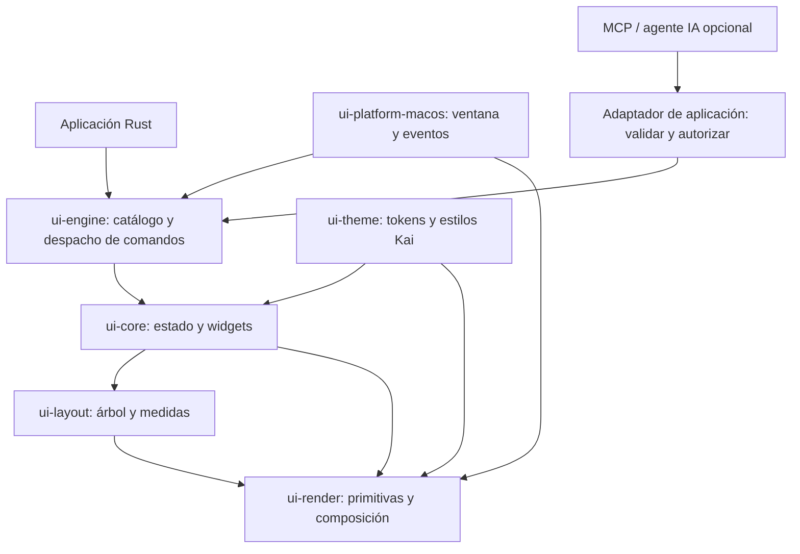

# 00 — Visión y arquitectura

## Objetivo

Construir **Kai UI Desktop**, un framework de interfaz escrito en Rust, con árbol de widgets y renderer propios. La primera plataforma objetivo es macOS. `wgpu` puede usar Metal como backend gráfico, pero los controles los dibuja Kai: no se pretende que sean widgets de AppKit.

La aplicación sí debe integrarse con macOS para crear ventanas, recibir entrada, gestionar composición de texto (IME), portapapeles, accesibilidad y ciclo de vida. Integrarse con servicios del sistema no equivale a delegar el dibujo de los widgets.

## Principios

1. **Probar el recorrido vertical antes de generalizar.** Una ventana real con interacción vale más que seis crates vacíos.
2. **Mantener una sola fuente de verdad para estado y eventos.** La vista se deriva del estado; las acciones del usuario producen mensajes que actualizan el modelo.
3. **Separar layout, interacción y dibujo.** Cada subsistema recibe contratos claros; ninguno debe conocer detalles innecesarios de los otros.
4. **Adoptar dependencias por evidencia.** Preferir crates existentes en las fronteras complejas (ventanas, GPU, texto, layout), pero mantener el árbol y los widgets propios de Kai.
5. **Medir antes de optimizar.** No prometer tiempos de layout ni implementar caché incremental hasta tener benchmarks reproducibles.
6. **Accesibilidad y texto son requisitos de arquitectura.** No son retoques para el final.
7. **Avanzar por capas con gates.** Implementar L0–L6 en orden, conservando el recorrido vertical ya validado y sin crear crates vacíos.

## Candidatos técnicos

| Responsabilidad | Candidato para evaluar | Nota |
|---|---|---|
| Ventana y eventos de plataforma | `winit` | La app dibuja los controles; la ventana y eventos siguen integrándose con macOS. |
| Renderizado GPU | `wgpu` | En macOS puede usar Metal. No proporciona widgets ni edición de texto completa. |
| Layout | `taffy` | Evaluar Flexbox/Grid, medidas disponibles y encaje con el árbol de widgets. |
| Geometría | `kurbo` o tipos propios; `euclid` como alternativa | Elegir una sola solución tras probar unidades, transforms y compatibilidad con el renderer. |
| Texto editable | `cosmic-text` como candidato | Probar selección, cursor, shaping, IME, escalado y fuentes en macOS. |
| Accesibilidad | `accesskit` como candidato | Verificar el puente efectivo hacia las APIs de accesibilidad de macOS. |
| Utilidades Craft | `craft-libs` | Evaluar por crate/capacidad; ver [07-integracion-craft-libs.md](07-integracion-craft-libs.md). `craft-ui` tiene frontend egui y no debe convertirse en renderer de Kai. |

No se propone `egui` ni `iced` como renderer de producción: sus árboles/controles y ciclo de UI duplicarían el objetivo de un frontend y renderer propios. Pueden usarse en ejemplos comparativos, no mezclados sin una necesidad demostrada.

## Capas lógicas previstas

Estas son **fronteras conceptuales**, no una obligación de crear crates independientes desde el primer día. Empezar con un crate ejecutable/prototipo o workspace pequeño; separar crates cuando haya APIs estables y dependencias que lo justifiquen.

## Roadmap de implementación L0–L6

| Fase | Capa | Alcance y límite |
|---|---|---|
| L0 | Base geométrica y unidades | Tipos geométricos y conversiones lógicas/físicas compartidas. No contiene reglas de widgets ni GPU. |
| L1 | Estado reactivo y señales | Estado tipado y señales locales, explícitas y testeables. No crear bus global ni reactividad automática compleja. |
| L2–L3 | Catálogo unificado de comandos | Intenciones tipadas separadas de eventos de plataforma; mantener diferenciados tecla física, texto e IME. |
| L4 | Layout incremental y caché | Layout determinista primero; añadir invalidación/caché solo con equivalencia y mediciones. |
| L5 | Render desacoplado | Operaciones de dibujo independientes del backend; `wgpu` permanece en la implementación del renderer. |
| L6 | Frontend y árbol de widgets | Integrar árbol, comandos, estado, layout y paint; migrar Button y TextField antes de ampliar catálogo. |

Las fases dependen de la anterior y se aceptan individualmente. La ruta y los gates operativos están en [README.md](README.md); el detalle de cada responsabilidad está en los documentos 02–06.

`ui-engine` es inicialmente una **frontera lógica para L2–L3**, no una decisión de crear un crate separado. El catálogo recibe comandos tipados desde adaptadores de plataforma o de aplicación y los dirige al modelo Kai. MCP/agentes no forman parte de `ui-core`, `ui-render` ni del árbol: un adaptador opcional de la app valida y autoriza cada solicitud antes de traducirla a comandos permitidos. `craft-ai-core` puede evaluarse como contrato opcional de integración, pero no es dependencia del framework ni se adopta en L1.

## Decisiones explícitas del MVP

- Plataforma inicial: macOS de escritorio.
- Lenguaje del framework: Rust.
- Controles: dibujados por Kai, no widgets nativos.
- Renderer: propio de Kai sobre infraestructura gráfica existente; `wgpu` es el candidato inicial.
- Modelo: eventos/comandos y actualización unidireccional simple; señales locales solo como mecanismo explícito de observación del estado.
- Primeros controles: texto estático, botón y campo editable.
- No requerido en MVP: Tokio como runtime de UI, señales globales, undo/redo, comandos de IA, grid complejo, impresión, CMS o Android.

## Criterios de aceptación del prototipo

- Ventana macOS redimensionable y cierre limpio.
- Dibujado repetible y sin parpadeo visible.
- Texto legible y campo de texto editable.
- Mouse, teclado, cursor, selección y foco comprobables.
- Composición de texto/IME investigada y documentada; no asumir que eventos de teclado simples bastan.
- Errores y limitaciones conocidas registrados antes de invertir en el catálogo completo.
