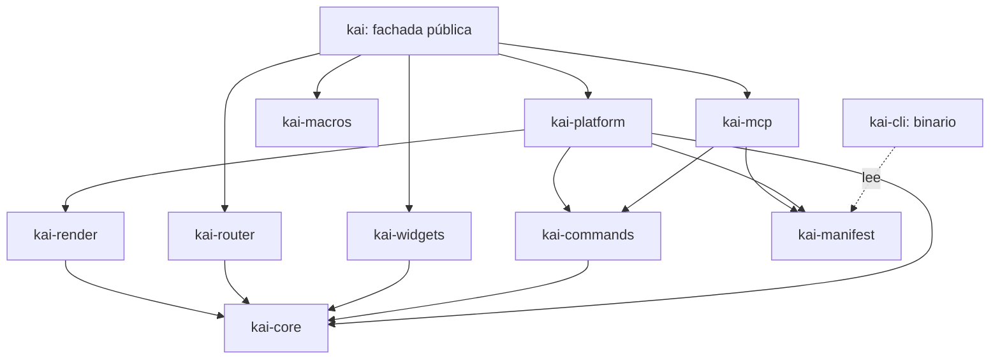

# 09 — Framework y plataforma de aplicaciones

**Fase:** posterior a L6. Esta guía propone cómo convertir el prototipo en una plataforma para desarrollar apps de escritorio (en la línea de Tauri, Flutter o SwiftUI + Xcode) sin abandonar las decisiones de [00](00-vision-y-arquitectura.md): árbol y renderer propios, flujo unidireccional y dependencias adoptadas por evidencia. Su eje es el **registro de comandos de la app**: una sola lista tipada de lo que la app sabe hacer, que alimenta menús, atajos, paleta de comandos, automatización y un **servidor MCP** integrado.

> **Todo el código de esta guía es API propuesta, no existente.** Los nombres de crates, traits, macros, comandos de CLI y claves de `kai.toml` son un diseño a validar. Lo que sí existe hoy se cita con su archivo (`runtime.rs`, `element.rs`, `tw.rs`…).

> **Cambio de postura respecto a [00](00-vision-y-arquitectura.md), [03](03-eventos-y-estado.md) y [07](07-integracion-craft-libs.md).** Esos documentos tratan MCP/agentes como un adaptador externo y opcional de cada aplicación. Esta guía lo hace **de primera clase en la capa de framework**: toda app Kai puede exponer un servidor MCP sin código adicional. Las capas de UI (`kai-core`, `kai-render`, el árbol, layout, paint y widgets) **siguen sin depender de MCP**; la dependencia vive en `kai-commands`/`kai-mcp` y en la fachada. Se sugiere, como seguimiento (no hecho aquí), actualizar el diagrama de capas de 00, la sección «Integración futura de MCP/agentes» de 03 y «Frontera futura MCP / agentes de IA» de 07 para que remitan a este documento.

## 1. Objetivo y principios

Permitir que un equipo cree, ejecute, empaquete y distribuya una app Kai con un solo flujo: `kai new` → `kai dev` → `kai bundle`, escribiendo la UI con un árbol declarativo, clases tipo Tailwind y el tema compartido con `kai-ui-web`, y que esa app sea **operable por personas y por agentes** con las mismas acciones.

Principios:

1. **Toda app Kai es MCP por diseño.** Declarar comandos es suficiente para que la app pueda exponerse como servidor MCP; activarlo, y qué se expone, lo decide `kai.toml`.
2. **Un registro de comandos, una fuente de verdad.** Menús, atajos, paleta de comandos, botones que invocan acciones, scripts de automatización, tests y herramientas MCP leen el mismo registro. No hay una segunda lista de «acciones para la IA».
3. **Extraer, no reescribir.** Cada crate nace moviendo módulos que ya existen y tienen tests; no se crean crates vacíos (principio 1 de [00](00-vision-y-arquitectura.md)).
4. **Elm sigue siendo el modelo.** Un modelo, mensajes, `update` y `view`. Un comando invocado por un agente se convierte en un `Msg` y pasa por `update` como un clic: la UI refleja lo que hace el agente y nadie modifica el modelo por otra vía.
5. **El núcleo no conoce la plataforma ni MCP.** Árbol, estilos, layout y paint siguen siendo puros y testeables sin ventana ni GPU, como hoy (`layout.rs`, `render/paint.rs`, `a11y.rs`).
6. **Seguridad explícita.** Cada comando declara su nivel (lectura, mutación, destructivo); lo destructivo pide confirmación en la UI; lo que la app puede hacer fuera de su ventana se declara como capacidad en `kai.toml`, como en Tauri.
7. **Azúcar opcional.** `rsx!`, derives, router y CLI se apoyan en la API de builders actual; todo se puede escribir a mano.
8. **Un tema, dos plataformas.** Los tokens siguen saliendo de `kai-ui-web/src/theme/tokens.css`.
9. **macOS primero.** Las abstracciones multiplataforma se diseñan, pero solo se implementan en F5.

## 2. Punto de partida

### Lo que ya existe

| Pieza | Archivo | Estado |
|---|---|---|
| Runtime Elm (`App` con `title`/`update`/`view`, `run(app, theme)`) | `runtime.rs` | Una sola ventana, sin tareas async ni menús. |
| Árbol tipo DOM `Element<Msg>` (`div`, `text`, `icon`, `input`), ids por ruta o `key`, `FocusOrder` | `element.rs` | Builders encadenables; no existe `Element::map`. |
| Intents de UI y su `enum Command` interno (`SetFocus`, `SetPressed`, `Activate`, `Text`) | `ui_engine.rs` | Foco, pulsación y edición; **no** son comandos de la app (sección 4). |
| Clases tipo Tailwind → `Style` → `taffy::Style` | `tw.rs`, `style.rs` | Clases desconocidas reportadas en ejecución (`StyleCache::unknown`). |
| Tokens Kai web, densidades | `theme.rs` | Copiados a mano desde `tokens.css`. |
| Layout, scroll, clip, z-index, hit-test | `layout.rs` | Completo por frame, sin caché. |
| `DrawList`, paint puro, backend `wgpu`/Metal, texto, atlas de iconos | `render/`, `quad.wgsl` | Un backend. |
| Edición de texto, IME, portapapeles | `text_field.rs`, `platform_adapter.rs` | Línea única. |
| Accesibilidad AccessKit (acciones `Focus`, `Click`, `ReplaceSelectedText` → intents) | `a11y.rs` | Árbol completo por frame. Es el precedente más cercano de «otro agente que opera la UI». |
| Componentes Button, TextField, Card, Stat… | `components.rs` | Builders con las clases de Kai web. |
| Fuente de UI del sistema | `fonts.rs` | `.AppleSystemUIFont` en macOS, `Segoe UI` en Windows. |
| Iconos Lucide generados | `scripts/gen-icons.mjs`, `assets/icons/`, `src/icons/` | Depende de `kai-ui-web/node_modules`. |
| Versión | `version.rs`, `CHANGELOG.md` | `CARGO_PKG_VERSION`. |

### Lo que falta para ser framework

- **Es un binario.** Todos los módulos se declaran con `pub mod` en `main.rs`, junto a la demo; no hay `lib.rs`. El paquete se llama `kai-ui-desktop-prototype` y tiene `publish = false`.
- **API pública indefinida.** Casi todo es `pub` porque los módulos se usan entre sí, no porque sea un contrato.
- **No hay `examples/`.** La demo y sus tests (snapshots, benchmark) viven en `main.rs`.
- **No hay comandos de app.** Las acciones existen solo como variantes de `Msg` enganchadas a botones; no tienen id, descripción, esquema ni nivel de seguridad, así que no se pueden listar, buscar, automatizar ni exponer.
- **No hay manifiesto, empaquetado ni CLI.** El bundle `.app`, la firma y la notarización están pendientes en [06](06-calidad-y-distribucion.md).
- **Una ventana, sin efectos.** `Cmd`/`Sub`, trabajo async y undo/redo están fuera del alcance inicial ([README](README.md)); esta guía propone introducirlos de forma consciente (F1–F4).

## 3. Estructura de crates propuesta

Workspace Cargo en `kai-ui-desktop/` (o en un repositorio propio si se publica). Ningún crate depende de uno situado por encima en el diagrama; las capas de UI no ven MCP.



| Crate | Contenido (origen actual) | Dependencias externas | Notas |
|---|---|---|---|
| `kai-core` | `geometry.rs`, `signal.rs`, `element.rs`, `ui_engine.rs`, `style.rs`, `tw.rs`, `theme.rs`, `layout.rs`, `grid_layout.rs`, `icons/` (catálogo) | `taffy` | Puro: sin `winit`, `wgpu`, AccessKit ni MCP. |
| `kai-render` | `render/*`, `quad.wgsl`, `fonts.rs` | `wgpu`, `glyphon`, `cosmic-text`, `resvg` | Implementa `TextMeasure`. Backend offscreen para snapshots. |
| `kai-commands` | nuevo | `serde`, `serde_json`, `schemars` (candidato) | Trait `Command`, registro, esquemas JSON, niveles de seguridad, disponibilidad, `Reply`, auditoría, datos de la paleta. Sin transporte ni red. |
| `kai-platform` | `runtime.rs`, `platform_adapter.rs`, `a11y.rs`, `text_field.rs`, portapapeles | `winit`, `accesskit`, `accesskit_winit`, `arboard`, `cosmic-text` | Event loop, ventanas, IME, menús nativos y paleta construidos desde el registro, ejecución de tareas, diálogos de confirmación. |
| `kai-mcp` | nuevo | runtime async en hilo propio; SDK MCP a decidir (`rmcp` candidato, sección 4) | Protocolo MCP, transportes stdio y HTTP, sesiones, autenticación. Traduce el registro a tools/resources/prompts. |
| `kai-widgets` | `components.rs` | — | Button, TextField, Card…; Dialog de confirmación, paleta, Select, Toast. |
| `kai-macros` | nuevo | `syn`, `quote`, `proc-macro2` | `rsx!`, `#[component]`, `#[derive(Command)]`, `#[derive(Routable)]`. |
| `kai-router` | nuevo | — | Rutas tipadas, historial, parámetros. Puro. |
| `kai-manifest` | nuevo | `serde`, `toml` | Tipos y validación de `kai.toml`. |
| `kai` | fachada | — | Reexporta `prelude`, `run`, `rsx!`, comandos, widgets, router. Feature `mcp` activa por defecto en las plantillas. |
| `kai-cli` | nuevo (binario `kai`) | `clap`, `notify`, `kai-manifest` | `new`, `dev`, `build`, `bundle`, `sign`, `notarize`, `doctor`, `icons`, `mcp`. |

Reglas:

- **F0 empieza con un solo crate más `lib.rs`.** La división ocurre cuando una frontera esté probada (regla de [README](README.md)): primero `kai-core`, después `kai-commands` (F1) y el resto.
- `kai-core` y `kai-commands` compilan y se prueban en CI Linux sin GPU; `kai-render` y `kai-platform`, en macOS.
- La versión de la fachada `kai` gobierna la compatibilidad (semver); los ids y esquemas de comandos de cada app tienen su propia política de versiones (sección 13).

## 4. Registro de comandos y servidor MCP

### 4.1 Dos tipos de «comando»: cómo nombrarlos

Hoy `ui_engine.rs` tiene un `enum Command` (`SetFocus`, `SetPressed`, `Activate`, `Text`) que reduce intents de plataforma sobre el `UiModel`. Es un detalle interno de la UI: mueve foco y pulsación, no expresa intenciones de negocio. Para evitar confusión:

| Concepto | Nombre propuesto | Visibilidad | Ejemplo |
|---|---|---|---|
| Intención de plataforma (tecla, clic, IME, acción AccessKit) | `Intent` (ya existe) | interno de `kai-platform` | `Intent::PointerDown(id)` |
| Reducción sobre el estado de UI | **`UiCommand`** (renombrar el `enum Command` actual) | `pub(crate)` en `kai-core` | `UiCommand::SetFocus(..)` |
| Acción de la app, con id, esquema y seguridad | **`Command`** (trait público) | API pública de `kai-commands` | `clientes.buscar` |

El renombrado de `ui_engine::Command` a `UiCommand` se hace en F0, antes de publicar nada; esta guía no lo aplica al código.

### 4.2 Qué es un comando de app

Un comando es una acción tipada que la app sabe hacer, con:

- **id** estable y con espacio de nombres: `clientes.buscar`, `clientes.crear`, `ventana.preferencias`. Los ids `kai.*` quedan reservados para comandos del framework (`kai.deshacer`, `kai.paleta`, `kai.cerrar_ventana`).
- **título y descripción** para personas y agentes. La descripción sale del comentario `///` del tipo.
- **esquema de entrada y de salida** derivados del tipo Rust (JSON Schema vía `schemars`, candidato). Un comando sin parámetros tiene esquema vacío.
- **nivel de seguridad**: `ReadOnly` (no cambia el modelo), `Mutating` (lo cambia de forma reversible o esperable) o `Destructive` (borra, envía, paga o es irreversible: **exige confirmación del usuario** cuando lo invoca un agente, y opcionalmente desde la UI).
- **disponibilidad** según el estado: `Enabled`, `Disabled { motivo }` o `Hidden`. Se reevalúa tras cada `update`; los menús se atenúan, la paleta lo oculta o lo explica, los botones con `on_command` se deshabilitan y la lista de herramientas MCP cambia.
- **mapeo a `Msg`**: invocar un comando produce un `Msg` que pasa por `update`. La respuesta tipada vuelve con un `Reply<Output>` que viaja dentro del mensaje.
- **atajo, menú y categoría** opcionales, para la UI.

```rust
// API propuesta
/// Busca clientes por nombre o RUT y devuelve como máximo `limite` resultados.
#[derive(Clone, Debug, Deserialize, JsonSchema, Command)]
#[command(id = "clientes.buscar", title = "Buscar clientes", safety = ReadOnly,
          output = Vec<ClienteResumen>, msg = Msg::Buscar)]
pub struct BuscarClientes {
    pub consulta: String,
    #[serde(default)]
    pub limite: Option<u32>,
}

/// Elimina definitivamente un cliente y su historial.
#[derive(Clone, Debug, Deserialize, JsonSchema, Command)]
#[command(id = "clientes.borrar", title = "Borrar cliente", safety = Destructive,
          output = (), msg = Msg::Borrar, available = puede_borrar)]
pub struct BorrarCliente {
    pub id: u32,
}

fn puede_borrar(app: &Clientes, cmd: Option<&BorrarCliente>) -> Availability {
    match cmd {
        Some(c) if !app.existe(c.id) => Availability::disabled("El cliente no existe"),
        _ if app.sesion.es_solo_lectura() => Availability::disabled("Sesión de solo lectura"),
        _ => Availability::Enabled,
    }
}

// El Msg lleva la entrada y el canal de respuesta:
#[derive(Clone, Debug)]
enum Msg {
    Buscar(BuscarClientes, Reply<Vec<ClienteResumen>>),
    Borrar(BorrarCliente, Reply<()>),
    // ...
}

fn update(&mut self, msg: Msg) -> Task<Msg> {
    match msg {
        Msg::Buscar(cmd, reply) => {
            self.filtro = cmd.consulta.clone();          // la UI muestra la búsqueda del agente
            reply.ok(self.buscar(&cmd.consulta, cmd.limite.unwrap_or(20)));
        }
        Msg::Borrar(cmd, reply) => {
            self.clientes.retain(|c| c.id != cmd.id);
            reply.ok(());
        }
        // ...
    }
    Task::none()
}
```

Detalles del contrato:

```rust
// API propuesta (kai-commands)
pub enum Safety { ReadOnly, Mutating, Destructive }

pub enum Availability { Enabled, Disabled { reason: String }, Hidden }

pub trait Command: Clone + DeserializeOwned + JsonSchema + Send + 'static {
    type App: App;
    type Output: Serialize + JsonSchema + Send + 'static;
    const ID: &'static str;
    const TITLE: &'static str;
    const SAFETY: Safety;
    fn description() -> &'static str;
    fn available(app: &Self::App, input: Option<&Self>) -> Availability { Availability::Enabled }
    fn into_msg(self, reply: Reply<Self::Output>) -> <Self::App as App>::Msg;
}

/// Canal de respuesta clonable (Msg exige Clone). Responder dos veces es un error
/// en debug; no responder se reporta al cliente como timeout.
pub struct Reply<T>(/* Arc interno */);
impl<T> Reply<T> {
    pub fn ok(&self, value: T);
    pub fn err(&self, error: impl Into<CommandError>);
    pub fn origin(&self) -> &Origin;      // Menu, Shortcut, Palette, Button, Script, Mcp { client, session }
}
```

- `#[derive(Command)]` genera las constantes, `description()` desde `///` y `into_msg` desde `msg = Msg::Variante`. `available` es opcional.
- Una invocación desde menú o botón usa un `Reply` cuyo resultado se descarta (o se muestra como Toast si es error).
- Comandos async: `update` pasa el `Reply` a una `Task` (sección 8) y responde al terminar; el cliente MCP recibe la respuesta entonces.

### 4.3 El registro

```rust
// API propuesta
impl App for Clientes {
    fn commands(registry: &mut CommandRegistry<Self>) {
        registry
            .add::<BuscarClientes>().shortcut(Shortcut::cmd('f')).menu("Clientes")
            .add::<CrearCliente>().shortcut(Shortcut::cmd('n')).menu("Archivo")
            .add::<BorrarCliente>().shortcut(Shortcut::cmd_backspace()).menu("Clientes")
            .resource(ClienteSeleccionado::descriptor())
            .prompt(prompts::resumen_cliente());
    }
}
```

- El registro se construye **una vez** al arrancar (tipos, esquemas, atajos) y su **disponibilidad** se evalúa tras cada `update`, igual que `view`.
- Consumidores del mismo registro:

| Consumidor | Qué toma |
|---|---|
| Barra de menús de macOS | título, menú, atajo, disponibilidad (atenuado), `Hidden` |
| Atajos | se resuelven antes que el campo con foco: extensión de `ui_engine.rs::text_key_commands`, que hoy fija Cmd+A/C/X/V |
| Paleta (Cmd+Shift+P, `kai.paleta`) | búsqueda por título/id/descripción; si el comando tiene parámetros, formulario generado desde el esquema |
| Botones y elementos | `Element::on_command(BorrarCliente { id })`: se deshabilitan solos si el comando no está disponible y respetan la confirmación |
| Accesibilidad | el nombre accesible de un control con `on_command` es el título del comando |
| Tests y scripts | `TestApp::invoke(cmd)` y el cliente MCP en proceso (sección 10) |
| Servidor MCP | tools, resources y prompts (4.4) |

- Un `Plugin` (sección 8) añade sus comandos al mismo registro con su propio espacio de nombres (`updater.buscar_actualizacion`).
- Colisión de ids o de atajos: error al construir el registro en debug, con ambos orígenes.

### 4.4 Correspondencia con MCP

Kai implementa el lado **servidor** de MCP. La correspondencia (a verificar contra la versión del spec que se fije en F2):

| Kai | MCP | Detalles |
|---|---|---|
| `Command` expuesto | **tool** | `name` = id (si el spec o los clientes restringen caracteres como `.`, se usa un alias `clientes_buscar`); `description`; `inputSchema` desde `schemars`; esquema de salida y resultado estructurado si la versión del spec lo admite; anotaciones de lectura/destructivo derivadas de `Safety` si el spec las ofrece. |
| Disponibilidad | `tools/list` dinámico | `tools/list` solo devuelve comandos expuestos y disponibles (o `Disabled` con su motivo en la descripción, configurable). Cuando cambia el conjunto tras un `update`, el servidor emite la notificación de lista cambiada (capacidad `listChanged`). |
| Estado, documentos, selección | **resources** | URIs `kai://<app>/...`: p. ej. `kai://clientes/seleccion`, `kai://clientes/{id}` como plantilla. Se leen del modelo en el hilo de UI. Con suscripción, el servidor notifica cambios cuando la revisión del recurso cambia tras un `update` (patrón de `signal.rs::revision`). |
| Plantillas de tareas | **prompts** | `registry.prompt(..)` con argumentos tipados; p. ej. «Resumir cliente {id}». |
| Confirmación | diálogo en la app | Lo decide la app, no el cliente (4.6). La elicitación del spec puede evaluarse como complemento, no como sustituto. |

```rust
// API propuesta: un recurso
/// Cliente seleccionado en la ventana principal.
#[derive(Serialize, JsonSchema, Resource)]
#[resource(uri = "kai://clientes/seleccion", mime = "application/json")]
pub struct ClienteSeleccionado { pub id: u32, pub nombre: String, pub saldo: i64 }

impl ResourceSource<Clientes> for ClienteSeleccionado {
    fn read(app: &Clientes, scope: &Scope) -> Option<Self> { app.seleccion(scope.window()) }
    fn revision(app: &Clientes, scope: &Scope) -> u64 { app.revision_seleccion }
}
```

### 4.5 Transportes y modelo de ejecución

- **stdio.** El cliente (Claude Desktop, Cursor u otro) lanza `MiApp.app/Contents/MacOS/miapp --mcp`. Si ya hay una instancia gráfica abierta, el proceso `--mcp` actúa como puente: reenvía stdio a la instancia por un socket Unix en el directorio de datos de la app (permisos `0600`), para que el agente opere la app que el usuario está viendo. Si no hay instancia, arranca la app con su ventana (por defecto) o sin ventana (`[mcp] stdio-ui = "headless"`, útil en CI).
- **Streamable HTTP en localhost.** Opcional (`[mcp] transports = ["stdio", "http"]`). Escucha solo en `127.0.0.1`; puerto fijo o `0` (libre) publicado en un archivo de descubrimiento en el directorio de datos. Exige un token portador por instalación, guardado en el llavero de macOS (o un archivo `0600`), y valida la cabecera `Origin` para mitigar DNS rebinding. Nunca se enlaza a `0.0.0.0`.
- **Dónde corre.** El servidor vive en el proceso de la app, en un runtime async en un hilo de fondo (`kai-mcp`). Parsear, validar contra el esquema y gestionar sesiones ocurre allí. Ejecutar ocurre en el hilo de UI:

```text
cliente MCP ──► kai-mcp (hilo de fondo): sesión, auth, JSON-RPC, validación de esquema
                 │  CommandInvocation { id, input, origin, scope, reply }
                 ▼  EventLoopProxy (el mismo mecanismo que runtime.rs usa para AccessKit)
            kai-platform (hilo de UI): exposición en kai.toml → disponibilidad → confirmación
                 │  into_msg(input, reply)
                 ▼
            App::update ──► view/layout/paint (la UI refleja la acción) ──► reply ──► cliente
```

- Lecturas de recursos y comandos `ReadOnly` también se ejecutan en el hilo de UI sobre `&App`; deben ser rápidas. Trabajo pesado va a una `Task`.
- Cancelación y timeouts del protocolo se traducen a `CancelToken` de la `Task` asociada; un `Reply` sin responder al vencer el plazo devuelve error al cliente.

### 4.6 Confirmación, auditoría y deshacer

- **Confirmación.** Un comando `Destructive` invocado por un agente (y las categorías listadas en `[mcp] require-confirmation`) abre un diálogo modal en la ventana afectada: título y descripción del comando, argumentos resumidos, nombre del cliente MCP. Opciones: *Permitir una vez*, *Permitir en esta sesión*, *Rechazar*. Sin respuesta en el plazo configurado, se rechaza. El rechazo vuelve al cliente como error de herramienta, no como fallo del servidor. Requiere el widget Dialog, pendiente en [05](05-widgets-y-tema.md).
- **Auditoría.** Cada invocación `Mutating`/`Destructive` (y opcionalmente todas) se registra: fecha, origen (`Origin`), sesión, id, entrada redactada (campos `#[command(secret)]` no se guardan), resultado y duración. Se consulta en una vista de la app (`kai.auditoria`) y como recurso de solo lectura.
- **Deshacer.** Un comando puede declarar su inverso (`#[command(undo = deshacer_borrar)]`, que produce un `Msg`); `kai.deshacer` (Cmd+Z fuera de campos de texto) revierte la última acción, con prioridad para «Deshacer acción del agente». Undo/redo estaba fuera del MVP ([README](README.md)); aquí entra solo a nivel de comandos de app, no de edición de texto.
- **Visibilidad.** Mientras un agente opera, la app muestra un indicador discreto (cliente conectado, última acción) y un Toast opcional por acción mutante.

### 4.7 Alcance por sesión y por ventana

- Cada conexión MCP es una **sesión** con su identidad de cliente, sus permisos concedidos («Permitir en esta sesión») y sus suscripciones.
- Los comandos y recursos que dependen de «lo que está abierto» reciben un `Scope`: por defecto la ventana con foco; el cliente puede fijar otra con el parámetro opcional `window` que el framework añade al esquema de esos comandos. Los recursos por ventana usan URIs `kai://clientes/ventana/{id}/seleccion`.
- Una ventana puede excluirse de MCP (`[[window]] mcp = false`), p. ej. preferencias o datos sensibles.

### 4.8 Crates, SDK y relación con craft-ai-core

- `kai-commands`: registro, derive, esquemas, `Reply`, auditoría y deshacer. No depende de MCP: la paleta, los menús y los tests lo usan aunque MCP esté desactivado.
- `kai-mcp`: protocolo, transportes, sesiones, auth, traducción del registro.
- **SDK MCP: decisión abierta.** El SDK oficial de Rust para MCP (`rmcp`) es el **candidato** principal frente a una implementación propia de JSON-RPC + MCP. Antes de adoptarlo hay que verificar: versión del spec que implementa, soporte de stdio y Streamable HTTP en servidor, runtime async que exige, MSRV, licencia, estabilidad de su API y tamaño de dependencias. Esta guía no da por hecho ninguna de esas propiedades.
- **craft-ai-core** ([07](07-integracion-craft-libs.md)) puede aportar contratos de datos compartidos con las apps Craft (descripciones de herramientas, solicitudes). Sigue siendo opcional: no es dependencia de `kai-commands` ni define la autorización, que pertenece a Kai y a la app.

## 5. Macro `rsx!`

### Objetivo

Escribir vistas con sintaxis tipo JSX/Dioxus que se expanda **exactamente** a los builders actuales de `element.rs`, sin un runtime nuevo. La macro es azúcar: el `Element<Msg>` resultante es el mismo que hoy.

### Sintaxis propuesta

```rust
// API propuesta
fn view(&self) -> Element<Msg> {
    rsx! {
        div(class: "flex flex-col gap-4 p-6", role: Role::Main) {
            text(class: "text-2xl font-semibold") { "{self.clicks} clics" }
            Button(variant: ButtonVariant::Primary, onclick: Msg::Increment) { "Incrementar" }
            input(
                value: &self.name,
                placeholder: "Nombre",
                class: "w-full h-control px-3 border border-border",
                oninput: Msg::NameChanged,
                onsubmit: Msg::Submit,
            )
        }
    }
}
```

### Mapeo a `Element<Msg>`

| `rsx!` | Expansión (API actual salvo indicación) |
|---|---|
| `div(..) { hijos }` | `div().class(..).children([..])` |
| `text { "Hola {x}" }` | `text(format!("Hola {}", x))`; un literal sin interpolación usa `text("Hola")` |
| `icon(Icon::Search, class: "size-5")` | `icon(Icon::Search).class("size-5")` |
| `input(value: v, placeholder: p, ..)` | `input(v, p)` + `.masked`, `.read_only`, `.select_on_focus` |
| `class: "…"` | `.class("…")`; varias apariciones se concatenan como hoy |
| `role:`, `label:`, `disabled:`, `required:`, `description:`, `pressed:` | métodos homónimos de `Element` |
| `key: expr` | `.key(expr.to_string())` |
| `onclick: Msg::X` | `.on_click(Msg::X)` |
| `oninput: Msg::Changed` o `oninput: \|v\| Msg::Edit(Field::A, v)` | `.on_input(..)` |
| `onsubmit: Msg::Submit` | `.on_submit(..)` |
| `oncommand: BorrarCliente { id }` | `.on_command(BorrarCliente { id })` (propuesto, sección 4.3): disponibilidad, confirmación y nombre accesible salen del registro |
| `Componente(props..) { hijos }` (mayúscula inicial) | `Componente { props.., children: vec![..] }.render()` (ver [8](#8-protocolos-y-contratos)) |
| `{expr}` como hijo | `expr` debe ser `Element<Msg>`, `Option<Element<Msg>>` o un iterador de elementos |

### Clases Tailwind en compilación

- Para literales, la macro ejecuta el parser de `tw.rs` (sin tema: solo valida que la clase exista y su sintaxis) y emite un **error de compilación** con la clase desconocida y su posición. Sustituye al test actual de `main.rs` que comprueba que la demo solo use clases soportadas.
- Las clases dinámicas (`class: format!(..)`, `class: if activo { "bg-primary" } else { "" }`) se validan en ejecución como hoy (`StyleCache::unknown`).
- `class:` admite una lista condicional, para no concatenar a mano:

```rust
// API propuesta
div(class: ["flex items-center gap-2", (seleccionado, "bg-accent"), (!activo, "opacity-50")]) { .. }
```

### Condicionales y listas

```rust
// API propuesta
rsx! {
    div(class: "flex flex-col gap-2") {
        if model.items.is_empty() {
            text(class: "text-muted-foreground") { "Sin elementos" }
        } else {
            for item in &model.items {
                div(key: item.id, class: "flex justify-between") {
                    text { "{item.nombre}" }
                    Button(variant: ButtonVariant::Text, onclick: Msg::Borrar(item.id)) { "Borrar" }
                }
            }
        }
        if let Some(error) = &model.error {
            text(class: "text-error text-sm", role: Role::Status) { "{error}" }
        }
        match model.estado {
            Estado::Cargando => icon(Icon::LoaderCircle, class: "size-5"),
            Estado::Listo => text { "Listo" },
        }
    }
}
```

- `for` exige `key:` en el elemento raíz de cada iteración (warning de compilación si falta), porque los ids por índice (`element.rs`, `assign`) mueven foco y caret cuando la lista se reordena.
- La macro emite `debug_assert!` de keys únicas entre hermanos: hoy dos keys iguales producen `WidgetId` duplicados sin aviso.

### Componentes con otro tipo de mensaje

Para componer módulos con su propio `Msg` hace falta un `Element::map` (equivalente a `Html.map` de Elm), que no existe hoy:

```rust
// API propuesta
rsx! { {self.ajustes.view().map(Msg::Ajustes)} }
```

`map` convierte los `Handlers` (`on_click`, `on_input`, `on_submit`) envolviendo los mensajes; el resto del árbol se mueve sin copiar.
## 6. Manifiesto `kai.toml`

Archivo en la raíz de la app. Lo leen la CLI (empaquetado, `Info.plist`, iconos, firma), el runtime (ventanas, capacidades, fuentes, tema) y `kai-mcp` (qué se expone y cómo). `kai-manifest` valida el esquema y da errores con línea y clave; también comprueba que los ids citados en `[mcp]` existan en el registro (en `kai build`).

```toml
# API propuesta
[app]
name = "Kai Ventas"                  # CFBundleName / CFBundleDisplayName
id = "cl.kai.ventas"                 # CFBundleIdentifier, obligatorio para firmar
version = "0.3.0"                    # por defecto, la de Cargo.toml
copyright = "© 2026 Kai"
category = "public.app-category.business"
icon = "assets/app-icon.png"         # PNG 1024×1024; kai bundle genera el .icns
min-macos = "13.0"

[theme]
tokens = "../kai-ui-web/src/theme/tokens.css"  # opcional: regenerar tokens en build
density = "comfortable"              # comfortable | compact
appearance = "system"                # light | dark | system (dark: pendiente)

[fonts]
ui = "system"                        # system (fonts.rs) o el nombre de una familia de [fonts.files]
files = ["assets/fonts/Inter-Variable.ttf"]

[i18n]
default = "es-CL"
locales = ["es-CL", "en"]
dir = "locales"                      # locales/<idioma>.ftl

[commands]
palette = true                        # paleta Cmd+Shift+P con todos los comandos disponibles
confirm-destructive-in-ui = false     # true: también pide confirmación al invocar desde la UI
audit-log = "mutating"                # none | mutating | all

[[window]]
id = "main"
title = "Kai Ventas"
route = "/"
size = [1024, 720]
min-size = [420, 340]                # mínimo actual de Theme::minimum_viewport
resizable = true
restore-state = true

[[window]]
id = "preferencias"
title = "Preferencias"
route = "/preferencias"
size = [560, 420]
resizable = false
open-at-start = false
single-instance = true
mcp = false                           # esta ventana no se expone a agentes

[capabilities]
clipboard = true
network = ["https://api.kai.cl"]
files = { read = ["$DOCUMENTS"], write = ["$APPDATA"], dialogs = true }
notifications = false

[mcp]
enabled = true
name = "kai-ventas"                   # nombre del servidor anunciado al cliente
version = "0.3.0"                     # por defecto, [app].version
instructions = "Gestiona clientes y ventas de Kai. Pide confirmación antes de borrar."
transports = ["stdio", "http"]        # stdio: miapp --mcp; http: Streamable HTTP local
stdio-ui = "window"                   # window | headless (si no hay instancia abierta)
http = { bind = "127.0.0.1", port = 0, token = "keychain" }   # 0 = puerto libre
expose = "all-read-only"              # none | all-read-only | all | allowlist
allow = ["clientes.crear"]            # se suman a expose
deny = ["clientes.importar_csv"]      # siempre fuera, aunque expose lo incluya
require-confirmation = ["destructive", "mutating"]   # categorías que abren diálogo
confirmation-timeout = "60s"
resources = ["kai://ventas/seleccion", "kai://ventas/clientes/{id}"]
prompts = true
tools-list-disabled = "hide"          # hide | describe (listar con el motivo)

[macos]
entitlements = "macos/entitlements.plist"   # generado desde [capabilities] y [mcp] si no existe
hardened-runtime = true
sandbox = false
url-schemes = ["kai-ventas"]                 # deep links a rutas

[bundle]
formats = ["app", "dmg"]
resources = ["assets/data/**"]
```

Reglas:

- `[capabilities]` produce las entitlements de macOS y una lista que `Plugin`, `Service` y **los comandos invocados por MCP** consultan antes de actuar: un agente nunca obtiene más capacidades que la app. Una capacidad no declarada devuelve error, no un panic. `[mcp] transports` con `http` implica la entitlement de servidor de red cuando haya sandbox.
- `expose` decide la base; `allow` y `deny` la ajustan por id; `deny` gana. Un comando no expuesto sigue en menús, atajos y paleta.
- Las ventanas de `[[window]]` son las **declaradas**; el código puede abrir instancias adicionales de un `id` declarado (sección 7), no ventanas sin declarar.
- Las rutas de archivos son relativas al manifiesto. Ningún secreto (tokens, credenciales de notarización) va en `kai.toml`.

## 7. Rutas y ventanas

### Router

Rutas tipadas como enum; la ruta actual es parte del modelo y la navegación es un `Msg` más.

```rust
// API propuesta
#[derive(Clone, Debug, PartialEq, Routable)]
enum Ruta {
    #[route("/")]
    Inicio,
    #[route("/clientes")]
    Clientes,
    #[route("/clientes/:id")]
    Cliente { id: u32 },
    #[route("/preferencias")]
    Preferencias,
    #[not_found]
    NoEncontrada { path: String },
}

struct Modelo {
    router: Router<Ruta>,   // historial: pila atrás/adelante
    // ...
}

enum Msg {
    Navegar(Ruta),
    Atras,
    // ...
}

fn update(&mut self, msg: Msg) -> Task<Msg> {
    match msg {
        Msg::Navegar(ruta) => self.router.push(ruta),
        Msg::Atras => self.router.back(),
        // ...
    }
    Task::none()
}
```

- `Router<R>` es datos puros: `current()`, `push`, `replace`, `back`, `forward`, `can_go_back()`. Se prueba sin ventana.
- `#[derive(Routable)]` genera `parse(&str) -> R` y `to_path(&R) -> String`. Sirve para deep links (`kai-ventas://clientes/42` desde `[macos] url-schemes`), restaurar ventanas y tests.
- Al cambiar de ruta, el runtime conserva por ruta los offsets de scroll (`ScrollOffsets`) y el foco, y AccessKit anuncia el título de la nueva vista.
- `kai.atras` y `kai.adelante` (Cmd+[ y Cmd+]) son comandos del registro (sección 4) que emiten `Atras`/`Adelante`; `kai.navegar` (con la ruta como texto) permite a un agente navegar, y la ruta actual se publica como recurso `kai://<app>/ruta`.

### Varias ventanas

Hoy `WindowState` en `runtime.rs` agrupa ventana, renderer, `UiModel` (foco y pulsación), `ScrollOffsets`, `TextStore`, editores de los inputs y adaptador AccessKit. Esa agrupación ya es "estado por ventana"; la propuesta la conserva y la multiplica:

| Estado | Dónde vive | Ejemplo |
|---|---|---|
| Modelo de la app | **Compartido**: uno por proceso, en `App` | clientes cargados, sesión |
| Ruta, foco, hover, scroll, caret, IME | **Por ventana**: `WindowState` | la ventana de preferencias tiene su propio foco |
| Estado de UI que la app quiere controlar por ventana | En el modelo, indexado por `WindowKey` | pestaña seleccionada en cada ventana de documento |
| Recursos GPU | `wgpu::Device` y atlas de glifos e iconos compartidos; una `Surface` por ventana | — |

```rust
// API propuesta
pub struct WindowKey { pub id: &'static str, pub instance: u32 }

impl App for Ventas {
    fn view(&self, window: WindowKey) -> Element<Msg> {
        match window.id {
            "main" => self.vista_principal(),
            "preferencias" => self.vista_preferencias(),
            _ => rsx! { div {} },
        }
    }
}

// Abrir y cerrar ventanas desde update, como tareas:
Msg::AbrirPreferencias => Task::window(WindowRequest::open("preferencias")),
Msg::AbrirCliente(id) => Task::window(WindowRequest::open("cliente").route(Ruta::Cliente { id })),
```

- Los `WidgetId` se derivan de la ruta del árbol y pueden repetirse entre ventanas; por eso el estado de UI se indexa por `(WindowKey, WidgetId)` y los ids de AccessKit se calculan por ventana (cada ventana es un árbol AccessKit con su propio adaptador).
- `single-instance = true` reenfoca la ventana existente en vez de abrir otra.
- Cerrar la última ventana termina la app salvo que `[app] keep-alive = true` (comportamiento típico de macOS con menú).

## 8. Protocolos y contratos

Firmas de ejemplo; los nombres son orientativos.

### `App`

```rust
// API propuesta (evolución del trait de runtime.rs)
pub trait App: Sized + 'static {
    type Msg: Clone + Send + 'static;

    fn init(ctx: &mut InitContext) -> (Self, Task<Self::Msg>);
    fn update(&mut self, msg: Self::Msg) -> Task<Self::Msg>;
    fn view(&self, window: WindowKey) -> Element<Self::Msg>;
    fn title(&self, window: WindowKey) -> String;

    /// Registro estático: comandos, recursos y prompts (sección 4). Se llama una vez.
    fn commands(registry: &mut CommandRegistry<Self>) {}
    /// Estructura de menús por ids de comando; se reevalúa tras cada update.
    fn menu(&self) -> Menu { Menu::standard() }
    fn subscriptions(&self) -> Subscription<Self::Msg> { Subscription::none() }
}
```

Compatibilidad: el `App` actual (`title`, `update` sin retorno, `view` sin ventana) se conserva como `SimpleApp` con una implementación genérica de `App` que devuelve `Task::none()`, una sola ventana `"main"` y un registro vacío. La demo actual compila sin cambios.

### `Component`

Funciones puras de props a árbol, sin estado oculto (el estado está en el modelo; ver [03](03-eventos-y-estado.md)).

```rust
// API propuesta
pub trait Component<Msg> {
    fn render(self) -> Element<Msg>;
}

#[component]
fn Contador<Msg: Clone + 'static>(valor: u32, al_incrementar: Msg) -> Element<Msg> {
    rsx! {
        div(class: "flex items-center gap-2") {
            text(class: "text-3xl font-bold") { "{valor}" }
            Button(variant: ButtonVariant::Primary, onclick: al_incrementar) { "+1" }
        }
    }
}
```

`#[component]` genera la struct de props `Contador { valor, al_incrementar, children }` y su `impl Component`. `components.rs` migra sus builders (`TextField::new(..).build()`) a este trait sin romper la API de builders.

### `Command` y `CommandRegistry`

El trait `Command` y el registro se definen en la sección 4 ([4.2](#42-qué-es-un-comando-de-app) y [4.3](#43-el-registro)). Los menús ya no contienen acciones propias: referencian comandos por tipo o id, así que título, atajo y disponibilidad se definen una sola vez.

```rust
// API propuesta
fn menu(&self) -> Menu {
    Menu::standard()                                  // Acerca de, Ocultar, Salir, Edición
        .submenu("Archivo", |m| m.command::<CrearCliente>().separator().command_id("kai.cerrar_ventana"))
        .submenu("Clientes", |m| m.command::<BuscarClientes>().command::<BorrarCliente>())
        .submenu("Ventana", |m| m.command_id("ventana.preferencias"))
}
```

- El runtime aplica las diferencias a la barra de menús nativa tras cada `update`.
- Los atajos se resuelven en `kai-platform` antes de pasar las teclas al campo con foco; un atajo de comando no roba combinaciones de edición (Cmd+A/C/X/V/Z) mientras un TextField tiene foco, salvo que el comando lo declare.
- `UiCommand` (el actual `ui_engine::Command`) sigue siendo interno y no aparece en esta API.

### `Task` y `Service`: trabajo async

```rust
// API propuesta
pub struct Task<Msg>(/* interno */);

impl<Msg: Send + 'static> Task<Msg> {
    pub fn none() -> Self;
    pub fn perform<F, T>(future: F, to_msg: impl FnOnce(T) -> Msg + Send + 'static) -> Self
    where F: Future<Output = T> + Send + 'static;
    pub fn batch(tasks: impl IntoIterator<Item = Self>) -> Self;
    pub fn window(request: WindowRequest) -> Self;
    pub fn cancelable(self, key: &'static str) -> Self;   // reemplaza la anterior con la misma key
}

pub trait Service: Send + 'static {
    type Event: Send + 'static;
    fn run(self, events: ServiceSender<Self::Event>, cancel: CancelToken)
        -> impl Future<Output = ()> + Send;
}

// En subscriptions():
Subscription::service("sync", SyncService::new(url)).map(Msg::Sync)
```

- Las futures se ejecutan en un pool fuera del hilo de UI y entregan el resultado como `Msg` a través del `EventLoopProxy` que `runtime.rs` ya crea para AccessKit. El event loop de dibujo nunca espera trabajo bloqueante.
- `Service` es para trabajo de larga duración (sincronización, watchers de archivos, sockets); se arranca y detiene según `subscriptions()` y recibe un `CancelToken`.

### `Store`: estado global persistente

El modelo ya es global; `Store` cubre la persistencia y el estado que comparten varias ventanas o plugins.

```rust
// API propuesta
pub trait Store: Default + Serialize + DeserializeOwned + Send + 'static {
    const KEY: &'static str;          // archivo en $APPDATA/<bundle-id>/<KEY>.toml
    const VERSION: u32;
    fn migrate(from: u32, raw: toml::Value) -> Result<Self, StoreError> { .. }
}

// Lectura en init y escritura como tarea:
let prefs: Preferencias = ctx.load_store()?;
Task::save_store(self.prefs.clone())
```

La escritura usa guardado atómico; `craft-settings`/`craft-atomic` son candidatos ([07](07-integracion-craft-libs.md)).

### `Plugin`

```rust
// API propuesta
pub trait Plugin<A: App>: 'static {
    fn name(&self) -> &'static str;                    // espacio de nombres de sus comandos
    fn capabilities(&self) -> &[Capability];          // validadas contra kai.toml
    fn setup(&mut self, ctx: &mut PluginContext<A>);  // comandos, recursos, servicios, stores
}

impl<A: App> Plugin<A> for Updater {
    fn name(&self) -> &'static str { "updater" }
    fn capabilities(&self) -> &[Capability] { &[Capability::Network] }
    fn setup(&mut self, ctx: &mut PluginContext<A>) {
        ctx.commands().add::<BuscarActualizacion>();   // id: updater.buscar_actualizacion
        ctx.subscription(Subscription::service("updater", UpdaterService::new(self.url.clone())));
    }
}

kai::app::<Ventas>()
    .plugin(Updater::new("https://kai.cl/ventas/appcast.xml"))
    .run()
```

Un plugin no toca el árbol ni el renderer: aporta comandos **al mismo registro** (con su prefijo), recursos, servicios, stores y mensajes. Sus comandos aparecen en menús, paleta y MCP con las mismas reglas de exposición y confirmación que los de la app. MCP no es un plugin: es parte del framework (sección 4); un plugin sí puede añadir recursos o prompts específicos.

## 9. Recursos e iconos

Convención de carpetas de una app:

```text
assets/
├── app-icon.png        1024×1024, fuente del .icns
├── icons/              SVG Lucide (o propios) con el formato de gen-icons.mjs
├── fonts/              .ttf/.otf propios, con su licencia
├── images/             PNG/SVG de la app
└── data/               otros recursos copiados al bundle
locales/
├── es-CL.ftl
└── en.ftl
```

- **Icono de la app.** `kai bundle` genera `AppIcon.icns` desde `app-icon.png` con las herramientas de macOS (`sips` para los tamaños 16–1024 en 1× y 2×, `iconutil -c icns` sobre el `.iconset`). `kai doctor` avisa si el PNG no es cuadrado o es menor de 1024.
- **Iconos de UI.** Hoy `scripts/gen-icons.mjs` lee `lucide-react` desde `kai-ui-web/node_modules`, escribe `assets/icons/*.svg` y regenera `src/icons/catalog.rs`. Propuesta:
  1. El catálogo Lucide base viaja con `kai-core` (los 16 iconos actuales y los que pidan los widgets).
  2. Los iconos propios de cada app se declaran en `assets/icons/` y `kai build` (o un `build.rs` generado) produce un enum `AppIcon` con el mismo formato (solo los hijos del `<svg>`, trazo aplicado al rasterizar en `render/icons.rs`).
  3. `kai icons add <nombre-lucide>` sustituye al script de Node para las apps; el script actual se mantiene para el propio Kai mientras dependa de `kai-ui-web`.
- **Fuentes.** Los archivos de `[fonts] files` se incrustan (`include_bytes!`) y se cargan en el `FontSystem` antes del primer frame; `ui = "system"` mantiene `fonts.rs`. La licencia de cada fuente se copia al bundle, igual que `assets/icons/LICENSE`.
- **Traducciones.** Archivos Fluent (`.ftl`) por idioma, accesibles con `t!("clientes.titulo")` en `rsx!`; el idioma inicial sale del sistema y `[i18n] default`. Las cadenas de accesibilidad (por ejemplo "Mostrar contraseña" en el TextField) pasan al catálogo de `kai-widgets`.
- **Empaquetado.** En desarrollo se leen de disco (permite recargar); en `--release`, las fuentes y SVG se incrustan y `assets/data/**` se copia a `Contents/Resources/`.

## 10. CLI `kai` y plantilla de proyecto

| Comando | Qué hace |
|---|---|
| `kai new <nombre> [--template basic\|router\|multiwindow]` | Crea el proyecto, `kai.toml` (con `[mcp]` en `all-read-only`), `Cargo.toml` con la dependencia `kai`, un comando de ejemplo, CI y `.gitignore`. |
| `kai dev [--mcp]` | `cargo build` + ejecución, observando `src/`, `assets/`, `locales/` y `kai.toml`. Cambios en Rust: recompila y reinicia restaurando tamaño, posición y ruta de cada ventana. Assets, traducciones y tema: recarga sin reiniciar. Con `--mcp`, arranca el servidor HTTP local y muestra la configuración lista para pegar en Claude Desktop o Cursor (comando stdio y URL con token). |
| `kai build [--release]` | Compila e incrusta recursos; valida `kai.toml` contra el registro (ids de `[mcp] allow/deny`, recursos declarados). |
| `kai bundle [--format app,dmg]` | Genera `target/kai/<Nombre>.app` con `Info.plist`, `AppIcon.icns`, recursos y entitlements; `.dmg` opcional. |
| `kai sign [--identity "Developer ID Application: …"]` | `codesign --options runtime --entitlements …` sobre binario y frameworks, en el orden correcto. |
| `kai notarize [--profile kai-notary]` | `xcrun notarytool submit --wait` y `xcrun stapler staple`; credenciales en el llavero (`notarytool store-credentials`), nunca en `kai.toml`. |
| `kai doctor` | Rust ≥ MSRV (hoy 1.89), Xcode Command Line Tools, identidades de firma, perfil de notarización, Node (solo para iconos Lucide), coherencia de `kai.toml`. |
| `kai icons add/list` | Gestión del catálogo de iconos (sección 9). |
| `kai commands list [--json]` | Lista el registro: id, título, seguridad, atajo, menú, si se expone por MCP y por qué (`expose`/`allow`/`deny`). |
| `kai mcp list [--json]` | Imprime lo que vería un cliente: `tools` con `inputSchema` y salida, `resources`, `prompts`. Ejecuta el binario con `--mcp-describe`, que vuelca el registro sin abrir ventana ni red. Sirve para revisar cambios de esquema en PR. |
| `kai mcp inspect` | Cliente interactivo contra la instancia de `kai dev`: listar, leer recursos, llamar herramientas (`kai mcp call clientes.buscar '{"consulta":"ana"}'`) y ver notificaciones. |
| `kai mcp diff <ref>` | Compara el esquema MCP actual con el de un commit o versión publicada y marca cambios incompatibles (sección 13). |

### Pruebas de comandos como cliente MCP

`kai::testing` ofrece una app sin ventana ni GPU (layout con `FixedMeasure`, como los tests actuales de `layout.rs`) y un cliente MCP en proceso que usa el mismo camino que un cliente real, salvo el transporte:

```rust
// API propuesta
#[test]
fn agente_busca_y_borra_con_confirmacion() {
    let mut app = TestApp::<Clientes>::with_fixture(datos_de_prueba());
    let mcp = app.mcp_client();                         // sesión "test"

    let tools = mcp.list_tools();
    assert!(tools.iter().any(|t| t.name == "clientes.buscar"));

    let r = mcp.call("clientes.buscar", json!({ "consulta": "Ana" })).unwrap();
    assert_eq!(r.structured()["0"]["nombre"], "Ana Pérez");
    assert_eq!(app.model().filtro, "Ana");              // la UI refleja la acción

    app.on_confirmation(Confirm::Deny);
    let denied = mcp.call("clientes.borrar", json!({ "id": 1 }));
    assert!(denied.is_tool_error());
    assert_eq!(app.model().clientes.len(), 3);

    app.on_confirmation(Confirm::AllowOnce);
    mcp.call("clientes.borrar", json!({ "id": 1 })).unwrap();
    assert_eq!(app.audit_log().last().unwrap().command, "clientes.borrar");
    assert!(app.view_contains_text("Cliente borrado"));
}
```

Plantilla `kai new ventas --template multiwindow`:

```text
ventas/
├── Cargo.toml
├── kai.toml
├── README.md
├── mcp-schema.json              salida de `kai mcp list --json`, versionada para revisar cambios
├── .github/workflows/ci.yml     fmt, clippy -D warnings, test, kai mcp diff, kai bundle en macOS
├── assets/
│   ├── app-icon.png
│   ├── icons/
│   └── fonts/
├── locales/
│   ├── es-CL.ftl
│   └── en.ftl
├── macos/
│   └── entitlements.plist       opcional; si falta se genera
├── src/
│   ├── main.rs                  kai::run::<App>()
│   ├── app.rs                   Modelo, Msg, update
│   ├── comandos.rs              #[derive(Command)] y registro
│   ├── recursos.rs              #[derive(Resource)]
│   ├── rutas.rs                 enum Ruta
│   ├── vistas/
│   │   ├── inicio.rs
│   │   ├── clientes.rs
│   │   └── preferencias.rs
│   └── servicios/
│       └── api.rs
└── tests/
    ├── vistas.rs                layout y paint sin ventana, como los tests actuales
    └── mcp.rs                   cliente MCP en proceso
```

## 11. Ejemplo completo

App pequeña con lista de clientes, detalle por ruta, una ventana de preferencias, tres comandos (lectura, mutación y destructivo) usados por menú, atajo, paleta, botones y MCP, y un recurso. **Todo es API propuesta.**

`kai.toml`:

```toml
[app]
name = "Kai Clientes"
id = "cl.kai.clientes"
icon = "assets/app-icon.png"

[theme]
density = "comfortable"

[[window]]
id = "main"
title = "Clientes"
route = "/"
size = [900, 640]

[[window]]
id = "preferencias"
title = "Preferencias"
route = "/preferencias"
size = [480, 320]
resizable = false
open-at-start = false
single-instance = true
mcp = false

[mcp]
enabled = true
name = "kai-clientes"
transports = ["stdio"]
expose = "all"
require-confirmation = ["destructive"]
resources = ["kai://clientes/seleccion"]
```

`src/main.rs`:

```rust
use kai::prelude::*;

#[derive(Clone, Debug, PartialEq, Routable)]
enum Ruta {
    #[route("/")]
    Lista,
    #[route("/clientes/:id")]
    Detalle { id: u32 },
    #[route("/preferencias")]
    Preferencias,
}

#[derive(Clone, Debug, Serialize, JsonSchema)]
struct Cliente { id: u32, nombre: String }

// ── Comandos: una definición para menú, atajo, paleta, botones y MCP ──

/// Busca clientes cuyo nombre contenga `consulta` y muestra el resultado en la lista.
#[derive(Clone, Debug, Deserialize, JsonSchema, Command)]
#[command(id = "clientes.buscar", title = "Buscar clientes", safety = ReadOnly,
          output = Vec<Cliente>, msg = Msg::Buscar)]
struct Buscar { consulta: String }

/// Crea un cliente y lo abre en la ventana principal. Devuelve su id.
#[derive(Clone, Debug, Deserialize, JsonSchema, Command)]
#[command(id = "clientes.crear", title = "Nuevo cliente", safety = Mutating,
          output = u32, msg = Msg::Crear, undo = deshacer_crear)]
struct Crear { nombre: String }

/// Borra definitivamente un cliente.
#[derive(Clone, Debug, Deserialize, JsonSchema, Command)]
#[command(id = "clientes.borrar", title = "Borrar cliente", safety = Destructive,
          output = (), msg = Msg::Borrar, available = existe)]
struct Borrar { id: u32 }

fn existe(app: &Clientes, cmd: Option<&Borrar>) -> Availability {
    match cmd {
        Some(c) if !app.clientes.iter().any(|x| x.id == c.id) => Availability::disabled("No existe"),
        None if app.clientes.is_empty() => Availability::disabled("No hay clientes"),
        _ => Availability::Enabled,
    }
}

fn deshacer_crear(id: &u32) -> Msg { Msg::Borrar(Borrar { id: *id }, Reply::discard()) }

/// Cliente abierto en la ventana principal, si lo hay.
#[derive(Serialize, JsonSchema, Resource)]
#[resource(uri = "kai://clientes/seleccion", mime = "application/json")]
struct Seleccion { cliente: Option<Cliente> }

impl ResourceSource<Clientes> for Seleccion {
    fn read(app: &Clientes, _: &Scope) -> Option<Self> {
        let cliente = match app.router.current() {
            Ruta::Detalle { id } => app.clientes.iter().find(|c| c.id == *id).cloned(),
            _ => None,
        };
        Some(Seleccion { cliente })
    }
    fn revision(app: &Clientes, _: &Scope) -> u64 { app.revision }
}

// ── Modelo ──

#[derive(Clone, Debug)]
enum Msg {
    Navegar(Ruta),
    Atras,
    Filtro(String),
    Buscar(Buscar, Reply<Vec<Cliente>>),
    Crear(Crear, Reply<u32>),
    Borrar(Borrar, Reply<()>),
    AbrirPreferencias,
    Densidad(Density),
}

struct Clientes {
    router: Router<Ruta>,
    filtro: String,
    clientes: Vec<Cliente>,
    siguiente_id: u32,
    densidad: Density,
    revision: u64,
}

impl App for Clientes {
    type Msg = Msg;

    fn init(_ctx: &mut InitContext) -> (Self, Task<Msg>) {
        let modelo = Self {
            router: Router::new(Ruta::Lista),
            filtro: String::new(),
            clientes: vec![Cliente { id: 1, nombre: "Ana Pérez".into() }],
            siguiente_id: 2,
            densidad: Density::Comfortable,
            revision: 0,
        };
        (modelo, Task::none())
    }

    fn commands(registry: &mut CommandRegistry<Self>) {
        registry
            .add::<Buscar>().shortcut(Shortcut::cmd('f'))
            .add::<Crear>().shortcut(Shortcut::cmd('n'))
            .add::<Borrar>().shortcut(Shortcut::cmd_backspace())
            .resource::<Seleccion>();
    }

    fn menu(&self) -> Menu {
        Menu::standard()
            .submenu("Archivo", |m| m.command::<Crear>())
            .submenu("Clientes", |m| m.command::<Buscar>().command::<Borrar>())
            .app_item("Preferencias…", Shortcut::cmd(','), Msg::AbrirPreferencias)
    }

    fn update(&mut self, msg: Msg) -> Task<Msg> {
        self.revision += 1;
        match msg {
            Msg::Navegar(ruta) => self.router.push(ruta),
            Msg::Atras => self.router.back(),
            Msg::Filtro(texto) => self.filtro = texto,
            Msg::Buscar(cmd, reply) => {
                self.filtro = cmd.consulta;
                self.router.replace(Ruta::Lista);
                reply.ok(self.visibles().cloned().collect());
            }
            Msg::Crear(cmd, reply) => {
                let id = self.siguiente_id;
                self.siguiente_id += 1;
                self.clientes.push(Cliente { id, nombre: cmd.nombre });
                self.router.push(Ruta::Detalle { id });
                reply.ok(id);
            }
            Msg::Borrar(cmd, reply) => {
                self.clientes.retain(|c| c.id != cmd.id);
                self.router.replace(Ruta::Lista);
                reply.ok(());
            }
            Msg::AbrirPreferencias => return Task::window(WindowRequest::open("preferencias")),
            Msg::Densidad(densidad) => {
                self.densidad = densidad;
                return Task::set_theme(Theme::kai(densidad));
            }
        }
        Task::none()
    }

    fn title(&self, window: WindowKey) -> String {
        match (window.id, self.router.current()) {
            ("main", Ruta::Detalle { id }) => format!("Cliente {id}"),
            ("preferencias", _) => "Preferencias".into(),
            _ => "Clientes".into(),
        }
    }

    fn view(&self, window: WindowKey) -> Element<Msg> {
        match window.id {
            "preferencias" => self.preferencias(),
            _ => match self.router.current() {
                Ruta::Detalle { id } => self.detalle(*id),
                _ => self.lista(),
            },
        }
    }
}

impl Clientes {
    fn visibles(&self) -> impl Iterator<Item = &Cliente> {
        self.clientes.iter().filter(|c| c.nombre.contains(&self.filtro))
    }

    fn lista(&self) -> Element<Msg> {
        rsx! {
            div(class: "flex flex-col h-full", role: Role::Main) {
                div(class: "flex items-center gap-4 h-14 px-6 border-b border-border/70", role: Role::Header) {
                    text(class: "text-lg font-semibold text-primary") { "Clientes" }
                    TextField(label: "Buscar", value: &self.filtro, start_icon: Icon::Search, oninput: Msg::Filtro)
                    Button(variant: ButtonVariant::Primary, oncommand: Crear { nombre: "Nuevo cliente".into() }) { "Nuevo" }
                }
                div(class: "flex-1 overflow-y-auto p-6 flex flex-col gap-2") {
                    for cliente in self.visibles() {
                        div(
                            key: cliente.id,
                            class: "flex items-center justify-between p-3 rounded-md hover:bg-accent cursor-pointer",
                            onclick: Msg::Navegar(Ruta::Detalle { id: cliente.id }),
                        ) {
                            text { "{cliente.nombre}" }
                        }
                    }
                }
            }
        }
    }

    fn detalle(&self, id: u32) -> Element<Msg> {
        let nombre = self.clientes.iter().find(|c| c.id == id).map_or("Desconocido", |c| c.nombre.as_str());
        rsx! {
            div(class: "flex flex-col gap-4 p-6", role: Role::Main) {
                Button(variant: ButtonVariant::Text, onclick: Msg::Atras) { "← Volver" }
                Card {
                    CardHeader(title: nombre, subtitle: Some("Cliente"))
                    CardActions {
                        // Mismo comando que Cmd+Backspace, el menú y la herramienta MCP:
                        Button(variant: ButtonVariant::Danger, oncommand: Borrar { id }) { "Borrar" }
                    }
                }
            }
        }
    }

    fn preferencias(&self) -> Element<Msg> {
        let compacta = self.densidad == Density::Compact;
        rsx! {
            div(class: "flex gap-2 p-6", role: Role::Main) {
                Button(variant: if compacta { ButtonVariant::Outlined } else { ButtonVariant::Primary },
                       onclick: Msg::Densidad(Density::Comfortable)) { "Cómoda" }
                Button(variant: if compacta { ButtonVariant::Primary } else { ButtonVariant::Outlined },
                       onclick: Msg::Densidad(Density::Compact)) { "Compacta" }
            }
        }
    }
}

fn main() -> kai::Result<()> {
    kai::run::<Clientes>()   // con --mcp, además sirve MCP por stdio
}
```

Qué ve un cliente MCP (salida abreviada de `kai mcp list`):

```text
tools
  clientes.buscar   read-only     { consulta: string }         -> Cliente[]
  clientes.crear    mutating      { nombre: string }           -> integer
  clientes.borrar   destructive   { id: integer }              -> null    (confirmación en la app)
  kai.navegar       mutating      { ruta: string }             -> null
resources
  kai://clientes/seleccion        application/json   suscribible
```

Puntos a observar:

- Un agente que llama `clientes.crear` produce el mismo `Msg::Crear` que Cmd+N o el botón «Nuevo»: la ventana navega al nuevo cliente, el recurso `kai://clientes/seleccion` cambia de revisión y los suscriptores reciben la notificación.
- `clientes.borrar` desaparece de `tools/list` cuando no hay clientes (`existe` devuelve `Disabled`) y el servidor notifica `listChanged`; invocado por un agente, abre el diálogo de confirmación en la ventana principal.
- La ventana de preferencias comparte el modelo, pero tiene su propio foco y scroll y no se expone a MCP (`mcp = false`).
- Requiere piezas que no existen: `rsx!`, `Router`, `Task`, `WindowKey`, registro de comandos, `Reply`, recursos, `on_command`, menús, componentes con props y `Task::set_theme`.

## 12. Hoja de ruta por fases

Cada fase conserva el gate de [README](README.md): `cargo fmt`, `check`, `test` y `clippy -D warnings` en verde, más su criterio propio.

### F0 — Librería y `examples/`

- `src/lib.rs` con los módulos actuales; `main.rs` pasa a `examples/demo.rs` junto con sus tests de snapshot y benchmark.
- Revisión de visibilidad: `pub` solo lo que una app necesita (`App`, `run`, `Element` y builders, `Theme`, componentes, `Icon`); el resto `pub(crate)`. Renombrar `ui_engine::Command` a `UiCommand` (sección 4.1).
- Renombrar el paquete (`kai-ui-desktop-prototype` → `kai`) y documentar la API con `cargo doc` sin warnings.
- Pendientes que conviene cerrar aquí porque afectan a cualquier app:
  - **Ya resueltos en código** (commit `cb5a380`), falta registrarlos y validarlos a mano en [04](04-renderer-y-texto.md) y [05](05-widgets-y-tema.md): fuente del sistema (`fonts.rs`), Enter que insertaba texto en el TextField (`platform_adapter.rs`, `should_emit_committed_text`), caché del display del TextField (`display_cache`) y caret conservado cuando el modelo normaliza el valor (`set_text`).
  - Abiertos: modificador Option y navegación por palabra o línea (Option/Cmd+flechas, Option/Cmd+Backspace), doble y triple clic; detección de keys duplicadas; elipsis real en `truncate`.
- **Terminado cuando:** una app de ejemplo en otro directorio depende de la librería por `path`, compila y abre una ventana usando solo la API pública; `cargo run --example demo` reproduce la demo y los snapshots no cambian.

### F1 — `rsx!` y registro de comandos

- `kai-macros` con `rsx!` (sección 5), `#[component]`, validación de clases en compilación y `Element::map`.
- `kai-commands`: trait `Command`, `#[derive(Command)]` con esquemas (`schemars` u otra opción evaluada), `Safety`, `Availability`, `Reply`, `CommandRegistry`, auditoría en memoria.
- Consumidores locales del registro: atajos, menús nativos, paleta (Cmd+Shift+P), `on_command` en elementos, nombre accesible desde el título. `kai commands list` y `TestApp::invoke`.
- La demo actual migra sus acciones (incrementar, reiniciar, enviar, limpiar) a comandos.
- **Terminado cuando:** un test compara el `Element` generado por `rsx!` y por builders para la demo completa; una clase inexistente da error de compilación con su posición; las acciones de la demo funcionan igual desde botón, atajo, menú y paleta, y un comando `Disabled` atenúa a la vez el menú y el botón; los esquemas generados se fijan con un snapshot test.

### F2 — Manifiesto, CLI, bundle y servidor MCP (stdio)

- `kai-manifest` con `[commands]` y `[mcp]`; `kai-cli` con `new`, `dev`, `build`, `bundle`, `sign`, `notarize`, `doctor`, `icons`, `mcp list/inspect/diff`.
- `kai-mcp` con transporte stdio (y puente a la instancia abierta por socket Unix), `tools/list` y `tools/call` desde el registro, `resources/list` y `resources/read`, reglas `expose`/`allow`/`deny`, confirmación de destructivos con un Dialog mínimo, auditoría visible. Decidir `rmcp` frente a implementación propia antes de empezar (sección 13).
- Cierra los pendientes de [06](06-calidad-y-distribucion.md): bundle `.app`, firma y notarización.
- **Terminado cuando:**
  - `kai new demo && kai bundle && kai sign && kai notarize` produce una `.app` que Gatekeeper abre en otro Mac sin avisos.
  - Un cliente MCP real (Claude Desktop o Cursor) configurado con el binario y `--mcp` lista y llama las herramientas de la app de la sección 11 (con datos locales), y la UI muestra el resultado de cada llamada.
  - Llamar `clientes.borrar` desde el cliente abre el diálogo de confirmación en la app; rechazarlo devuelve error de herramienta y no cambia el modelo; aceptarlo queda en la auditoría.
  - `kai mcp list --json` coincide con lo que recibe el cliente, y el test de la sección 10 pasa en CI sin ventana.

### F3 — Router, varias ventanas y MCP completo

- `kai-router` con `#[derive(Routable)]`; `WindowState` por ventana con `Device` y atlas compartidos; `[[window]]`, `Task::window`, deep links; AccessKit por ventana.
- MCP: Streamable HTTP en localhost con token y validación de `Origin`; `Scope` por ventana y sesión; suscripción a recursos con notificación de cambios; `listChanged` dinámico; prompts; `kai.navegar` y la ruta como recurso; `kai dev --mcp`.
- **Terminado cuando:** el ejemplo de la sección 11 funciona con dos ventanas (foco independiente, densidad compartida, Cmd+[ y Cmd+]); un cliente suscrito a `kai://clientes/seleccion` recibe la notificación al navegar desde la UI; `clientes.borrar` desaparece de la lista del cliente cuando no hay clientes; una petición HTTP sin token o con `Origin` ajeno se rechaza (test); VoiceOver recorre las dos ventanas.

### F4 — Servicios, stores, plugins y deshacer

- `Task`, `Subscription`, `Service`, `Store`, `Plugin` y capacidades verificadas también para invocaciones MCP. Requiere decidir el ejecutor async (sección 13) y revisar la exclusión de `Cmd`/`Sub` en [README](README.md).
- Comandos async (el `Reply` viaja a la `Task`), cancelación y progreso; deshacer de comandos (`kai.deshacer`) y auditoría persistente.
- Primeros plugins: preferencias persistentes y actualizador. Componentes que las apps reales piden: Select/AutoComplete, Dialog/Alert/Toast completos y textarea ([05](05-widgets-y-tema.md)); selección de texto y caret en AccessKit ([08](08-accesibilidad.md)).
- **Terminado cuando:** una herramienta MCP con trabajo de red no bloquea el frame (benchmark de [02](02-geometria-y-layout.md) durante la llamada); cancelar desde el cliente no entrega su `Msg`; una capacidad no declarada devuelve error también vía MCP; deshacer revierte la última acción de un agente; un `Store` migra de versión con test.

### F5 — Multiplataforma

- Windows primero (`fonts.rs` ya contempla `Segoe UI`), luego Linux: features de `wgpu`, IME y portapapeles por plataforma, adaptadores AccessKit, `kai bundle` para `.msi`/AppImage; socket local equivalente (named pipe) para el puente stdio.
- Pendientes del renderer que se notan más fuera de macOS: sombras gaussianas, clip redondeado, comparación automática de capturas ([04](04-renderer-y-texto.md)).
- **Terminado cuando:** la app de la sección 11 pasa los mismos tests puros, snapshots (con tolerancia) y tests MCP en macOS y Windows, y la matriz manual de IME, portapapeles, foco, lector de pantalla y cliente MCP está registrada por plataforma.

## 13. Decisiones abiertas y riesgos

### Decisiones abiertas

- **SDK MCP.** `rmcp` (candidato) frente a implementación propia; criterios en 4.8. Fijar la versión del spec soportada y cómo se negocia con clientes más nuevos o más viejos.
- **Esquemas.** `schemars` es el candidato para JSON Schema; decidir el dialecto que se publica, cómo se representan enums y tipos propios (`Rut`, montos) y si los esquemas se generan en compilación o al arrancar.
- **Nombres de herramienta.** Ids con punto (`clientes.buscar`) frente a alias con guion bajo si algún cliente los rechaza; verificar con los clientes objetivo en F2.
- **Modelo de hilos.** El servidor corre en un runtime async de fondo y la ejecución se serializa en el hilo de UI. Queda por decidir el ejecutor ([00](00-vision-y-arquitectura.md) excluye Tokio como runtime de UI, no necesariamente en un hilo de servicio), el plazo máximo de una lectura en el hilo de UI y si los recursos grandes se sirven desde instantáneas (`Arc` del modelo) para no bloquear frames.
- **`rsx!` frente a builders** y **validación de clases en compilación** (puede exigir un crate `kai-tw` sin tema ni `taffy`).
- **Menús nativos.** Implementación propia sobre AppKit frente a un crate (`muda`, usado por Tauri); `craft-quit` como referencia de cierre ([07](07-integracion-craft-libs.md)).
- **Deshacer.** Inversos declarados por comando frente a instantáneas del modelo; alcance (por sesión, por ventana o global).
- **Recarga en caliente de Rust.** Reiniciar con estado de ventanas es seguro; parchear código en vivo (estilo `subsecond` de Dioxus) es experimental.
- **i18n** (Fluent frente a gettext, y cómo se traducen títulos y descripciones de comandos que ve un agente), **tokens generados en build** desde `tokens.css` frente a la copia manual de `theme.rs`, y **nombre y publicación** de los crates (`kai`/`kai-*` en crates.io, licencia, semver).

### Riesgos de seguridad

- **Exposición en localhost.** Cualquier proceso local puede intentar conectarse al puerto HTTP. Mitigaciones: HTTP desactivado por defecto, solo `127.0.0.1`, token por instalación en el llavero, validación de `Origin`, archivo de descubrimiento con permisos `0600`, límite de sesiones y de tasa. El puente stdio confía en el proceso que lo lanza; documentarlo.
- **Autorización.** Un agente nunca supera al usuario: `[capabilities]`, `expose`/`deny`, disponibilidad y confirmación se aplican a todas las invocaciones. «Permitir en esta sesión» caduca al desconectar. La configuración de exposición no debe poder cambiarse por MCP.
- **Inyección de prompts vía recursos y resultados.** Los datos de la app (nombres, notas, documentos) pueden contener instrucciones dirigidas al agente. Kai no puede impedir que el cliente las obedezca, pero sí limitar el daño: lo destructivo siempre pasa por confirmación humana en la UI, los recursos se marcan con su origen, se exponen solo los declarados y con tamaño acotado, y los campos `secret` nunca salen.
- **Fatiga de confirmación.** Pedir confirmación para todo lleva a aceptar sin leer; por eso el valor por defecto es solo `destructive`, con resumen claro de argumentos.
- **Auditoría y privacidad.** El registro de acciones puede contener datos personales; redactar entradas, rotar y permitir borrarlo.

### Otros riesgos

- **Versionado de esquemas.** Los ids y esquemas de comandos se convierten en una API pública que usan agentes y scripts de terceros. Reglas propuestas: ids estables; cambios de entrada solo aditivos (campos nuevos opcionales); renombres con alias y `#[command(deprecated)]`; `mcp-schema.json` versionado y `kai mcp diff` en CI para detectar rupturas.
- **Superficie de API prematura.** Publicar `kai-core` y `kai-commands` congela tipos como `Element` y `Command`; F0 y F1 deben decidir qué se encapsula antes de que existan usuarios externos.
- **Coste por frame.** Hoy cada frame reconstruye vista, layout y árbol AccessKit completos (≈130 µs p95 en M4). Reevaluar disponibilidad y revisiones de recursos tras cada `update` suma trabajo; medir en F3 con varias ventanas y un agente activo antes de optimizar.
- **Recursos GPU compartidos** entre ventanas con escalas distintas no están probados; el `SIGTRAP` histórico al cambiar de pantalla ([01](01-prototipo-macos.md)) no tiene causa identificada.
- **Evolución del spec MCP.** El protocolo cambia; aislarlo en `kai-mcp` para que el registro de comandos no dependa de una versión concreta.
- **Firma y notarización** dependen de cuentas de Apple Developer y de cambios en `notarytool`; la CLI debe fallar con mensajes claros y no guardar secretos.
- **Paridad con macOS nativo.** Menús, atajos, edición de texto y VoiceOver son lo primero que los usuarios comparan con apps AppKit; el catálogo de widgets debe madurar en paralelo a la plataforma.
- **Dependencia de `kai-ui-web`.** Tokens e iconos se generan desde el repositorio web; una app fuera de ese monorepo necesita que viajen dentro de los crates.
