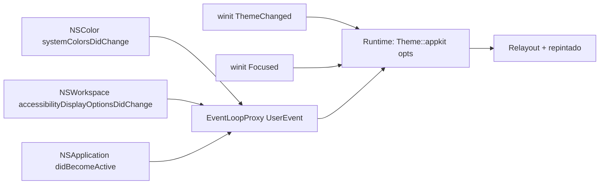

# 11 — Tema AppKit para macOS

**Fase:** posterior a L6, en paralelo a F0–F1 de [09](09-framework-y-plataforma.md). Esta guía propone un tema alternativo, `Theme::appkit`, para que una app Kai se vea y se comporte como una app AppKit nativa en macOS, sin abandonar el principio de [00](00-vision-y-arquitectura.md) y del [README](README.md): **Kai dibuja sus controles**; AppKit solo se consulta para leer valores (colores, fuentes, preferencias, métricas) y para la ventana.

> **Todo el código de esta guía es API propuesta, no existente.** Los nombres de tipos, módulos, clases Tailwind y funciones son un diseño a validar. Lo que existe hoy se cita con su archivo (`theme.rs`, `tw.rs`, `fonts.rs`…).

> **Contexto de versiones (18-oct-2026).** La versión vigente es **macOS 27 Golden Gate** (publicada el 14-sep-2026 según [9to5Mac](https://9to5mac.com/2026/09/14/macos-27-golden-gate-now-available-here-is-everything-new/)). **macOS 26 Tahoe** introdujo Liquid Glass y controles más altos; 27 lo refina. Las mediciones propias de esta guía se hicieron en el Mac de desarrollo, que corre **macOS 15.6.1 (24G90)**, Apple Silicon, pantalla Retina 2×: describen la generación «Aqua plana» (macOS 11–15) y coinciden con lo que AppKit 26+ llama métricas *compactas*. Los valores de 26/27 que no pude medir se marcan como tales; la **sección 6.3** reúne todo lo publicado sobre 26 y 27 (oficial y de terceros) con ambas generaciones lado a lado.

## Procedencia de los datos

Cada número lleva una marca:

| Marca | Significado |
|---|---|
| **[A]** | Documentado oficialmente por Apple (HIG, documentación de AppKit o sesión WWDC). Se cita la URL. |
| **[B-med]** | Medido en este Mac (macOS 15.6.1) con AppKit: `fittingSize`, `alignmentRectInsets`, `NSColor` resuelto en sRGB, o renderizado con `cacheDisplay` a 2× (sección 14). Exacto para esa versión; puede cambiar en otras. |
| **[B-ext]** | Apple Design Resources o terceros reputados (Mozilla, Zed, comunidad con fuente). |
| **[C]** | Estimación propia, inferida de las anteriores. Hay que verificarla. |
| (?) | Duda abierta o fuente contradictoria. |

La HIG advierte que los valores de color publicados son de referencia y «pueden fluctuar de una versión a otra»; hay que usar las APIs del sistema en tiempo de ejecución [A] ([Color](https://developer.apple.com/design/human-interface-guidelines/color#System-colors)). Por eso esta propuesta **lee en runtime** y usa las tablas estáticas solo como respaldo (tests, capturas, plataformas sin AppKit).

## 1. Objetivo

1. Un tema `AppKit` seleccionable al arrancar (`run(app, Theme::appkit(..))`), con paleta, tipografía, métricas de controles, radios, anillo de foco y animaciones de AppKit.
2. **Fidelidad sin dependencia de dibujo:** los mismos componentes Kai (`button`, `TextField`, `switch`…) adoptan variantes AppKit (push button, botón por defecto, checkbox, pop-up, segmented) dibujadas por el renderer `wgpu` propio.
3. **Vivo:** el tema reacciona sin reiniciar a modo claro/oscuro, color de acento, Aumentar contraste, Reducir transparencia, Reducir movimiento, Diferenciar sin color y al cambio de ventana *key*/inactiva.
4. **Compatibilidad:** las clases Tailwind actuales siguen resolviendo; se agregan nombres semánticos AppKit (`bg-window`, `text-label`, `ring-focus`…).
5. **Generaciones:** se distinguen al menos dos estéticas: *Aqua 11–15* (medida aquí) y *Liquid Glass 26+*, con selección automática por versión del sistema y posibilidad de fijarla.

**Fuera de alcance:** usar widgets nativos (`NSButton`, `NSTextField`) para dibujar; clonar Liquid Glass con refracción; incluir activos de Apple (SF Pro, SF Symbols, imágenes de los kits) en el repositorio.

## 2. Fuentes oficiales y su alcance

| Fuente | Qué aporta | Qué **no** aporta |
|---|---|---|
| HIG: [Typography](https://developer.apple.com/design/human-interface-guidelines/typography) | Tabla de estilos de texto de macOS (tamaño, peso, interlineado), tamaños por defecto y mínimo, tracking por tamaño, «macOS no soporta Dynamic Type». | Métricas de fuente (ascender, descender). |
| HIG: [Color](https://developer.apple.com/design/human-interface-guidelines/color), [Dark Mode](https://developer.apple.com/design/human-interface-guidelines/dark-mode) | Lista de colores dinámicos de AppKit y su propósito; valores RGB de los colores del sistema (actualizados el 9-jun-2025 para Liquid Glass); contraste mínimo 4,5:1 y 7:1 recomendado; *desktop tinting* con acento grafito. | Valores de los colores semánticos (labelColor, controlColor…): solo su propósito. |
| HIG: [Materials](https://developer.apple.com/design/human-interface-guidelines/materials) | Liquid Glass (regular/clear) frente a materiales estándar; en macOS, modos de mezcla *behind window* / *within window*; capa de atenuación del 35 % sobre contenido brillante con glass *clear*. | Parámetros de desenfoque, saturación o tinte. |
| HIG: [Accessibility](https://developer.apple.com/design/human-interface-guidelines/accessibility) | Control por defecto 28×28 pt y mínimo 20×20 pt en macOS; ~12 pt de separación alrededor de elementos con bisel y ~24 pt sin bisel; ampliación de texto ≥ 200 %; tabla de contraste WCAG AA. | Métricas por control. |
| HIG: [Buttons](https://developer.apple.com/design/human-interface-guidelines/buttons), [Toggles](https://developer.apple.com/design/human-interface-guidelines/toggles), [Pop-up buttons](https://developer.apple.com/design/human-interface-guidelines/pop-up-buttons), [Segmented controls](https://developer.apple.com/design/human-interface-guidelines/segmented-controls), [Sliders](https://developer.apple.com/design/human-interface-guidelines/sliders), [Text fields](https://developer.apple.com/design/human-interface-guidelines/text-fields) | Tipos de botón de macOS (push, square, help, image), botón por defecto, elipsis en títulos que abren otra vista, «~10 px de padding» en image buttons, mini switch en formularios agrupados, estados de checkbox (mixto), radios en grupos de 2–5. | Alturas, radios, paddings. |
| HIG: [Windows](https://developer.apple.com/design/human-interface-guidelines/windows), [Toolbars](https://developer.apple.com/design/human-interface-guidelines/toolbars), [Sidebars](https://developer.apple.com/design/human-interface-guidelines/sidebars), [Layout](https://developer.apple.com/design/human-interface-guidelines/layout), [Menus](https://developer.apple.com/design/human-interface-guidelines/menus) | Estados *main/key/inactive* y su apariencia; los ítems de toolbar no llevan bisel; tamaño de sidebar (pequeño/mediano/grande) según Ajustes; evitar controles en el borde inferior. | Alturas de barra de título, márgenes. |
| HIG: [Focus and selection](https://developer.apple.com/design/human-interface-guidelines/focus-and-selection), [Motion](https://developer.apple.com/design/human-interface-guidelines/motion) | En macOS solo los elementos de contenido (campos, listas) necesitan foco; los controles lo reciben con el modo de acceso completo por teclado. Anillo para campos, resaltado para filas. «Sin consideraciones adicionales para macOS» en movimiento. | Grosor del anillo, duraciones. |
| AppKit: [UI element colors](https://developer.apple.com/documentation/appkit/ui-element-colors), [`NSColor.SystemEffect`](https://developer.apple.com/documentation/appkit/nscolor/systemeffect), [`usingColorSpace`](https://developer.apple.com/documentation/appkit/nscolor/usingcolorspace(_:)), [`NSAppearance`](https://developer.apple.com/documentation/appkit/nsappearance) | Nombres de colores dinámicos, efectos *pressed/deepPressed/disabled/rollover*, conversión a sRGB, `performAsCurrentDrawingAppearance` (macOS 11+). | — |
| AppKit: [`NSFont.TextStyle`](https://developer.apple.com/documentation/appkit/nsfont/textstyle), [`preferredFont(forTextStyle:)`](https://developer.apple.com/documentation/appkit/nsfont/preferredfont(fortextstyle:options:)), [`NSControl.ControlSize`](https://developer.apple.com/documentation/appkit/nscontrol/controlsize-swift.enum) | 11 estilos (macOS 11+); tamaños `mini/small/regular/large` y `extraLarge` (macOS 26). | Alturas por tamaño. |
| AppKit: [`prefersCompactControlSizeMetrics`](https://developer.apple.com/documentation/appkit/nsview/preferscompactcontrolsizemetrics), [`NSGlassEffectView`](https://developer.apple.com/documentation/appkit/nsglasseffectview), [`NSButton.BezelStyle`](https://developer.apple.com/documentation/appkit/nsbutton/bezelstyle-swift.enum) (incl. `.glass`), [`NSVisualEffectView.Material`](https://developer.apple.com/documentation/appkit/nsvisualeffectview/material-swift.enum), [`NSFocusRingType`](https://developer.apple.com/documentation/appkit/nsfocusringtype) | Existencia y semántica de las APIs de 26+ (métricas compactas = las de macOS 15 y anteriores), estilos de bisel, materiales con nombre. | Valores de píxel. |
| AppKit: [`NSWorkspace` accesibilidad](https://developer.apple.com/documentation/appkit/nsworkspace/accessibilitydisplayoptionsdidchangenotification), [`systemColorsDidChangeNotification`](https://developer.apple.com/documentation/appkit/nscolor/systemcolorsdidchangenotification), [`isFullKeyboardAccessEnabled`](https://developer.apple.com/documentation/appkit/nsapplication/isfullkeyboardaccessenabled) | Preferencias de pantalla (contraste, transparencia, movimiento, sin color, invertir) y sus notificaciones. | — |
| WWDC25 [«Build an AppKit app with the new design»](https://developer.apple.com/videos/play/wwdc2025/310/) | macOS 26: tamaño *extra large*; mini/small/medium «ligeramente más altos»; mini–medium rectángulo redondeado, large/extra large cápsula; `borderShape`, `tintProminence`; radios de ventana según estilo. | Tablas de alturas. |
| WWDC26 [«Modernize your AppKit app»](https://developer.apple.com/videos/play/wwdc2026/289/) ([transcripción](https://apple-docs.everest.mt/docs/wwdc/wwdc2026-289/)) | macOS 27: sidebars de borde a borde, selección de sidebar en semibold, efecto *bounce* en glass interactivo, API de concentricidad `NSViewCornerConfiguration` / `.containerConcentric`, `autorecalculatesKeyViewLoop`. | Valores numéricos. |
| [Apple Design Resources](https://developer.apple.com/design/resources/) | Kits de Figma/Sketch para macOS (hay un [kit de macOS 26 en Figma](https://www.figma.com/community/file/1543337041090580818/macos-26)). Serían la mejor fuente de métricas [B-ext]. | **No los inspeccioné** (requieren descarga/cuenta); su licencia limita el uso a diseñar para plataformas Apple (?). |

Conclusión: Apple documenta **semántica** (nombres, propósito, estados, reglas de uso) y la **tipografía**, pero casi ninguna métrica de píxel de controles. Esas salen de medir AppKit (lo que hace esta guía) o de los kits.

### Licencias y derechos

- **SF Pro, SF Mono, New York:** la licencia de [Apple Fonts](https://developer.apple.com/fonts/) permite usarlas para maquetas de interfaces de software para plataformas Apple; **no** se pueden empaquetar ni redistribuir. Kai las usa **como fuente del sistema** a través del sistema operativo (como hoy `fonts.rs`), nunca copiadas a `assets/`. En plataformas no Apple el tema AppKit cae a la familia genérica (sin SF).
- **SF Symbols:** su licencia restringe el uso a apps de plataformas Apple y prohíbe usarlos en logos. Kai sigue con Lucide (ISC). Una opción futura es rasterizar símbolos en runtime con `NSImage(systemSymbolName:)` solo en macOS, sin guardarlos en el repo (pregunta abierta, sección 13).
- **HIG:** texto con copyright de Apple. Esta guía resume y enlaza; no copiar pasajes largos al repo.
- **Kits de Apple Design Resources:** no extraer imágenes ni componentes al repositorio.

## 3. Tipografía

### 3.1 Estilos de texto de macOS

Tabla oficial [A] ([Typography › Specifications](https://developer.apple.com/design/human-interface-guidelines/typography#Specifications)), **verificada** con `NSFont.preferredFont(forTextStyle:)` y `NSLayoutManager.defaultLineHeight(for:)` en macOS 15.6.1 [B-med]: los once valores coinciden.

| Estilo (`NSFont.TextStyle`) | Peso | Tamaño (pt) | Interlineado (pt) | Peso enfatizado | Cara resuelta [B-med] |
|---|---|---|---|---|---|
| `largeTitle` | Regular | 26 | 32 | Bold | `.SFNS-Regular` |
| `title1` | Regular | 22 | 26 | Bold | `.SFNS-Regular` |
| `title2` | Regular | 17 | 22 | Bold | `.SFNS-Regular` |
| `title3` | Regular | 15 | 20 | Semibold | `.SFNS-Regular` |
| `headline` | **Bold** | 13 | 16 | Heavy | `.SFNS-Bold` |
| `body` | Regular | 13 | 16 | Semibold | `.SFNS-Regular` |
| `callout` | Regular | 12 | 15 | Semibold | `.SFNS-Regular` |
| `subheadline` | Regular | 11 | 14 | Semibold | `.SFNS-Regular` |
| `footnote` | Regular | 10 | 13 | Semibold | `.SFNS-Regular` |
| `caption1` | Regular | 10 | 13 | Medium | `.SFNS-Regular` |
| `caption2` | **Medium** | 10 | 13 | Semibold | `.SFNS-Medium` |

Otros datos:

- Tamaño por defecto **13 pt**, mínimo **10 pt** [A] (Typography y Accessibility).
- `NSFont.systemFontSize` = 13, `smallSystemFontSize` = 11, `labelFontSize` = 10 [B-med]. `systemFontSize(for:)`: **mini 9, small 11, regular 13, large 13** [B-med]. Es decir, el tamaño de control cambia la fuente solo hasta *regular*.
- Fuentes de control [B-med]: `menuFont` 13, `menuBarFont` 13, `messageFont` 13, `titleBarFont` 13, `toolTipsFont` 11, `controlContentFont` **12** (ojo: no 13), `labelFont` 10. Monoespaciada: `.AppleSystemUIFontMonospaced-Regular` (SF Mono); `userFixedPitchFont` = Menlo.
- Métricas de SF a 13 pt [B-med]: ascender 12,57, descender −2,74, leading 0 (fuente del sistema) → interlineado natural 16. A 11 pt: 10,63 / −2,32 → 13. A 10 pt: 9,67 / −2,11 → 12. Los estilos de texto añaden `leading` para llegar a los valores de la tabla (p. ej. `footnote` 10 pt → 13).
- **Tracking:** el sistema ajusta el espaciado según el tamaño; la HIG publica la tabla para maquetas [A] ([Tracking values](https://developer.apple.com/design/human-interface-guidelines/typography#Tracking-values)). Extracto: 10 pt +0,12; 11 pt +0,06; 12 pt 0; **13 pt −0,08**; 15 pt −0,23; 17 pt −0,43; 20 pt −0,45; 22 pt −0,26; 26 pt +0,22 (en puntos). CoreText lo aplica desde la tabla `trak` de la fuente (`SFNS.ttf` la tiene [B-med]); cosmic-text 0.19 no aplica tracking (`UNMAPPED_TOKENS` de `theme.rs`). Sin él, el texto de 13 pt queda ~0,08 pt más ancho por carácter que en AppKit.
- **Pesos:** evitar Ultralight/Thin/Light [A]. En `TypeTokens`, `weight_*` mapean a Regular 400, Medium 500, Semibold 600, Bold 700, Heavy 800.

### 3.2 Dynamic Type en macOS

- «macOS no soporta Dynamic Type» [A] (Typography › macOS). `preferredFont(forTextStyle:)` devuelve los tamaños fijos de la tabla [B-med]. AppKit reserva espacio vertical extra para escrituras como tailandés o hindi si están en los idiomas preferidos [A] ([preferredFont](https://developer.apple.com/documentation/appkit/nsfont/preferredfont(fortextstyle:options:))).
- La HIG pide permitir ampliar el texto hasta 200 % «por UI propia o Dynamic Type» [A] (Accessibility). Propuesta: un **factor de escala de texto de la app** (`text_scale`) en el tema, persistido por la app, en lugar de un ajuste del sistema inexistente.
- El tamaño de iconos de sidebar (pequeño/mediano/grande en Ajustes › General) cambia altura de fila, texto y glifos de las sidebars [A] (Sidebars › macOS). Leerlo exige preferencias no documentadas (?); v1 lo expone como opción del tema.

### 3.3 Obtener la fuente del sistema

| Opción | Cómo | Pros / contras |
|---|---|---|
| **cosmic-text / fontdb (actual)** | `fonts.rs` pide `Family::Name(".AppleSystemUIFont")`. | Sin dependencias nuevas. **Riesgo:** `.AppleSystemUIFont` es un alias de CoreText; `fontdb` indexa los nombres de la tabla `name` de `/System/Library/Fonts/SFNS.ttf`, cuyo nombre de familia (ID 1, en-US) es **«System Font»** y cuyo ID 25 es `.SFNS` [B-med]. Terceros reportan que fontdb la registra como `.SF NS` ([native-theme-iced](https://docs.rs/native-theme-iced/latest/x86_64-apple-darwin/native_theme_iced/)) [B-ext]. Hay que verificar con un test que la cara resuelta es SFNS y no un *fallback* (?). |
| CoreText para descubrir la ruta | `CTFontCreateUIFontForLanguage(kCTFontUIFontSystem, 13, nil)` → `kCTFontURLAttribute` → cargar ese archivo en `fontdb` y pedir la familia por su nombre real. | Robusto ante cambios de nombre entre versiones. Requiere `objc2-core-text` o `core-text`. |
| Ejes variables | `SFNS.ttf` es variable: `wdth` 30–150, `opsz` 17–96, `GRAD` 400–1000, `wght` 1–1000; 369 instancias con nombre [B-med]. | cosmic-text 0.19 empareja caras variables a cualquier peso de su eje `wght` (según [native-theme-iced](https://docs.rs/native-theme-iced/latest/x86_64-apple-darwin/native_theme_iced/)) [B-ext]. **No consta que fije `opsz` según el tamaño** como hace CoreText («dynamic optical sizes» [A]); si no lo hace, el texto pequeño usa el diseño por defecto del eje (`opsz` 28) y se ve distinto al de AppKit (?). Verificar y, si hace falta, fijar `opsz` en las variaciones de la cara. |
| Dibujar con CoreText | Shaping y rasterizado por CoreText a un atlas propio. | Fidelidad máxima (tracking, `opsz`, *smoothing*). Rompe la pila de texto común (glyphon) y la paridad multiplataforma. No recomendado en v1. |

## 4. Colores semánticos

### 4.1 Lectura en runtime (fuente de verdad)

- Los colores de AppKit son **dinámicos**: se resuelven según la apariencia (`aqua`, `darkAqua` y sus variantes de alto contraste y *vibrant*) [A] ([NSAppearance.Name](https://developer.apple.com/documentation/appkit/nsappearance/name-swift.struct)).
- Para leer un valor: dentro de `appearance.performAsCurrentDrawingAppearance { … }` (macOS 11+) [A], convertir con `color.usingColorSpace(.sRGB)` [A] y leer `redComponent`… `alphaComponent`. «No hacer suposiciones sobre el espacio de color» de `controlAccentColor` [A]: convertir siempre.
- **Alfa:** muchos colores son negro/blanco con alfa (`labelColor` = negro al 84,7 %) [B-med]. Kai debe conservar el alfa y componer como AppKit (ver 4.4).
- **Estados:** `withSystemEffect(.pressed | .deepPressed | .disabled | .rollover)` (macOS 10.14+) [A] da los colores de estado que usa el sistema; preferirlo a mezclas inventadas con `Color::mix`.
- **Alto contraste:** al pedir `accessibilityHighContrastAqua` por nombre se obtuvieron **los mismos valores** que con `aqua`, con el ajuste apagado [B-med]. Las variantes de alto contraste aparecen cuando el usuario activa Aumentar contraste; el lector debe usar la apariencia efectiva de `NSApp` y releer al recibir la notificación (sección 9). No hay valores estáticos de alto contraste en esta guía [C].

### 4.2 Tabla: color AppKit → propósito → token Kai

Valores en sRGB, `#rrggbb` + alfa, resueltos en macOS 15.6.1 con el acento por defecto (multicolor/azul) [B-med]. Propósito según la HIG/AppKit [A]. «Token Kai» indica el campo actual de `ColorTokens` o el nombre nuevo propuesto (en cursiva) para `Theme::color`.

| AppKit (`NSColor`) | Propósito [A] | Claro | Oscuro | Token Kai |
|---|---|---|---|---|
| `windowBackgroundColor` | Fondo de ventana | `#ececec` | `#323232` | `background`, *`window`* |
| `underPageBackgroundColor` | Detrás del documento | `#969696` α .90 | `#282828` | *`under-page`* |
| `controlBackgroundColor` | Fondo de controles grandes (tablas, navegadores) | `#ffffff` | `#1e1e1e` | `surface`, *`control-background`* |
| `textBackgroundColor` | Fondo detrás de texto (campos) | `#ffffff` | `#1e1e1e` | *`field`* (reemplaza `bg-background` en TextField) |
| `controlColor` | Superficie de un control (bisel del push button) | `#ffffff` | `#ffffff` α .247 | `secondary`, *`control`* |
| `labelColor` | Texto principal | `#000000` α .847 | `#ffffff` α .847 | `foreground`, `text-primary`, *`label`* |
| `secondaryLabelColor` | Texto secundario | `#000000` α .498 | `#ffffff` α .549 | `muted-foreground`, `text-secondary`, *`secondary-label`* |
| `tertiaryLabelColor` | Texto terciario | `#000000` α .259 | `#ffffff` α .247 | *`tertiary-label`* |
| `quaternaryLabelColor` | Marcas de agua | `#000000` α .098 | `#ffffff` α .098 | *`quaternary-label`* |
| `textColor` | Texto de documento | `#000000` | `#ffffff` | *`text`* |
| `placeholderTextColor` | Placeholder | `#000000` α .247 | `#ffffff` α .247 | *`placeholder`* (para `placeholder-*`) |
| `controlTextColor` | Texto de control habilitado | `#000000` α .847 | `#ffffff` α .847 | *`control-text`* |
| `disabledControlTextColor` | Texto de control deshabilitado | `#000000` α .247 | `#ffffff` α .247 | `text-disabled` |
| `controlAccentColor` | Acento elegido en Ajustes | `#007aff` | `#007aff` | `primary`, `accent`, `info` |
| acento `.pressed` | Acento presionado | `#005cd7` | `#2ea8ff` | `active` |
| acento `.rollover` | Acento con el puntero encima | `#0045b7` | `#3db7ff` | *`accent-rollover`* (raro, ver 7) |
| acento `.disabled` | Acento deshabilitado | `#007aff` α .35 | `#007aff` α .50 | *`accent-disabled`* |
| `controlColor` `.pressed` | Bisel presionado | `#d7d7d7` | `#6d6d6d` α .427 | *`control-pressed`* |
| `alternateSelectedControlTextColor` | Texto sobre selección o acento | `#ffffff` | `#ffffff` | `on-primary` |
| `selectedContentBackgroundColor` | Selección enfatizada (fila en ventana *key*) | `#0064e1` | `#0059d1` | *`selection`* |
| `unemphasizedSelectedContentBackgroundColor` | Selección sin énfasis (ventana inactiva) | `#dcdcdc` | `#464646` | *`selection-inactive`* |
| `selectedTextBackgroundColor` | Fondo de texto seleccionado | `#b3d7ff` | `#3f638b` | *`text-selection`* |
| `unemphasizedSelectedTextBackgroundColor` | Texto seleccionado sin foco | `#dcdcdc` | `#464646` | *`text-selection-inactive`* |
| `selectedControlColor` | Cara de un control seleccionado | `#b3d7ff` | `#3f638b` | *`control-selected`* |
| `keyboardFocusIndicatorColor` | Anillo de foco | `#0067f4` α .498 | `#1aa9ff` α .498 | *`focus`* (para `ring-focus`) |
| `textInsertionPointColor` (14+) | Caret | `#007aff` | `#007aff` | *`caret`* |
| `linkColor` | Enlaces | `#0068da` | `#419cff` | *`link`* (hoy en `UNMAPPED_TOKENS`) |
| `separatorColor` | Separadores | `#000000` α .098 | `#ffffff` α .098 | `border`, *`separator`* |
| `gridColor` | Rejilla de tablas | `#e6e6e6` | `#1a1a1a` | *`grid`* |
| `headerTextColor` | Cabeceras de tabla | `#000000` α .847 | `#ffffff` | *`header-text`* |
| `alternatingContentBackgroundColors` | Filas alternas | `#ffffff` / `#f4f5f5` | `#1e1e1e` / `#ffffff` α .047 | *`row`*, *`row-alt`* |
| `systemFill` … `quinarySystemFill` | Rellenos: formas delgadas (pista de slider), pequeñas, medianas (switch), grandes (group box), formularios | negro α .098 / .078 / .047 / .027 / .008 | blanco con los mismos alfas | `muted` = *`fill-3`*; *`fill`*, *`fill-2`*… *`fill-5`* |
| `findHighlightColor` | Indicador de búsqueda | `#ffff00` | `#ffff00` | *`find`* |
| `shadowColor` | Sombra virtual | `#000000` | `#000000` | base de `shadow-*` |
| `windowFrameTextColor` | Título de ventana | `#000000` α .847 | `#ffffff` α .847 | *`title`* |
| `selectedMenuItemTextColor` | Texto de ítem de menú seleccionado | `#ffffff` | `#ffffff` | *`menu-selected-text`* |

`hover` (Kai: `color-mix(neutral 65%, background)`) no tiene equivalente: en AppKit los controles de contenido no cambian con el puntero (sección 7). En el tema AppKit, `hover` = color base del control.

### 4.3 Colores del sistema (tonos)

| Nombre | Claro 11–15 [B-med] | Oscuro 11–15 [B-med] | Claro 26+ [A] | Oscuro 26+ [A] | Token Kai |
|---|---|---|---|---|---|
| Red | `#ff3b30` | `#ff453a` | 255,56,60 | 255,66,69 | `error` |
| Orange | `#ff9500` | `#ff9f0a` | 255,141,40 | 255,146,48 | `warning` |
| Yellow | `#ffcc00` | `#ffd60a` | 255,204,0 | 255,214,0 | — |
| Green | `#28cd41` | `#32d74b` | 52,199,89 | 48,209,88 | `success` |
| Mint | `#00c7be` | `#63e6e2` | 0,200,179 | 0,218,195 | — |
| Teal | `#59adc4` | `#6ac4dc` | 0,195,208 | 0,210,224 | — |
| Cyan | `#55bef0` | `#5ac8f5` | 0,192,232 | 60,211,254 | — |
| Blue | `#007aff` | `#0a84ff` | 0,136,255 | 0,145,255 | `info` (acento por defecto) |
| Indigo | `#5856d6` | `#5e5ce6` | 97,85,245 | 109,124,255 | — |
| Purple | `#af52de` | `#bf5af2` | 203,48,224 | 219,52,242 | — |
| Pink | `#ff2d55` | `#ff375f` | 255,45,85 | 255,55,95 | — |
| Brown | `#a2845e` | `#ac8e68` | 172,127,94 | 183,138,102 | — |
| Gray | `#8e8e93` | `#98989d` | — | — | `neutral` |

- Las columnas 26+ son las de la HIG actual («Updated system color values», 9-jun-2025), tomadas del texto alternativo de las muestras [A]. La HIG también publica valores de **contraste aumentado**; la tabla completa está en 6.3.4 [A].
- La tabla de la HIG es común a todas las plataformas; no confirma que `NSColor.systemBlue` en macOS 26/27 devuelva exactamente esos valores (?). Por eso: leer en runtime.

### 4.4 Composición y gestión de color en el renderer

Dos detalles del backend actual pueden afectar la fidelidad más que cualquier tabla:

1. **Espacio de mezcla.** `wgpu_backend.rs` usa el formato por defecto de la superficie y, si es sRGB, renderiza en lineal (`linear_target: format.is_srgb()`, `clear.to_linear()`). Core Animation y AppKit mezclan colores con alfa sobre valores **codificados** sRGB (gamma), no lineales [C]. Un separador negro α .098 sobre `#ececec` da ≈ `#d5d5d5` mezclando en gamma y un gris visiblemente más claro mezclando en lineal. Propuesta: en el tema AppKit, superficie `Bgra8Unorm` (no sRGB) con mezcla en espacio codificado, o resolver a opaco en CPU los colores con alfa sobre fondos conocidos. Verificar con comparación de píxeles (fase A4).
2. **Perfil de color.** Los Mac recientes son Display P3 y AppKit convierte de sRGB a P3. Si `CAMetalLayer.colorspace` queda en `nil`, Core Animation no hace esa conversión y los valores sRGB se muestran sin gestión de color, más saturados que en una app nativa [C] (?). Propuesta: fijar `colorspace = sRGB` en la capa (vía `objc2-quartz-core`) en el tema AppKit, y medir.

## 5. Materiales y vibrancy

| Necesidad | AppKit | Factible en `wgpu` (Kai dibuja) |
|---|---|---|
| Fondo opaco de ventana | `windowBackgroundColor` | **Sí, trivial.** Es el defecto del tema. |
| Sidebar, titlebar o menú translúcidos *behind window* (desenfocan el escritorio y otras ventanas) | `NSVisualEffectView` con `.sidebar`, `.titlebar`, `.menu`, `.popover`, `.hudWindow`, `.headerView`, `.sheet`, `.windowBackground`, `.underWindowBackground`… y `blendingMode = .behindWindow` [A] | **No desde wgpu:** una app no puede leer los píxeles de otras ventanas. **Sí con composición del sistema:** superficie con alfa (`CAMetalLayer` no opaca, `CompositeAlphaMode` no opaco), ventana no opaca y un `NSVisualEffectView` insertado **debajo** de la vista Metal; Kai pinta transparente donde debe verse el material. Es lo que hace GPUI de Zed con `WindowBackgroundAppearance::Blurred` [B-ext] ([PR #9610](https://github.com/zed-industries/zed/pull/9610)). Limitación: un material por vista nativa; varias regiones exigen varias vistas posicionadas desde el layout. |
| Desenfoque *within window* (contenido propio bajo una barra) | `.withinWindow` [A] | **Sí, con trabajo:** renderizar a textura, desenfoque gaussiano separable y componer. El renderer ya desenfoca sombras SDF, no el fondo. Coste de GPU por frame. Fase posterior. |
| Vibrancy (texto o gris que toma color del material) | Colores `label*`/`fill` dentro de `NSVisualEffectView` con `allowsVibrancy` | **Aproximada.** Los modos de mezcla de vibrancy no son públicos. Aproximación: `label` con alfa sobre el material [C]. |
| Ventana inactiva | `NSVisualEffectView.state = .followsWindowActiveState` [A]; las ventanas inactivas no usan materiales [A] (Windows) | Sí: al perder *key*, pintar el color opaco equivalente. |
| Reducir transparencia | `accessibilityDisplayShouldReduceTransparency` [A] | Sí: siempre opaco. |
| Liquid Glass (26+) | `NSGlassEffectView` (26+), `NSButton.BezelStyle.glass`, toolbars y sidebars automáticos [A] | **No clonable con fidelidad** (refracción, brillo especular, adaptación al contenido; parámetros no publicados). Opciones en 11.9: (a) glass nativo con una segunda capa Metal de Kai como `contentView` (?); (b) imitar con desenfoque *within window* y un borde especular [C]. v1: superficies opacas o `NSVisualEffectView` clásico. Detalles de la API en 6.3.5. |
| *Desktop tinting* con acento grafito | El fondo de ventana toma color del escritorio [A] (Dark Mode › macOS) | No replicable sin material del sistema; con un `NSVisualEffectView` `.windowBackground` debajo se obtiene gratis. |

## 6. Métricas de controles por tamaño

### 6.1 Cómo leer las tablas

AppKit distingue el **frame** de la vista y el **rectángulo de alineación** (`alignmentRectInsets`), que excluye sombra y margen. La fila «alineación» es la que importa para el layout: es la caja que se alinea con otros controles. Valores en puntos, medidos con `fittingSize` y `alignmentRectInsets` en macOS 15.6.1 [B-med]. «—» = tamaño no aplicable.

### 6.2 Controles, macOS 11–15 (= métricas compactas de 26+)

| Control | mini | small | regular | large | Notas |
|---|---|---|---|---|---|
| Push button (`.push`), alineación | 13 | 16 | **20** | 28 | Frame: 16 / 27 / 32 / 40 (incluye márgenes). Bisel visible regular ≈ 21,5 pt con sombra [B-med]. |
| Pop-up button | 13 | 16 | 20 | 28 | Frame: 16 / 22 / 25 / 40. |
| Segmented control | 14 | 18 | 22 | 30 | Frame: 16 / 21 / 24 / 40. |
| Text field cuadrado (`.square`) | 15 | 19 | 21 | 21 | No crece en *large*. Radio 0. |
| Text field redondeado (`.roundedBezel`) | 17 | 19 | 22 | 30 | |
| Search field | 15 | 19 | 21 | 21 | |
| Combo box | 13 | 16 | 20 | 20 | |
| Switch (`NSSwitch`), ancho × alto | 26 × 15 | 32 × 18 | **38 × 22** | 38 × 22 | Cápsula. |
| Checkbox / radio (caja) | 10 | 12 | **14** | 16 | Caja de checkbox redondeada ≈ 3 pt [C]. |
| Slider (alineación) | 13 | 16 | 20 | 20 | Frame: 17 / 20 / 28 / 28. |
| Stepper | 13 | 16 | 20 | — | |
| Help button (`.helpButton`) | 13 | 16 | 20 | 26 | Circular. |

- **Radios** inferidos del canal alfa de los renders a 2× [C]: push, pop-up y campo redondeado ≈ 3 / 4 / 5 / 6 pt (mini → large). Error estimado ±0,5 pt.
- **Relleno del push button** [B-med]: claro, blanco con borde sutil y sombra de 0,5 pt; oscuro, blanco α .25 (`controlColor`). El botón **por defecto** (Retorno) se rellena con `controlAccentColor` y texto blanco; **en una ventana inactiva pierde el acento** y se ve como un push normal [B-med].
- **Switch** [B-med]: pista apagada negro α ≈ .22 en claro; encendida con acento. En ventana inactiva, la pista encendida se ve gris `#b8b8b8`.
- **Tamaño mínimo de objetivo** [A]: control por defecto 28 × 28 pt, mínimo 20 × 20 pt (Accessibility). Los controles *regular* de 20 pt de alto cumplen el mínimo; *small* y *mini* no, y la HIG los reserva para paneles e inspectores.
- **Padding horizontal** de push button: no medido de forma fiable (?). Estimación [C]: ~12 pt a cada lado del título en *regular*, ~8 en *small*; ancho mínimo habitual de botones de diálogo 70–80 pt [B-ext].

### 6.3 Generación Liquid Glass: macOS 26 Tahoe y 27 Golden Gate

El Mac de desarrollo corre macOS 15, así que **nada de esta sección está medido por mí**. Reúne lo que Apple publica [A] y lo que midieron terceros con fuente [B-ext] (investigación del 18-oct-2026). Donde no hay dato se escribe «sin dato»; no se rellenan huecos con estimaciones salvo las marcadas [C].

**Fuentes descartadas:** tablas de alturas «verificadas» en repositorios de *prompts* o *skills* para IA (p. ej. push regular «~32 pt», large «~38 pt») que no citan ninguna medición y contradicen lo medido aquí en macOS 15. No se usan.

#### 6.3.1 Lo que Apple documenta [A]

- **Tamaños:** `NSControl.ControlSize.extraLarge`, nuevo en macOS 26.0 ([doc](https://developer.apple.com/documentation/appkit/nscontrol/controlsize-swift.enum/extralarge)). Mini, small y medium son «ligeramente más altos» que en versiones anteriores, para dar aire a la etiqueta y agrandar el área de clic ([WWDC25-310](https://developer.apple.com/videos/play/wwdc2025/310/), [WWDC25-323](https://developer.apple.com/videos/play/wwdc2025/323/)). **Apple no publica las alturas.**
- **Formas:** mini–medium siguen siendo **rectángulos redondeados**; large y extra large pasan a **cápsula** ([WWDC25-356 «Get to know the new design system»](https://developer.apple.com/videos/play/wwdc2025/356/), WWDC25-310). Se puede forzar con `borderShape` en botones, pop-ups y segmented.
- **Reglas de radio** (WWDC25-356):
  - *Fija:* radio constante.
  - *Cápsula:* radio = alto / 2.
  - *Concéntrica:* radio = radio del contenedor − padding.

  La HIG de Toolbars repite que los componentes estándar tienen radios concéntricos con la barra.
- **Métricas compactas:** con `NSView.prefersCompactControlSizeMetrics = true` (26.0, se hereda por la jerarquía), los controles usan las métricas de macOS 15 y anteriores ([doc](https://developer.apple.com/documentation/appkit/nsview/preferscompactcontrolsizemetrics)). En otras palabras, la tabla 6.2 **es** la métrica compacta oficial de 26+.
- **Prominencia de tinte:** `tintProminence` admite `automatic`, `none`, `secondary` y `primary`. El botón por defecto usa `primary` y los destructivos un rojo de prominencia menor. En sliders decide si la pista se rellena; `neutralValue` fija el ancla del relleno (WWDC25-310).
- **Bisel `.glass`:** `NSButton.BezelStyle.glass` (26.0) reemplaza el fondo del botón por Liquid Glass y respeta `bezelColor` como tinte ([doc](https://developer.apple.com/documentation/appkit/nsbutton/bezelstyle-swift.enum/glass)).
- **Ventanas:** el radio de las esquinas «varía según el estilo de ventana». Con toolbar es mayor y envuelve concéntricamente los controles glass de la barra; con solo barra de título es menor y envuelve los semáforos (WWDC25-310). Para no chocar con las esquinas existe `NSView.LayoutRegion` con `safeArea(cornerAdaptation:)` / `margins(cornerAdaptation:)` (26.0).
- **Sidebars en 26:** el sidebar es un panel de glass **flotante** sobre el contenido y el inspector es glass de borde a borde (WWDC25-310). Ya no se debe poner `NSVisualEffectView` dentro del sidebar.
- **Cambios de macOS 27** ([WWDC26-289](https://developer.apple.com/videos/play/wwdc2026/289/), [transcripción](https://apple-docs.everest.mt/docs/wwdc/wwdc2026-289/); [notas de versión de macOS 27](https://apple-docs.everest.mt/docs/macos-release-notes/macos-27-release-notes/)):
  - Sidebars **de borde a borde**, con la selección en **semibold**.
  - El scroll edge effect automático pasa a *hard* cuando hay texto flotante.
  - Los items de toolbar con borde sobre el sidebar adoptan glass.
  - Efecto opcional de **rebote** del glass al hacer clic.
  - Concentricidad con `NSView.cornerConfiguration` → `NSViewCornerConfiguration` (`uniformCorners`, `capsule(maximumRadius:)`, `corners(...)`) y `NSViewCornerRadius.containerConcentric(min)` / `.fixed(r)` (27.0).
  - `NSSegmentedControl.role` (`.tabs`, `.valueSelection`) con «apariencia visual distinta» para pestañas.
  - Menús con **menos iconos** (vuelven a ocultarse los símbolos por defecto).
  - `NSTitlebarAccessoryViewController` puede dibujar fuera de sus límites.
- **Sin vuelta atrás desde 27:** `UIDesignRequiresCompatibility` (que en 26 mantenía el aspecto anterior) **se ignora** al compilar con el SDK de macOS 27 ([doc](https://apple-docs.everest.mt/docs/bundleresources/information-property-list/uidesignrequirescompatibility/)). Para AppKit, el aspecto pre-26 solo sobrevive como métricas compactas, no como estética.

#### 6.3.2 Controles: tabla comparativa (alto en pt)

| Control | macOS 15 / compacto 26+, alineación [B-med] | macOS 26 Tahoe | macOS 27 Golden Gate |
|---|---|---|---|
| Push button mini / small / regular | 13 / 16 / 20 (frame 16 / 27 / 32) | **18 / 24 / 30** «px» según un usuario del foro de PureBasic ([hilo](https://www.purebasic.fr/english/viewtopic.php?t=87595)) [B-ext] (?): no dice si es frame o alineación, ni cómo midió. Con el SDK 26 **el bisel llena todo el frame** (sin márgenes incorporados, [Firefox c44e1d9](https://github.com/mozilla-firefox/firefox/commit/c44e1d9c2ec16b550fc492ac408015fd63930c31)) [B-ext], así que frame ≈ bisel visible. | sin dato |
| Push button large | 28 (frame 40) | sin dato; forma cápsula [A] | sin dato |
| Push button extraLarge | — (no existe) | sin dato; forma cápsula [A] | sin dato |
| Botones de alerta | — | **28 pt** (el kit de Figma 26.0.1 los bajó de 32 a 28), alerta con **radio 26 pt**; changelog del kit citado por [AAPL Ch.](https://applech2.com/archives/20250927-apple-macos-26-tahoe-design-update.html) [B-ext] | sin dato |
| Pop-up, segmented, text field, search field, combo | 20 / 22 / 21–22 / 21 / 20 (regular) | sin dato («ligeramente más altos» [A]) | sin dato; segmented con rol `.tabs` y aspecto propio [A] |
| Switch | 38 × 22 (regular) | sin dato | sin dato |
| Checkbox / radio | 14 (regular) | sin dato. Firefox sigue dibujando celdas de 11 / 13 / 16 px (mini / small / regular) ([nsNativeThemeCocoa.mm](https://searchfox.org/mozilla-central/source/widget/cocoa/nsNativeThemeCocoa.mm)) [B-ext] (?) | sin dato |
| Slider | 20 (frame 28) | sin dato; relleno opcional y `neutralValue` [A] | sin dato |

Conclusión: **en 26/27 no hay ninguna tabla fiable de alturas publicada.** La única cifra concreta (30/24/18) es de foro. La estimación anterior de esta guía (regular 24) queda **retirada**. La única fuente segura es medir en runtime con `fittingSize` y `alignmentRectInsets` (fase A2) en un Mac con 26 o 27.

#### 6.3.3 Ventana, barra de título, semáforos y sidebar

| Elemento | macOS 15 | macOS 26 Tahoe | macOS 27 Golden Gate |
|---|---|---|---|
| Radio de ventana con toolbar `.unified` | ≈ 10 pt: [B-ext] ([bremer-media](https://notes.bremer-media.com/macos/corner-radius-sizes.html)) y [C] | **26 pt** [B-ext]: cifra de la diapositiva de WWDC25-310 citada en [Reddit](https://www.reddit.com/r/MacOSBeta/comments/1l9zfdi/whats_the_new_window_corner_radius_in_macos_26/); el radio cambia al añadir toolbar ([lapcatsoftware](https://www.lapcatsoftware.com/articles/2026/3/1.html)) | **uniforme en todas las apps** [A] (Apple: «updated window shapes», citado por [9to5Mac](https://9to5mac.com/2026/06/09/macos-27-golden-gate-includes-these-changes-that-tahoe-critics-will-appreciate/) y [MacRumors](https://www.macrumors.com/2026/06/09/macos-golden-gate-liquid-glass/)). Valor: **16 pt** según bremer-media [B-ext] (?) |
| Radio con `.unifiedCompact` | ≈ 10 | **20 pt** [B-ext] (misma fuente) | 16 (?) |
| Radio solo barra de título | ≈ 10 | **16 pt** [B-ext] | 16 (?) |
| Override global (no documentado) | — | `defaults write -g NSConvolutionOverride1 -float <r>` [B-ext] | ídem [B-ext] |
| Alto de la barra de título sola | 28 [B-med] | **32 pt** ([Yaak 242f55b](https://github.com/mountain-loop/yaak/commit/242f55b609d39c82d7ed2692aed3c80a5371a83b), [GitHub Desktop #21135](https://github.com/desktop/desktop/issues/21135)) [B-ext] | sin dato |
| Frame de cada semáforo (alto) | 16 [B-med] | **14** ([VS Code](https://github.com/microsoft/vscode/issues/281620), Yaak) [B-ext] | sin dato |
| `origin.y` del botón de cierre en su contenedor | ≈ 5 ([Readest](https://github.com/readest/readest/blob/4c2d8022/apps/readest-app/src-tauri/src/macos/traffic_light.rs)) [B-ext]; mi medida: 6 desde arriba [B-med] | **≈ 7** [B-ext] | sin dato |
| Inicio del contenido a la derecha de los semáforos | 71 px ([Zed 95ae388](https://github.com/zed-industries/zed/commit/95ae388c0ce8ae4a0b8d149ace3ecba1ea417491)) [B-ext] | **78 px** con SDK 26 [B-ext] | sin dato |
| Toolbar `.unified` / `.unifiedCompact` | 52 / 38 [B-med] | sin dato (toolbar de glass flotante [A]) | «toolbars uniformes» [A], sin cifra |
| Sidebar | Material `.sidebar` de borde a borde | **Flotante**, glass [A]. Radio mínimo **19 pt** (valor por defecto de `NSSplitViewItemGlassMinimumCornerRadius`, [macos-defaults #450](https://gitblind.noratr.app/yannbertrand/macos-defaults/issues/450)) [B-ext] (?). Separación del borde de la ventana ≈ 26 − 19 = **7 pt**, por la regla de concentricidad [C] | **De borde a borde** [A]; flotante desactivado por defecto (`NSSplitViewItemSidebarDefaultsToFloatingAppearance` = false según bremer-media) [B-ext] |
| Título de ventana | Centrado | Alineado a la izquierda (lapcatsoftware) [B-ext] | sin dato |

Consecuencia para winit: los valores fijos de 8.2 **no sirven en 26+**. Kai debe leer en runtime `standardWindowButton(_:).frame` y el alto del contenedor de la barra de título, como ya hacen Readest y Yaak; Readest y Zed reportan que el *offset* cambió entre 15 y 26.

#### 6.3.4 Colores (HIG, unificados para 26+) [A]

La [HIG de Color](https://developer.apple.com/design/human-interface-guidelines/color#System-colors) publica (cambio del 9-jun-2025, sin cambios para 27; último cambio de la página: 16-dic-2025) los valores RGB 0–255:

| Color | Claro | Oscuro | Contraste aumentado (claro) | Contraste aumentado (oscuro) |
|---|---|---|---|---|
| Red | 255,56,60 | 255,66,69 | 233,21,45 | 255,97,101 |
| Orange | 255,141,40 | 255,146,48 | 197,83,0 | 255,160,86 |
| Yellow | 255,204,0 | 255,214,0 | 161,106,0 | 254,223,67 |
| Green | 52,199,89 | 48,209,88 | 0,137,50 | 74,217,104 |
| Mint | 0,200,179 | 0,218,195 | 0,133,117 | 84,223,203 |
| Teal | 0,195,208 | 0,210,224 | 0,129,152 | 59,221,236 |
| Cyan | 0,192,232 | 60,211,254 | 0,126,174 | 109,217,255 |
| Blue | 0,136,255 | 0,145,255 | 30,110,244 | 92,184,255 |
| Indigo | 97,85,245 | 109,124,255 | 86,74,222 | 167,170,255 |
| Purple | 203,48,224 | 219,52,242 | 176,47,194 | 234,141,255 |
| Pink | 255,45,85 | 255,55,95 | 231,18,77 | 255,138,196 |
| Brown | 172,127,94 | 183,138,102 | 149,109,81 | 219,166,121 |
| Gray (`systemGray`) | 142,142,147 | 142,142,147 | 108,108,112 | 174,174,178 |

- El índigo oscuro 109,124,255 también figura en el changelog del kit de Figma 26.0.1 [B-ext], lo que confirma que es el valor vigente.
- La tabla es común a todas las plataformas (sus nombres de API son de SwiftUI/UIKit). No confirma que `NSColor.systemBlue` devuelva exactamente 0,136,255 en macOS 26 (?). Los colores semánticos de AppKit (`labelColor`, `controlColor`…) **no tienen valores publicados** para 26/27.
- **Observadores** [B-ext] ([OpenJFX 8367370](https://mail.openjdk.org/pipermail/openjfx-dev/2025-September/056199.html), probado en 13, 15 y 26):
  - Las notificaciones privadas `AppleColorPreferencesChangedNotification` / `AppleInterfaceThemeChangedNotification` se sustituyen por `NSSystemColorsDidChangeNotification` y KVO sobre `NSApp.effectiveAppearance`.
  - Un cambio de acento puede disparar hasta 3 notificaciones, así que hay que *debounce*.
  - El acento grafito también vuelve grises los semáforos.

#### 6.3.5 Materiales y glass [A]

- **`NSGlassEffectView`** (26.0) envuelve una `contentView` en glass; no se usa como hermano detrás del contenido.
  - Propiedades: `style` (`.regular` | `.clear`), `cornerRadius`, `tintColor`, `effectIsInteractive`.
  - **`NSGlassEffectContainerView`** agrupa varios glass para que compartan muestreo y se fundan; su `spacing` vale 0 por defecto (sin fusión) ([doc](https://developer.apple.com/documentation/appkit/nsglasseffectcontainerview/spacing)).
  - El glass **no puede muestrear otro glass**, de ahí la necesidad de contenedores (WWDC25-310).
- **Variantes:**
  - *Regular* desenfoca y ajusta la luminancia del fondo; es la de casi todos los componentes del sistema.
  - *Clear* es muy translúcida, solo para fondos ricos (fotos, vídeo), con una capa de atenuación del **35 %** si el fondo es claro ([HIG Materials](https://developer.apple.com/design/human-interface-guidelines/materials#Liquid-Glass)).
  - El glass de toolbar cambia entre aspecto claro y oscuro según el contenido que tiene debajo y lo comunica por `NSAppearance` (WWDC25-310).
- **Scroll edge effect:** `NSScrollEdgeEffectStyle` `.automatic` / `.soft` / `.hard` (26.1).
- **macOS 27:** un **regulador de Liquid Glass** en Ajustes › Apariencia, de muy transparente a tintado ([MacRumors](https://www.macrumors.com/2026/06/09/macos-golden-gate-liquid-glass/), 9to5Mac) [B-ext]. Apple describe «refracción más uniforme», bordes oscurecidos y brillos especulares más intensos [B-ext, cita de Apple]. **No encontré API pública para leer ese regulador** (?).
- **No publicado:** radio del desenfoque, saturación, intensidad de refracción y curvas del efecto. Sigue siendo no clonable con fidelidad (sección 5).

#### 6.3.6 Tipografía, foco y estados

- **Tipografía:** la tabla de estilos de macOS (3.1) no cambió en 26 ni en 27. El único cambio de la página Typography es del 16-dic-2025: añadió los pesos enfatizados que ya recoge 3.1 [A]. En 27, la selección del sidebar pasa a semibold [A].
- **Anillo de foco:** no hay datos públicos de cambios en 26/27 (sin dato). Los controles de 26 pierden los márgenes incorporados [B-ext], así que el anillo de 3 pt (6.4) podría quedar más pegado o recortarse (?).
- **Estados (SwiftUI en 27):** los checkboxes deshabilitados ya no se tiñen, y los botones por defecto deshabilitados dejan de estar tintados (bug corregido) [A]. Esto indica la regla «deshabilitado = sin acento».

#### 6.3.7 Qué falta verificar

1. Alturas por `ControlSize` en 26 y 27 de push, pop-up, segmented, text field, search field, switch, checkbox, slider y extraLarge (6.3.2).
2. Radios de los controles de rectángulo redondeado en 26/27 y si `NSColor`/`NSFont` cambiaron de valor.
3. Radio de ventana en 27 (16 pt es de una sola fuente) y alto y posiciones de toolbar y semáforos en 27.
4. Separación real del sidebar flotante en 26 (el 7 pt es inferido).
5. Anillo de foco en 26/27.

Todo eso se resuelve ejecutando el sondeo de la sección 14 (los mismos `probe*.swift`) en un Mac con 26 y otro con 27, o en VMs de macOS con Virtualization.framework (?).

### 6.4 Anillo de foco

- [B-med] (render de un campo con `NSFocusRingPlacement.only`): anillo de **3 pt hacia fuera**, sin separación (*offset* 0), alfa uniforme, color `keyboardFocusIndicatorColor` (acento al 50 %), y sigue el radio del control **+ 3 pt**.
- Hoy los botones de Kai usan `ring-2 ring-primary/40 ring-offset-2`. En el tema AppKit: *`ring-focus`* = `ring-3 ring-[focus] ring-offset-0`.
- [A] (Focus and selection): el anillo se dibuja en campos y vistas de contenido. En botones, casillas y pop-ups **solo** cuando el acceso completo por teclado está activo (`NSApp.isFullKeyboardAccessEnabled`, `false` en este Mac [B-med]).

### 6.5 Mapeo con `Density` y `ControlTokens`

| `ControlTokens` (Kai) | Hoy, Comfortable · Compact | AppKit con `Regular` | AppKit con `Small` | Procedencia |
|---|---|---|---|---|
| `height_sm` / `md` / `lg` | 32 / 36 / 44 · 28 / 32 / 40 | small 16 / regular 20 / large 28 | mini 13 / small 16 / regular 20 | [B-med] |
| `padding_x` | 16 · 12 | ~12 [C] | ~8 [C] | [C] |
| `radius` | 6 (`rounded-md`) | 5 | 4 | [C] |
| `font_size` (control) | 16 · 14 | 13 | 11 | [A]/[B-med] |
| `focus_ring_width` | 2 + offset 2 | 3 + offset 0 | 3 | [B-med] |
| `switch` | 40 × 24 (`w-10 h-6`) | 38 × 22 | 32 × 18 | [B-med] |
| `checkbox` | — | 14 | 12 | [B-med] |

Propuesta: `Density::Comfortable` ↔ `ControlSize::Regular` y `Density::Compact` ↔ `ControlSize::Small`; `ControlSize` agrega `Mini`, `Large` y `ExtraLarge`.

## 7. Estados

| Estado | AppKit (11–15) | Procedencia | Propuesta Kai |
|---|---|---|---|
| Reposo | Bisel `controlColor`, texto `controlTextColor` | [B-med] | base |
| **Hover** | **Sin cambio** en push, checkbox, pop-up, segmented ni campos. El rollover existe en botones sin bisel de toolbar y en `NSButton.showsBorderOnlyWhileMouseInside` | [B-med]/[A] | `hover:` = no-op en las variantes AppKit; los botones sin bisel de toolbar muestran un fondo `fill` al pasar el puntero [C]. |
| Presionado | Bisel `controlColor.withSystemEffect(.pressed)`: `#d7d7d7` claro, `#6d6d6d` α .427 oscuro; el botón por defecto oscurece el acento (`#005cd7`) | [B-med] | `active:` usa *`control-pressed`* / `active` |
| Deshabilitado | Texto `disabledControlTextColor` (α .247); bisel con menor contraste; acento `.disabled` α .35 / .50 | [B-med] | Sustituir `disabled:opacity-50` por colores específicos |
| Foco por teclado | Anillo 3 pt (6.4); solo controles de contenido salvo acceso completo por teclado | [A]/[B-med] | Nueva variante *`keyboard-focus:`* (foco + FKA o campo de texto) |
| Seleccionado / encendido | Segmento o checkbox con acento y glifo blanco | [B-med] | `selected:` (nuevo) |
| Mixto | Checkbox con guion | [A] (Toggles) | `CheckState::Mixed` |
| **Ventana inactiva** | Los controles pierden el acento: botón por defecto gris, switch encendido gris `#b8b8b8`, selección `unemphasized*`, semáforos grises | [A] (Windows)/[B-med] | Nueva variante *`window-inactive:`* alimentada por `WindowEvent::Focused` |
| Default button | Acento + texto blanco; activa con Retorno | [A] (Buttons) | `ButtonVariant::Default` |
| Destructivo | La HIG no da un estilo rojo a los push buttons de macOS: usar `hasDestructiveAction` (26+) o texto explícito | [A] | `Danger` se mapea a push normal con `systemRed` solo en texto [C] |

## 8. Espaciado y layout de ventanas

### 8.1 Reglas generales

- Separación ≈ 12 pt alrededor de elementos con bisel y ≈ 24 pt alrededor de los sin bisel [A] (Accessibility › Buttons and controls).
- Valores clásicos (HIG anterior a 2020, citados por terceros) [B-ext]: márgenes de ventana 20 pt, 8 pt entre controles relacionados, 12–20 pt entre grupos, filas de tabla de 22 pt (tamaño medio de sidebar ~28) (?).
- macOS 26 exige **concentricidad**: radios internos = radio externo − padding; 27 añade `NSViewCornerConfiguration` / `.containerConcentric` [A].
- Kai usa una escala de espaciado en REM (16). Propuesta: mantener la escala Tailwind y añadir *`gap-control`* (8), *`gap-group`* (20) y *`p-window`* (20) [B-ext]/[C].

### 8.2 Ventana (macOS 15) [B-med]

Valores de macOS 15. Para 26/27 (barra de título de 32 pt, semáforos de 14 pt, contenido desde x = 78), ver 6.3.3.


| Elemento | Valor | Notas |
|---|---|---|
| Barra de título sola | 28 pt | `contentLayoutRect` empieza a −28 con `fullSizeContentView`. |
| Semáforos | Frames de 14 × 16 en x = 7, 27, 47; y = 6 (desde arriba) | Botones de 12 pt visibles, 20 pt de paso. |
| Toolbar unificada (`.unified`) | 52 pt; botón de cierre en (19, 18) | |
| `.unifiedCompact` | 38 pt; cierre en (12, 11) | |
| `.expanded` | 44 pt | |
| Radio de ventana | ≈ 10 pt en 11–15 [B-ext]/[C]; 26: 26 con toolbar, 20 compacta, 16 solo titlebar [B-ext]; 27: uniforme, 16 pt según una fuente [B-ext] (?). Ver 6.3.3 | Lo decide el sistema, no la app. |
| Scrollers | 15 pt *legacy* (11 small), 16 pt *overlay* | `NSScroller.scrollerWidth`. |
| Menú | Uno de un ítem: 55 × 32 pt | Fila de menú ~22 pt [C]. |

### 8.3 Semáforos y barra de título con winit 0.30

- winit 0.30.12 ofrece en `WindowAttributesExtMacOS`: `with_titlebar_transparent`, `with_fullsize_content_view`, `with_title_hidden`, `with_titlebar_buttons_hidden`, `with_movable_by_window_background`, `with_unified_titlebar`… **pero no un *inset* de los semáforos** [B-ext] ([docs.rs](https://docs.rs/winit/0.30.12/winit/platform/macos/trait.WindowAttributesExtMacOS.html)).
- Para moverlos (como `traffic_light_position` de GPUI en Zed [B-ext]): con `objc2-app-kit`, obtener `NSWindow` desde el `raw-window-handle` (`ns_view.window()`), `standardWindowButton(.closeButton)` etc. y fijar su `frameOrigin`; **reaplicar** en `windowDidResize`, al entrar o salir de pantalla completa y al cambiar el *key* (AppKit los reubica). **No usar constantes por versión:** en 26 la barra de título pasa de 28 a 32 pt y el frame de cada botón de 16 a 14 pt [B-ext] (6.3.3). Yaak y Readest guardan el `origin.y` y el alto del contenedor la primera vez que los leen (`OnceLock`) para no realimentar el cálculo tras un *resize* [B-ext].
- Alternativa sin hacks: una `NSToolbar` vacía con estilo `.unified` o `.unifiedCompact` [A] da 52 o 38 pt y la posición nativa de los semáforos. Requiere *full size content view* y reservar esa franja en el layout de Kai como región de arrastre.
- Arrastre: zona de título vía `Window::drag_window()` de winit en `MouseDown` sobre la franja, y doble clic según `AppleActionOnDoubleClick` (?).

## 9. Accesibilidad del sistema

| Preferencia | Lectura [A] | Efecto en el tema | Valor en este Mac [B-med] |
|---|---|---|---|
| Apariencia clara/oscura | `NSApp.effectiveAppearance`, KVO o `WindowEvent::ThemeChanged` de winit | Cambia la paleta | Aqua |
| Color de acento | `controlAccentColor`; `systemColorsDidChangeNotification` | `primary`, `focus`, `selection`… | sin fijar (`AppleAccentColor` ausente = multicolor) |
| Aumentar contraste | `NSWorkspace.shared.accessibilityDisplayShouldIncreaseContrast` | Bordes más visibles, colores de alto contraste | false |
| Reducir transparencia | `…ShouldReduceTransparency` | Materiales opacos | false |
| Reducir movimiento | `…ShouldReduceMotion` | Animaciones a fundido o 0 | false |
| Diferenciar sin color | `…ShouldDifferentiateWithoutColor` | Añadir forma o glifo a los estados | false |
| Invertir colores | `…ShouldInvertColors` | Nada (lo hace el sistema); quizá no invertir imágenes | false |
| Acceso completo por teclado | `NSApp.isFullKeyboardAccessEnabled` | Foco en todos los controles | false |
| Repetición de teclas y doble clic | `NSEvent.keyRepeatDelay` / `keyRepeatInterval` / `doubleClickInterval` | Text field y listas | 0,5 s / 0,083 s / 0,5 s |

Notificación: `NSWorkspace.accessibilityDisplayOptionsDidChangeNotification` (en el *notification center* de `NSWorkspace`) [A]. Contraste: mínimo 4,5:1 y 7:1 recomendado [A].

## 10. Animaciones

- La HIG no da duraciones para macOS («no hay consideraciones adicionales») [A].
- `NSAnimationContext` por defecto: **0,25 s** [B-med]; el `CATransaction` por defecto también es 0,25 s [A].
- Estimaciones de comportamiento [C]: el presionado de botón es inmediato (sin animación); la palanca del switch se desliza ~0,2 s con *ease-out*; el anillo de foco aparece con un breve fundido (~0,1 s); el destello del botón por defecto clásico desapareció en macOS 10.10.
- 26+: el glass interactivo «rebota» al pulsarse (27 [A], WWDC26-289), sin curva publicada.
- Reducir movimiento: convertir deslizamientos en fundidos o eliminarlos [A] (Motion).
- Kai: `transition-*` está en `UNMAPPED_TOKENS`; el tema AppKit añadiría `MotionTokens { standard: 0.25, quick: 0.1, switch: 0.2 }` [C] y respetaría `reduce_motion`.

## 11. Propuesta de implementación

### 11.1 Forma del tema (API propuesta)

`Theme` sigue siendo `Copy` y se construye una vez; el tema AppKit agrega campos sin romper los existentes.

```rust
// API propuesta — src/theme.rs
#[derive(Clone, Copy, Debug, PartialEq)]
pub enum ThemeKind { Kai, AppKit(AppKitGeneration) }

#[derive(Clone, Copy, Debug, PartialEq)]
pub enum AppKitGeneration {
    Aqua11,   // macOS 11–15; también = métricas compactas de 26+
    Glass26,  // macOS 26 Tahoe: sidebar flotante, radio de ventana por estilo (26/20/16)
    Glass27,  // macOS 27+: sidebar de borde a borde, radio uniforme, selección semibold
}

#[derive(Clone, Copy, Debug, PartialEq, Default)]
pub enum ControlSize { Mini, Small, #[default] Regular, Large, ExtraLarge }

#[derive(Clone, Copy, Debug)]
pub struct AppKitOptions {
    pub generation: Option<AppKitGeneration>, // None = según la versión de macOS en runtime
    pub compact_metrics: bool,                // = prefersCompactControlSizeMetrics (Glass26/27 con alturas de 6.2)
    pub control_size: ControlSize,
    pub appearance: Option<Appearance>,       // None = la del sistema
    pub text_scale: f32,                      // 1.0..=2.0, ampliación propia de la app
}

pub struct Theme {
    pub kind: ThemeKind,
    pub density: Density,           // derivado de control_size (11.2)
    pub control_size: ControlSize,
    pub colors: ColorTokens,        // tokens actuales, rellenados desde AppKit
    pub appkit: AppKitColors,       // tokens nuevos de 4.2 (window, label, selection…)
    pub space: SpaceTokens,
    pub typography: TypeTokens,
    pub text_styles: TextStyles,    // 11 estilos de 3.1
    pub controls: ControlTokens,
    pub focus: FocusTokens,         // ancho 3, offset 0, color
    pub motion: MotionTokens,
    pub prefs: SystemPrefs,         // contraste, transparencia, movimiento, FKA…
    pub window_active: bool,
}

impl Theme {
    /// Lee AppKit en runtime (solo macOS); en otras plataformas = appkit_static.
    pub fn appkit(opts: AppKitOptions) -> Theme;
    /// Tablas estáticas de esta guía (tests, capturas, otras plataformas).
    pub fn appkit_static(generation: AppKitGeneration, appearance: Appearance,
                         size: ControlSize) -> Theme;
}
```

### 11.2 Mapeo de tokens

- **`ColorTokens` actuales** ← AppKit según la última columna de 4.2: `primary`/`accent`/`info` ← `controlAccentColor`; `background` ← `windowBackgroundColor`; `surface` ← `controlBackgroundColor`; `secondary` ← `controlColor`; `foreground`/`text-primary` ← `labelColor`; `muted-foreground`/`text-secondary` ← `secondaryLabelColor`; `text-disabled` ← `disabledControlTextColor`; `border` ← `separatorColor`; `muted` ← `tertiarySystemFill`; `success`/`warning`/`error`/`neutral` ← `systemGreen`/`Orange`/`Red`/`Gray`; `on-primary` ← `alternateSelectedControlTextColor`; `active` ← acento `.pressed`; `hover` ← base.
- **Tipografía:** `body` = 13/16; `TypeTokens.size_sm` = 11, `size_base` = 13, `size_lg` = 15, `size_xl` = 17, `size_2xl` = 22, `size_3xl` = 26 [A]; `text_styles` expone los 11.
- **Densidad:** `ControlSize::Regular` ↔ `Density::Comfortable`; `Small` ↔ `Compact`; `Mini`, `Large`, `ExtraLarge` solo en `control_size`. `ControlTokens` se rellenan desde 6.2 (o 6.3) según la generación.
- **REM:** se mantiene en 16 para que `p-4` siga siendo 16 pt; el tema AppKit cambia tamaños de texto, no la escala de espaciado.

### 11.3 Compatibilidad con Tailwind

- Todo lo que hoy resuelve `tw.rs` sigue resolviendo: los nombres de color actuales leen los tokens rellenados por AppKit.
- **Nuevos nombres de color** para `bg-*`, `text-*`, `border-*`, `ring-*`: `window`, `under-page`, `control`, `control-background`, `field`, `label`, `secondary-label`, `tertiary-label`, `quaternary-label`, `placeholder`, `link`, `selection`, `selection-inactive`, `text-selection`, `focus`, `caret`, `grid`, `row`, `row-alt`, `fill` … `fill-5`, `separator`, `accent-rollover`, `accent-disabled`, `control-pressed`.
- **Nuevas clases:** `text-large-title`, `text-title1`…`text-caption2` (tamaño + interlineado + peso del estilo); `h-control`, `h-control-sm`…; `rounded-control`; `ring-focus`; `gap-control`, `gap-group`, `p-window`.
- **Nuevas variantes**, añadidas a `VARIANT_ORDER` después de `focus`: *`window-inactive:`*, *`keyboard-focus:`*, *`selected:`*, *`dark:`* (hoy no existe y en AppKit es útil para recursos propios).
- Con `ThemeKind::Kai`, las clases nuevas resuelven a equivalentes del tema Kai o se ignoran con aviso, como hoy `UNMAPPED_TOKENS`.

### 11.4 Variantes de componentes

| Componente Kai | Variante AppKit | Notas |
|---|---|---|
| `button` (`Primary`) | `ButtonVariant::Default`: acento, texto blanco, Retorno | Gris en ventana inactiva |
| `button` (`Secondary`/`Outlined`) | push button con bisel `control` y sombra 0,5 pt | |
| `button` (`Text`) | botón sin bisel (toolbar) con fondo `fill` en hover | |
| `button` (`Danger`) | push con texto `systemRed` [C] | 7 |
| `button` tamaños `Sm`/`Md`/`Lg` | `ControlSize` | |
| `icon_button` | toolbar item sin bisel o `.helpButton` | |
| `switch` | 38 × 22 / 32 × 18 / 26 × 15 | |
| `TextField` | **sin etiqueta flotante**: etiqueta a la izquierda o encima; campo cuadrado o redondeado; anillo 3 pt | El label flotante es Material, no AppKit. |
| nuevos | `checkbox`, `radio`, `popup`, `segmented`, `stepper`, `slider`, `search_field` | En `components/appkit.rs` |
| `card` | *group box* con `quinarySystemFill` y radio concéntrico | |
| `badge`/`alert`/`stat` | Sin equivalente directo; `alert` → hoja (*sheet*) o `NSAlert` dibujado | (?) |

### 11.5 Módulo de plataforma (`src/platform/macos/`, API propuesta)

Dependencias: `objc2`, `objc2-foundation`, `objc2-app-kit` (features `NSColor`, `NSColorSpace`, `NSAppearance`, `NSApplication`, `NSWorkspace`, `NSFont`, `NSWindow`, `NSButton`, `NSControl`…), `objc2-quartz-core` (para `CAMetalLayer.colorspace`), opcionalmente `objc2-core-text`. Todo con `#[cfg(target_os = "macos")]` y acceso desde el hilo principal (`MainThreadMarker`).

| Archivo | Responsabilidad |
|---|---|
| `appearance.rs` | `read_colors(appearance) -> AppKitColors`: por cada `NSColor` de 4.2, dentro de `performAsCurrentDrawingAppearance`, `colorUsingColorSpace(sRGBColorSpace)` → `Color` (con alfa). También efectos `withSystemEffect`. |
| `fonts.rs` | Ruta del archivo de la fuente del sistema vía CoreText, carga en `fontdb` y verificación de la familia (3.3). |
| `metrics.rs` | **Sondeo de métricas en runtime**: crear `NSButton`/`NSTextField`/`NSSwitch`… fuera de pantalla para cada `ControlSize`, leer `fittingSize` y `alignmentRectInsets` y rellenar `ControlTokens`. Hace que 26/27/28 funcionen sin tablas manuales. Coste: algunos ms al arrancar (?). |
| `window.rs` | Semáforos (8.3), toolbar vacía unificada, `NSVisualEffectView` bajo la capa, `colorspace` de la capa. |
| `observers.rs` | Observadores de 11.6 que envían eventos al bucle de winit. |

### 11.6 Re-tematizado en vivo

Hoy el bucle usa `EventLoopProxy<accesskit_winit::Event>`. Propuesta: un `enum UserEvent { AccessKit(accesskit_winit::Event), SystemThemeChanged }` y un `Theme` mutable en el runtime, que se reconstruye y fuerza *relayout* y repintado.



`WindowEvent::Focused(false)` actualiza solo `window_active` (barato). Los demás reconstruyen colores y preferencias; las métricas solo cambian con la versión o con `control_size`.

### 11.7 Fases

| Fase | Contenido | **Terminado cuando:** |
|---|---|---|
| **A0** | Tipos de 11.1, `Theme::appkit_static` con las tablas de esta guía, tests unitarios. `Glass26`/`Glass27` estáticos solo con lo publicado (6.3): colores de 6.3.4, formas (cápsula en large/XL) y radios de ventana; alturas = las de `Aqua11` hasta tener mediciones | `Theme::appkit_static(Aqua11, Light, Regular).color("label")` devuelve `#000000` α .847 y los 11 estilos coinciden con 3.1; `appkit_static(Glass26, ..)` devuelve azul 0,136,255 y marca sus alturas como *no medidas*. |
| **A1** | Fuente del sistema verificada (3.3), tamaños y pesos | Un test en macOS confirma que la cara cargada es SFNS (no *fallback*) y el ancho de «Hello, World» a 13 pt difiere ≤ 1 pt del de `NSAttributedString.size()`. |
| **A2** | `platform/macos/appearance.rs` y `metrics.rs` | En macOS 15 los valores leídos igualan las tablas 4.2 y 6.2. |
| **A2b** | Sondeo en 26 y 27 (sección 14, en Macs o VMs con esas versiones), con y sin `prefersCompactControlSizeMetrics` | Las filas «sin dato» de 6.3.2 y 6.3.3 quedan rellenas con valores [B-med] para 26 y 27; las tablas estáticas de `Glass26`/`Glass27` se regeneran desde la salida del sondeo; las cifras [B-ext] (30/24/18, 26/20/16, 16, 32/14) quedan confirmadas o corregidas. |
| **A3** | Tailwind: nombres y variantes nuevos (11.3) | `tw.rs` resuelve `bg-window text-label ring-focus h-control rounded-control window-inactive:bg-fill` con tests. |
| **A4** | Composición en gamma y `colorspace` (4.4) | Diferencia de píxeles con el oráculo (11.8) < 2/255 en fondos con alfa. |
| **A5** | Componentes de 11.4 | Cada componente pasa el oráculo en claro/oscuro, *key*/inactiva, en `Small` y `Regular`, con IoU de silueta ≥ 0,98. |
| **A6** | Observadores y re-tematizado en vivo (11.6) | Cambiar a modo oscuro, acento o Aumentar contraste en Ajustes actualiza la app en < 1 s sin reiniciar. |
| **A7** | Ventana: semáforos, toolbar, materiales opcionales | Semáforos en la posición nativa de `.unified` tras redimensionar y salir de pantalla completa **en 15, 26 y 27**, sin constantes por versión; materiales desactivados con Reducir transparencia. |
| **A8** | Variante Glass (11.9): formas cápsula/concéntricas, sidebar flotante (26) o de borde a borde (27), glass nativo opcional | Con `Glass26`, un botón large es cápsula (radio = alto/2) y un control junto a la esquina de un contenedor usa radio = radio del contenedor − padding; el sidebar se dibuja según la generación; con Reducir transparencia todo el glass pasa a opaco; el oráculo (11.8) compara contra AppKit 26/27 reales. |

### 11.8 Oráculo AppKit

Un binario de desarrollo (`examples/appkit_oracle.rs` o un script Swift fuera de `src/`) renderiza el control nativo con `cacheDisplay(in:to:)` a 2× y lo compara con el render de Kai del mismo control. Es el método de la sección 14 convertido en test de regresión, y la única forma fiable de seguir los cambios de 26/27.

### 11.9 Variante Glass26 / Glass27 (propuesta ajustada)

Con lo encontrado en 6.3, la variante Glass se apoya en **reglas** publicadas y en **medición en runtime**, no en tablas inventadas:

1. **Alturas:** `ControlTokens` sale de `metrics.rs` (A2/A2b). Sin AppKit (tests, otras plataformas), `Glass26`/`Glass27` usan las alturas de `Aqua11` marcadas como aproximación, porque no hay ninguna tabla fiable de 26/27. `compact_metrics = true` equivale a `prefersCompactControlSizeMetrics` y fuerza las alturas de 6.2 en cualquier generación [A].
2. **Formas** [A]:
   - `ControlSize::{Large, ExtraLarge}` → cápsula (radio = alto/2); mini–regular → rectángulo redondeado.
   - Nueva clase *`rounded-concentric`*: radio = radio del contenedor − padding, con mínimo, como `.containerConcentric(min)`. Requiere que el layout propague a los hijos el radio del padre (nuevo campo en el contexto de layout).
3. **Ventana:**
   - El radio no lo dibuja Kai (lo recorta el sistema), pero Kai lo necesita para la concentricidad y para no poner contenido en las esquinas. Se lee en runtime si hay forma (?); si no, se usan 26/20/16 (26) o 16 (27) [B-ext] según el `toolbarStyle`.
   - `LayoutRegion` con `cornerAdaptation` se imita reservando ese radio en las esquinas inferiores.
4. **Sidebar:**
   - `Glass26`: panel flotante, separación ≈ 7 pt [C] y radio 19 pt [B-ext], con el contenido de la columna principal extendido por debajo (`automaticallyAdjustsSafeAreaInsets`).
   - `Glass27`: de borde a borde, selección en semibold, iconos con el color de acento [A].
5. **Glass, en dos niveles:**
   - **(a) Nativo** (solo macOS, opcional): cada región de *chrome* (toolbar, sidebar flotante) es un `NSGlassEffectView` cuyo `contentView` es una **segunda `CAMetalLayer` de Kai** con los iconos y textos de esa barra, sobre la capa de contenido.
     - Así el glass muestrea de verdad el contenido de Kai que tiene debajo.
     - Costes: varias superficies `wgpu`, sincronizar el layout entre capas cada frame y enrutar el *hit testing*.
     - cmux reporta que `CAMetalLayer` ignora el recorte por `cornerRadius` del padre ([cmux #2647](https://github.com/manaflow-ai/cmux/pull/2647)) [B-ext] (?).
   - **(b) Imitación** (multiplataforma): desenfoque *within window* + tinte + borde especular [C]. Por defecto en tests y fuera de macOS.
   - En ambos casos, Reducir transparencia y el regulador de Liquid Glass de 27 (si llega a tener API) llevan a opaco.
6. **Tinte y prominencia:** `tintProminence` → `ButtonVariant::{Default (primary), Tinted (secondary), Plain (none)}`. Los destructivos usan rojo con prominencia `secondary` [A].
7. **Menús en 27:** los iconos se ocultan por defecto y se muestran solo si se pide (`preferredImageVisibility`) [A]. Afecta a los menús propios de Kai, si los dibuja.

## 12. Cómo lo hicieron otros

| Proyecto | Enfoque | Lección |
|---|---|---|
| [Zed GPUI](https://github.com/zed-industries/zed/tree/main/crates/gpui) | Dibuja todo con Metal; `TitlebarOptions { appears_transparent, traffic_light_position }`; `WindowBackgroundAppearance::{Opaque, Transparent, Blurred}` con un truco de alfa 0,0001 para que el fondo desenfocado reciba clics [B-ext] | Semáforos reposicionados y blur *behind window* son viables con una vista nativa. |
| [Slint](https://slint.dev/) | Estilos elegidos en compilación (`fluent`, `material`, `cupertino`, `native` con Qt) | Un tema como conjunto de componentes y tokens, no solo colores. |
| [macos_ui (Flutter)](https://pub.dev/packages/macos_ui) | Widgets propios que imitan AppKit, con `ControlSize`, `MacosTheme`, ventana vía `macos_window_utils` | El patrón de esta propuesta; sus métricas son a ojo (?). |
| Qt `QMacStyle` | Dibuja controles reales de AppKit (`NSCell`/`NSView`) en un buffer | Máxima fidelidad a costa de acoplarse a AppKit; no encaja con «Kai dibuja». |
| SwiftUI | `.buttonStyle(.bordered)`, `.controlSize(.small)` sobre AppKit | Confirma `ControlSize` como eje principal de densidad. |
| [native-theme](https://docs.rs/native-theme) / native-theme-iced, `system-theme` (Rust) | Leen colores, fuentes y métricas del sistema y los exponen a iced/egui | Prueba de que la lectura con objc2 es viable; documentan la trampa del nombre de fuente en fontdb. |
| iced / egui | Temas propios; sin tema AppKit fiel | Nada que copiar en métricas. |
| Yaak, Readest (Tauri), VS Code, GitHub Desktop (Electron), Zed | Ajustaron semáforos y barra de título a Tahoe: barra 32, botón 14, `origin.y` ≈ 7, contenido desde x = 78 [B-ext] (6.3.3) | Leer los frames en runtime y cachear el valor natural. |
| Qt 6 en macOS 26 ([blog](https://www.qt.io/blog/qt-on-macos-26-tahoe)) | Recomienda `UIDesignRequiresCompatibility` o compilar con Xcode 16 para conservar las métricas anteriores | En 27 esa salida desaparece [A]; no basar el tema en el modo de compatibilidad. |
| Firefox ([c44e1d9](https://github.com/mozilla-firefox/firefox/commit/c44e1d9c2ec16b550fc492ac408015fd63930c31)) | Dibujo nativo; con el SDK de 26 los controles llenan todo su frame y dejó de inflarlos; descartó `prefersCompactControlSizeMetrics` porque le producía un render borroso [B-ext] | Las métricas cambian entre versiones: medirlas en runtime. |

## 13. Riesgos y preguntas abiertas

### Riesgos

1. **Métricas de 26/27 sin medir.** Las tablas fiables son de macOS 15. De 26/27 solo hay reglas oficiales (formas, concentricidad) y cifras sueltas de terceros (6.3). Mitigación: `metrics.rs` (A2), sondeo en 26/27 (A2b) y el oráculo (11.8).
2. **Sin modo de compatibilidad en 27:** `UIDesignRequiresCompatibility` se ignora con el SDK 27 [A]. Una app Kai con tema `Aqua11` en 27 se verá deliberadamente antigua junto a las apps del sistema.
3. **Diseño en movimiento:** Apple cambió radios, sidebars, menús y glass de 26 a 27 en un año. Mantener tablas estáticas por generación es caro; preferir medición y reglas.
4. **Fuente:** que `fontdb` no resuelva `.AppleSystemUIFont` (cae a otra fuente sin aviso) y que cosmic-text no aplique `opsz` ni tracking. Diferencias visibles en texto pequeño.
5. **Mezcla en lineal y falta de `colorspace`** (4.4): colores con alfa más claros y colores saturados en P3. Más visible que un error de 1 pt.
6. **Liquid Glass** no es clonable; una app Kai en 26+ se verá «generación anterior» en barras y botones glass si no se hospeda una vista nativa.
7. **Valle inquietante:** un clon al 95 % se percibe peor que un tema propio. El criterio de A5 (oráculo) es la defensa.
8. **APIs privadas o no documentadas** (tamaño de sidebar, acción del doble clic, `NSConvolutionOverride1`, `NSSplitViewItemGlassMinimumCornerRadius`): leerlas con `NSUserDefaults` puede romperse.
9. **Licencias:** nunca incluir SF, SF Symbols ni imágenes de los kits; documentarlo en el README del tema.
10. **Coste de los observadores y del hilo principal:** toda lectura de AppKit debe ocurrir en el hilo principal.

### Preguntas abiertas

1. ¿Generación por defecto: la del sistema en runtime (`Glass27` en 27, `Glass26` en 26, `Aqua11` en ≤ 15), o `Aqua11` fijo con `compact_metrics`? Propuesta: la del sistema.
2. ¿Rasterizar SF Symbols en runtime en macOS (sin redistribuirlos) o quedarse con Lucide?
3. ¿Se cambia el espacio de mezcla de todo el renderer o solo con el tema AppKit?
4. ¿`NSToolbar` vacía real o barra propia con semáforos movidos?
5. ¿Hasta dónde llevar `TextField`: sin etiqueta flotante en AppKit, o conservarla como opción?
6. ¿Leer los kits de Apple Design Resources para confirmar radios y paddings ([C] en 6.2) es compatible con su licencia?
7. ¿Alturas reales por `ControlSize` en 26 y 27 (¿regular 30 en 26?), radio de ventana en 27 (¿16?) y separación del sidebar flotante en 26 (¿7?)? Medir en un Mac o una VM con 26/27 (A2b).
8. ¿Hay API pública para leer el radio de la ventana y el regulador de Liquid Glass de 27? No encontré ninguna.
9. ¿Vale la pena la variante de glass nativo (11.9 a) con varias superficies `wgpu`, o basta la imitación?

## 14. Anexo: el sondeo de esta guía

Las cifras [B-med] salen de tres programas Swift (`probe.swift`, `probe2.swift`, `probe3.swift`) ejecutados con `swift` en el Mac de desarrollo, en `/tmp/kai-appkit-probe/` (fuera del repo):

- **Colores:** cada `NSColor` dinámico resuelto en `aqua` y `darkAqua` con `performAsCurrentDrawingAppearance` y `usingColorSpace(.sRGB)`; efectos con `withSystemEffect`.
- **Fuentes:** `preferredFont(forTextStyle:)`, `systemFontSize(for:)`, `ascender`/`descender`/`leading`, `NSLayoutManager.defaultLineHeight(for:)`; tabla `name`, `fvar` y `trak` de `SFNS.ttf`.
- **Controles:** para cada `ControlSize`, `fittingSize` y `alignmentRectInsets` de `NSButton` (push, help), `NSPopUpButton`, `NSSegmentedControl`, `NSTextField` (cuadrado y redondeado), `NSSearchField`, `NSComboBox`, `NSSwitch`, `NSSlider`, `NSStepper`; render a 2× con `cacheDisplay(in:to:)` y lectura del canal alfa para radios y anillo de foco (`NSFocusRingPlacement.only.set()`).
- **Ventana:** `NSWindow` con `titled`, `fullSizeContentView` y `NSToolbar` en cada `toolbarStyle`; `frame` de `standardWindowButton`, `contentLayoutRect`, `NSScroller.scrollerWidth`, `NSMenu.size`.
- **Preferencias:** `NSWorkspace.accessibilityDisplayShould*`, `NSApp.isFullKeyboardAccessEnabled`, `NSEvent.keyRepeatDelay`… y `NSAnimationContext.current.duration`.

Repetir el sondeo en macOS 26 y 27 (fase A2b) es la tarea pendiente más valiosa de esta guía. Hay que añadir: alto del contenedor de la barra de título, `standardWindowButton(_:).frame` con cada `toolbarStyle`, radio de los controles por `ControlSize` (incluido `.extraLarge`), con y sin `prefersCompactControlSizeMetrics`, y un render de `NSSplitViewController` con sidebar para medir la separación y el radio del panel flotante.
