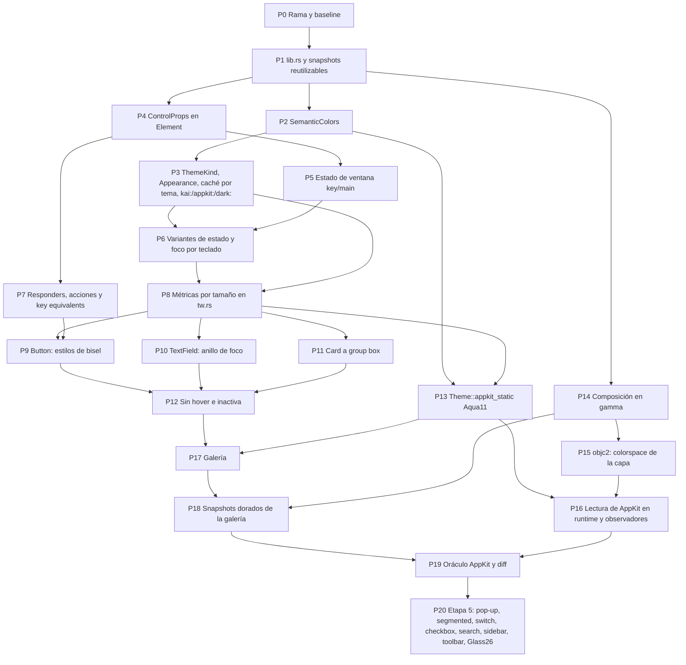

# 12 — Guía: modelo AppKit como estándar de Kai

**Tipo:** guía de desarrollo paso a paso. Complementa a [11](11-tema-appkit.md), que tiene el *qué* (medidas, colores, tipografía, procedencia); este documento tiene el *cómo* y el *en qué orden*, sobre el código actual de `kai-ui-desktop`.

> **Todo el código Rust, WGSL, Swift y TOML de esta guía es API propuesta, no existente.** Se marca con `// PROPUESTO`. Lo que ya existe se cita con su archivo y nombre real (`tw.rs::ClassList::resolve`, `layout.rs::Builder::build`, `wgpu_backend.rs::WgpuRenderer::with_device`…). Antes de aplicar un paso, confirma que la función citada sigue con la misma forma: el código cambia y aquí se citan nombres, no números de línea.

> **Valores.** Las cifras de AppKit vienen de [11](11-tema-appkit.md) con su procedencia ([A] oficial, [B-med] medido en macOS 15.6.1, [B-ext] terceros, [C] estimado, (?) dudoso). Esta guía no agrega cifras nuevas: si una no está en 11, se marca (?) y se mide en el paso del oráculo.

## Índice

- [0. Resumen y decisiones](#0-resumen-y-decisiones)
- [1. Punto de partida (código actual)](#1-punto-de-partida-código-actual)
- [2. Diagrama de dependencias de los pasos](#2-diagrama-de-dependencias-de-los-pasos)
- [3. Convenciones de cada paso](#3-convenciones-de-cada-paso)
- [Etapa 0 — Preparación](#etapa-0--preparación): Pasos 0–1
- [Etapa 1 — Modelo](#etapa-1--modelo): Pasos 2–8
- [Etapa 2 — Componentes existentes](#etapa-2--componentes-existentes): Pasos 9–12
- [Etapa 3 — Tema AppKit, generación macOS 15](#etapa-3--tema-appkit-generación-macos-15): Pasos 13–16
- [Etapa 4 — Prototipo: galería y oráculo](#etapa-4--prototipo-galería-y-oráculo): Pasos 17–19
- [Etapa 5 — Después](#etapa-5--después): Paso 20
- [Plan de migración de llamadas existentes](#plan-de-migración-de-llamadas-existentes)
- [Resolución de problemas](#resolución-de-problemas)
- [Checklist final](#checklist-final)

## 0. Resumen y decisiones

**Meta.** Que el modelo de controles de AppKit (tamaños de control, estado on/off/mixed, botón por defecto, equivalentes de teclado, ventana *key*/inactiva, cadena de *responders*, colores semánticos) sea **el modelo de Kai**, y que el tema web de Kai pase a ser **un tema más** sobre ese modelo. El resultado visible es una ventana de galería con todos los controles actuales en todos los tamaños, claro/oscuro y *key*/inactiva, comparada píxel a píxel contra AppKit nativo.

Decisiones que atraviesan toda la guía:

| # | Decisión | Por qué |
|---|---|---|
| D1 | **Tokens semánticos con nombres de AppKit** (`label`, `secondary-label`, `control-accent`, `window`, `separator`, `selection`, `focus`…) en un struct nuevo `SemanticColors`, además de `ColorTokens`. `Theme::kai` los rellena desde los tokens web; `Theme::appkit_*` desde AppKit. | Un componente escrito con tokens semánticos se ve «Kai» con el tema Kai y «Mac» con el tema AppKit, sin `if`. |
| D2 | **Resolución en parseo, invalidación por tema.** `tw.rs` sigue resolviendo colores al parsear (`Parser::color`); `layout.rs::StyleCache` guarda el `Theme` con que parseó y se vacía sola si cambia. | Cambiar a resolución diferida tocaría `Decl`, `apply` y `Style`. Con `Theme: Copy + PartialEq` la invalidación es una comparación por frame. Reabrir si un perfil muestra re-parseos caros. |
| D3 | **Variantes de tema en parseo**: `kai:`, `appkit:`, `dark:`, `light:`. El parser descarta las declaraciones que no aplican al tema con que parsea. | Una sola cadena de clases por componente sirve a los dos temas; el tema Kai ignora lo `appkit:` y viceversa. Funciona por D2. |
| D4 | **Variantes de estado en resolución**: `window-inactive:`, `keyboard-focus:`, `selected:`, `mixed:`, y por tamaño `control-mini:` … `control-xl:`. Viven en `tw.rs::State` y se calculan en `layout.rs::Builder::build`. | Igual que `hover:` hoy: dependen del nodo y del frame, no del tema. |
| D5 | **Métricas por tamaño en una declaración**: `h-control`, `rounded-control`, `px-control`, `text-control` guardan al parsear las 5 cifras del tema (`[f32; 5]`) y eligen en `apply` según `State::control_size`. | El tamaño se hereda por el árbol (como `.controlSize()` de SwiftUI) y no se conoce al parsear. |
| D6 | **`ControlProps` en `Element`**: `control_size`, `state`, `is_default`, `key_equivalent`. `enabled` sigue siendo `!disabled` y `is_pressed` queda como alias de `state == On`. | Lo que NSControl tiene en común, sin heredar clases. |
| D7 | **Cadena de responders** derivada del foco: elemento con foco → ancestros → ventana → app (registro de comandos de [09](09-framework-y-plataforma.md)). Los equivalentes de teclado se buscan **antes** (como `performKeyEquivalent`). | Mismo orden que AppKit; prepara el `CommandRegistry` de 09 sin implementarlo. |
| D8 | **Composición en gamma** para **todos** los temas: superficie `Bgra8Unorm` (sin sufijo sRGB), glyphon en `ColorMode::Web`, colores sin linealizar (`build_instances(.., linear: false, ..)`). Es el único paso que cambia a propósito las capturas del tema Kai, con re-baseline explícita (Paso 14). | AppKit/Core Animation mezclan sobre valores sRGB codificados ([11](11-tema-appkit.md) 4.4) y **los navegadores también**, así que el tema Kai se acerca a kai-ui-web en vez de alejarse. Un solo camino de render. |
| D9 | **Lectura de AppKit en runtime con *fallback* estático**: `Theme::appkit_static(..)` (tablas de 11) siempre existe; `Theme::appkit(..)` en macOS la sobrescribe con lo leído vía `objc2-app-kit`. | Tests y CI Linux sin AppKit; la app real sigue al sistema. |
| D10 | **Primero la generación macOS 15 (`Aqua11`)**, que coincide con las métricas compactas de 26+ (`prefersCompactControlSizeMetrics`). Glass26/27 es la etapa 5. | Es lo que está medido [B-med]. |

**Fuera de alcance** de las etapas 0–4: pop-up, segmented, checkbox, radio, search field, sidebar, toolbar y Glass26/27 (todo en la etapa 5, Paso 20), animaciones, vibrancy/materiales y menús nativos.

## 1. Punto de partida (código actual)

Lo que hay hoy y qué paso lo toca:

| Pieza | Archivo · nombre | Estado hoy | Pasos |
|---|---|---|---|
| Tema | `theme.rs` · `Theme { density, colors, space, typography, controls }`, `Theme::kai(Density)`, `Theme::color(&str)` | Solo tokens web; `Copy + PartialEq`; sin apariencia ni tipo de tema | 2, 3, 13 |
| Clases | `tw.rs` · `State` (7 bools), `Variant`, `VARIANT_ORDER` (8), `Decl`, `ClassList::{parse, resolve}`, `Parser::{keyword, color, …}` | Colores resueltos al parsear; `ring` = 3; `h-control` fijo por densidad | 3, 6, 7, 8 |
| Caché | `layout.rs` · `StyleCache::get(classes, theme)` | Clave = cadena; **no** se invalida al cambiar de tema («Clear it when the theme changes») | 3 |
| Estilo | `style.rs` · `Style`, `Ring { width, offset, color: Option<Color> }`, `radius: f32` uniforme | Sin cambios de forma salvo lo indicado | 6, 8 |
| Árbol | `element.rs` · `Element<Msg>` (`disabled`, `is_pressed`, `focus_on_press`, `handlers`…), `Kind`, `Role`, `FocusOrder`, `FocusKind::{Button, TextField}` | Sin tamaño, estado tri, default ni equivalente | 4, 7 |
| Layout | `layout.rs` · `Interaction { hovered, focused, pressed }`, `Builder::build` arma `State`, `Inherited` | Sin ventana ni foco por teclado | 5, 6 |
| Motor | `ui_engine.rs` · `Intent`, `Command` (interno), `UiModel { focused, pressed, activation_count }`, `dispatch`, `key_commands`, `text_key_commands`, `Key` | Enter/Espacio activan botones; Cmd+A/C/X/V fijos; no hay `Escape` en `Key` | 6, 7 |
| Runtime | `runtime.rs` · `App { title, update, view }`, `run(app, theme)`, `WindowState`, `relayout`, `render`, `WindowEvent::Focused` solo cancela puntero/IME | Tema fijo por sesión; `EventLoopProxy<accesskit_winit::Event>` | 5, 15, 16 |
| Paint | `render/paint.rs` · `PaintInput { layout, theme, focused, text_fields }`, `decorations` (sombra, anillo, fondo, borde), `input_contents` (selección `primary` α 71, caret con color de texto), `scrollbar` | Colores por defecto desde `theme.colors.*` | 2, 5, 10 |
| GPU | `render/wgpu_backend.rs` · `WgpuRenderer::{new, new_offscreen, with_device, render, render_to_rgba}`, `build_instances(.., linear, ..)`, `linear_target: format.is_srgb()`; `TextAtlas::new` | Mezcla en lineal en superficie sRGB; offscreen `Rgba8UnormSrgb` | 14, 15 |
| Shader | `quad.wgsl` · `fs_main`, `rounded_box`, `premultiply` | Premultiplica en el shader; agnóstico del espacio | 14 (sin cambios de lógica) |
| Texto | `fonts.rs` · `ui_font_family()` = `.AppleSystemUIFont`; `render/text.rs` · `TextStyle { font_size, line_height, weight, wrap }` | Sin *tracking*; cosmic-text 0.19 **sí** tiene `Attrs::letter_spacing(em)` | 13, 16 |
| A11y | `a11y.rs` · `role_of`, `emit` (`is_pressed` → `Toggled::True`) | Sin `Mixed` ni default | 4 |
| Demo y capturas | `main.rs` · `Demo`, tests `snapshot(..)`, `bmp(..)`, `snapshot_demo` (`#[ignore]`, escribe `target/snapshots/*.bmp`) | El crate es **solo binario** (no hay `lib.rs`), así que `examples/` no puede usarlo | 0, 1, 17 |
| Componentes | `components.rs` · `BUTTON_BASE`, `button_classes`, `button`, `button_sized`, `TextField::build`, `card`, `switch_with_options`, `icon_button_sized`… | Clases web | 9–12 |

Dependencias relevantes (`Cargo.toml`/`Cargo.lock`): `wgpu 30.0.1` (expone `SurfaceConfiguration::color_space` y `SurfaceColorSpace`), `glyphon 0.12.0` (expone `TextAtlas::with_color_mode` y `ColorMode::{Accurate, Web}`), `cosmic-text 0.19.0`, `winit 0.30.12`, `accesskit 0.25.1`. En el lock ya están `objc2 0.6.5`, `objc2-app-kit 0.3.2`, `objc2-foundation 0.3.2`, `objc2-quartz-core 0.3.2` y `png 0.18.1` como transitivas: **usar esas mismas versiones** al declararlas para no duplicar crates.

> **Corrección a [11](11-tema-appkit.md) 3.1:** allí se dice que cosmic-text 0.19 no aplica *tracking*. `cosmic_text::Attrs::letter_spacing(f32)` existe en 0.19.0 (en *em*). El Paso 13 lo usa. Conviene corregir esa frase en 11 al aplicar el Paso 13.

## 2. Diagrama de dependencias de los pasos



Caminos paralelos posibles: {P4, P5, P7} con {P2, P3}; P14 en cualquier momento después de P1.

## 3. Convenciones de cada paso

- **Gate** (el de [README](README.md)) al final de **cada** paso, desde `kai-ui-desktop/`:

```sh
cargo fmt --check
cargo check --all-targets
cargo test
cargo clippy --all-targets -- -D warnings
```

- **Capturas** (necesitan GPU, macOS): `cargo test -- --ignored snapshot_` y, desde el Paso 18, `cargo test -- --ignored golden_`.
- **Sin regresión del tema Kai:** en todos los pasos las capturas del tema Kai deben quedar **idénticas** a la baseline vigente (diff 0). La única excepción es el Paso 14 (composición en gamma), que genera una baseline nueva a propósito.
- **Commits pequeños**, uno por paso salvo que se indique, con el prefijo `desktop:` del historial (`69c9e31 desktop: arquitectura Elm…`).
- **Revertir:** cada paso es un commit; `git revert <sha>` deshace el paso sin tocar los demás, salvo dependencias del diagrama (revertir en orden inverso).
- Cada paso tiene: **Objetivo**, **Archivos**, **Cambios**, **Tests**, **Comandos**, **Terminado cuando**, **Riesgos y reversión**, **Commit**.

---
## Etapa 0 — Preparación

### Paso 0 — Rama y baseline de capturas

**Objetivo.** Partir de un árbol limpio y congelar cómo se ve hoy la demo, para detectar cualquier cambio visual no buscado.

**Archivos.**
- Crear `scripts/snapshot-baseline.sh`.
- Crear `snapshots/baseline/` (ignorado por git, ver abajo) o, si se prefiere versionar, `snapshots/golden/kai/`.
- Modificar `.gitignore` (raíz del paquete): `snapshots/baseline/`.

**Cambios.**

1. Guardar o commitear los cambios en curso de `src/` antes de crear la rama: esta guía asume que `main` compila y pasa el gate.

```sh
git switch -c appkit-model
cargo fmt --check && cargo check --all-targets && cargo test && cargo clippy --all-targets -- -D warnings
```

2. Script de baseline (PROPUESTO):

```sh
#!/usr/bin/env bash
# PROPUESTO — scripts/snapshot-baseline.sh
# Genera las capturas actuales (snapshot_demo) y las copia como baseline.
set -euo pipefail
cd "$(dirname "$0")/.."
cargo test -- --ignored snapshot_demo
mkdir -p snapshots/baseline
cp target/snapshots/*.bmp snapshots/baseline/
shasum -a 256 snapshots/baseline/*.bmp > snapshots/baseline/SHA256SUMS
echo "Baseline en snapshots/baseline ($(ls snapshots/baseline/*.bmp | wc -l) imágenes)"
```

3. Registrar en el commit la máquina y versión del sistema (`sw_vers`, modelo de GPU que imprime `WgpuRenderer::new`: «Adaptador GPU: …»). Las capturas dependen de la GPU y del *rasterizado* de fuentes.

**Tests.** Ninguno nuevo. `snapshot_demo` (en `main.rs`) produce hoy `demo-idle`, `demo-interaction`, `demo-narrow`, `demo-variants-focus`, `demo-fields` y `demo-fields-focus`.

**Comandos.**

```sh
chmod +x scripts/snapshot-baseline.sh && scripts/snapshot-baseline.sh
shasum -a 256 -c snapshots/baseline/SHA256SUMS   # repetir: debe dar OK (determinismo)
```

**Terminado cuando.**
- [ ] Rama `appkit-model` creada y gate en verde.
- [ ] Dos corridas seguidas de `snapshot_demo` dan los mismos SHA-256 (si no, ver «Capturas no deterministas» en [Resolución de problemas](#resolución-de-problemas)).

**Riesgos y reversión.** Ninguno en código. Si las capturas no son deterministas, el resto de la guía usa diff con tolerancia (Paso 1) en lugar de SHA.

**Commit.** `desktop: script de baseline de capturas para el modelo AppKit`

### Paso 1 — `lib.rs` y capturas reutilizables

**Objetivo.** Poder escribir `examples/gallery.rs` y tests de captura que usen el crate como librería, y sacar `snapshot`/`bmp` de `main.rs` para reutilizarlos. Es el inicio de F0 de [09](09-framework-y-plataforma.md) (sección 12), sin renombrar el paquete.

**Archivos.**
- Crear `src/lib.rs`.
- Modificar `src/main.rs` (quita los `mod`, usa el crate).
- Crear `src/snapshot.rs`.
- Modificar `Cargo.toml` (`[lib]`, `[[example]]`, `png`).

**Cambios.**

1. `Cargo.toml` (PROPUESTO):

```toml
# PROPUESTO
[lib]
name = "kai"            # nombre corto para `use kai::...`; el paquete sigue siendo kai-ui-desktop-prototype
path = "src/lib.rs"

[[bin]]
name = "kai-ui-desktop-prototype"
path = "src/main.rs"

[features]
snapshots = ["dep:png"]   # habilita kai::snapshot fuera de los tests

[dependencies]
png = { version = "0.18", optional = true }   # ya está en Cargo.lock (0.18.1)

[dev-dependencies]
png = "0.18"
```

2. `src/lib.rs` (PROPUESTO): mueve las declaraciones `pub mod …` que hoy están al inicio de `main.rs` (`a11y`, `components`, `fonts`, `element`, `geometry`, `grid_layout`, `icons`, `layout`, `platform_adapter`, `render`, `runtime`, `signal`, `style`, `text_field`, `theme`, `tw`, `ui_engine`, `version`). `element` hoy es `mod element;` (privado) y `main.rs` lo usa: en `lib.rs` pasa a `pub mod element;`.

```rust
// PROPUESTO — src/lib.rs
pub mod a11y;
pub mod components;
pub mod element;
pub mod fonts;
pub mod geometry;
pub mod grid_layout;
pub mod icons;
pub mod layout;
pub mod platform_adapter;
pub mod render;
pub mod runtime;
pub mod signal;
pub mod style;
pub mod text_field;
pub mod theme;
pub mod tw;
pub mod ui_engine;
pub mod version;
#[cfg(any(test, feature = "snapshots"))]
pub mod snapshot;
```

3. `src/main.rs`: reemplazar `mod …` por `use kai::{components::…, element::…, runtime::App, theme::…}`. Los tests de `main.rs` que usan `crate::element::sample` deben pasar a `kai::element::sample`, que hoy es `#[cfg(test)]`: cambiarlo a `#[cfg(any(test, feature = "snapshots"))] pub mod sample` o mover esos tests a `src/` (preferible: los tests de la demo siguen en `main.rs`, los de `sample` en sus módulos).

4. `src/snapshot.rs` (PROPUESTO): extrae `snapshot(..)` y `bmp(..)` de `main.rs::tests` y agrega PNG y diff.

```rust
// PROPUESTO — src/snapshot.rs
use crate::element::Element;
use crate::geometry::Size;
use crate::layout::{Interaction, ScrollOffsets};
use crate::theme::Theme;

pub struct Shot<'a, Msg> {
    pub tree: &'a Element<Msg>,   // con ids asignados (runtime::build_view)
    pub theme: &'a Theme,
    pub logical: Size,
    pub scale: f32,               // 2.0 en todas las capturas doradas
    pub interaction: &'a Interaction,
    pub scroll: &'a ScrollOffsets,
}

pub struct Image { pub width: u32, pub height: u32, pub rgba: Vec<u8> }

/// Layout con texto real + paint + render offscreen, igual que `runtime::WindowState::render`
/// (incluye los TextFieldState de cada input, como hace hoy main.rs::tests::snapshot).
pub fn render<Msg>(shot: &Shot<'_, Msg>) -> Result<Image, String>;

pub fn write_bmp(path: &std::path::Path, image: &Image) -> std::io::Result<()>;
pub fn write_png(path: &std::path::Path, image: &Image) -> std::io::Result<()>;
pub fn read_png(path: &std::path::Path) -> std::io::Result<Image>;

#[derive(Debug)]
pub struct Diff {
    pub max_channel: u8,          // mayor |a-b| por canal
    pub differing: usize,         // píxeles con algún canal > tolerance
    pub ratio: f32,               // differing / total
}
pub fn diff(a: &Image, b: &Image, tolerance: u8) -> Diff;
/// Imagen roja donde difieren, para revisar a ojo.
pub fn diff_image(a: &Image, b: &Image, tolerance: u8) -> Image;
```

`render` crea un `WgpuRenderer::new_offscreen` por llamada, como hoy. Si se vuelve lento con la galería (Paso 18), cachear el renderer por tamaño en un `thread_local!`.

**Tests.**
- `snapshot::tests::diff_counts_pixels_over_tolerance` (CPU, sin GPU): dos imágenes 2×2 que difieren en 1 canal por 3 → con `tolerance = 2`, `differing == 1`.
- `snapshot::tests::png_round_trip` (CPU).
- `main.rs::tests::snapshot_demo` sigue igual pero llama a `kai::snapshot::render` + `write_bmp`.

**Comandos.**

```sh
cargo check --all-targets && cargo test
cargo test -- --ignored snapshot_demo
shasum -a 256 -c snapshots/baseline/SHA256SUMS      # deben coincidir con el Paso 0
cargo run                                            # la demo abre igual
```

**Terminado cuando.**
- [ ] `cargo run` abre la demo igual que antes.
- [ ] `snapshot_demo` reproduce la baseline del Paso 0 (SHA iguales, o `diff` con `differing == 0`).
- [ ] `cargo doc --no-deps` compila sin warnings nuevos.

**Riesgos y reversión.**
- Visibilidad: lo que era privado del binario (`mod element`) pasa a público; aceptable en un prototipo, se revisa en F0 de 09.
- `dead_code` de clippy en funciones que solo usaba `main.rs`: ahora son públicas de la lib y no avisan. No agregar `#[allow]`.
- Revertir: `git revert`; no hay cambios de comportamiento.

**Commit.** `desktop: lib.rs y módulo snapshot reutilizable (PNG, diff)`

---

## Etapa 1 — Modelo

### Paso 2 — Tokens semánticos (`SemanticColors`)

**Objetivo.** Introducir los colores con nombre de AppKit como capa semántica del tema. `Theme::kai` los deriva de los tokens web **sin cambiar ningún píxel**.

**Archivos.** Modificar `src/theme.rs`, `src/render/paint.rs`.

**Cambios.**

1. `theme.rs` (PROPUESTO). Los nombres siguen la tabla 4.2 de [11](11-tema-appkit.md):

```rust
// PROPUESTO — src/theme.rs
/// Colores con el significado de NSColor. Todos los temas los rellenan;
/// los componentes nuevos solo usan estos.
#[derive(Clone, Copy, Debug, PartialEq)]
pub struct SemanticColors {
    // Texto
    pub label: Color,                    // labelColor
    pub secondary_label: Color,          // secondaryLabelColor
    pub tertiary_label: Color,           // tertiaryLabelColor
    pub quaternary_label: Color,         // quaternaryLabelColor
    pub placeholder: Color,              // placeholderTextColor
    pub control_text: Color,             // controlTextColor
    pub disabled_control_text: Color,    // disabledControlTextColor
    pub on_accent: Color,                // alternateSelectedControlTextColor
    pub link: Color,                     // linkColor
    // Superficies
    pub window_background: Color,        // windowBackgroundColor
    pub under_page: Color,               // underPageBackgroundColor
    pub control_background: Color,       // controlBackgroundColor
    pub text_background: Color,          // textBackgroundColor (campos)
    pub control: Color,                  // controlColor (bisel)
    pub control_pressed: Color,          // controlColor .pressed
    // Acento y selección
    pub control_accent: Color,           // controlAccentColor
    pub accent_pressed: Color,           // acento .pressed
    pub accent_disabled: Color,          // acento .disabled
    pub selected_content: Color,         // selectedContentBackgroundColor
    pub selected_content_inactive: Color,// unemphasizedSelectedContentBackgroundColor
    pub text_selection: Color,           // selectedTextBackgroundColor
    pub text_selection_inactive: Color,  // unemphasizedSelectedTextBackgroundColor
    pub focus_ring: Color,               // keyboardFocusIndicatorColor
    pub caret: Color,                    // textInsertionPointColor
    // Líneas y rellenos
    pub separator: Color,                // separatorColor
    pub grid: Color,                     // gridColor
    pub fill: [Color; 5],                // systemFill … quinarySystemFill
    // Estado de ventana inactiva (no son NSColor: medidos en 11 §6.2)
    pub switch_on_inactive: Color,       // pista encendida en ventana inactiva (#b8b8b8)
}
```

2. `Theme` gana el campo `pub semantic: SemanticColors` (sigue siendo `Copy`). `Theme::kai` lo arma desde `ColorTokens` para que cada uso actual mantenga su color:

```rust
// PROPUESTO — src/theme.rs
fn kai_semantic(c: &ColorTokens) -> SemanticColors {
    SemanticColors {
        label: c.foreground,
        secondary_label: c.text_secondary,
        tertiary_label: c.text_disabled,
        quaternary_label: c.border,
        placeholder: c.muted_foreground,          // = default de paint.rs::input_contents
        control_text: c.foreground,
        disabled_control_text: c.text_disabled,
        on_accent: c.text_on_primary,
        link: c.primary,
        window_background: c.background,          // = clear de paint.rs::paint
        under_page: c.neutral,
        control_background: c.surface,
        text_background: c.background,
        control: c.background,
        control_pressed: c.active,
        control_accent: c.primary,
        accent_pressed: c.active,
        accent_disabled: c.primary.with_alpha(128),
        selected_content: c.primary,
        selected_content_inactive: c.neutral,
        text_selection: c.primary.with_alpha(71), // = paint.rs::input_contents hoy
        text_selection_inactive: c.neutral,
        focus_ring: c.primary.with_alpha(128),    // = default de paint.rs::decorations hoy
        caret: c.foreground,
        separator: c.border,                      // = default de border_color hoy
        grid: c.border,
        fill: [c.muted, c.muted, c.neutral, c.neutral, c.surface],
        switch_on_inactive: c.primary,            // Kai no atenúa
    }
}
```

> **Ojo:** el caret hoy se pinta con el color del texto del input (`text_color` en `paint.rs::input_contents`), no con `foreground`. Para no cambiar píxeles, el Paso 2 solo introduce `caret`; `input_contents` lo usa a partir del Paso 10 y solo con el tema AppKit (en Kai, `caret` = color de texto).

3. `Theme::color(name)` acepta los nombres nuevos, en *kebab-case* (los de 11.3): `label`, `secondary-label`, `tertiary-label`, `quaternary-label`, `placeholder`, `control-text`, `disabled-control-text`, `on-accent`, `link`, `window`, `under-page`, `control-background`, `field` (= `text_background`), `control`, `control-pressed`, `control-accent`, `accent-pressed`, `accent-disabled`, `selection`, `selection-inactive`, `text-selection`, `text-selection-inactive`, `focus`, `caret`, `separator`, `grid`, `fill`, `fill-2` … `fill-5`. Los nombres actuales no cambian.

4. `paint.rs`: sustituir los tres valores por defecto por los semánticos (mismo color en Kai):
   - `paint`: `.unwrap_or(input.theme.colors.background)` → `.unwrap_or(input.theme.semantic.window_background)`.
   - `decorations`: `ring.color.unwrap_or(colors.primary.with_alpha(128))` → `unwrap_or(theme.semantic.focus_ring)`; `style.border_color.unwrap_or(colors.border)` → `unwrap_or(theme.semantic.separator)`.
   - `input_contents`: selección `theme.colors.primary.with_alpha(71)` → `theme.semantic.text_selection`; placeholder `theme.colors.muted_foreground` → `theme.semantic.placeholder`.
   - `scrollbar`: `muted_foreground.with_alpha(153)` se deja (AppKit dibuja su propio *scroller*; ver Paso 20).

**Tests** (en `theme.rs::tests`).
- `kai_semantic_matches_current_defaults`: `semantic.focus_ring == colors.primary.with_alpha(128)`, `text_selection == primary.with_alpha(71)`, `separator == border`, `window_background == background`.
- `semantic_names_resolve`: cada nombre del punto 3 da `Some(_)` en `Theme::kai(Comfortable)`; uno inexistente da `None`.
- `paint.rs::tests` existentes deben pasar sin cambios.

**Comandos.** Gate + `cargo test -- --ignored snapshot_demo` + diff contra baseline.

**Terminado cuando.**
- [ ] Gate verde; `every_component_class_is_supported` y `demo_uses_only_supported_classes_and_fills_the_window` en verde.
- [ ] Capturas idénticas a la baseline.
- [ ] `grep -n "colors.primary.with_alpha\|colors.border)" src/render/paint.rs` no encuentra nada.

**Riesgos y reversión.** Riesgo bajo (solo nombres). Si una captura cambia, algún valor de `kai_semantic` no es el que `paint.rs` usaba: compararlo con el `git diff` de `paint.rs`. Revertir con `git revert`.

**Commit.** `desktop: tokens semánticos con nombres de AppKit (SemanticColors)`

### Paso 3 — Tipo de tema, apariencia, caché por tema y variantes de tema

**Objetivo.** Que el `Theme` sepa qué es (`Kai` o `AppKit`) y en qué apariencia está, que `StyleCache` se invalide sola al cambiar de tema y que las clases puedan decir `appkit:`, `kai:`, `dark:` y `light:`.

**Archivos.** Modificar `src/theme.rs`, `src/tw.rs`, `src/layout.rs`.

**Cambios.**

1. `theme.rs` (PROPUESTO; tipos de 11.1, simplificados a lo que usan las etapas 0–4):

```rust
// PROPUESTO — src/theme.rs
#[derive(Clone, Copy, Debug, PartialEq, Eq)]
pub enum ThemeKind { Kai, AppKit(AppKitGeneration) }

#[derive(Clone, Copy, Debug, PartialEq, Eq)]
pub enum AppKitGeneration { Aqua11, Glass26, Glass27 }

#[derive(Clone, Copy, Debug, Default, PartialEq, Eq)]
pub enum Appearance { #[default] Light, Dark }   // Aumentar contraste: Paso 16

pub struct Theme {
    pub kind: ThemeKind,
    pub appearance: Appearance,
    pub density: Density,
    pub colors: ColorTokens,
    pub semantic: SemanticColors,
    pub space: SpaceTokens,
    pub typography: TypeTokens,
    pub controls: ControlTokens,     // se amplía en el Paso 8
    pub prefs: SystemPrefs,          // Paso 6
}

impl Theme {
    pub fn is_appkit(&self) -> bool { matches!(self.kind, ThemeKind::AppKit(_)) }
}
```

`Theme::kai(density)` fija `kind: ThemeKind::Kai, appearance: Light`. (Un `Theme::kai_dark` queda fuera: la web no tiene tokens oscuros publicados.)

2. `layout.rs::StyleCache` (PROPUESTO): recordar el tema.

```rust
// PROPUESTO — src/layout.rs
#[derive(Default)]
pub struct StyleCache {
    lists: HashMap<String, ClassList>,
    theme: Option<Theme>,
}

impl StyleCache {
    pub fn get(&mut self, classes: &str, theme: &Theme) -> &ClassList {
        if self.theme.as_ref() != Some(theme) {
            self.lists.clear();
            self.theme = Some(*theme);
        }
        // … igual que hoy
    }
}
```

Coste: una comparación de `Theme` (~unos cientos de bytes) por llamada a `get`. Si el *bench* (`bench_layout_and_paint`) sube más de un 5 %, cambiar a un `theme_revision: u64` calculado una vez por frame en `runtime.rs::relayout`.

3. `tw.rs` (PROPUESTO): variantes de tema, evaluadas al parsear.

```rust
// PROPUESTO — src/tw.rs
/// Condición sobre el tema; se evalúa en `ClassList::parse`, no en `resolve`.
#[derive(Clone, Copy, Debug, PartialEq, Eq)]
enum ThemeVariant { Kai, AppKit, Dark, Light }

impl ThemeVariant {
    fn parse(prefix: &str) -> Option<Self> {
        Some(match prefix { "kai" => Self::Kai, "appkit" => Self::AppKit,
                            "dark" => Self::Dark, "light" => Self::Light, _ => return None })
    }
    fn holds(self, theme: &Theme) -> bool {
        match self {
            Self::Kai => !theme.is_appkit(),
            Self::AppKit => theme.is_appkit(),
            Self::Dark => theme.appearance == Appearance::Dark,
            Self::Light => theme.appearance == Appearance::Light,
        }
    }
}
```

En `ClassList::parse`, al separar prefijos de una clase (`appkit:hover:bg-control`), consumir **primero** los prefijos de tema (pueden ser varios: `appkit:dark:`); si alguno no se cumple, la clase se descarta **sin** contarla como desconocida. Después sigue el `Variant::parse` actual. El orden admitido es `[tema…]:[estado]:utilidad`; un prefijo de tema después de uno de estado (`hover:appkit:x`) es clase desconocida.

**Tests** (`tw.rs::tests`).
- `theme_variants_filter_at_parse_time`: con `Theme::kai`, `"kai:bg-primary appkit:bg-error"` resuelve `background = primary`; con un `Theme { kind: AppKit(Aqua11), ..Theme::kai(..) }` resuelve `error`. Ninguna clase va a `unknown`.
- `stacked_theme_variants`: `"appkit:dark:text-label"` solo aplica con AppKit + Dark.
- `theme_variant_after_state_is_unknown`: `"hover:appkit:bg-primary"` → `unknown`.
- `layout.rs::tests::style_cache_clears_on_theme_change`: `get("bg-label", &kai)` y luego con otro tema da otro color.

**Comandos.** Gate + capturas.

**Terminado cuando.**
- [ ] Gate verde, capturas Kai idénticas.
- [ ] El comentario «Clear it when the theme changes» de `StyleCache` ya no aplica y se actualiza.

**Riesgos y reversión.**
- Cadenas de clases más largas en componentes (Pasos 9–12). Mitigación: constantes `const` por componente y tema, como `BUTTON_BASE`.
- kai-ui-web no conoce `kai:`/`appkit:`. Si alguna vez se comparten cadenas con la web, agregar allí variantes Tailwind equivalentes (`@custom-variant appkit (...)`) o filtrar en el generador. Hoy no se comparten.
- Revertir: `git revert`.

**Commit.** `desktop: ThemeKind, Appearance, caché de estilos por tema y variantes kai:/appkit:/dark:/light:`

### Paso 4 — Propiedades de control (`ControlProps`)

**Objetivo.** Dar a todo control las propiedades comunes de NSControl: tamaño, estado on/off/mixed, habilitado, botón por defecto y equivalente de teclado; heredar el tamaño por el árbol.

**Archivos.** Modificar `src/element.rs`, `src/layout.rs`, `src/a11y.rs`, `src/ui_engine.rs` (solo `Key`), `src/platform_adapter.rs` (mapear teclas nuevas).

**Cambios.**

1. `element.rs` (PROPUESTO):

```rust
// PROPUESTO — src/element.rs
#[derive(Clone, Copy, Debug, Default, PartialEq, Eq, Hash)]
pub enum ControlSize { Mini, Small, #[default] Regular, Large, ExtraLarge }

impl ControlSize {
    pub const ALL: [ControlSize; 5] =
        [Self::Mini, Self::Small, Self::Regular, Self::Large, Self::ExtraLarge];
    pub const fn index(self) -> usize { self as usize }
}

/// NSControl.StateValue
#[derive(Clone, Copy, Debug, Default, PartialEq, Eq)]
pub enum ControlState { #[default] Off, On, Mixed }

/// Atajo que activa el control aunque no tenga foco (keyEquivalent).
#[derive(Clone, Copy, Debug, PartialEq, Eq)]
pub struct KeyEquivalent { pub key: Key, pub modifiers: Modifiers }

impl KeyEquivalent {
    pub const RETURN: Self = Self { key: Key::Enter, modifiers: Modifiers::NONE };
    pub const ESCAPE: Self = Self { key: Key::Escape, modifiers: Modifiers::NONE };
    pub const fn cmd(key: Key) -> Self { /* command: true */ }
}

#[derive(Clone, Copy, Debug, Default, PartialEq, Eq)]
pub struct ControlProps {
    /// `None` = heredar del ancestro más cercano que lo fije (raíz: Regular).
    pub size: Option<ControlSize>,
    /// `None` = el control no es de dos/tres estados.
    pub state: Option<ControlState>,
    /// Botón por defecto de la ventana: Retorno lo activa (keyEquivalent "\r").
    pub is_default: bool,
    pub key_equivalent: Option<KeyEquivalent>,
}
```

`Element` gana `pub control: ControlProps` y builders:

```rust
// PROPUESTO — src/element.rs, impl<Msg> Element<Msg>
pub fn control_size(mut self, size: ControlSize) -> Self { self.control.size = Some(size); self }
pub fn state(mut self, state: ControlState) -> Self { self.control.state = Some(state); self }
pub fn default_button(mut self, on: bool) -> Self {
    self.control.is_default = on;
    if on { self.control.key_equivalent.get_or_insert(KeyEquivalent::RETURN); }
    self
}
pub fn cancel_button(self) -> Self { self.key_equivalent(KeyEquivalent::ESCAPE) }
pub fn key_equivalent(mut self, key: KeyEquivalent) -> Self {
    self.control.key_equivalent = Some(key); self
}
pub fn enabled(self, enabled: bool) -> Self { self.disabled(!enabled) }
```

`Element::pressed(bool)` (hoy fija `is_pressed`) pasa a ser azúcar de `state(if on { On } else { Off })` y `is_pressed` se calcula: `self.control.state == Some(ControlState::On)`. Así `switch_with_options` y `a11y.rs` siguen funcionando.

2. `ui_engine.rs::Key`: agregar `Escape` y `Period` (para Cmd+. = cancelar), y en `Modifiers` una constante `NONE` y el campo `option: bool` (lo pide F0 de 09 para navegación por palabra). `platform_adapter.rs::adapt_keyboard_event` mapea `NamedKey::Escape` y `.`.

3. `layout.rs`: `Inherited` gana `control_size: ControlSize`; en `Builder::build`, `let control_size = element.control.size.unwrap_or(inherited.control_size);` y se propaga a los hijos. `LayoutNode` gana `control_size: ControlSize`, `control_state: Option<ControlState>`, `is_default: bool`.

4. `a11y.rs::emit`: `control_state` → `Toggled::{False, True, Mixed}` (hoy solo `is_pressed` → `True`). `is_default`: AccessKit 0.25 no tiene una propiedad «default button» (?); se expone en la descripción solo si un lector lo necesita (verificar con VoiceOver en el Paso 19). `key_equivalent` → `node.set_keyboard_shortcut("⌘S")` si AccessKit 0.25 la tiene (?); si no, omitir.

**Tests.**
- `element.rs::tests::control_size_is_inherited`: `div().control_size(Small).child(button)` → el `LayoutNode` del botón tiene `Small`; sin ancestro, `Regular`.
- `element.rs::tests::default_button_sets_return_equivalent`.
- `element.rs::tests::pressed_maps_to_state_on` (compatibilidad).
- `a11y.rs::tests`: estado `Mixed` publica `Toggled::Mixed`; el test actual del *toggle* (`toggle.toggled() == Some(Toggled::True)`) sigue en verde.
- `platform_adapter.rs::tests`: Escape produce `Key::Escape`.

**Comandos.** Gate + capturas (sin cambios visuales).

**Terminado cuando.**
- [ ] Gate verde, capturas idénticas.
- [ ] Ningún componente usa todavía `control_size` (eso empieza en el Paso 9).

**Riesgos y reversión.**
- `Element` crece; es `Debug` y no `Clone`, no afecta. `FocusOrder::from_tree` no cambia.
- `KeyEquivalent` usa `ui_engine::Key`: dependencia `element → ui_engine`. Si molesta, mover `Key`/`Modifiers` a un `keys.rs` común.
- Revertir: `git revert` (después de revertir 7, 9 y 12, que usan estas props).

**Commit.** `desktop: ControlProps (tamaño, estado, default, key equivalent) heredables`

### Paso 5 — Estado de ventana *key* / *main* propagado al árbol

**Objetivo.** Que cada nodo sepa si su ventana es la *key window* (recibe teclado) y la *main window*, y que la app esté activa, para atenuar como AppKit cuando la ventana pierde el foco.

**Archivos.** Modificar `src/layout.rs`, `src/runtime.rs`, `src/render/paint.rs`.

**Cambios.**

1. `layout.rs` (PROPUESTO):

```rust
// PROPUESTO — src/layout.rs
/// NSWindow.isKeyWindow / isMainWindow. Con una sola ventana, key == main == app activa.
#[derive(Clone, Copy, Debug, PartialEq, Eq)]
pub struct WindowActivity { pub key: bool, pub main: bool }

impl Default for WindowActivity {
    fn default() -> Self { Self { key: true, main: true } }   // tests y capturas: activa
}
impl WindowActivity {
    pub const INACTIVE: Self = Self { key: false, main: false };
    /// AppKit atenúa acentos cuando la ventana no es key **ni** main.
    pub fn is_inactive(self) -> bool { !self.key && !self.main }
}

pub struct Interaction {
    pub hovered: Vec<WidgetId>,
    pub focused: Option<WidgetId>,
    pub pressed: Option<WidgetId>,
    pub window: WindowActivity,         // NUEVO
    pub focus_visible: bool,            // NUEVO, Paso 6
}
```

Con una sola ventana (hoy), `key == main` siempre. La distinción importa con hojas y paneles (`NSPanel` *key* sin ser *main*): cuando lleguen varias ventanas ([09](09-framework-y-plataforma.md) §7), la ventana *main* que no es *key* **no** se atenúa por completo (la selección pasa a *unemphasized*, pero el botón por defecto conserva el acento (?)). Medirlo con el oráculo antes de modelarlo; hasta entonces `is_inactive()` = no *key* y no *main*.

2. `runtime.rs::WindowState` gana `window: WindowActivity`. En `window_event`:
   - `WindowEvent::Focused(false)`: además de lo que hace hoy (cancelar puntero, IME), `state.window = WindowActivity::INACTIVE` y `request_redraw()`.
   - `WindowEvent::Focused(true)`: `state.window = WindowActivity::default()` y `request_redraw()`.
   - `relayout` pasa `window: self.window` en `Interaction`.
   - No hace falta re-ejecutar `view`: el cambio es de estado de variantes, igual que `hover`.

3. `paint.rs::PaintInput` gana `window: WindowActivity`. Usos:
   - `input_contents`: selección `semantic.text_selection` si activa, `semantic.text_selection_inactive` si no. El caret no se dibuja con la ventana inactiva (AppKit lo oculta).
   - Nada más: el resto se expresa con la variante `window-inactive:` (Paso 6).

**Tests.**
- `layout.rs::tests::window_activity_defaults_to_active`.
- `paint.rs::tests::inactive_window_hides_caret_and_dims_selection`: un input enfocado con selección; con `WindowActivity::INACTIVE` no hay `fill_rect` del caret y la selección usa `text_selection_inactive`.
- `runtime.rs`: sin test de ventana real (requiere winit); cubrir con la galería (Paso 17).

**Comandos.** Gate + capturas (sin cambios con la ventana activa).

**Terminado cuando.**
- [ ] Al pasar a otra app con `cargo run`, el caret del campo enfocado desaparece y la selección se vuelve gris (con el tema Kai, `text_selection_inactive` = `neutral`).
- [ ] Capturas Kai idénticas (todas usan `Interaction::default()`, activa).

**Riesgos y reversión.**
- winit 0.30 manda `Focused(false)` también al abrir un menú contextual del sistema o el panel de emojis (?): verificar en la galería que no parpadee. Si molesta, ignorar `Focused(false)` cuando el IME está activo.
- Revertir: `git revert`.

**Commit.** `desktop: estado key/main de la ventana en Interaction y paint`

### Paso 6 — Variantes de estado AppKit y foco por teclado

**Objetivo.** Agregar a `tw.rs` las variantes `window-inactive:`, `keyboard-focus:`, `selected:`, `mixed:` y `control-mini:` … `control-xl:`, y distinguir el foco «visible por teclado» como AppKit (anillo en campos siempre; en botones solo con acceso completo por teclado).

**Archivos.** Modificar `src/tw.rs`, `src/layout.rs`, `src/ui_engine.rs`, `src/runtime.rs`, `src/theme.rs` (`SystemPrefs`).

**Cambios.**

1. `theme.rs` (PROPUESTO):

```rust
// PROPUESTO — src/theme.rs
#[derive(Clone, Copy, Debug, Default, PartialEq, Eq)]
pub struct SystemPrefs {
    /// NSApp.isFullKeyboardAccessEnabled (Ajustes › Teclado › Navegación por teclado).
    pub full_keyboard_access: bool,
    pub increase_contrast: bool,       // Paso 16
    pub reduce_transparency: bool,     // Paso 16
    pub reduce_motion: bool,           // Paso 16
}
```

`Theme::kai` usa `full_keyboard_access: true`: hoy los botones Kai muestran anillo con Tab, y debe seguir así.

2. `ui_engine.rs::UiModel` gana `pub focus_visible: Signal<bool>`. En `dispatch`:
   - `Command::SetFocus` originado por `Key::Tab` (en `key_commands`) → `focus_visible = true`.
   - originado por `Intent::PointerDown` → `focus_visible = false`.
   - `Intent::SetFocus`/`Intent::Activate` (AccessKit) → `true`.
   Para distinguir el origen, `Command::SetFocus` pasa a `Command::SetFocus(Option<WidgetId>, FocusOrigin)` con `enum FocusOrigin { Keyboard, Pointer, Programmatic }`.

3. `tw.rs::State` (PROPUESTO):

```rust
// PROPUESTO — src/tw.rs
#[derive(Clone, Copy, Debug, Default, PartialEq)]
pub struct State {
    pub hover: bool,
    pub focus: bool,
    pub focus_within: bool,
    pub active: bool,
    pub disabled: bool,
    pub group_hover: bool,
    pub group_focus_within: bool,
    // NUEVOS
    pub keyboard_focus: bool,      // focus && (campo de texto || (focus_visible && FKA))
    pub window_inactive: bool,     // Interaction.window.is_inactive()
    pub selected: bool,            // ControlState::On
    pub mixed: bool,               // ControlState::Mixed
    pub control_size: ControlSize, // efectivo (heredado)
}
```

4. `tw.rs::Variant` agrega `KeyboardFocus`, `Selected`, `Mixed`, `WindowInactive` y `ControlSize(ControlSize)`; prefijos `keyboard-focus`, `selected` (alias `checked`), `mixed` (alias `indeterminate`), `window-inactive`, `control-mini`, `control-small`, `control-regular`, `control-large`, `control-xl`. `Variant::applies` los lee de `State`.

5. `VARIANT_ORDER` nuevo (prioridad creciente; lo posterior gana):

```rust
// PROPUESTO — src/tw.rs
// Sustituye a `const VARIANT_ORDER: [Variant; 8]`: Variant::ControlSize lleva dato,
// así que la prioridad se expresa con un rango (lo posterior gana).
impl Variant {
    fn rank(self) -> u8 {
        match self {
            Variant::Base => 0,
            Variant::ControlSize(_) => 1,
            Variant::GroupHover => 2,
            Variant::GroupFocusWithin => 3,
            Variant::Hover => 4,
            Variant::FocusWithin => 5,
            Variant::Focus => 6,
            Variant::KeyboardFocus => 7,
            Variant::Selected => 8,
            Variant::Mixed => 9,
            Variant::Active => 10,
            Variant::WindowInactive => 11, // gana a selected/active: el acento se apaga
            Variant::Disabled => 12,       // gana a todo
        }
    }
}
```

`ClassList::parse` ordena `decls` por `rank` una sola vez con un orden **estable** (`sort_by_key`), y `resolve` las aplica en ese orden. Hoy `resolve` recorre `VARIANT_ORDER` y filtra; el resultado es el mismo: dentro de un mismo rango manda el orden de la cadena.

Regla actual que se mantiene: con `disabled`, `hover:` y `active:` se ignoran. Se agrega: con `window_inactive`, `hover:` se ignora (AppKit no hace *rollover* en ventanas inactivas).

6. `layout.rs::Builder::build` calcula los nuevos campos:

```rust
// PROPUESTO — src/layout.rs, dentro de Builder::build
let focus = interaction.focused == Some(id);
let is_text = matches!(element.kind, Kind::Input { .. });
let state = State {
    // … campos actuales …
    keyboard_focus: focus && (is_text || (interaction.focus_visible
                                          && self.theme.prefs.full_keyboard_access)),
    window_inactive: interaction.window.is_inactive(),
    selected: element.control.state == Some(ControlState::On),
    mixed: element.control.state == Some(ControlState::Mixed),
    control_size,
};
```

Para que `keyboard-focus:` funcione en el **contorno** de un TextField (que no es el input), agregar `group-keyboard-focus-within:` solo si un componente lo necesita; en el Paso 10 basta `focus-within:` porque en AppKit el anillo de un campo se ve con cualquier foco.

7. `runtime.rs::relayout` pasa `focus_visible: *self.ui.focus_visible.get()`.

**Tests** (`tw.rs::tests`, `layout.rs::tests`, `ui_engine.rs::tests`).
- `window_inactive_beats_selected_and_active`: `"bg-primary selected:bg-control-accent window-inactive:bg-control"` con `selected + window_inactive` → `control`.
- `disabled_beats_window_inactive`.
- `hover_ignored_when_window_inactive`.
- `control_size_variants_pick_one`: `"h-4 control-small:h-3 control-large:h-7"` con cada tamaño.
- `keyboard_focus_requires_fka_for_buttons`: botón enfocado por Tab con `full_keyboard_access=false` → `keyboard_focus=false`; input → `true`.
- `pointer_focus_is_not_visible` (`ui_engine`): `PointerDown` sobre un botón deja `focus_visible=false`; `Tab` lo pone en `true`.
- Los tests actuales `variants_apply…` siguen en verde.

**Comandos.** Gate + capturas. Medir `bench_layout_and_paint` (release) antes y después:

```sh
cargo test --release -- --ignored --nocapture bench_layout_and_paint
```

**Terminado cuando.**
- [ ] Gate verde, capturas Kai idénticas.
- [ ] El p95 del *bench* no sube más de un 5 % (≈ 130 µs hoy en M4, [README](README.md)).

**Riesgos y reversión.**
- Cambiar `focus:` por `keyboard-focus:` en componentes Kai **cambiaría** el comportamiento web (la web muestra anillo con clic en algunos navegadores). Este paso **no** toca componentes; el Paso 9 lo hace solo bajo `appkit:`.
- `Command::SetFocus` con origen rompe los tests de `ui_engine.rs` que construyen `Command` a mano: actualizar con `FocusOrigin::Programmatic`.
- Revertir: `git revert` (después de 9–12).

**Commit.** `desktop: variantes window-inactive, keyboard-focus, selected, mixed y control-*; foco visible`

### Paso 7 — Cadena de responders, acciones estándar y equivalentes de teclado

**Objetivo.** Rutear el teclado como AppKit: primero los equivalentes de teclado (botón por defecto con Retorno, cancelar con Esc, atajos), después el elemento con foco, después sus ancestros, la ventana y la app. Deja el punto de enganche del `CommandRegistry` de [09](09-framework-y-plataforma.md) (§4.3, F1) sin implementarlo.

**Archivos.** Modificar `src/ui_engine.rs`, `src/element.rs`, `src/runtime.rs`. Crear `src/responder.rs`.

**Cambios.**

1. Renombrar `ui_engine::Command` a `UiCommand` (lo pide 09 §4.1 en F0; evita chocar con el `Command` de app).

2. `src/responder.rs` (PROPUESTO):

```rust
// PROPUESTO — src/responder.rs
use crate::element::{KeyEquivalent, WidgetId};

/// Acciones estándar con nombre de selector de AppKit (NSResponder / NSStandardKeyBindingResponding).
#[derive(Clone, Copy, Debug, PartialEq, Eq, Hash)]
pub enum Action {
    InsertNewline,     // Retorno en un campo (insertNewline:)
    CancelOperation,   // Esc o Cmd+. (cancelOperation:)
    SelectAll, Copy, Cut, Paste,
    Undo, Redo,
    Delete,            // delete:
    /// Comando de app por id (registro de 09). `&'static str` hasta que exista el registro.
    Command(&'static str),
}

/// Responder: quién puede manejar una acción, del más específico al más general.
#[derive(Clone, Copy, Debug, PartialEq, Eq)]
pub enum Responder { Widget(WidgetId), Window, App }

/// Cadena para el foco actual: [foco, padres…, Window, App].
pub fn chain(path_to_focus: &[WidgetId]) -> Vec<Responder>;

/// Resultado de ofrecer una tecla a la ventana antes que al foco (performKeyEquivalent).
#[derive(Debug, PartialEq)]
pub enum KeyRoute {
    /// Un control con ese key equivalent, habilitado y visible: se activa.
    Activate(WidgetId),
    /// Atajo de app (futuro CommandRegistry).
    Command(&'static str),
    /// Sigue al foco.
    PassThrough,
}

pub fn key_equivalent_route(
    equivalents: &[(WidgetId, KeyEquivalent)],   // de FocusOrder (solo habilitados)
    key: KeyEquivalent,
    focused_is_text: bool,
) -> KeyRoute;
```

Reglas de `key_equivalent_route`:
- Cmd+tecla: si un control declara ese equivalente, `Activate`; si no, `PassThrough` (los Cmd+A/C/X/V del campo siguen en `text_key_commands`).
- Retorno (sin modificadores): si hay un botón `is_default` habilitado, `Activate(default)` **aunque** el foco esté en un campo de texto (comportamiento de AppKit en diálogos). Excepción: si el campo con foco tiene `on_submit`, gana el campo (compatibilidad con la demo y con Kai web). Documentar esta excepción en [05](05-widgets-y-tema.md).
- Esc / Cmd+.: control con `KeyEquivalent::ESCAPE` → `Activate`.
- Dos controles con el mismo equivalente: gana el primero en orden de documento y, en debug, `eprintln!` con ambos ids (igual que la colisión de atajos de 09 §4.3).

3. `element.rs`:
   - `FocusOrder::from_tree` recoge también `(id, key_equivalent)` de controles habilitados y visibles, en `FocusOrder::equivalents()`. Un botón con `focus_on_press(false)` o sin foco sigue pudiendo tener equivalente.
   - `Handlers` gana `on_action: Option<Rc<dyn Fn(Action) -> Option<Msg>>>` y el builder `Element::on_action(..)`. `None` = no maneja ninguna acción.

4. `ui_engine.rs::key_commands`: antes de mirar `order.kind(focused)`, consultar `key_equivalent_route`. `DispatchResult` gana `action: Option<Action>` para lo que el foco no consume (p. ej. Esc en un campo sin cancelar).

5. `runtime.rs::apply_intent`: si `result.action` es `Some(a)`, recorrer `responder::chain(tree.path_to(focused))` buscando el primer `Handlers::on_action` que devuelva `Some(msg)`; si nadie, `Responder::Window` maneja `CancelOperation` (no hace nada hoy) y `Responder::App` es el *hook* del registro de 09 (hoy: `eprintln!` en debug de la acción no manejada).

**Tests** (`responder.rs::tests`, `ui_engine.rs::tests`).
- `return_activates_default_button_from_text_field_without_submit`.
- `text_field_with_on_submit_keeps_return`.
- `escape_activates_cancel_button`.
- `disabled_default_button_is_ignored`.
- `cmd_key_equivalent_activates_control`.
- `chain_goes_from_focus_to_app`: `chain(&[root, card, field]) == [Widget(field), Widget(card), Widget(root), Window, App]`.
- `action_bubbles_to_first_handler` (con `on_action` en un ancestro).
- Los tests actuales de `ui_engine.rs` (activación con Enter/Espacio sobre un botón con foco) siguen en verde.

**Comandos.** Gate.

**Terminado cuando.**
- [ ] En la demo, marcar «Enviar» como `.default_button(true)` y quitar `on_submit` del campo «Nombre»: Retorno en el campo envía el formulario; Esc no hace nada salvo que exista un `.cancel_button()`.
- [ ] `ui_engine::Command` ya no existe (`UiCommand`).

**Riesgos y reversión.**
- Cambio de comportamiento visible: Retorno en un campo sin `on_submit` ahora puede activar el botón por defecto. Es lo esperado en AppKit; en el tema Kai también ocurre (el modelo es único). Si se quiere solo en AppKit, condicionar a `theme.is_appkit()` en `key_equivalent_route` (no recomendado: dos modelos).
- Revertir: `git revert`; la demo vuelve a `on_submit`.

**Commit.** `desktop: cadena de responders, acciones estándar y key equivalents (default/cancel)`

### Paso 8 — Métricas por tamaño de control en `tw.rs`

**Objetivo.** Que `h-control`, `rounded-control`, `px-control`, `text-control` (y amigos) resuelvan según el tamaño de control efectivo del nodo, con cifras del tema; y agregar `ring-focus` y los estilos de texto de macOS.

**Archivos.** Modificar `src/theme.rs` (`ControlTokens`, `TypeTokens`), `src/tw.rs`, `src/style.rs` (solo si hace falta `letter_spacing`), `src/render/text.rs`, `src/layout.rs` (`text_style`).

**Cambios.**

1. `theme.rs::ControlTokens` (PROPUESTO): por tamaño, índice `ControlSize::index()`.

```rust
// PROPUESTO — src/theme.rs
pub type BySize = [f32; 5];   // Mini, Small, Regular, Large, ExtraLarge

#[derive(Clone, Copy, Debug, PartialEq)]
pub struct ControlTokens {
    // Los 4 campos actuales se mantienen (h-control-compact, py-control los usan)
    pub height_md: f32, pub padding_y_md: f32, pub height_compact: f32, pub padding_y_compact: f32,
    // NUEVOS
    pub button_height: BySize,      // alto de alineación del push button
    pub field_height: BySize,       // text field redondeado
    pub radius: BySize,             // rounded-control
    pub padding_x: BySize,          // px-control
    pub font_size: BySize,          // text-control
    pub line_height: BySize,
    pub gap: f32,                   // gap-control: separación entre controles (8 [C])
    pub focus_ring_width: f32,      // 3 en AppKit, 2 en Kai
    pub focus_ring_offset: f32,     // 0 en AppKit, 2 en Kai
}
```

`Theme::kai` llena los arrays para que **`h-control` siga dando lo de hoy en `Regular`**: `button_height = [h, h, height_md, height_md + 8, height_md + 16]` con `h = height_compact`, etc. (Kai solo tenía dos alturas; los extremos son una extrapolación [C] que ningún componente Kai usa todavía.) Los valores AppKit llegan en el Paso 13.

2. `tw.rs::Decl` (PROPUESTO): declaraciones con valor por tamaño.

```rust
// PROPUESTO — src/tw.rs
enum Decl {
    // … actuales …
    HeightBySize(BySize),
    MinHeightBySize(BySize),
    RadiusBySize(BySize),
    PaddingXBySize(BySize),
    FontBySize { size: BySize, line: BySize },
    Tracking(f32),                // em; text-tracking-*
}
```

`apply(style, decl)` necesita el tamaño: cambia a `fn apply(style: &mut Style, decl: &Decl, state: &State)` y elige `values[state.control_size.index()]`.

3. `tw.rs::Parser::keyword` agrega:

| Clase | Decl | Tema Kai (Regular) | Tema AppKit (Regular) |
|---|---|---|---|
| `h-control` | `HeightBySize(button_height)` | 36 / 32 (densidad) | 20 |
| `h-field` | `HeightBySize(field_height)` | `height_md` | 22 |
| `min-h-control` | `MinHeightBySize(button_height)` | igual que hoy | 20 |
| `rounded-control` | `RadiusBySize(radius)` | 6 (`rounded-md`) | 5 [C] |
| `px-control` | `PaddingXBySize(padding_x)` | 16 | 12 [C] |
| `text-control` | `FontBySize` | 14/20 (`text-sm leading-5`) | 13/16 |
| `ring-focus` | `RingWidth(focus_ring_width)` + `RingOffset(focus_ring_offset)` + `RingColor(semantic.focus_ring)` | 2 + 2 + primary/50 | 3 + 0 + `keyboardFocusIndicatorColor` |
| `gap-control` | `Gap(gap)` | 8 | 8 [C] |
| `text-large-title` … `text-caption2` | `FontSize` + `Leading` + `Weight` (+ `Tracking` en AppKit) | equivalentes Kai más cercanos | tabla 3.1 de 11 |
| `tracking-[Nem]` | `Tracking(N)` | — | — |

**Compatibilidad:** `h-control` hoy es `Decl::Height(Px(theme.controls.height_md))`. Con `HeightBySize` y `Regular` por defecto el resultado es el mismo en el tema Kai; `h-control-compact` y `py-control` no cambian.

4. Tracking: `style.rs::TextProps` gana `letter_spacing: Option<f32>` (em), `ComputedText` lo hereda, `layout.rs::text_style` lo copia a `render/text.rs::TextStyle` (nuevo campo `letter_spacing: f32`, 0 por defecto) y `TextStyle::attrs` llama a `cosmic_text::Attrs::letter_spacing(..)`. Como `TextStyle` es parte de la clave de `TextStore::sync_text`, el cambio re-forma solo lo que cambia.

5. Estilos de texto: `TypeTokens` gana `pub styles: TextStyles`, un struct `Copy` con los 11 estilos de 11 §3.1 (`large_title`, `title1`, `title2`, `title3`, `headline`, `body`, `callout`, `subheadline`, `footnote`, `caption1`, `caption2`), cada uno `TextStyleToken { size: f32, line_height: f32, weight: Weight, tracking_em: f32 }`. `Theme::kai` los rellena con los equivalentes Kai más cercanos (`body` = `font_size_body`/`line_height_normal`, títulos = `font_size_page_title`/`section_title`, `tracking_em = 0`); el Paso 13 pone las cifras de AppKit.

6. Tema de prueba para los Pasos 9–12, hasta que exista el Paso 13: `theme::testing::appkit_stub()` (`#[cfg(test)]`) = `Theme::kai(Comfortable)` con `kind: AppKit(Aqua11)` y los arrays de 11 §6.2 (`button_height = [13, 16, 20, 28, 28]`, `field_height = [17, 19, 22, 30, 30]`, `font_size = [9, 11, 13, 13, 13]`, anillo 3/0). El Paso 13 lo reemplaza por `Theme::appkit_static`.

**Tests.**
- `tw.rs::tests::control_metrics_follow_control_size`: con un `Theme` de prueba cuyo `button_height = [13, 16, 20, 28, 36]`, `h-control` da 13/16/20/28/36 según `State::control_size`.
- `tw.rs::tests::h_control_unchanged_for_kai_regular` (no regresión).
- `tw.rs::tests::ring_focus_reads_theme`.
- `tw.rs::tests::text_styles_parse` (los 11 nombres; desconocidos a `unknown`).
- `render/text.rs::tests::letter_spacing_changes_measured_width`: «Hello, World» a 13 pt con `-0.08/13` em es más angosto que sin tracking.
- `every_component_class_is_supported` sigue en verde.

**Comandos.** Gate + capturas (idénticas).

**Terminado cuando.**
- [ ] Gate verde, capturas Kai idénticas.
- [ ] `ClassList::parse("h-control rounded-control px-control text-control ring-focus", &kai)` no deja desconocidas.

**Riesgos y reversión.**
- `apply` con `&State` toca todas las ramas de `apply`; es mecánico. Hacerlo en un commit propio antes de agregar las `Decl` nuevas.
- Tracking cambia el ancho del texto y por tanto el layout **solo** si alguna clase lo pide; Kai no lo pide.
- Revertir: `git revert`.

**Commit.** (dos) `desktop: apply recibe State` y `desktop: métricas por tamaño de control, ring-focus y estilos de texto`

---
## Etapa 2 — Componentes existentes

Principio de esta etapa: **un componente, una cadena de clases por tema**. Cada componente conserva su cadena Kai actual con el prefijo `kai:` y agrega la AppKit con `appkit:`. Para no escribir el prefijo en cada clase:

```rust
// PROPUESTO — src/components.rs (o src/components/themed.rs)
use std::sync::LazyLock;

/// Antepone `kai:` y `appkit:` a cada clase de cada cadena. Las clases ya
/// prefijadas con un tema se dejan igual.
pub fn themed(kai: &str, appkit: &str) -> String {
    fn prefix(out: &mut String, theme: &str, classes: &str) {
        for class in classes.split_whitespace() {
            if !out.is_empty() { out.push(' '); }
            if class.starts_with("kai:") || class.starts_with("appkit:") { out.push_str(class); }
            else { out.push_str(theme); out.push(':'); out.push_str(class); }
        }
    }
    let mut out = String::new();
    prefix(&mut out, "kai", kai);
    prefix(&mut out, "appkit", appkit);
    out
}

// Las combinaciones fijas se calculan una vez:
static PUSH: LazyLock<String> = LazyLock::new(|| themed(KAI_BUTTON_MD_SECONDARY, APPKIT_PUSH));
```

`StyleCache` usa la cadena como clave, así que cadenas estáticas no cuestan nada por frame.

### Paso 9 — Button con estilos de bisel (push, bordered, borderless, default/accent)

**Objetivo.** Que `button` dibuje un push button de AppKit con el tema AppKit, con tamaño por `ControlSize`, botón por defecto con acento, y sin cambiar el aspecto Kai.

**Archivos.** Modificar `src/components.rs`, `src/tw.rs` (sombra `shadow-bezel`), `src/main.rs` (marcar el botón por defecto de la demo).

**Cambios.**

1. Tipos (PROPUESTO):

```rust
// PROPUESTO — src/components.rs
/// NSButton.BezelStyle (subconjunto) + isBordered.
#[derive(Clone, Copy, Debug, Default, PartialEq, Eq)]
pub enum BezelStyle {
    /// `.push`: bisel con sombra; alto fijo por tamaño (11 §6.2).
    #[default]
    Push,
    /// Relleno `fill` sin sombra ni borde (como `.toolbar` / SwiftUI `.bordered` en barras) [C].
    Bordered,
    /// `isBordered = false`: solo el título, en color de acento o de etiqueta.
    Borderless,
}

impl From<ButtonSize> for ControlSize {
    fn from(size: ButtonSize) -> Self {
        match size { ButtonSize::Sm => Self::Small, ButtonSize::Md => Self::Regular, ButtonSize::Lg => Self::Large }
    }
}
```

2. Mapeo de las variantes Kai al modelo AppKit (sin cambiar la API de `button`):

| `ButtonVariant` | `BezelStyle` | Acento | Retorno | Notas |
|---|---|---|---|---|
| `Primary` | `Push` | sí (`accent`) | solo si `.default_button(true)` | SwiftUI `.borderedProminent`; AppKit tiene un solo botón por defecto por ventana |
| `Secondary` | `Push` | no | — | |
| `Outlined` | `Push` | no | — | AppKit no tiene contorno sin relleno |
| `Text` | `Borderless` | título en acento | — | |
| `Danger` | `Push` | no; título `system-red` [C] | — | 11 §7 «Destructivo» |

3. Clases AppKit (PROPUESTO; cifras de 11 §6.2, §6.4 y §7; las [C] se ajustan con el oráculo):

```rust
// PROPUESTO — src/components.rs
const APPKIT_BUTTON_BASE: &str = "inline-flex items-center justify-center gap-1 whitespace-nowrap \
    h-control px-control rounded-control text-control font-normal cursor-default \
    keyboard-focus:ring-focus window-inactive:ring-0 disabled:text-disabled-control-text";

const APPKIT_PUSH: &str = "bg-control text-control-text border-[0.5px] border-separator \
    shadow-bezel dark:border-0 active:bg-control-pressed";

const APPKIT_ACCENT: &str = "bg-control-accent text-on-accent border-0 shadow-bezel \
    active:bg-accent-pressed \
    window-inactive:bg-control window-inactive:text-control-text window-inactive:border-[0.5px] \
    disabled:bg-accent-disabled";

const APPKIT_BORDERED: &str = "bg-fill-2 text-control-text active:bg-fill";
const APPKIT_BORDERLESS: &str = "bg-transparent text-control-accent active:text-accent-pressed \
    window-inactive:text-control-text px-1";
const APPKIT_DESTRUCTIVE_TEXT: &str = "text-system-red";
```

- `shadow-bezel` (nuevo en `tw.rs::shadow`): `Shadow { offset_y: 0.5, blur: 0.5, spread: 0, color: black α .2 }` [C] (11 §6.2 «sombra de 0,5 pt»). En oscuro, `dark:shadow-none` si el oráculo lo confirma (?).
- `system-red`: color nuevo en `Theme::color` (tonos de 11 §4.3); en Kai = `error`.
- `font-normal`: AppKit usa Regular para títulos de botón; Kai usa `font-medium`.
- `cursor-default`: en macOS los botones no cambian a la mano.
- `disabled:` en AppKit: colores, no opacidad. La base Kai conserva `disabled:opacity-50` bajo `kai:`.

4. `button_classes(variant, size)` devuelve `themed(kai_actual, appkit)`; la parte Kai es **exactamente** la cadena de hoy (`BUTTON_BASE` + tamaño + variante). Para `Sm`/`Lg`, `button_sized` además llama a `.control_size(size.into())`; `button` (Md) no fija tamaño y hereda.

5. Builder opcional para lo nuevo (PROPUESTO), sin romper `button`/`button_sized`:

```rust
// PROPUESTO — src/components.rs
pub struct Button<Msg> { label: String, bezel: BezelStyle, accent: bool, destructive: bool,
                         size: Option<ControlSize>, is_default: bool, cancel: bool,
                         disabled: bool, on_click: Option<Msg> }

impl<Msg> Button<Msg> {
    pub fn new(label: impl Into<String>) -> Self;
    pub fn bezel(self, bezel: BezelStyle) -> Self;
    pub fn accent(self, on: bool) -> Self;           // relleno de acento sin Retorno
    pub fn default_button(self, on: bool) -> Self;   // acento + Retorno (ControlProps::is_default)
    pub fn cancel_button(self) -> Self;             // Esc
    pub fn destructive(self, on: bool) -> Self;
    pub fn control_size(self, size: ControlSize) -> Self;
    pub fn disabled(self, on: bool) -> Self;
    pub fn on_click(self, msg: Msg) -> Self;
    pub fn build(self) -> Element<Msg>;
}
```

Con el tema Kai, `Button::new(..).default_button(true)` se ve como `Primary` y `BezelStyle::Borderless` como `Text`: el mapeo inverso de la tabla del punto 2.

**Tests** (`components.rs::tests`).
- `primary_button_matches_web_tokens_in_each_state` **sin cambios** (tema Kai).
- `appkit_push_button_metrics`: con `theme::testing::appkit_stub()` (Paso 8; desde el Paso 13, `Theme::appkit_static(Aqua11, Light)`), `Style` resuelto: alto 20, radio 5, fuente 13, sin anillo con foco por puntero, anillo 3/0 con `keyboard_focus`.
- `appkit_button_sizes`: `Mini…Large` → 13/16/20/28 de alto.
- `appkit_default_button_loses_accent_when_inactive`: `window_inactive` → fondo `control`.
- `appkit_buttons_ignore_hover`: `hover=true` no cambia el `Style`.
- `every_component_class_is_supported`: ampliar para parsear cada componente con **ambos** temas y exigir `unknown` vacío.

**Comandos.** Gate + capturas Kai (idénticas).

**Terminado cuando.**
- [ ] Capturas Kai idénticas a la baseline.
- [ ] Los tests AppKit de arriba en verde.
- [ ] En la demo, «Enviar» es `.default_button(true)` (Paso 7) y se ve igual en Kai.

**Riesgos y reversión.**
- El ancho de los botones AppKit depende de `px-control` [C]; un ancho mínimo (diálogos: 70–80 pt [B-ext]) se agrega en la galería si el oráculo lo pide (`min-w-[70px]` en `Button::default_button`).
- `shadow-bezel` con `blur 0.5` está al límite del SDF (`quad.wgsl` usa `smoothstep(-blur, blur, d)`); si se ve borroso a 1×, sustituir por un segundo quad de borde inferior de 0,5 pt.
- Revertir: `git revert` (la API pública no cambió).

**Commit.** `desktop: Button con estilos de bisel AppKit (push, bordered, borderless, default)`

### Paso 10 — TextField con el anillo de foco de macOS

**Objetivo.** Con el tema AppKit, TextField se ve como `NSTextField`: sin etiqueta flotante, alto por tamaño, fondo `field`, anillo de foco de 3 pt hacia fuera con `keyboardFocusIndicatorColor` (acento al 50 %), caret con `caret`, selección con `text-selection`.

**Archivos.** Modificar `src/components.rs` (`TextField::build` y constantes de contorno), `src/render/paint.rs` (`input_contents`), `src/tw.rs` (`h-field-square`).

**Cambios.**

1. Contorno (PROPUESTO). Hoy el contorno usa `rounded-md h-control border border-border hover:border-muted-foreground focus-within:border-primary bg-background`. Con `themed`:

```rust
// PROPUESTO — src/components.rs
const APPKIT_FIELD_SHELL: &str = "flex items-center h-field-square rounded-none bg-field \
    border-[0.5px] border-separator px-1 \
    focus-within:ring-focus window-inactive:ring-0 \
    disabled:bg-fill-5 disabled:text-disabled-control-text";
const APPKIT_FIELD_SHELL_ROUNDED: &str = "flex items-center h-field rounded-control bg-field \
    border-[0.5px] border-separator px-1.5 focus-within:ring-focus window-inactive:ring-0";
const APPKIT_FIELD_INPUT: &str = "flex-1 text-control text-label placeholder-placeholder";
```

- `h-field-square` = alturas de `.square` de 11 §6.2: 15 / 19 / 21 / 21 (y 21 en `ExtraLarge` [C]). `h-field` = `.roundedBezel`: 17 / 19 / 22 / 30.
- Forma por defecto: `TextField::bezel(FieldBezel::{Square, Rounded})`, por defecto `Square` como `NSTextField(string:)` (?). Verificar con el oráculo cuál es el aspecto por defecto en macOS 15 y cambiar el *default* si hace falta.
- **Anillo:** `ring-focus` = ancho 3, offset 0. `paint.rs::decorations` ya dibuja el anillo como borde de `grow(bounds, offset + width)` con radio `style.radius + spread` cuando `radius > 0`: queda **fuera** del contorno y concéntrico, como pide 11 §6.4. Con `rounded-none` el anillo sale cuadrado; AppKit también (?).
- `focus-within:` (no `keyboard-focus:`): en AppKit el anillo de un campo se ve con cualquier foco (11 §6.4).

2. Etiqueta. La etiqueta flotante (`absolute left-3 -top-2 z-20`, `group-focus-within:`) es Material, no AppKit (11 §11.4). `TextField::build` emite:
   - la etiqueta flotante actual con `appkit:hidden`;
   - una etiqueta estática nueva `kai:hidden appkit:block text-control text-label` **encima** (`LabelLayout::Stack`) o **a la izquierda** (`LabelLayout::Leading`, nuevo, alineada a la derecha con `w-[var]` del formulario; ver Paso 20, formularios).
   - El placeholder AppKit es el `placeholder` explícito; si no hay, vacío (AppKit no repite la etiqueta como placeholder).
   - La etiqueta accesible (`Element::label`) no cambia.

3. Adornos: `start_icon`/`end_icon` en AppKit `size-[13px] text-secondary-label` (?); el botón de ojo del password usa `Button::new(..).bezel(Borderless)` con icono (Paso 9).

4. `paint.rs::input_contents`:
   - caret: `if theme.is_appkit() { semantic.caret } else { text_color }`;
   - ancho del caret: 1 pt hoy (`TextFieldDecorations::caret`); AppKit 14+ usa ~2 pt con `textInsertionPointColor` (?). Dejar 1 pt hasta medir.
   - selección: ya usa `semantic.text_selection` / `_inactive` (Pasos 2 y 5).

**Tests** (`components.rs::tests`, `paint.rs::tests`).
- Los actuales (`text_field_floats_its_label_only_with_value_or_focus`, `required_fields…`, `password_fields…`, `compact_and_inline_layouts…`, `read_only_and_disabled…`) **sin cambios** con el tema Kai.
- `appkit_text_field_has_no_floating_label`: con AppKit la etiqueta flotante tiene `display: none` y la estática es visible.
- `appkit_focus_ring_is_3pt_outside`: con foco, el `DrawList` contiene un quad con `border_width == 3`, `rect == grow(contorno, 3)` y color `semantic.focus_ring`.
- `appkit_ring_hidden_in_inactive_window`.
- `appkit_field_heights_by_size`.

**Comandos.** Gate + capturas Kai.

**Terminado cuando.**
- [ ] Capturas Kai idénticas.
- [ ] Tests AppKit en verde; en la galería (Paso 17), el anillo se ve concéntrico y sin separación.

**Riesgos y reversión.**
- `TextField::build` es la función más larga de `components.rs` (~300 líneas): partir el cambio en dos commits (contorno/anillo; etiqueta).
- Si el contorno tiene `overflow-hidden` (lo tiene en algunas densidades para el *inline label*), el anillo **no** se recorta porque se pinta en `decorations` del propio nodo con el clip del padre; verificar en `compact_and_inline_layouts`.
- Revertir: `git revert` de cada commit.

**Commit.** (dos) `desktop: TextField AppKit, contorno y anillo de foco de 3 pt` y `desktop: TextField AppKit sin etiqueta flotante`

### Paso 11 — Card como *box* / *group*

**Objetivo.** Con el tema AppKit, `card()` se dibuja como `NSBox` primario (*group box*): relleno sutil, borde de separador, radio pequeño, sin sombra.

**Archivos.** Modificar `src/components.rs` (`card`, `card_header`, `card_content`, `card_actions`; nuevo `group_box`).

**Cambios** (PROPUESTO).

```rust
// PROPUESTO — src/components.rs
const APPKIT_BOX: &str = "flex flex-col bg-fill-4 border-[0.5px] border-separator \
    rounded-[5px] shadow-none overflow-hidden";
const APPKIT_BOX_HEADER_TITLE: &str = "text-subheadline font-normal text-label";  // NSBox.titleFont = 11 pt (?)
const APPKIT_BOX_CONTENT: &str = "flex flex-col gap-control p-3";
const APPKIT_BOX_ACTIONS: &str = "flex justify-end gap-control px-3 pb-3 border-0";

pub fn card<Msg>() -> Element<Msg> {
    div().class(&CARD).role(Role::Group)            // CARD = themed(KAI_CARD, APPKIT_BOX)
}

/// NSBox con título fuera del recuadro (estilo AppKit). En Kai = card + card_header.
pub fn group_box<Msg>(title: Option<&str>) -> Element<Msg>;
```

- Relleno: 11 §4.2 asigna los *group boxes* a los rellenos «grandes» (`quaternarySystemFill`, `fill-4`), pero 11 §11.4 dice `quinarySystemFill`. Contradicción abierta: empezar con `fill-4` y decidir con el oráculo (Paso 19).
- Radio 5 pt [C]; en Glass26 pasa a ser concéntrico (Paso 20).
- El título de un `NSBox` va **encima** del recuadro, no dentro: `group_box` lo emite como hermano previo con `appkit:block kai:hidden`, y dentro del recuadro con `card_header` para Kai.

**Tests.** `card` con ambos temas sin desconocidas; `appkit_card_has_no_shadow` (`Style::shadow == None`); `group_box_title_outside_in_appkit`.

**Comandos.** Gate + capturas Kai.

**Terminado cuando.** [ ] Capturas Kai idénticas. [ ] Tests en verde.

**Riesgos y reversión.** Bajo. `stat()` usa `card()` por dentro: revisar que su contenido no dependa de la sombra. Revertir con `git revert`.

**Commit.** `desktop: Card como group box en el tema AppKit`

### Paso 12 — Sin hover en AppKit y atenuación en ventana inactiva

**Objetivo.** Cerrar la etapa 2: ningún componente con el tema AppKit reacciona al puntero (salvo los *borderless* que lo pidan), y todo lo que usa acento se apaga con la ventana inactiva.

> **Cambio de rumbo (19-oct-2026): tema mixto.** Por decisión del dueño, los temas AppKit de Kai **sí tienen hover**: lógica y aspecto AppKit, con un paso de hover sutil en botones, botones de icono, ojo de contraseña, switch y borde de los campos (tokens `bezel-hover`, `accent-hover`, `fill-pressed`; valores en `src/theme/appkit.rs` y `src/components.rs`). Cards y group boxes no reaccionan. El hover sigue apagado en ventana inactiva y en controles deshabilitados. AppKit estricto, sin hover: `Theme::with_hover(false)` (`Theme::hover_effects`) o `KAI_HOVER=0` en la demo.

**Archivos.** Modificar `src/components.rs` (todas las constantes con `hover:`; `switch_with_options`, `icon_button_sized`, `badge_classes`, `alert`), `src/theme.rs` (`switch-on-inactive`).

**Cambios.**

1. Auditoría de `hover:`. Hoy hay 16 apariciones de `hover:` en `components.rs`. Regla: **todas** quedan bajo `kai:` (por `themed`). En AppKit solo se permite `hover:` en `BezelStyle::Borderless` con `.shows_border_on_hover(true)` (= `NSButton.showsBorderOnlyWhileMouseInside`): `appkit:hover:bg-fill-3`.

```sh
# Cada `hover:` de components.rs debe estar dentro de una cadena Kai o prefijado `kai:`
rg -n 'hover:' src/components.rs
```

2. Ventana inactiva, por componente (valores de 11 §6.2 y §7):

| Componente | Activa | Inactiva |
|---|---|---|
| Button default/accent | `bg-control-accent text-on-accent` | `bg-control text-control-text` + borde (push normal) |
| Button borderless | `text-control-accent` | `text-control-text` |
| Switch encendido | `bg-control-accent` | `bg-switch-on-inactive` (`#b8b8b8`) |
| TextField con foco | anillo `ring-focus` | sin anillo (`ring-0`) |
| Selección de texto | `text-selection` | `text-selection-inactive` (Paso 5, en `paint.rs`) |
| Badges/alerts con `primary` | sin cambio [C] | sin cambio [C] (no son controles) |

3. Switch: solo los colores de la tabla en este paso (sin cambiar medidas; las medidas AppKit 38 × 22 llegan en el Paso 20). `track_bg` pasa de `"bg-primary"` a `themed("bg-primary", "bg-control-accent window-inactive:bg-switch-on-inactive")`; el apagado `bg-border hover:bg-muted-foreground/40` → `themed(.., "bg-fill")` sin hover.

4. `icon_button_sized`: `appkit:` = `Borderless` sin hover, `cursor-default`.

**Tests.**
- `components.rs::tests::appkit_components_ignore_hover`: para cada componente público, resolver su `Style` con `hover=true` y `false` con el tema AppKit y exigir igualdad (salvo `shows_border_on_hover`).
- `appkit_accent_controls_dim_when_inactive`: default button, borderless, switch.
- `kai_components_unchanged`: los mismos con el tema Kai dan los `Style` de antes del paso (comparar contra un *snapshot* textual `insta`-like guardado en el test, o contra la baseline de capturas).

**Comandos.** Gate + capturas Kai.

**Terminado cuando.**
- [ ] `rg -n 'hover:' src/components.rs` solo muestra cadenas Kai o `appkit:hover:` dentro de `shows_border_on_hover`.
- [ ] Capturas Kai idénticas; tests en verde.

**Riesgos y reversión.** Olvidar un `hover:` sin prefijo hace que AppKit reaccione al puntero: el test `appkit_components_ignore_hover` lo detecta. Revertir con `git revert`.

**Commit.** `desktop: componentes AppKit sin hover y atenuados en ventana inactiva`

---
## Etapa 3 — Tema AppKit, generación macOS 15

### Paso 13 — `Theme::appkit_static` (Aqua11, claro y oscuro)

**Objetivo.** Un tema AppKit completo **sin** AppKit: las tablas de [11](11-tema-appkit.md) en código, usable en tests, capturas y fuera de macOS. Es la fase A0 de 11 §11.7 para `Aqua11`.

**Archivos.** Crear `src/theme/appkit.rs` (convertir `theme.rs` en `theme/mod.rs`), modificar `src/theme/mod.rs`, `src/layout.rs` (tamaño raíz). Corregir en `docs/dev/11-tema-appkit.md` la frase de *tracking* (ver §1).

**Cambios.**

1. API (PROPUESTO):

```rust
// PROPUESTO — src/theme/mod.rs
impl Theme {
    /// Tablas de 11 (§4.2, §3.1, §6.2, §6.4). Sin dependencias de plataforma.
    pub fn appkit_static(generation: AppKitGeneration, appearance: Appearance) -> Theme;
}

pub struct Theme {
    // … Paso 3 …
    /// Tamaño de control de la raíz (lo heredan los nodos sin `control_size`).
    pub control_size: ControlSize,
}
```

`Theme::kai` usa `control_size: Regular`. Difiere de la firma de 11 §11.1 (`appkit_static(generation, appearance, size)`): el tamaño va en `Theme.control_size` y se cambia con `Theme { control_size, ..theme }`, porque además se hereda por el árbol (Paso 4). `layout.rs::Layout::compute` inicia `Inherited { control_size: theme.control_size, .. }`. `Density` se deriva: `Regular`/`Large`/`ExtraLarge` → `Comfortable`, `Small`/`Mini` → `Compact` (11 §6.5). `Glass26`/`Glass27` devuelven, por ahora, lo mismo que `Aqua11` con `kind` distinto (11 §11.9 punto 1); el Paso 20 los diferencia.

2. Colores (PROPUESTO; 11 §4.2, α redondeado a u8: .847→216, .498→127, .549→140, .259→66, .247→63, .098→25, .90→230, .35→89, .50→128, .427→109):

```rust
// PROPUESTO — src/theme/appkit.rs
const fn k(a: u8) -> Color { Color::rgba(0, 0, 0, a) }
const fn w(a: u8) -> Color { Color::rgba(255, 255, 255, a) }

pub(super) const LIGHT: SemanticColors = SemanticColors {
    label: k(216), secondary_label: k(127), tertiary_label: k(66), quaternary_label: k(25),
    placeholder: k(63), control_text: k(216), disabled_control_text: k(63),
    on_accent: Color::hex(0xffffff), link: Color::hex(0x0068da),
    window_background: Color::hex(0xececec), under_page: Color::rgba(0x96, 0x96, 0x96, 230),
    control_background: Color::hex(0xffffff), text_background: Color::hex(0xffffff),
    control: Color::hex(0xffffff), control_pressed: Color::hex(0xd7d7d7),
    control_accent: Color::hex(0x007aff), accent_pressed: Color::hex(0x005cd7),
    accent_disabled: Color::rgba(0x00, 0x7a, 0xff, 89),
    selected_content: Color::hex(0x0064e1), selected_content_inactive: Color::hex(0xdcdcdc),
    text_selection: Color::hex(0xb3d7ff), text_selection_inactive: Color::hex(0xdcdcdc),
    focus_ring: Color::rgba(0x00, 0x67, 0xf4, 127), caret: Color::hex(0x007aff),
    separator: k(25), grid: Color::hex(0xe6e6e6),
    fill: [k(25), k(20), k(12), k(7), k(2)],
    switch_on_inactive: Color::hex(0xb8b8b8),
};

pub(super) const DARK: SemanticColors = SemanticColors {
    label: w(216), secondary_label: w(140), tertiary_label: w(63), quaternary_label: w(25),
    placeholder: w(63), control_text: w(216), disabled_control_text: w(63),
    on_accent: Color::hex(0xffffff), link: Color::hex(0x419cff),
    window_background: Color::hex(0x323232), under_page: Color::hex(0x282828),
    control_background: Color::hex(0x1e1e1e), text_background: Color::hex(0x1e1e1e),
    control: w(63), control_pressed: Color::rgba(0x6d, 0x6d, 0x6d, 109),
    control_accent: Color::hex(0x007aff), accent_pressed: Color::hex(0x2ea8ff),
    accent_disabled: Color::rgba(0x00, 0x7a, 0xff, 128),
    selected_content: Color::hex(0x0059d1), selected_content_inactive: Color::hex(0x464646),
    text_selection: Color::hex(0x3f638b), text_selection_inactive: Color::hex(0x464646),
    focus_ring: Color::rgba(0x1a, 0xa9, 0xff, 127), caret: Color::hex(0x007aff),
    separator: w(25), grid: Color::hex(0x1a1a1a),
    fill: [w(25), w(20), w(12), w(7), w(2)],
    switch_on_inactive: w(63),   // sin medir en oscuro (?): provisional, medir en el Paso 19
};
```

`ColorTokens` se rellena desde `SemanticColors` con el mapeo de 11 §11.2 (`primary`/`accent`/`info` ← `control_accent`; `background` ← `window_background`; `surface` ← `control_background`; `secondary` ← `control`; `foreground`/`text_primary` ← `label`; `muted_foreground`/`text_secondary` ← `secondary_label`; `text_disabled` ← `disabled_control_text`; `border` ← `separator`; `muted` ← `fill[2]`; `active` ← `accent_pressed`; `hover` ← `control`; `on-primary` ← `on_accent`; `success`/`warning`/`error`/`neutral` ← `systemGreen`/`Orange`/`Red`/`Gray` de 11 §4.3). Así una pantalla escrita con clases Kai sin `appkit:` también se ve razonable con el tema AppKit.

3. Métricas (PROPUESTO; 11 §6.2, §6.4, §3.1). `ExtraLarge` no existe en macOS 15 (llega en 26): se usa el valor de `Large` [C].

```rust
// PROPUESTO — src/theme/appkit.rs
pub(super) const AQUA11_CONTROLS: ControlTokens = ControlTokens {
    height_md: 20.0, padding_y_md: 2.0, height_compact: 16.0, padding_y_compact: 1.0, // [C] padding
    button_height: [13.0, 16.0, 20.0, 28.0, 28.0],   // [B-med]
    field_height:  [17.0, 19.0, 22.0, 30.0, 30.0],   // roundedBezel [B-med]
    // field_square_height: [15, 19, 21, 21, 21]      (h-field-square)
    radius:        [3.0, 4.0, 5.0, 6.0, 6.0],        // [C] ±0,5
    padding_x:     [6.0, 8.0, 12.0, 14.0, 14.0],     // small/regular [C]; mini/large (?)
    font_size:     [9.0, 11.0, 13.0, 13.0, 13.0],    // systemFontSize(for:) [B-med]
    line_height:   [11.0, 13.0, 16.0, 16.0, 16.0],   // 11 y 13 naturales; 9 pt → 11 (?)
    gap: 8.0,                                        // [C]
    focus_ring_width: 3.0, focus_ring_offset: 0.0,   // [B-med]
};
```

4. Tipografía: `TypeTokens.styles` con la tabla 3.1 (large_title 26/32 … caption2 10/13 Medium) y `tracking_em` = tabla de tracking de 11 §3.1 dividida por el tamaño (13 pt: −0,08 / 13 = −0,00615 em). `font_size_body = 13`, `font_size_sm = 11`, `font_size_xs = 10`, `font_size_page_title = 15` (`text-lg`), `font_size_section_title = 17` (`text-xl`), como 11 §11.2. `REM` sigue en 16.

5. `SpaceTokens`: se mantienen los de Kai (11 §11.2: «el tema AppKit cambia tamaños de texto, no la escala de espaciado»); `card_padding = 12`, `page_gap = 20` (márgenes de ventana de la HIG [A] según 11 §8.1).

**Tests** (`theme/appkit.rs::tests`).
- `label_is_black_847` (criterio de A0): `appkit_static(Aqua11, Light).color("label") == Some(Color::rgba(0,0,0,216))`.
- `dark_window_background`: `#323232`.
- `text_styles_match_hig`: los 11 estilos (tamaño, interlineado, peso) igual a 11 §3.1.
- `control_heights_match_measurements`.
- `kai_tokens_are_filled_from_semantic`: `colors.primary == semantic.control_accent`, etc.
- `every_component_class_is_supported` con `appkit_static` en claro y oscuro.

**Comandos.** Gate. Capturas Kai idénticas.

**Terminado cuando.**
- [ ] Criterio de A0 de 11 §11.7 en verde (sin la parte Glass, que es del Paso 20).
- [ ] `theme::testing::appkit_stub()` eliminado; los tests de los Pasos 9–12 usan `appkit_static`.

**Riesgos y reversión.**
- Redondeo de α: `Color` es `u8`; .498 × 255 = 127 (≠ 128). Documentado en el test para que nadie lo «corrija».
- Revertir: `git revert` (los Pasos 9–12 vuelven a fallar sus tests AppKit; revertir en orden).

**Commit.** `desktop: Theme::appkit_static (Aqua11, claro/oscuro) con las tablas de 11`

### Paso 14 — Composición en gamma (blending sRGB codificado)

**Objetivo.** Mezclar colores con alfa como AppKit y los navegadores: sobre valores sRGB **codificados**. Hoy `wgpu_backend.rs` elige el formato por defecto de la superficie (sRGB en Metal), y por eso `linear_target = format.is_srgb()` es `true` y todo se mezcla en lineal.

**Archivos.** Modificar `src/render/wgpu_backend.rs`, `src/render/mod.rs` (comentarios de `to_linear`), `src/main.rs`/`src/snapshot.rs` (baseline).

**Cambios.**

1. Formato de superficie no sRGB (PROPUESTO), en `WgpuRenderer::new`:

```rust
// PROPUESTO — src/render/wgpu_backend.rs, WgpuRenderer::new
let caps = surface.get_capabilities(&adapter);
let mut config = surface
    .get_default_config(&adapter, size.width.max(1), size.height.max(1))
    .ok_or_else(|| "El adaptador no ofrece configuración para esta superficie".to_owned())?;
// Mezcla en gamma: escribir valores sRGB ya codificados.
let gamma = config.format.remove_srgb_suffix();
if caps.formats.contains(&gamma) {
    config.format = gamma;                        // Bgra8Unorm en Metal
}
config.color_space = wgpu::SurfaceColorSpace::Srgb; // explícito (en Metal = colorspace nil; Paso 15)
surface.configure(&device, &config);
```

2. `with_device`: `linear_target: format.is_srgb()` se mantiene (ahora da `false` en la superficie). Cambiar el atlas de glyphon para un destino no sRGB:

```rust
// PROPUESTO — src/render/wgpu_backend.rs, WgpuRenderer::with_device
let color_mode = if format.is_srgb() { ColorMode::Accurate } else { ColorMode::Web };
let atlas = TextAtlas::with_color_mode(&device, &queue, &cache, format, color_mode);
```

`ColorMode::Web` «reproduce la estrategia de color de la Web… para renderizar a una textura lineal que contiene colores sRGB» (doc de glyphon 0.12): exactamente el caso.

3. `new_offscreen`: `wgpu::TextureFormat::Rgba8UnormSrgb` → `wgpu::TextureFormat::Rgba8Unorm`, para que las capturas usen el mismo camino que la ventana. `render_to_rgba` sigue devolviendo RGBA8 sRGB (ahora sin conversión de la GPU).

4. Nada cambia en `quad.wgsl`: premultiplica en `fs_main` y la mezcla es `PREMULTIPLIED_ALPHA_BLENDING`; con un destino no sRGB, la GPU mezcla los valores tal cual (gamma). El comentario de cabecera del shader se actualiza («colors are sRGB-encoded and blended in gamma space»). Los iconos (máscaras `R8Unorm` como cobertura) se ven un poco más gruesos en gamma: es lo que hacen AppKit y los navegadores.

5. Bandera de escape para comparar: `KAI_LINEAR_BLEND=1` fuerza el formato sRGB (solo en debug), útil para el Paso 19 y para diagnosticar.

**Tests.**
- `wgpu_backend.rs::tests` actuales: el que usa `build_instances(.., true, ..)` sigue probando la ruta lineal; agregar `build_instances(.., false, ..)` ya existe (`srgb[0].fill[1] == 128/255`).
- `gamma_blend_matches_appkit` (`#[ignore]`, GPU): offscreen 4×4, fondo `#ececec`, quad negro α 25 (= .098) → píxel central **213 ± 1** (gamma: 236 × (1 − 0,098) ≈ 212,9). En lineal daría ≈ 226 (`#e2`), que es la diferencia que 11 §4.4 anticipaba.
- `text_is_not_double_encoded` (`#[ignore]`, GPU): texto negro sobre blanco; el píxel más oscuro de un glifo grande es < 10 (si glyphon quedara en `Accurate` con destino no sRGB, el texto saldría lavado).

**Comandos.**

```sh
cargo test -- --ignored gamma_blend_matches_appkit text_is_not_double_encoded
cargo test -- --ignored snapshot_demo
scripts/snapshot-baseline.sh          # NUEVA baseline, a propósito
```

**Terminado cuando.**
- [ ] El separador negro α .098 sobre `#ececec` da `#d5d5d5` ± 1.
- [ ] La demo se ve igual a ojo; las diferencias de la baseline vieja están solo en bordes con alfa, sombras y antialiasing (revisar `diff_image`).
- [ ] Baseline nueva commiteada (o regenerada) con su `SHA256SUMS`.

**Riesgos y reversión.**
- El texto puede verse más fino o más grueso: comparar con Safari mostrando kai-ui-web al mismo tamaño.
- Si un adaptador no ofrece `Bgra8Unorm` (no pasa en Metal), queda en sRGB y el `eprintln!` de arranque debe decirlo.
- Revertir: `git revert` y volver a la baseline anterior.

**Commit.** `desktop: composición en gamma (superficie no sRGB, glyphon ColorMode::Web)`

### Paso 15 — `objc2` y espacio de color de la `CAMetalLayer`

**Objetivo.** Que los colores sRGB de Kai se gestionen como los de AppKit en pantallas Display P3. Primero **medir** si hace falta; solo entonces fijar `colorspace = sRGB` en la capa.

**Archivos.** Modificar `Cargo.toml`. Crear `src/platform/mod.rs`, `src/platform/macos/mod.rs`, `src/platform/macos/layer.rs`. Modificar `src/render/wgpu_backend.rs`, `src/lib.rs`.

**Cambios.**

1. Dependencias (PROPUESTO), con las versiones que **ya** están en `Cargo.lock`:

```toml
# PROPUESTO
[target.'cfg(target_os = "macos")'.dependencies]
objc2 = "0.6.5"
objc2-foundation = { version = "0.3.2", features = ["NSString", "NSNotification", "NSThread"] }
objc2-app-kit = { version = "0.3.2", features = ["NSApplication", "NSAppearance", "NSColor",
    "NSColorSpace", "NSFont", "NSResponder", "NSView", "NSWindow", "NSWorkspace", "NSAccessibility"] }
objc2-quartz-core = { version = "0.3.2", features = ["CALayer", "CAMetalLayer"] }
objc2-core-graphics = { version = "0.3.2", features = ["CGColorSpace"] }
block2 = "0.6"   # performAsCurrentDrawingAppearance (Paso 16); verificar versión en el lock
```

Los nombres exactos de *features* de `objc2-app-kit 0.3` deben verificarse con `cargo add` / docs.rs al aplicar el paso (?).

2. Por qué hay que **re-aplicar**: `wgpu-hal 30.0.1` (`metal/surface.rs`, `configure`) llama a `render_layer.setColorspace(..)` en **cada** `surface.configure`, y con `SurfaceColorSpace::Srgb` lo deja en `nil` («Reset to the layer's default, which treats contents as sRGB»). Si se fija a mano, el siguiente `resize` lo borra.

3. `layer.rs` (PROPUESTO):

```rust
// PROPUESTO — src/platform/macos/layer.rs
#![cfg(target_os = "macos")]
use objc2_core_graphics::{CGColorSpace, kCGColorSpaceSRGB};
use objc2_quartz_core::CAMetalLayer;

/// Fija el espacio de color de la capa a sRGB. Llamar después de cada `surface.configure`.
pub fn set_srgb_colorspace(layer: &CAMetalLayer) {
    let srgb = unsafe { CGColorSpace::with_name(Some(kCGColorSpaceSRGB)) };
    layer.setColorspace(srgb.as_deref());
}
```

4. Obtener la capa desde wgpu, con la API pensada para eso (`Surface::as_hal`), no buscando subcapas a mano:

```rust
// PROPUESTO — src/render/wgpu_backend.rs
fn configure_surface(&self) {
    let Target::Surface { surface, config } = &self.target else { return };
    surface.configure(&self.device, config);
    #[cfg(target_os = "macos")]
    if self.manage_colorspace {
        // SAFETY: solo leemos la capa para fijar una propiedad; no la retenemos.
        unsafe {
            if let Some(hal) = surface.as_hal::<wgpu::hal::api::Metal>() {
                crate::platform::macos::layer::set_srgb_colorspace(&hal.render_layer().lock());
            }
        }
    }
}
```

`as_hal` y el feature de wgpu que lo habilita dependen de la versión (?): verificar en la doc de wgpu 30. `configure_surface` reemplaza las cuatro llamadas a `surface.configure` de hoy (`new`, `resize`, rama `Lost | Outdated` y `suboptimal` de `render`).

5. **Experimento antes de activar** (`manage_colorspace` empieza en `false`):
   1. En la galería (Paso 17), un parche de `control-accent` (`#007aff`) junto a una `NSView` nativa con `controlAccentColor` (o la ventana del oráculo, Paso 19, abierta al lado).
   2. Medir ambos con *Digital Color Meter* en «Display native values» en una pantalla P3.
   3. Si difieren más de 2/255 con `colorspace = nil` y coinciden con `sRGB`, activar `manage_colorspace` por defecto en macOS. Si no difieren, dejarlo apagado y anotar el resultado en 11 §4.4 (quita el «(?)»).

**Tests.** No automatizables sin pantalla. `layer.rs::tests::srgb_colorspace_is_named` (macOS, sin ventana): crear una `CAMetalLayer` suelta, aplicar y leer `colorspace()` → nombre `kCGColorSpaceSRGB`.

**Comandos.** Gate en macOS. `cargo check --all-targets --target x86_64-unknown-linux-gnu` si se cuida la compilación cruzada (todo lo de `platform/macos` va con `#[cfg(target_os = "macos")]`).

**Terminado cuando.**
- [ ] Resultado del experimento anotado (valores medidos) en el commit y en 11 §4.4.
- [ ] Tras redimensionar la ventana, el `colorspace` sigue siendo el elegido (log en debug).

**Riesgos y reversión.**
- `as_hal` es `unsafe` y su firma cambia entre versiones de wgpu; aislarlo en `configure_surface`.
- Revertir: `manage_colorspace = false` (sin revertir código) o `git revert`.

**Commit.** `desktop: módulo platform/macos y espacio de color sRGB de la CAMetalLayer`

### Paso 16 — Leer AppKit en runtime y re-tematizar en vivo

**Objetivo.** `Theme::appkit(opts)` lee colores, fuente y preferencias del sistema con `objc2-app-kit`, cae a `appkit_static` si algo falla, y el runtime se re-tematiza al cambiar apariencia, acento o accesibilidad (fases A2 y A6 de 11 §11.7, sin el sondeo de métricas, que es del Paso 19).

**Archivos.** Crear `src/platform/macos/appearance.rs`, `fonts.rs`, `prefs.rs`, `observers.rs`. Modificar `src/theme/mod.rs`, `src/runtime.rs`, `src/fonts.rs`.

**Cambios.**

1. API (PROPUESTO; forma de 11 §11.1 reducida):

```rust
// PROPUESTO — src/theme/mod.rs
#[derive(Clone, Copy, Debug, Default, PartialEq)]
pub struct AppKitOptions {
    pub generation: Option<AppKitGeneration>, // None = según la versión de macOS (Paso 20); hoy Aqua11
    pub appearance: Option<Appearance>,       // None = la del sistema
    pub control_size: ControlSize,
    pub compact_metrics: bool,                // prefersCompactControlSizeMetrics (26+), Paso 20
}

impl Theme {
    /// macOS: lee el sistema; otras plataformas o error: `appkit_static`.
    pub fn appkit(opts: AppKitOptions) -> Theme;
}

/// Cómo elige el runtime el tema en cada momento.
#[derive(Clone, Copy, Debug)]
pub enum ThemeSource { Fixed(Theme), AppKit(AppKitOptions) }
```

2. `appearance.rs` (PROPUESTO; método de 11 §4.1 y §14):

```rust
// PROPUESTO — src/platform/macos/appearance.rs
#![cfg(target_os = "macos")]
use objc2::rc::Retained;
use objc2_app_kit::{NSAppearance, NSColor, NSColorSpace};

fn to_color(color: &NSColor) -> Option<Color> {
    let srgb = unsafe { color.colorUsingColorSpace(&NSColorSpace::sRGBColorSpace()) }?;
    let c = |v: f64| (v.clamp(0.0, 1.0) * 255.0).round() as u8;
    unsafe {
        Some(Color::rgba(c(srgb.redComponent()), c(srgb.greenComponent()),
                         c(srgb.blueComponent()), c(srgb.alphaComponent())))
    }
}

/// Resuelve cada NSColor de 11 §4.2 dentro de la apariencia pedida.
pub fn read_semantic(appearance: &NSAppearance, fallback: &SemanticColors) -> SemanticColors {
    let mut out = *fallback;
    let block = block2::RcBlock::new(|| unsafe {
        if let Some(v) = to_color(&NSColor::labelColor()) { out.label = v; }
        if let Some(v) = to_color(&NSColor::secondaryLabelColor()) { out.secondary_label = v; }
        // … un renglón por campo de SemanticColors …
        // efectos: NSColor::controlColor().colorWithSystemEffect(NSColorSystemEffect::Pressed)
    });
    unsafe { appearance.performAsCurrentDrawingAppearance(&block) };
    out
}
```

Cada campo que no se pueda leer conserva el valor estático (`fallback`), y en debug se registra cuál. `switch_on_inactive` no es un `NSColor`: siempre estático.

3. `prefs.rs`: `NSApplication::isFullKeyboardAccessEnabled` → `SystemPrefs::full_keyboard_access`; `NSWorkspace::accessibilityDisplayShouldIncreaseContrast`, `…ShouldReduceTransparency`, `…ShouldReduceMotion`. Con Aumentar contraste, `appearance` usa `NSAppearanceNameAccessibilityHighContrastAqua` / `…DarkAqua` al leer colores.

4. `fonts.rs` (plataforma): verificar que `.AppleSystemUIFont` (de `src/fonts.rs::ui_font_family`) resuelve en `fontdb` a la cara SFNS y no a un *fallback* (fase A1 de 11). Si no resuelve, cargar el archivo de la fuente del sistema obtenido con CoreText (`CTFontCopyAttribute(kCTFontURLAttribute)`) en `TextStore::font_system.db_mut()`.

5. `observers.rs` y runtime (11 §11.6). `runtime.rs` cambia el tipo de evento de usuario:

```rust
// PROPUESTO — src/runtime.rs
pub enum UserEvent {
    AccessKit(accesskit_winit::Event),
    SystemThemeChanged,
}
impl From<accesskit_winit::Event> for UserEvent {
    fn from(event: accesskit_winit::Event) -> Self { Self::AccessKit(event) }
}

pub fn run<A: App>(app: A, theme: impl Into<ThemeSource>) -> Result<(), Box<dyn Error>>;
// EventLoop::<UserEvent>::with_user_event(); Runner { source: ThemeSource, .. }
```

   - `accesskit_winit::Adapter::with_event_loop_proxy` acepta un proxy de `T: From<accesskit_winit::Event> + Send`: con el `From` de arriba basta (verificar el *bound* exacto en accesskit_winit 0.34 (?)).
   - Observadores que envían `SystemThemeChanged` por el proxy: `NSSystemColorsDidChangeNotification`, `NSWorkspaceAccessibilityDisplayOptionsDidChangeNotification` (centro de notificaciones de `NSWorkspace`), KVO de `NSApp.effectiveAppearance` (o `WindowEvent::ThemeChanged` de winit, que ya cubre claro/oscuro), `NSPreferredScrollerStyleDidChangeNotification` (Paso 20).
   - Al recibirlo: `state.theme = Theme::appkit(opts)`; `StyleCache` se invalida sola (Paso 3); `rebuild` + `relayout` + `request_redraw`.
   - `Theme::kai` como `ThemeSource::Fixed` ignora todo esto: kai-ui-desktop con el tema web se comporta como hoy.

**Tests.**
- `appearance.rs::tests::reads_label_color` (macOS): `read_semantic(Aqua)` da `label` α 216 ± 1 (comprobación de que la lectura funciona, no de cifras).
- `theme::tests::appkit_falls_back_to_static`: en Linux, `Theme::appkit(default) == Theme::appkit_static(Aqua11, Light)`.
- `runtime.rs`: `user_event_from_accesskit_roundtrip`.

**Comandos.** Gate. Manual: `cargo run --example gallery -- --theme appkit` (Paso 17) y cambiar en Ajustes: apariencia, acento, Aumentar contraste, Navegación por teclado.

**Terminado cuando.**
- [ ] En macOS 15 los colores leídos igualan la tabla 4.2 (criterio de A2 de 11 sin `metrics.rs`).
- [ ] Cambiar a oscuro, cambiar el acento o activar Aumentar contraste actualiza la galería en < 1 s sin reiniciar (criterio de A6).
- [ ] Con Navegación por teclado activada, Tab muestra anillo en botones; desactivada, solo en campos.

**Riesgos y reversión.**
- Todo acceso a AppKit debe hacerse en el hilo principal (`MainThreadMarker`); el bucle de winit corre ahí, los observadores también.
- Observadores sin quitar al cerrar: guardarlos en `WindowState` y soltarlos en `Drop`.
- Revertir: `ThemeSource::Fixed(Theme::appkit_static(..))` en la app, o `git revert`.

**Commit.** (tres) `desktop: lectura de colores y preferencias de AppKit`, `desktop: fuente del sistema verificada`, `desktop: re-tematizado en vivo con observadores`

---
## Etapa 4 — Prototipo: galería y oráculo

### Paso 17 — Galería (`examples/gallery.rs`)

**Objetivo.** Una ventana que muestre **todos** los controles actuales en **todos** los tamaños, en claro/oscuro y *key*/inactiva, con el tema Kai y el AppKit, para revisión visual y como fuente de las capturas doradas.

**Archivos.** Crear `src/gallery.rs` (vista y modelo, para reutilizarlos en tests), `examples/gallery.rs` (binario fino). Modificar `src/lib.rs`, `src/runtime.rs` (dos métodos opcionales en `App`), `Cargo.toml`.

**Cambios.**

1. `runtime.rs::App` gana dos métodos con implementación por defecto (no rompe `Demo`):

```rust
// PROPUESTO — src/runtime.rs
pub trait App: 'static {
    type Msg: Clone + 'static;
    fn title(&self) -> String;
    fn update(&mut self, msg: Self::Msg);
    fn view(&self) -> Element<Self::Msg>;
    /// Tema pedido por la app; `None` = el de `run`. Se consulta tras cada `update`.
    fn theme(&self) -> Option<ThemeSource> { None }
    /// Forzar el estado de ventana (galería y capturas). `None` = el real.
    fn window_override(&self) -> Option<WindowActivity> { None }
}
```

En `WindowState::send`, después de `app.update`, si `app.theme()` cambió respecto del último, recalcular `self.theme` (la caché se invalida sola).

2. `src/gallery.rs` (PROPUESTO):

```rust
// PROPUESTO — src/gallery.rs
#[derive(Clone, Copy, Debug, PartialEq, Eq)]
pub enum GalleryTheme { Kai, AppKit }

#[derive(Clone, Debug)]
pub struct Gallery {
    pub theme: GalleryTheme,
    pub appearance: Appearance,
    pub force_inactive: bool,
    pub section: Section,         // Todo | Buttons | Fields | Toggles | Boxes | Text | Colors
    pub text: String,
    pub switches: [bool; 3],
    pub last_action: Option<&'static str>,
}

#[derive(Clone, Debug, PartialEq)]
pub enum Msg {
    SetTheme(GalleryTheme), SetAppearance(Appearance), ToggleInactive, Show(Section),
    Edit(String), Switch(usize), Clicked(&'static str),
}

impl Gallery {
    pub fn from_args(args: impl Iterator<Item = String>) -> Self;  // --theme --appearance --inactive --section
    pub fn section_view(&self, section: Section) -> Element<Msg>;  // usado por los tests dorados
}
impl App for Gallery { /* title, update, view, theme, window_override */ }
```

3. Contenido (una sección por fila; columnas = `ControlSize::ALL` con su nombre arriba):

| Sección | Filas | Notas |
|---|---|---|
| Buttons | Push · Default (Retorno) · Accent · Bordered · Borderless · Destructive · Disabled · Pressed (forzado con `.state(On)` solo en la galería (?)) | Un botón por celda, título «Button» |
| Fields | Vacío con placeholder · Con valor · Con foco (el primero recibe foco al abrir) · Read-only · Disabled · Password | `TextField` con `control_size` por columna |
| Toggles | Switch apagado · encendido · deshabilitado | Medidas actuales hasta el Paso 20 |
| Boxes | `card()` con header/content/actions · `group_box(Some("Título"))` | |
| Text | Los 11 estilos de texto con su nombre y cifras | `text-body`, `text-headline`… |
| Colors | Un parche por campo de `SemanticColors` con su nombre y `#rrggbbaa` | Facilita el Paso 15 y el oráculo |

Cabecera fija con botones para tema (Kai/AppKit), apariencia (claro/oscuro), «Simular inactiva» y sección; con `ThemeSource::AppKit` la apariencia la pone el sistema y los botones la fuerzan (`AppKitOptions::appearance`).

4. `examples/gallery.rs`:

```rust
// PROPUESTO — examples/gallery.rs
fn main() -> Result<(), Box<dyn std::error::Error>> {
    let gallery = kai::gallery::Gallery::from_args(std::env::args().skip(1));
    kai::runtime::run(gallery, kai::theme::ThemeSource::AppKit(Default::default()))
}
```

**Tests.**
- `gallery::tests::uses_only_supported_classes` con los dos temas y las dos apariencias (como `demo_uses_only_supported_classes_and_fills_the_window`).
- `gallery::tests::every_size_is_shown`: cada fila tiene 5 celdas.
- `gallery::tests::focus_order_covers_all_enabled_controls`.

**Comandos.**

```sh
cargo run --example gallery
cargo run --example gallery -- --theme appkit --appearance dark --inactive --section buttons
cargo run --example gallery -- --theme kai
```

**Terminado cuando.**
- [x] La galería abre con los dos temas y se puede alternar en vivo sin reiniciar.
- [ ] Con la ventana realmente inactiva (clic en otra app) se ve igual que con «Simular inactiva». Por código pasan por el mismo camino (`App::window_override` sustituye a `WindowActivity` en layout, fondo y paint); falta la comparación a ojo.
- [x] Retorno activa el botón Default de la fila «Buttons»; Esc no hace nada (no hay cancelar).

**Implementado.** `src/gallery.rs`, `examples/gallery.rs` y, en `runtime.rs`, `App::theme() -> Option<Theme>` (todavía no existe `ThemeSource`; el runtime compara el `Theme` entero, que es `Copy + PartialEq`) y `App::window_override() -> Option<WindowActivity>`. Diferencias con lo propuesto: sin fila «Pressed» ni «Con foco» en Fields; `switches: [bool; 2]` (la fila deshabilitada no tiene estado); cada control de la cuadrícula lleva `test_id` `gallery.<sección>.<fila>.<tamaño>` ([13](13-hoja-de-ruta-plataforma.md), Paso 2). Tests: los tres de arriba más `return_activates_the_single_default_button`, `args_pick_theme_appearance_window_and_section`, `theme_follows_the_model`, `every_cell_has_a_unique_test_id_on_its_control` y `snapshot_gallery` (`#[ignore]`, PNG en `target/snapshots/gallery/`).

**Riesgos y reversión.** `App::theme` agrega una comparación por `update`; insignificante. Revertir con `git revert` (la demo no depende de la galería).

**Commit.** `desktop: galería de controles (todos los tamaños, temas, apariencias y estados de ventana)`

### Paso 18 — Capturas doradas de la galería

**Objetivo.** Fijar el aspecto de la galería con imágenes de referencia y detectar regresiones con diff y tolerancia.

**Archivos.** Crear `tests/gallery_golden.rs`, `snapshots/golden/gallery/` (PNG versionados), `scripts/update-golden.sh`. Modificar `Cargo.toml` (`[[test]] required-features = ["snapshots"]`).

**Cambios.**

1. Matriz (PROPUESTO): tema {Kai, AppKit} × apariencia {Light, Dark} (Dark solo AppKit) × ventana {Key, Inactive} × sección {Buttons, Fields, Toggles, Boxes, Text, Colors} = 3 × 2 × 6 = **36** imágenes a 2×.

```rust
// PROPUESTO — tests/gallery_golden.rs
#[test]
#[ignore = "needs a GPU; compares against snapshots/golden/gallery"]
fn golden_gallery() {
    let update = std::env::var_os("KAI_UPDATE_GOLDEN").is_some();
    let mut failures = Vec::new();
    for case in kai::gallery::golden_cases() {           // nombre, Gallery, Theme, Interaction
        let mut tree = case.gallery.section_view(case.section);
        tree.assign_ids();
        let image = kai::snapshot::render(&case.shot(&tree)).expect("render");
        let path = golden_dir().join(format!("{}.png", case.name));
        if update || !path.exists() {
            kai::snapshot::write_png(&path, &image).unwrap();
            continue;
        }
        let golden = kai::snapshot::read_png(&path).unwrap();
        let diff = kai::snapshot::diff(&golden, &image, 2);
        if diff.ratio > 0.001 {
            let out = actual_dir().join(format!("{}-diff.png", case.name));
            kai::snapshot::write_png(&out, &kai::snapshot::diff_image(&golden, &image, 2)).unwrap();
            failures.push(format!("{}: {:?}", case.name, diff));
        }
    }
    assert!(failures.is_empty(), "{failures:#?}");
}
```

2. Tolerancia: canal ≤ 2/255 y ≤ 0,1 % de píxeles distintos. Las doradas se generan **en un solo tipo de máquina** (Apple Silicon, macOS 15) y se anota cuál en `snapshots/golden/gallery/README.md`.

3. `scripts/update-golden.sh`: `KAI_UPDATE_GOLDEN=1 cargo test --features snapshots -- --ignored golden_gallery` y muestra `git diff --stat snapshots/golden`.

**Tests.** Este paso **es** el test. Además, `snapshot::tests` de CPU (Paso 1).

**Comandos.**

```sh
cargo test --features snapshots -- --ignored golden_gallery
scripts/update-golden.sh      # solo cuando el cambio visual es intencional
```

**Terminado cuando.**
- [ ] 36 doradas generadas, revisadas a ojo y commiteadas.
- [ ] Una corrida sin cambios pasa; cambiar a propósito `px-control` de Regular de 12 a 13 hace fallar los casos AppKit de «Buttons» y deja `*-diff.png` en `target/golden-actual/`.

**Riesgos y reversión.**
- Tamaño del repo: 36 PNG a 2× de secciones pequeñas ≈ 2–5 MB en total (?). Si crece, Git LFS o recortar a 1×.
- Revertir: borrar `snapshots/golden/gallery` y el test.

**Commit.** `desktop: capturas doradas de la galería con diff y tolerancia`

### Paso 19 — Oráculo AppKit y comparación de píxeles

**Objetivo.** Comparar cada control de Kai (tema AppKit) con el control **nativo** renderizado por AppKit en las mismas condiciones, y cerrar las cifras [C] y (?) de 11. Convierte en herramienta las ideas de `/tmp/kai-appkit-probe` (sección 14 de 11: `cacheDisplay(in:to:)` a 2×, `fittingSize`, `alignmentRectInsets`, colores con `performAsCurrentDrawingAppearance`). **No** se modifica `/tmp/kai-appkit-probe`: se copia la idea a un directorio versionado.

**Archivos.** Crear `tools/appkit-oracle/Package.swift`, `tools/appkit-oracle/Sources/AppKitOracle/main.swift`, `tests/oracle.rs`, `scripts/oracle.sh`. Salida en `target/oracle/` (no versionada).

**Cambios.**

1. Oráculo Swift (PROPUESTO). Un *Swift package* ejecutable, fuera de `src/`:

```swift
// PROPUESTO — tools/appkit-oracle/Sources/AppKitOracle/main.swift
import AppKit

struct Case: Codable { let control: String; let size: String; let appearance: String
                       let window: String; let png: String
                       let frame: [CGFloat]; let alignmentInsets: [CGFloat]; let fitting: [CGFloat] }

let sizes: [(String, NSControl.ControlSize)] =
    [("mini", .mini), ("small", .small), ("regular", .regular), ("large", .large)]

func render(_ view: NSView, scale: CGFloat) -> NSBitmapImageRep {
    let rep = view.bitmapImageRepForCachingDisplay(in: view.bounds)!
    rep.size = view.bounds.size                      // 2× si la pantalla es Retina
    view.cacheDisplay(in: view.bounds, to: rep)
    return rep
}

func makeControl(_ name: String, _ size: NSControl.ControlSize) -> NSControl {
    switch name {
    case "push":        let b = NSButton(title: "", target: nil, action: nil); b.bezelStyle = .push; b.controlSize = size; return b
    case "push-title":  let b = NSButton(title: "Button", target: nil, action: nil); b.controlSize = size; return b
    case "default":     let b = NSButton(title: "Button", target: nil, action: nil); b.keyEquivalent = "\r"; b.controlSize = size; return b
    case "borderless":  let b = NSButton(title: "Button", target: nil, action: nil); b.isBordered = false; b.controlSize = size; return b
    case "field":       let f = NSTextField(string: ""); f.placeholderString = "Placeholder"; f.controlSize = size; return f
    case "field-rounded": let f = NSTextField(string: ""); f.bezelStyle = .roundedBezel; f.controlSize = size; return f
    case "switch":      let s = NSSwitch(); s.controlSize = size; return s
    default: fatalError(name)
    }
}
// Para cada (control, size, appearance ∈ {aqua, darkAqua}, window ∈ {key, inactive}):
//  - ventana con fondo windowBackgroundColor y el control centrado en un contenedor de 120×60 pt;
//  - key: NSApp.setActivationPolicy(.regular); activate; makeKeyAndOrderFront; esperar un ciclo del run loop;
//    inactive: otra ventana auxiliar se vuelve key (o resignKey) (?);
//  - foco: window.makeFirstResponder(control) para los casos "-focus";
//  - escribir target/oracle/<appearance>-<window>/<control>-<size>.png y añadir un Case a cases.json.
```

Puntos delicados (marcados (?) porque dependen de cómo AppKit dibuja fuera de pantalla): si `cacheDisplay` de una ventana no visible dibuja siempre como inactiva, el caso *key* debe hacerse con la ventana visible en pantalla y `CGWindowListCreateImage`/`ScreenCaptureKit` (pide permiso de grabación de pantalla). Empezar por *inactive* (lo más fácil) y confirmar *key* con el botón Default: si sale azul, el método vale.

2. Lado Kai (`tests/oracle.rs`, `#[ignore]`): para cada `Case` del JSON, construir el mismo control con `Theme::appkit(..)` (o `appkit_static` en modo `--static`), en un contenedor del mismo tamaño lógico y fondo `window`, renderizar a la misma escala con `kai::snapshot::render`, y medir:

| Métrica | Cómo | Umbral (11 §11.7) |
|---|---|---|
| Silueta | máscara de píxeles que difieren del fondo en > 8/255; IoU Kai vs nativo | ≥ 0,98 (A5) |
| Alto visible | alto del *bounding box* de la silueta | ± 0,5 pt |
| Color de relleno | media del interior de la silueta, excluyendo el texto (casos sin título) | ≤ 2/255 por canal (A4) |
| Anillo de foco | ancho de la franja de `focus` alrededor del contorno | 3 pt ± 0,5 |
| Texto | casos con título: solo IoU ≥ 0,90 (CoreText vs swash) | informativo |

3. Informe: `target/oracle/report.md` con una fila por caso (✓/✗, IoU, Δalto, Δcolor) y `target/oracle/diff/<caso>.png` lado a lado (nativo | Kai | diferencia).

4. `scripts/oracle.sh`:

```sh
#!/usr/bin/env bash
# PROPUESTO — scripts/oracle.sh
set -euo pipefail
cd "$(dirname "$0")/.."
swift run --package-path tools/appkit-oracle -c release AppKitOracle --out target/oracle
cargo test --features snapshots -- --ignored oracle_ -- --nocapture
echo "Informe: target/oracle/report.md"
```

5. Usar el informe para **corregir** las cifras [C]: radios por tamaño, `padding_x`, `shadow-bezel`, relleno del *group box* (Paso 11), `switch_on_inactive` en oscuro, aspecto por defecto de `NSTextField`. Cada corrección: cambiar la constante en `theme/appkit.rs`, regenerar doradas (Paso 18) y actualizar la tabla de 11 con [B-med].

**Tests.** `oracle_push_buttons`, `oracle_text_fields`, `oracle_focus_ring` (todos `#[ignore]`, macOS).

**Comandos.** `scripts/oracle.sh`; luego `open target/oracle/report.md`.

**Terminado cuando.**
- [ ] Push (sin título), default, borderless y text field pasan IoU ≥ 0,98 en Small y Regular, claro/oscuro, *key*/inactiva (criterio de A5 de 11 para estos controles).
- [ ] Fondos con alfa a ≤ 2/255 (criterio de A4).
- [ ] Las cifras [C] usadas en los Pasos 9–13 quedan confirmadas o corregidas en 11.

**Riesgos y reversión.**
- El oráculo depende de la versión de macOS: guardar `sw_vers` en `cases.json` y comparar solo contra la misma versión.
- Grabación de pantalla: si se usa para el caso *key*, macOS pide permiso una vez a Terminal/Swift.
- Revertir: el oráculo está fuera de `src/`; borrar `tools/appkit-oracle` y `tests/oracle.rs`.

**Commit.** (dos) `desktop: oráculo AppKit (Swift) con capturas por control, tamaño y estado` y `desktop: comparación de píxeles Kai vs AppKit e informe`

---

## Etapa 5 — Después

### Paso 20 — Controles nuevos y variante Glass26

Cada control nuevo sigue la misma receta: **tipos** (en `components/appkit.rs` o junto a su par Kai), **clases** con `themed`, **props** de `ControlProps` (tamaño, estado, default, equivalente), **teclado** (Paso 7), **a11y** (`a11y.rs::role_of`), fila en la **galería**, **doradas** y caso del **oráculo**. Orden sugerido y lo específico de cada uno:

| # | Control | Lo nuevo que exige | Cifras de partida (11) | Terminado cuando |
|---|---|---|---|---|
| 20.1 | **Switch** (medidas AppKit) | Medidas por tamaño (38 × 22 / 32 × 18 / 26 × 15), `role` `Switch` en AccessKit, Espacio lo alterna | §6.2 | Oráculo IoU ≥ 0,98 en los 3 tamaños; pista inactiva medida en oscuro |
| 20.2 | **Checkbox** y **radio** | `ControlState::Mixed` con guion; glifo de check (icono nuevo en `scripts/gen-icons.mjs` o forma dibujada); grupo de radios con flechas | caja 10/12/14/16, radio ≈ 3 [C] | Mixed publica `Toggled::Mixed`; oráculo pasa |
| 20.3 | **Pop-up button** | Menú desplegable: capa por encima (`z-*` + `absolute`) o ventana hija de winit; teclado (flechas, Retorno, Esc, búsqueda por tipeo) | alto 13/16/20/28 | Se abre, navega y cierra solo con teclado; oráculo del botón cerrado pasa |
| 20.4 | **Segmented control** | Selección única/múltiple con `selected:`; separadores; flechas para moverse | alto 14/18/22/30 | Oráculo pasa con 3 segmentos |
| 20.5 | **Search field** | Icono lupa + botón borrar; `Action::CancelOperation` (Esc) borra; envío al tipear o al Retorno | alto 15/19/21/21 | Esc borra; oráculo pasa |
| 20.6 | **Formularios** | `LabelLayout::Leading` con columna de etiquetas alineada a la derecha (HIG) | §8.1 | La galería tiene un formulario de 4 campos alineado |
| 20.7 | **Sidebar** | Lista con selección `selection`/`selection-inactive`, filas ~28 pt (?), *source list*; en 26 flotante (11 §11.9.4) | §6.3.3 | Selección se apaga con la ventana inactiva; Tab/flechas |
| 20.8 | **Toolbar y titlebar** | `NSToolbar` vacía `.unified` para la posición nativa de los semáforos (11 §8.3); franja arrastrable; botones *borderless* con `shows_border_on_hover` | 52 / 38 pt; titlebar 28 (15) y 32 (26) | Criterio de A7 de 11 |
| 20.9 | **Scrollers nativos** | *Overlay* 16 pt / *legacy* 15 pt según `NSScroller.preferredScrollerStyle`; reemplaza el *scrollbar* de `paint.rs` en AppKit | §8.2 | Cambiar el ajuste del sistema cambia el estilo en vivo |
| 20.10 | **Glass26 / Glass27** | `AppKitGeneration` por versión de macOS en runtime; `metrics.rs` (sondeo de métricas en runtime, A2/A2b); cápsula en Large/XL; `rounded-concentric` (radio del padre − padding, nuevo campo en `Inherited`); sidebar flotante (26) o de borde a borde (27); glass imitado (desenfoque + tinte) y opcional nativo (`NSGlassEffectView` con segunda `CAMetalLayer`); Reducir transparencia → opaco | §6.3, §11.9 | Criterio de A8 de 11 |

Para 20.10, el orden recomendado es: (1) `metrics.rs` y A2b en Macs con 26 y 27 (sin eso no hay alturas fiables); (2) formas (cápsula, concéntrica); (3) ventana y sidebar; (4) glass imitado; (5) glass nativo, solo si (4) no basta.

**Estado de 20.2 a 20.5, 20.7 y 20.8** (sin oráculo todavía; se revisaron con las capturas de la galería y de la demo, una por sección):

- **20.2 Checkbox** (`components::checkbox`): caja y título son un solo control, así que un clic en el título también lo alterna. La caja sale del token `check_size` (`size-check`: 10/12/14/16/16 en AppKit, 16/16/16/20/20 en Kai) y lleva los iconos nuevos `Check` o `Minus` para el estado mixto. AccessKit publica `CheckBox` con `Toggled::{True, False, Mixed}`. Falta el radio suelto. El grupo con flechas ya existe (ver 20.4) y el radio lo reutiliza.
- **20.3 Pop-up button** (`components::select`): el botón tiene `Role::PopUpButton` y sus opciones viven en `Element::options`. La lista es una capa de la `Session` (`components::select_menu`, `test_id` `kai.menu` y `kai.menu.<i>`), agregada a la raíz después del inspector, así que la app no guarda si está abierta. Se abre con clic, Espacio, Retorno o ↑/↓, y se navega con flechas, Inicio y Fin. Escribir letras resalta la opción que empieza con ellas, sin distinguir mayúsculas ni acentos. Repetir la misma letra recorre las opciones que empiezan con ella, y una pausa de `TYPEAHEAD_RESET` (1 s) empieza una búsqueda nueva. Retorno o Espacio eligen, y Esc, Tab o ⌘. cierran. Un clic fuera solo cierra y el foco vuelve al botón. El puntero mueve el resaltado. Se abre debajo del botón, o arriba si hay más espacio. AccessKit lo publica como `ComboBox` (AXPopUpButton) con `expanded` y valor, y la lista como `MenuListPopup` (AXMenu) con `MenuListOption` seleccionadas. Aspecto (tema mixto, no el de `NSPopUpButton`): el botón termina en un `ChevronDown` como un desplegable, en Kai, Aqua11 y Glass, sin el ↕ en el cuadro de acento. En la lista, la opción elegida no lleva check: se marca con el vidrio de elección (`CHOICE_ACTIVE`, ver «Lenguaje de color de la selección» en 13) y letra media, y la resaltada con teclado o puntero con un gris neutro (`neutral` en Kai, `fill-2` en AppKit). Falta una ventana hija para listas que excedan la ventana.
- **20.4 Segmented control** (`components::segmented`): solo selección única, con `selected:` y sin separadores. Es un `RadioGroup` de `Radio` marcado con `Element::focus_group()`. `FocusOrder` lo trata como una sola parada de Tab (entra por el segmento en On), las flechas mueven el foco sin elegir (`Action::Move*` y `FocusOrder::group_step`, que se detiene en los extremos) y Espacio o Retorno eligen, como en AppKit. El segmento elegido es vidrio de elección (`selected:bg-choice/20` con borde `choice`) en los dos temas. Falta la selección múltiple.
- **20.5 Search field** (`components::search_field`, builder `SearchField`): input con lupa y, mientras tiene texto, un botón que lo borra (partes `<id>.icon`, `<id>.input` y `<id>.clear`). Esc lo borra; con el campo vacío, Esc sigue por la cadena de respuesta (el cancelar de un diálogo, por ejemplo). Cada edición, el borrado incluido, pasa por `on_input`, así que la app guarda el valor; `on_submit` es el Retorno. AccessKit lo publica como `SearchInput`. Tres variantes según dónde va (`SearchVariant`): `Toolbar`, la cápsula de siempre (`.roundedBezel`, `h-field`, mínimo 160 pt en Kai y 140 en AppKit); `Field`, para un formulario, con la forma y el borde de un `TextField` (`.squareBezel`, `h-field-square`); e `Inline`, para una celda de tabla o una lista densa, sin ancho mínimo, con fondo tenue y, en Kai, borde solo bajo el puntero o con foco. `control_size` lo achica en los dos temas: en AppKit por las alturas de bisel; en Kai la caja, el texto, la lupa y el botón de borrar juntos (Mini 24, Small 28, Regular 36, Large 44 pt). En Kai solo cuenta el tamaño dado al campo, no el heredado. En la demo filtra la tabla de clientes desde la toolbar (Retorno abre la sección Tabla), busca en la ayuda en Campos (`Field`) y es cada filtro de columna de la tabla (`Inline`, `Small`).
- **20.7 Sidebar** (`components::sidebar`, con `SidebarGroup` y `SidebarItem`): grupos con título opcional y filas con icono y badge. Las filas miden 28 pt (`h-7`) en AppKit y 36 pt en Kai. Es un grupo de foco que selecciona (`Element::selecting_focus_group()`): una sola parada de Tab, y ↑/↓ mueven el foco y eligen la fila a la vez (`ActivationSource::Arrow`), como en Finder o Mail; en los extremos no pasa nada. AccessKit la publica como `Tree` (AXOutline) de `TreeItem` (AXRow) con la fila elegida `selected`. La fila elegida es vidrio de elección (`CHOICE_ACTIVE`: `bg-choice/20` con borde `choice`, el `secondary` de Kai en los dos temas), con o sin foco y con la ventana inactiva; su icono y su badge van en el color del texto, porque el cyan no se lee sobre blanco. El resto de las filas muestran al pasar el puntero una versión tenue (`CHOICE_HOVER`: `bg-choice/10`, borde `choice/40`). El punto del badge en el riel sigue en `info`: es un aviso, no una selección. Todas las filas tienen borde (transparente si no están elegidas) para que el contenido no se mueva. En Glass27 la fila elegida va en semibold. El scroll de la sidebar sigue al foco. El builder `Sidebar` suma `collapsed(bool)`: un riel de iconos centrados de 48 pt (`w-12`) donde los títulos de grupo pasan a separadores, el badge a un punto sobre el icono (parte `<i>.punto`, el badge queda como descripción accesible) y cada fila muestra su título en un tooltip a la derecha; nombres, selección y hover se mantienen, y el cambio es instantáneo. `on_toggle(msg)` agrega abajo el botón `<id>.alternar` (PanelLeft), fuera de la parada de Tab de las filas. El tooltip es general (`Element::tooltip`): aparece tras `TOOLTIP_DELAY` (600 ms) o al instante si otro estaba visible, se oculta al presionar hasta que el puntero sale, y no recibe puntero ni foco. En la demo el comando `ui.alternar_sidebar` (Ctrl+Cmd+S, menú Ver) y el botón de la toolbar la pliegan, y empieza plegada si la ventana abre por debajo de `sm` (640 pt, vía `App::resized`). Faltan el tamaño de sidebar de Ajustes del Sistema (filas pequeñas, medianas y grandes), la sidebar flotante de 26 (ver 20.10) y los grupos plegables.
- **20.8 Toolbar** (`components::toolbar`, dibujada por Kai): franja superior de 52 pt en Kai y 38 pt en AppKit (`Role::Toolbar`) con `toolbar_item` (icono sin borde que muestra uno bajo el puntero, con su nombre como tooltip; `.pressed(..)` para alternar, y presionado se ve con el vidrio de elección), `toolbar_title`, `toolbar_separator`, `toolbar_spacer` y `toolbar_search`. Los botones son una sola parada de Tab y ←/→ se mueven entre ellos (`focus_group`); el campo de búsqueda es una parada propia porque las flechas editan su texto. En la demo reemplaza al header: alternar sidebar, título y versión, «Sumar» y el filtro de clientes. Faltan la `NSToolbar` nativa `.unified` para los semáforos y la franja arrastrable (criterio A7 de 11).
- **Tab view** (`components::Tabs`, equivalente a `NSTabView`; fuera de la tabla 20): `Tabs::new(selected, on_select).tab(título, contenido).build()`. La fila de pestañas es un grupo de foco con `Element::tabs_focus_group()` (`FocusGroup::Tabs`): una sola parada de Tab que entra por la pestaña elegida. ← y → mueven el foco y eligen a la vez (activación automática, como el patrón ARIA de pestañas); ↑ y ↓ no hacen nada, y en los extremos no se da la vuelta. Tab sigue al panel, y Mayúsculas+Tab vuelve a la pestaña. Solo el panel elegido está en el árbol. AccessKit publica `TabList` (AXTabGroup) de `Tab` con la elegida `selected`, y un `TabPanel` con el nombre de su pestaña. Partes: `<id>.tab.<i>` y `<id>.panel`. Aspecto: en Kai, pestañas sobre una pista `bg-muted` con la elegida en `bg-background` y sombra; en AppKit, centradas sobre una caja con borde, como `NSTabView`, con la elegida en vidrio de elección. En la demo está en Contenedores. Faltan pestañas con icono, cerrables o reordenables, y el estilo sin caja (`tabless`).
- **Table view** (`components::Table`, equivalente a `NSTableView`; fuera de la tabla 20; referencia completa en [05](05-widgets-y-tema.md#table-y-virtual_list)): columnas con valor tipado y componente opcional en la celda, `TableView` pura con búsqueda, filtros, orden, columnas ocultas y filas expandidas. Como en AppKit: filas que alternan el fondo (24 pt con `row_height(24.0)`), encabezado `bg-window` con divisor `separator`, menú de columnas con un clic derecho en el encabezado (el de `NSTableHeaderView` de Finder), chevron de las filas expandibles (como `NSOutlineView`) y scroll horizontal cuando las columnas no caben. Las columnas fijas (`Column::pin`) no existen en `NSTableView`; son de las grillas web, y en AppKit se ven opacas con el fondo alterno de su fila y un divisor `separator`. Exportar a Excel usa `NSSavePanel` (`Effects::save_file`). Faltan la selección múltiple, cambiar el ancho y el orden de las columnas arrastrando el encabezado, y la barra de scroll nativa (20.9).

---
## Plan de migración de llamadas existentes

Inventario de hoy (`rg` sobre `src/`): `button(` 10 y `button_sized(` 8 en `main.rs`; `TextField::new(` 13 en `main.rs`; `card()` 5; `icon_button_sized(` 5; `badge(` 13; `alert(` 3; `stat(` 3; `switch_labeled(` 1; `Theme::kai(` en 6 archivos de tests; usos directos de `theme.colors` en `paint.rs` (10), `tw.rs` (9), `theme.rs` (6), `layout.rs` (3) y `components.rs` (2).

**Reglas.**

1. **Nada se rompe de golpe.** Las firmas públicas actuales (`button`, `button_sized`, `TextField::new(..).build()`, `card`, `switch_labeled`…) se mantienen en todos los pasos. Lo nuevo entra como builders o métodos adicionales (`Button::new`, `.control_size`, `.default_button`, `group_box`).
2. **El tema Kai no cambia de aspecto** salvo en el Paso 14 (gamma), con re-baseline explícita.
3. **Código nuevo usa solo tokens semánticos** (`text-label`, `bg-window`, `border-separator`, `ring-focus`, `h-control`). Los nombres Kai (`primary`, `border`, `muted-foreground`…) siguen válidos y se resuelven en ambos temas.

**Tabla de migración.**

| Llamada / uso actual | Qué hacer | Cuándo | Obligatorio |
|---|---|---|---|
| `button(label, Primary)` en un formulario con Enviar | `Button::new(label).default_button(true).on_click(..).build()`; quitar `on_submit` del último campo si duplicaba | Paso 7/9 | Recomendado (comportamiento AppKit con Retorno) |
| `button(label, Primary)` que no es el principal de la ventana | Sin cambios (en AppKit = push con acento, sin Retorno) o `Button::new(..).accent(true)` | — | No |
| `button(label, Secondary \| Outlined)` | Sin cambios (= push) | — | No |
| `button(label, Text)` | Sin cambios (= borderless) | — | No |
| `button(label, Danger)` | Sin cambios; en diálogos destructivos, preferir texto explícito (HIG) | — | No |
| `button_sized(.., Sm \| Lg)` | Sin cambios; ahora fija `ControlSize::Small/Large` | Paso 9 | No |
| Formulario entero en tamaño pequeño | `div().control_size(ControlSize::Small).children([...])` en lugar de pasar `ButtonSize::Sm`/`FieldDensity::Compact` a cada hijo | Paso 4+ | No |
| `TextField::new(..).density(Compact)` | Sin cambios en Kai; en AppKit `Compact` ⇒ `ControlSize::Small` | Paso 10 | No |
| `TextField` con etiqueta flotante | Sin cambios en Kai; en AppKit la etiqueta pasa arriba. Para formularios Mac, `label_layout(Leading)` (Paso 20.6) | Paso 10 | No |
| `card()` + `card_header(..)` | Sin cambios; para cajas con título AppKit, `group_box(Some(..))` | Paso 11 | No |
| `switch_labeled(..)` | Sin cambios (colores en Paso 12; medidas en 20.1) | — | No |
| `icon_button_sized(..)` | Sin cambios (borderless en AppKit) | Paso 12 | No |
| `badge`, `alert`, `stat` | Sin equivalente AppKit (11 §11.4): quedan con clases Kai sobre tokens rellenados por AppKit | — | No |
| Clases propias con `hover:` en la app | Prefijar `kai:hover:` si deben desaparecer en AppKit | Paso 12 | Recomendado |
| Clases propias con `focus:ring-*` | `keyboard-focus:ring-focus` (AppKit-correcto) o dejar `focus:` (Kai) | Paso 6/8 | Recomendado |
| Colores fijos (`bg-[#ececec]`, `text-black/80`) | `bg-window`, `text-label` | Cualquiera | Recomendado |
| `theme.colors.X` en código Rust (paint, componentes) | `theme.semantic.Y` según la tabla del Paso 2 | Paso 2 | Sí en `paint.rs`; recomendado en el resto |
| `Theme::kai(Density::Comfortable)` en `run` | Sin cambios (= `ThemeSource::Fixed`). Para la app Mac: `run(app, ThemeSource::AppKit(Default::default()))` | Paso 16 | No |
| `Theme::kai(..)` en tests | Sin cambios; tests nuevos con ambos temas | — | No |
| `Element::pressed(bool)` | Sigue funcionando (alias de `.state(On/Off)`) | Paso 4 | No |
| `ui_engine::Command` en tests | `UiCommand` | Paso 7 | Sí |
| `Interaction { hovered, focused, pressed }` literal en tests | Añadir `..Interaction::default()` | Paso 5 | Sí (no compila sin él) |
| `PaintInput { .. }` literal | Añadir `window: WindowActivity::default()` | Paso 5 | Sí |
| `runtime::run(app, theme)` | Acepta `impl Into<ThemeSource>`; `Theme` implementa `Into` | Paso 16 | No |

**Orden de migración de la demo (`main.rs`).**
1. Paso 5: arreglar literales de `Interaction` en los tests de `main.rs` (`snapshot_demo` construye `Interaction { hovered, focused, pressed }`).
2. Paso 7: botón «Enviar» como `default_button(true)`; Retorno en «Nombre»/«Correo» envía.
3. Paso 9: nada (mismo aspecto).
4. Paso 16: añadir `--theme appkit` a la demo (`Demo` implementa `App::theme` leyendo un flag) para verla con el tema AppKit sin tocar su vista.
5. Revisar con la galería y la demo lado a lado; anotar en [05](05-widgets-y-tema.md) lo que cambió de comportamiento (Retorno y botón por defecto, foco visible por teclado).

**kai-ui-web.** No se toca. Lo único compartido es la tabla de tokens Kai de `theme.rs` (`comfortable_theme_mirrors_web_tokens` sigue siendo la garantía). Si en el futuro se quieren las mismas cadenas en la web, la web necesita variantes `kai:`/`appkit:` (o un filtro en el generador) y los nombres semánticos como variables CSS (`--color-label` …).

## Resolución de problemas

| Síntoma | Causa probable | Qué hacer |
|---|---|---|
| **Capturas no deterministas** (SHA distinto entre dos corridas) | Rasterizado de glifos o *subpixel offsets* distintos entre corridas; GPU distinta | Comparar con `snapshot::diff` y tolerancia 2/255; fijar `scale = 2.0`; cerrar apps que cambien la GPU activa (Macs con dos GPUs) |
| Capturas Kai cambian en un paso que no debía | Un valor por defecto de `paint.rs` o `kai_semantic` distinto del de antes | `diff_image` para ver dónde; revisar `git diff src/render/paint.rs src/theme.rs`; el test `kai_semantic_matches_current_defaults` debe cubrirlo |
| Un color de tema no cambia al cambiar de tema o apariencia | `StyleCache` no se invalidó (alguien construye otro `StyleCache` o el tema se compara antes de mutar) | Verificar que `runtime.rs` pasa el **nuevo** `Theme` a `Layout::compute`; test `style_cache_clears_on_theme_change` |
| Clases `appkit:` aparecen en `Clases no reconocidas` | Prefijo de tema después de uno de estado (`hover:appkit:`) o tema mal escrito | Orden correcto: `appkit:hover:bg-x`; ver `theme_variant_after_state_is_unknown` |
| `h-control` da 36 con el tema AppKit | El componente fija `h-10`/`py-*` en vez de `h-control`, o el tema no rellenó `button_height` | Revisar la cadena con `themed`; test `appkit_button_sizes` |
| El anillo de foco aparece al hacer clic en un botón | Se usó `focus:` en lugar de `keyboard-focus:` en la parte `appkit:` | Cambiar a `keyboard-focus:ring-focus`; con Navegación por teclado activada en Ajustes, el anillo **sí** debe salir con Tab |
| El anillo de foco no sale en un TextField | El anillo se puso en el input (sin borde ni radio) y no en el contorno, o falta `focus-within:` | Clase en el contorno (`APPKIT_FIELD_SHELL`) |
| El anillo queda cortado | Un ancestro con `overflow-hidden` recorta (el anillo se pinta con el clip heredado) | Quitar `overflow-hidden` del ancestro o añadir `p-[3px]` de margen |
| Retorno no activa el botón por defecto | El campo con foco tiene `on_submit` (gana por compatibilidad) o el botón está deshabilitado/oculto | Quitar `on_submit` o aceptar el comportamiento; ver `key_equivalent_route` |
| Texto demasiado claro o «lavado» tras el Paso 14 | glyphon quedó en `ColorMode::Accurate` con un destino no sRGB (doble codificación) | `TextAtlas::with_color_mode(.., ColorMode::Web)` cuando `!format.is_srgb()`; test `text_is_not_double_encoded` |
| Bordes con alfa más oscuros que antes | Esperado con mezcla en gamma (Paso 14) | Comparar con AppKit (oráculo), no con la baseline lineal |
| Colores más saturados que una app nativa en pantalla P3 | `CAMetalLayer.colorspace` en `nil` | Paso 15; recordar que `wgpu` lo resetea en cada `surface.configure` |
| El espacio de color vuelve a `nil` al redimensionar | Se llamó a `surface.configure` sin pasar por `configure_surface` | Buscar `surface.configure(` en `wgpu_backend.rs`: solo debe aparecer dentro de `configure_surface` |
| Pánico «must be on the main thread» | Acceso a AppKit fuera del hilo principal | Obtener `MainThreadMarker` y leer AppKit solo desde los *callbacks* de winit |
| La app no se re-tematiza al cambiar a oscuro | Falta el observador o el evento no llega al proxy | Probar primero con `WindowEvent::ThemeChanged` de winit; luego `NSSystemColorsDidChangeNotification` |
| Atenuación de ventana inactiva parpadea al abrir el panel de emojis | winit manda `Focused(false)` al abrir paneles del sistema | Ignorar `Focused(false)` mientras el IME está activo (Paso 5, riesgos) |
| El oráculo genera todo como inactivo | `cacheDisplay` de una ventana no visible no es *key* | Hacer la ventana visible y *key*, o capturar con ScreenCaptureKit (Paso 19) |
| IoU bajo solo en casos con título | Diferencias CoreText vs swash (hinting, *tracking*) | Usar los casos sin título para la silueta; para texto, comparar anchos (fase A1 de 11) |
| `objc2-*` duplicados en `Cargo.lock` | Versión declarada distinta de la transitiva (hay 0.5/0.2 y 0.6/0.3 en el lock) | Declarar `objc2 0.6.5`, `objc2-app-kit 0.3.2`, etc.; `cargo tree -d` |
| `bench_layout_and_paint` empeora | Comparación de `Theme` en cada `StyleCache::get` o `apply` con `&State` | Revisión por frame (`theme_revision: u64`) en vez de comparar `Theme`; medir con `--release` |

## Checklist final

Pasos 0 a 15 y 17 hechos (commit `cd561fc`, 19-10-2026); el resto, como se indica en cada línea.

**Etapa 0 — Preparación**
- [x] P0 Rama `appkit-model`, gate verde, baseline de capturas con SHA.
- [x] P1 `lib.rs`, `snapshot.rs` (PNG, diff), demo igual que antes.

**Etapa 1 — Modelo**
- [x] P2 `SemanticColors`; `paint.rs` sin colores Kai fijos; capturas idénticas.
- [x] P3 `ThemeKind`, `Appearance`, `StyleCache` por tema, variantes `kai:`/`appkit:`/`dark:`/`light:`.
- [x] P4 `ControlProps` (tamaño heredable, estado on/off/mixed, default, key equivalent); `Key::Escape`.
- [x] P5 `WindowActivity` en `Interaction` y `PaintInput`; caret y selección según la ventana.
- [x] P6 Variantes `window-inactive`, `keyboard-focus`, `selected`, `mixed`, `control-*`; `focus_visible`; *bench* ≤ +5 %.
- [x] P7 `UiCommand`; `responder.rs` (acciones, cadena, key equivalents); Retorno/Esc como AppKit.
- [x] P8 `apply(&State)`; `h-control`/`rounded-control`/`px-control`/`text-control`/`ring-focus`/estilos de texto; *tracking*.

**Etapa 2 — Componentes**
- [x] P9 Button: push, bordered, borderless, default/accent, tamaños; Kai idéntico.
- [x] P10 TextField: contorno AppKit, anillo de 3 pt fuera, sin etiqueta flotante.
- [x] P11 Card como group box; `group_box`.
- [x] P12 Sin `hover:` en AppKit; atenuación en ventana inactiva.

**Etapa 3 — Tema AppKit (macOS 15)**
- [x] P13 `Theme::appkit_static(Aqua11, Light|Dark)` con las tablas de 11; criterio A0.
- [x] P14 Mezcla en gamma; separador α .098 sobre `#ececec` = `#d5d5d5`; baseline nueva.
- [x] P15 `objc2`; experimento de `colorspace` medido y anotado en 11 §4.4.
- [ ] P16 `Theme::appkit` en runtime con *fallback*; observadores; criterios A2 (colores) y A6. Pendiente: el tema se elige por versión de macOS (`appkit_current`) sin leer los colores de AppKit.

**Etapa 4 — Prototipo**
- [x] P17 Galería con todos los controles × 5 tamaños × tema × apariencia × ventana.
- [ ] P18 36 capturas doradas con diff y tolerancia. Parcial: `snapshot::diff` con tolerancia y la baseline de la demo (21 capturas con SHA, `scripts/snapshot-baseline.sh`); faltan las doradas de la galería.
- [ ] P19 Oráculo AppKit: IoU ≥ 0,98 y color ≤ 2/255 en push, default, borderless y text field; cifras [C] de 11 confirmadas o corregidas.

**Etapa 5 — Después**
- [ ] P20.1–20.9 Switch, checkbox/radio, pop-up, segmented, search field, formularios, sidebar, toolbar, scrollers. Parcial: 20.2 (sin radio suelto), 20.3, 20.4, 20.5, 20.7 y 20.8 hechos sin oráculo (ver «Estado de 20.2 a 20.5, 20.7 y 20.8»); faltan 20.1 (medidas con oráculo), 20.6 y 20.9.
- [ ] P20.10 Glass26/Glass27 (A2b, formas, ventana, glass). Parcial: las generaciones Glass26 y Glass27 existen como tema estático (`theme/generation.rs`); faltan `metrics.rs`, las formas concéntricas, la sidebar flotante y el glass con desenfoque (hoy `glass:` es solo una variante de clases por tema).

**Documentación al cerrar cada etapa**
- [ ] [05](05-widgets-y-tema.md): nuevas clases, variantes, `ControlProps`, Retorno y botón por defecto.
- [ ] [11](11-tema-appkit.md): cifras confirmadas por el oráculo con [B-med]; corrección del *tracking* (cosmic-text 0.19 sí tiene `letter_spacing`); resultado del experimento de `colorspace`.
- [ ] [README](README.md): estado de implementación con la etapa cerrada.
