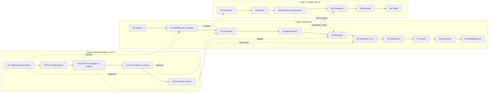

# 13 — Hoja de ruta: de Kai UI a plataforma de desarrollo de apps

**Fase:** posterior a L6, en paralelo a la guía AppKit ([12](12-modelo-appkit.md)). Este documento ordena **qué se construye y en qué orden** para que Kai deje de ser un renderer con una colección de componentes y pase a ser una plataforma para crear, probar, operar con agentes y distribuir apps de escritorio. Parte de la evaluación de [09](09-framework-y-plataforma.md) (sección 2), conserva su eje (registro de comandos y MCP) y corrige su orden, su alcance y algunos contratos.

> **Todo el código marcado como «API propuesta» no existe.** Los nombres de tipos, métodos, comandos de CLI y claves de `kai.toml` son diseño a validar en cada paso. Lo que sí existe se cita con su archivo.

> **Relación con otros documentos.** [09](09-framework-y-plataforma.md) sigue siendo la referencia de diseño del registro de comandos, MCP, manifiesto, CLI, router y ventanas; **su hoja de ruta por fases (§12) queda reemplazada por este documento**. [12](12-modelo-appkit.md) es la pista de fidelidad nativa (pista B) y se sincroniza con esta en los puntos marcados con 🔗.

## Índice

1. [Resumen ejecutivo](#1-resumen-ejecutivo): [estado actual](#11-estado-al-20-de-octubre-de-2026) y [costo de lo que falta](#12-lo-que-falta-para-cada-hito-con-costo-estimado)
2. [Evaluación de 09](#2-evaluación-de-09)
3. [Qué significa «ser plataforma»](#3-qué-significa-ser-plataforma)
4. [Principios](#4-principios)
5. [Punto de partida verificado](#5-punto-de-partida-verificado) (línea base del 19-10-2026)
6. [Modelo de identificación](#6-modelo-de-identificación)
7. [Contratos centrales](#7-contratos-centrales)
8. [Dos pistas y puntos de sincronización](#8-dos-pistas-y-puntos-de-sincronización) (incluye la pista de mapas, §8.1)
9. [Convenciones de cada paso](#9-convenciones-de-cada-paso)
10. [Etapas y pasos](#10-etapas-y-pasos)
11. [Hitos](#11-hitos)
12. [Decisiones abiertas con recomendación](#12-decisiones-abiertas-con-recomendación)
13. [Riesgos](#13-riesgos)
14. [Métricas de éxito](#14-métricas-de-éxito)
15. [Cambios respecto a 09](#15-cambios-respecto-a-09)
16. [Glosario](#16-glosario)
17. [Checklist](#17-checklist)

---

## 1. Resumen ejecutivo

- **La dirección de 09 es correcta**: un registro de comandos único, coherente con Elm, que alimenta menús, atajos, paleta, botones, accesibilidad, tests y un servidor MCP. Es el diferenciador de Kai frente a Tauri, Flutter o SwiftUI.
- **Lo que se corrige**: el orden (profundidad antes que amplitud), la pureza del `Msg` (sin canales de respuesta dentro), la semántica de `Safety` (separar consultas de acciones) y los valores por defecto de exposición a agentes (nada expuesto salvo lista explícita).
- **Lo que se añade**: una **etapa de identificación y pruebas** antes del registro de comandos, para que todo lo que venga después nazca con tests legibles; **herramientas de desarrollo** mínimas; y una **app guía real** que decide qué widgets y servicios se construyen. La app guía es **DSP desktop**: cliente de escritorio del core de DSP-27 (`/Users/felipe/dev/dsp-27`), que incluye mapas con edición de geometrías ([10](10-mapas.md)).
- **Orden resultante**: librería usable → identificación y pruebas → comandos → MCP mínimo → app guía DSP desktop (async, persistencia, widgets, mapas) → manifiesto y CLI → distribución → escala (router, ventanas, MCP completo, plugins) → ergonomía (`rsx!`, derives) → multiplataforma.
- **Dónde estamos**: Etapas 0 a 3 cerradas; la Etapa 4 (app guía) en curso. Detalle en §1.1 y, por paso, en las líneas **Estado** de §10 y en la checklist (§17).

### 1.1 Estado al 20 de octubre de 2026

| Etapa | Estado | Lo que falta |
|---|---|---|
| 0 — Librería usable (P0, P1, P1b) | ✅ Hecha | Probar el inspector (⌘⌥I) a mano en la ventana |
| 1 — Identificación y pruebas (P2–P6) | ✅ Hecha | Revisar con Accessibility Inspector y VoiceOver |
| 2 — Comandos (P7–P10) | ✅ Hecha | Probar a mano atajos con el menú y la paleta con VoiceOver |
| 3 — Agentes (P11–P13) | ✅ Hecha | Probar a mano con Cursor o Claude Desktop ([14](14-mcp.md)) |
| 4 — App guía (P14–P16, mapas M0–M2) | 🟡 En curso | Ver abajo |
| 5 — Manifiesto y CLI (P17–P19) | 🟡 Empezada: solo `kai dev` | `kai.toml`, `kai new/test/doctor/commands/mcp` |
| 6 — Distribución (P20–P21) | ⬜ Pendiente | Todo |
| 7 — Escala (P22–P25) | ⬜ Pendiente, salvo mapas M3 adelantado | Router, varias ventanas, MCP completo, plugins |
| 8 — Ergonomía (P26) | ⬜ Pendiente | `tw!`, derives, `rsx!` |
| 9 — Multiplataforma (P27) | ⬜ Pendiente | Windows y Linux |

**La Etapa 4 por partes:**

- **Widgets del backlog** ✅: checkbox, segmented, `Select`, sidebar con riel, toolbar, search field, textarea, `Dialog`, toasts, tabla y lista virtualizadas, edición por palabra y línea, `Avatar`, `MediaSlot` y `ColorField`. Todos en la demo, con un test de cobertura.
- **Lenguaje de color de la selección** ✅: toda elección activa usa el `secondary` (cyan) como vidrio teñido (token `choice`). El azul (acento) queda para acción, encendido y foco. Detalle en el Paso 14.
- **`DotProgress` y botón ocupado** ✅: el botón (o el comando) que lanzó un `Effects::perform` queda ocupado hasta que la tarea entrega su `Msg`. Muestra tres puntos en ola sobre el texto, conserva color y ancho, y no recibe clics. Detalle en el Paso 14.
- **P14 DSP desktop** 🟡: login con llavero, shell con menú y la sección Áreas (mapa de Parral con las áreas del core, lista y color por área). Faltan editar áreas desde el escritorio, el flujo operativo y las notificaciones.
- **P14b primitivas** 🟡: imágenes y geometría hechas; falta el clip redondeado de contenedores.
- **P15 efectos** 🟡: pool de tareas, `keyed`/`cancel`, `after`, panel de archivos y archivos arrastrados. Faltan futures, suscripciones (websockets para notificaciones) y comandos MCP async. **Fallo conocido:** el panel de archivos es modal dentro del manejador de eventos y la app aborta si se cierra con el panel abierto (ver el Paso 15).
- **P15b–P15d mapas** 🟡: mapa vectorial con áreas, edición de polígonos existentes y comandos `mapa.*`. Faltan los modos Punto y Línea, dibujar desde cero y `incidencias.set_ubicacion`.
- **P16 persistencia** ⬜.

**Cifras:** 500 tests de la librería (504 con `--features mcp`) más 14 `#[ignore]` de benchmarks y capturas, 4 doctests y 8 tests de `kai-cli`. Clippy sin avisos y CI en macOS para `kai-ui-desktop` y `kai-cli`.

### 1.2 Lo que falta para cada hito, con costo estimado

Estimaciones de orden de magnitud, en días de trabajo como el de las sesiones con agente (el agente implementa y una persona revisa). No incluyen esperas externas (cuenta de Apple Developer, prueba en otro Mac).

| Bloque | Pasos | Costo | Riesgo |
|---|---|---|---|
| Cerrar M3 (app guía en uso real) | Resto de P14, P15, P15b–d y P16 | 3–5 semanas | Medio: depende del corte que confirme DSP |
| Corte A1: `kai.toml` y CLI de desarrollo | P17, P18 y P19 | ≈ 2 semanas | Bajo |
| Resto de M4 (plataforma *preview*) | P20 (bundle, firma, notarización) y P21 (guías, semver, nombre) | 1,5–2,5 semanas | Medio: firma y notarización |
| Escala | P22 (router; versión manual 3–5 días), P23 (varias ventanas, 3–4 semanas), P24, P25 | 2,5–3,5 meses | P23 es el más riesgoso |
| Ergonomía | P26 (`tw!` solo: 2–3 días; macros completas: 4–6 semanas) | 1–1,5 meses | Mensajes de error y rust-analyzer |
| Multiplataforma | P27 | 2–3 meses | Alto |

**Recomendación (no decidida):** adelantar el corte A1 (P17–P19) antes de cerrar M3, con DSP como primer cliente (`desktop/kai.toml` y `kai dev` sin scripts). No cambia la arquitectura; solo rompe la dependencia formal del P17 con el P16. El router manual (P22 mínimo) también se puede adelantar cuando DSP pase de una sección a varias con detalle.

## 2. Evaluación de 09

### 2.1 Puntos altos

| Punto | Por qué importa |
|---|---|
| **Registro de comandos como única fuente de verdad** | Menús, atajos, paleta, botones (`on_command`), nombre accesible, tests y MCP leen la misma lista. Es lo que hacen VS Code (paleta), AppKit (validación de menús por la cadena de responders) y las App Intents de Apple. Se apoya en la cadena de responders que ya existe (`responder.rs`, Paso 7 de 12). |
| **Coherencia con Elm** | Un agente produce un `Msg` que pasa por `update`, igual que un clic. La UI muestra lo que hace el agente y nadie modifica el modelo por otra vía: confianza para el usuario y razonamiento simple. |
| **Diferenciador real** | «Toda app es operable por agentes de serie» no lo ofrece ningún framework de escritorio establecido. |
| **Seguridad pensada** | Niveles de seguridad, confirmación en la app y no en el cliente, capacidades estilo Tauri, HTTP solo en `127.0.0.1` con token y validación de `Origin`, inyección de prompts vía recursos, fatiga de confirmación. |
| **Disciplina de ingeniería** | «Extraer, no reescribir», un crate más `lib.rs` al inicio, criterios de «terminado cuando» verificables, `mcp-schema.json` versionado con `kai mcp diff` en CI, cliente MCP en proceso para tests. Honesto: todo marcado como API propuesta. |
| **Distinción `Intent` / `UiCommand` / `Command`** | Evita confundir intenciones de plataforma, reducciones de UI y acciones de la app. El renombrado a `UiCommand` ya está hecho en `ui_engine.rs`. |

### 2.2 Puntos bajos

1. **Alcance enorme para el estado actual.** Once crates, CLI con firma y notarización, router, varias ventanas, plugins, stores, i18n, recarga en caliente y MCP stdio + HTTP, con un catálogo de widgets todavía corto (Button, TextField, Card, Stat, Badge, Alert, IconButton, Switch). El propio 09 reconoce que menús, edición de texto y VoiceOver son lo primero que se compara con una app nativa. Riesgo: construir la plataforma alrededor de un núcleo que todavía no aguanta una app real.
2. **MCP como principio nº 1.** La abstracción valiosa es el registro; MCP es un protocolo que cambia rápido. 09 lo aísla bien en `kai-mcp`, pero el discurso y los valores por defecto (feature `mcp` activa en plantillas) lo ponen por encima del registro.
3. **«Solo lectura» no es inofensivo.** `expose = "all-read-only"` por defecto permite exfiltrar datos personales si el agente obedece una inyección de prompt. Para apps de clientes y ventas el defecto debe ser `none` o una lista explícita.
4. **Semántica de `ReadOnly` inconsistente.** En el ejemplo de 09, `clientes.buscar` se declara `ReadOnly` («no cambia el modelo») pero cambia `filtro` y la ruta (09 §4.2 y §11). Falta distinguir **consultas** (sin efectos) de **acciones** (con `Msg`), y definir `Safety` sobre los datos de dominio, no sobre el estado de la UI.
5. **`Reply<T>` dentro del `Msg`.** El `Msg` deja de ser dato: no se puede serializar, comparar ni reproducir, que es justo lo que permite un log de mensajes o depuración tipo *time travel*. Como `Msg: Clone`, duplicar un `Reply` es trivial; 09 lo resuelve con «error en debug».
6. **Fases que mezclan cosas sin relación.** F1 junta `rsx!` y el registro de comandos (independientes; `rsx!` es caro en macros, soporte de rust-analyzer y mensajes de error). F2 junta manifiesto, CLI, bundle, firma, notarización, servidor MCP y un puente stdio por socket Unix (complejo).
7. **El ejecutor async se decide tarde.** Queda abierto hasta F4, pero los `Reply` asíncronos y `rmcp` lo necesitan antes, y `rmcp` usa Tokio. En la práctica ya está decidido.
8. **Desfase con el giro a AppKit.** El principio 8 de 09 («los tokens siguen saliendo de `tokens.css`») y `[theme]` de `kai.toml` no contemplan el tema AppKit, que ya existe en código (`ThemeKind::AppKit`, `Theme::appkit_static`, `KAI_THEME`). Tampoco recoge la cadena de responders de 12 como base del despacho de comandos.
9. **Faltan piezas de framework.** Herramientas de desarrollo (inspector del árbol, log de `Msg`, tiempo por frame), **identificación para tests**, listas virtualizadas, textarea, arrastrar y soltar y diálogos de archivo.
10. **Formato.** Unas 1.200 líneas que mezclan visión, especificación y hoja de ruta con mucho código que aún no existe; envejecen rápido. Por eso la hoja de ruta vive aquí y 09 queda como especificación de diseño.

## 3. Qué significa «ser plataforma»

Kai es plataforma, y no una colección de componentes, cuando se cumplen cuatro condiciones verificables:

| Condición | Se verifica con |
|---|---|
| **Crear y distribuir** | Un equipo fuera de este repo hace `kai new` → `kai dev` → `kai test` → `kai bundle` → `kai notarize` y obtiene una `.app` que Gatekeeper abre en otro Mac sin avisos. |
| **Construir apps reales** | La app guía (Paso 14) tiene modelo, comandos, efectos async, persistencia, menús y los widgets que necesita, y aguanta un día de uso real. |
| **Probar con facilidad** | Cada pantalla se prueba sin ventana ni GPU, encontrando elementos por rol y nombre accesible o por `test_id`, en pocas líneas y en CI. |
| **Operable por personas y agentes** | Cada acción es un comando: el mismo `Msg` sale de un botón, un atajo, el menú, la paleta, un test o una herramienta MCP. |

## 4. Principios

1. **El registro de comandos es el corazón.** MCP es su adaptador de primera clase, no al revés. Los comandos existen y se usan (menú, atajos, paleta, tests) aunque MCP esté desactivado.
2. **Se puede probar por diseño.** Todo elemento relevante se encuentra por rol y nombre accesible, o por un `test_id` estable. Ningún test depende de la estructura interna del árbol ni de las clases de estilo.
3. **Profundidad antes que amplitud.** Una app guía real decide qué se construye. Ningún crate, widget ni servicio entra «por si acaso».
4. **Elm puro.** Un modelo, mensajes, `update` y `view`. El `Msg` es dato: `Clone + Debug`, sin canales ni callbacks con estado. Los efectos se describen como valores (`Effects`, `Task`), no se ejecutan dentro de `update`.
5. **Seguro por defecto.** Nada se expone a agentes salvo lista explícita; HTTP apagado; lo destructivo pasa siempre por confirmación humana en la UI; un agente nunca supera las capacidades de la app.
6. **El núcleo no conoce la plataforma ni MCP.** Árbol, estilos, layout, paint y consultas de prueba siguen siendo puros y testeables sin ventana ni GPU (como hoy `layout.rs`, `render/paint.rs`, `a11y.rs`).
7. **Extraer, no reescribir.** Un solo crate (`kai`) hasta que una frontera esté probada por uso; los crates nuevos nacen moviendo módulos con tests.
8. **Un tema, dos lenguajes visuales.** Los tokens Kai salen de `kai-ui-web/src/theme/tokens.css`; el tema AppKit, de las tablas de [11](11-tema-appkit.md). Las apps eligen con `ThemeKind` (y, más adelante, `kai.toml`).
9. **Cortes verticales.** Cada etapa termina en algo que se puede usar y demostrar, con su gate verde.
10. **macOS primero.** Las abstracciones multiplataforma se diseñan desde el inicio, pero solo se implementan en la Etapa 9.

## 5. Punto de partida verificado

Estado del código cuando se escribió este documento (19 de octubre de 2026, antes del Paso 0). Se conserva como línea base para ver qué cambió; **el estado actual está en §1.1**. Desde entonces, casi todo lo de §5.2 se resolvió en las Etapas 0 a 3: `examples/`, API pública con internos ocultos, `test_id` y consultas, registro de comandos, roles (`Dialog`, `Switch`, `CheckBox`, `Alert`, `Table`, `Tree`…) y efectos async. Siguen pendientes la persistencia, el manifiesto, la CLI completa, el bundle y la firma.

### 5.1 Lo que ya existe y sirve a la plataforma

| Pieza | Archivo | Estado | Uso en esta hoja de ruta |
|---|---|---|---|
| Crate como librería `kai` + binario demo | `Cargo.toml` (`[lib] name = "kai"`), `src/lib.rs`, `src/demo.rs`, `examples/{demo,gallery}.rs`, `fixtures/external-app` | Hecho (Paso 1 de 12 y Paso 0). Internos `#[doc(hidden)]`; paquete aún `kai-ui-desktop-prototype`, `publish = false`. | Base de todo lo demás. |
| Runtime Elm | `runtime.rs` (`App` v2: `init`, `update -> Effects`; `SimpleApp`; `run`, `build_view`), `session.rs` (`Session` sin ventana y `Outbox`) | Una ventana; `Effects` vacío hasta el Paso 15 (Pasos 1 y 4). | Pasos 15–16 (efectos). |
| Árbol `Element<Msg>`, ids por ruta o `key`, `test_id`, `FocusOrder`, `find`, `path_to` | `element.rs` | Hecho. `validate_ids` reporta `key` y `test_id` duplicados (Paso 2). | Paso 3. |
| Intents y reducciones de UI | `ui_engine.rs` (`Intent`, `UiCommand`, `FocusOrigin`, `UiModel`) | `UiCommand` ya renombrado. | Paso 4 (`TestApp` usa `Intent` reales). |
| Cadena de responders y equivalentes de teclado | `responder.rs` (`Action`, incluido `Action::Command(&'static str)`; `KeyRoute::Command`; `chain`) | Hecho; el extremo «App» es el enganche del registro. | Pasos 7–8. |
| Accesibilidad | `a11y.rs` (roles, nombre, descripción, `Toggled` desde `pressed`) | Hecho; `test_id` → `author_id` (Paso 2). | Pasos 3–4. |
| Capturas offscreen y diff | `snapshot.rs` (`render`, `render_element`, `diff`, `diff_image`, PNG con feature `snapshots`) | Hecho; recorte por elemento desde el Paso 4. | Pasos 17–18 (capturas doradas). |
| Tema Kai y AppKit | `theme.rs`, `theme/appkit.rs`, `theme/generation.rs` (`ThemeKind`, `Appearance`, `appkit_static`, `appkit_for`, `appkit_current`) | Hecho para estático; demo con `KAI_THEME`. | Paso 17 (`[theme] kind`). |
| Componentes | `components.rs` (Button, TextField, Card, `group_box`, Stat, Badge, Alert, IconButton, Switch) | Hecho para el alcance actual. | Paso 5 (convención de ids), Paso 14 (nuevos). |
| Estilos tipo Tailwind | `tw.rs`, `style.rs` (clases desconocidas en `layout::StyleCache::unknown`) | Hecho; validación solo en ejecución. | Paso 26 (`tw!`). |
| Tests | 219 tests en `src/` (213 normales y 6 `#[ignore]` de benchmark y capturas) más 1 doctest | Verdes. | Etapa 1 los hace más legibles. |
| Fondo animado | `background.rs`, `background.wgsl` | Hecho. | Sin relación directa. |

### 5.2 Lo que falta (resumen)

- **Sin `examples/`**: la demo y sus tests viven en `main.rs` (~1.970 líneas).
- **API pública sin definir**: casi todo es `pub` porque los módulos se usan entre sí.
- **Sin identificación para tests**: los tests localizan elementos por texto, por posición relativa o por clases. Hoy hay unas 29 búsquedas frágiles de ese tipo (`class.contains(..)`, `path[path.len() - 2]`, helpers como `element_with_text` e `input_labeled` en `main.rs`).
- **Sin comandos de app**: las acciones son variantes de `Msg` enganchadas a botones, sin id, descripción, esquema ni seguridad.
- **Sin efectos async, persistencia, manifiesto, CLI, bundle ni firma.**
- **Roles limitados**: `Role` tiene `Generic`, `Main`, `Header`, `Group`, `Heading`, `Paragraph`, `Label`, `Status`, `Button`, `TextInput`, `Image`. Faltan, como mínimo, `Dialog`, `Switch`, `CheckBox`, `List`/`ListItem`, `Alert` (el componente Alert y el Switch hoy usan `Status` y `Button`).

## 6. Modelo de identificación

### 6.1 Cómo se calculan hoy los `WidgetId`

`runtime::build_view` llama a `Element::assign_ids()` después de `view`. Cada hijo toma un id que es un hash FNV-1a de 62 bits del id de su padre más su `key` (si la tiene) o su índice entre hermanos (`element.rs`, `assign` y `hash`). El id es, en el fondo, la **ruta** del elemento en el árbol. Así el foco, el hover, el scroll y el caret sobreviven a la reconstrucción del árbol en cada frame.

Propiedades:

- **Unicidad práctica dentro de una ventana**: las colisiones por azar en 62 bits son despreciables con miles de nodos.
- **Límite 1 — keys repetidas**: dos hermanos con la misma `key` reciben el mismo id, sin aviso.
- **Límite 2 — dependencia de la posición**: sin `key`, insertar, borrar o reordenar mueve los ids de los hermanos siguientes y de todos sus descendientes; envolver un elemento en un `div` cambia los ids de todo su subárbol.
- **Límite 3 — único por árbol, no global**: con varias ventanas, dos árboles con la misma estructura producirán los mismos ids.

Conclusión: el `WidgetId` es un id **interno y técnico** para conservar estado entre frames. No es un nombre estable para tests, scripts ni agentes.

### 6.2 Cuatro niveles de identificación

| Nivel | Para qué sirve | ¿Estable? | ¿Afecta al `WidgetId`? | Dónde vive |
|---|---|---|---|---|
| `WidgetId` (ruta + `key`) | Conservar foco, scroll y caret entre frames | No: cambia con la estructura | — | `element.rs` (existe) |
| Rol + nombre accesible | Tests orientados al usuario y lector de pantalla | Sí, mientras no cambie el texto | No | `Element::role`, `label`, texto de los hijos (existe) |
| `test_id` | Tests y automatización externa (XCUITest, Appium) | Sí: contrato explícito | **No** | Nuevo (Paso 2) |
| Id de comando | Agentes, menús, paleta y scripts | Sí: API pública versionada | No | Nuevo (Paso 7) |

### 6.3 Reglas

1. **Agregar o quitar un `test_id` nunca cambia un `WidgetId`.** Un test lo verifica (Paso 2).
2. **Unicidad por ventana.** En debug, un `test_id` repetido en la misma ventana, o una `key` repetida entre hermanos, produce un error con las dos rutas. En release se registra un aviso y gana el primero en orden de documento.
3. **Listas**: `key` y `test_id` se combinan. `key` mantiene el estado al reordenar; `test_id` permite encontrar el ítem:
   ```rust
   // API propuesta
   div().key(cliente.id.to_string()).test_id(format!("cliente.{}", cliente.id))
   ```
4. **Formato**: minúsculas, segmentos separados por `.`, sin espacios: `form.enviar`, `cliente.42.borrar`. Los ids `kai.*` quedan reservados para el framework.
5. **Preferencia en tests**: primero rol + nombre (prueba lo que ve el usuario y empuja la accesibilidad); `test_id` cuando el nombre es dinámico, traducido o ambiguo; nunca clases ni posición.
6. **Exposición**: el `test_id` se publica en el árbol AccessKit como `author_id`. Verificado en el código de `accesskit_macos` 0.27.1: `author_id` se devuelve como `accessibilityIdentifier`, el identificador que usan XCUITest y Appium (driver mac2).
7. **Privacidad**: un `test_id` no debe contener datos personales (usar ids internos, no nombres ni RUT), porque es visible para cualquier herramienta de accesibilidad.

### 6.4 Convención de sub-ids en componentes

Un componente con `test_id("x")` nombra sus partes internas solo, para que el test no dependa de su estructura:

| Componente | Partes generadas |
|---|---|
| `TextField` | `x` (raíz), `x.input`, `x.label` (estática), `x.floating` (sobre el borde), `x.shell` (caja con borde), `x.placeholder` (placeholder de dos colores de un campo requerido vacío), `x.helper`, `x.toggle` (password), `x.start`, `x.end` (adornos) |
| `Button`, `IconButton`, `Badge` | `x` |
| `Switch` | `switch_labeled`: `x` (raíz), `x.track` (pista, `Role::Switch`), `x.label`. Sin label: `x` es la pista |
| `Card` | `x`, `x.header`, `x.title`, `x.subtitle`, `x.content`, `x.actions` |
| `group_box` | `x`, `x.label` (título AppKit, fuera de la caja), `x.box`, `x.header`, `x.title`, `x.content` |
| `Stat` | `x`, `x.label`, `x.value`, `x.hint` |
| `Alert` | `x` (sigue con `Role::Status`), `x.icon`, `x.message` |
| Botón con `on_command` (Paso 8) | `test_id` = id del comando si no se indica otro |
| Widgets nuevos (Paso 14) | Documentan sus partes en [05](05-widgets-y-tema.md) al nacer |

Reglas de derivación (`Element::assign_ids`):
- Una parte (`.part("title")`) toma el id del ancestro más cercano con `test_id` propio: el título de una card es `x.title`, no `x.header.title`.
- Un `test_id` explícito siempre gana sobre la parte.
- Un componente con partes es una frontera (`.parts_root()`): si no tiene id, sus partes no heredan el de un ancestro. Así dos `TextField` sin id dentro de `card().test_id("form")` no producen dos `form.input`.
- Los ids derivados se recalculan en cada `assign_ids` y `validate_ids` los revisa igual que a los explícitos.
- `Alert` no usa `Role::Alert`: en AccessKit es una región viva que interrumpe al lector, y el banner de la demo es informativo.

## 7. Contratos centrales

### 7.1 `App` v2 y efectos

```rust
// API propuesta (evolución de runtime::App)
pub trait App: Sized + 'static {
    type Msg: Clone + Debug + 'static;

    fn init(ctx: &mut InitContext) -> (Self, Effects<Self::Msg>);
    fn update(&mut self, msg: Self::Msg) -> Effects<Self::Msg>;
    fn view(&self) -> Element<Self::Msg>;
    fn title(&self) -> String;

    /// Registro estático (Paso 7). Se llama una vez al arrancar.
    fn commands(registry: &mut CommandRegistry<Self>) {}
    fn background(&self) -> BackgroundEffect { BackgroundEffect::NONE }
}

/// Lo que `update` pide al runtime, como valor. Vacío hasta el Paso 15.
pub struct Effects<Msg>(/* Vec<Effect<Msg>> */);
impl<Msg> Effects<Msg> {
    pub fn none() -> Self;
    pub fn batch(effects: impl IntoIterator<Item = Self>) -> Self;
    // Paso 15: perform, cancelable, after; Paso 23: window; Paso 17: set_theme
}
```

- **Compatibilidad**: el `App` actual pasa a llamarse `SimpleApp` y una implementación genérica lo adapta (`Effects::none()`, sin registro). La demo compila sin cambios.
- **Regla**: `Msg: Clone + Debug`. Se recomienda además `PartialEq` en las apps para tests y depuración; el framework no lo exige.

### 7.2 Consultas y acciones

| | `Query` | `Action` |
|---|---|---|
| Efecto | Ninguno: función pura sobre `&App` | Produce un `Msg` que pasa por `update` |
| Ejemplo | `clientes.buscar` (devuelve resultados sin tocar el filtro de la UI) | `clientes.crear`, `clientes.borrar`, `ui.filtrar` |
| Seguridad | Implícita: solo lectura de datos | `Safety::Mutating` o `Safety::Destructive` |
| Hilo | UI (rápida) o instantánea del modelo | UI, serializada con el resto de mensajes |
| Respuesta | El valor devuelto | `output(&App)` opcional, evaluado después de `update` |

```rust
// API propuesta (kai::commands)
pub enum Safety {
    /// Cambia datos de dominio de forma esperable o reversible.
    Mutating,
    /// Borra, envía, paga o es irreversible: confirmación humana si lo invoca un agente.
    Destructive,
}

pub enum Availability { Enabled, Disabled { reason: String }, Hidden }

pub trait Query: DeserializeOwned + JsonSchema + 'static {
    type App: App;
    type Output: Serialize + JsonSchema;
    const ID: &'static str;
    const TITLE: &'static str;
    fn run(app: &Self::App, input: Self) -> Result<Self::Output, CommandError>;
}

pub trait Action: Clone + DeserializeOwned + JsonSchema + 'static {
    type App: App;
    type Output: Serialize + JsonSchema;
    const ID: &'static str;
    const TITLE: &'static str;
    const SAFETY: Safety;
    fn description() -> &'static str;
    fn available(app: &Self::App) -> Availability { Availability::Enabled }
    fn into_msg(self) -> <Self::App as App>::Msg;
    /// Resultado para quien invocó (MCP, script, test), leído tras `update`.
    fn output(app: &Self::App, input: &Self) -> Result<Self::Output, CommandError>;
}
```

- **Semántica de `Safety`**: describe el efecto sobre **datos de dominio**. Cambiar el filtro, la ruta o la selección es estado de UI; si un agente necesita hacerlo, es una `Action` `Mutating` de la categoría `ui.*`, separada de las acciones de negocio.
- **Disponibilidad sin entrada**: `available(&App)` decide si el comando aparece en menús y paleta. La validez de una entrada concreta (por ejemplo, «el cliente 42 no existe») se valida al invocar y vuelve como `CommandError`, no como disponibilidad.

### 7.3 Respuesta sin canales en el `Msg`

```text
invocación (MCP, script, test) ──► Invocation { id, command, input, origin }
                                       │
           Query:  run(&App, input) ───┴──► respuesta inmediata
           Action: into_msg(input) ──► update ──► output(&App, &input) ──► respuesta
                                                     │
                     async (Paso 15): update devuelve Effects con InvocationId;
                     el runtime responde cuando llega el Msg final que lo cierra
```

- El `Msg` sigue siendo dato puro: se puede imprimir, comparar y reproducir.
- El runtime guarda las invocaciones pendientes por `InvocationId`; si no se responden en el plazo, el cliente recibe error de tiempo agotado.
- Para comandos async, la app marca qué `Msg` cierra la invocación: `Effects::perform(fut, Msg::Creado).completes(invocation)` (API propuesta, Paso 15).
- **Como quedó en el Paso 12:** las acciones no tienen `type Output` ni `output()`. Una acción que debe responder algo lo declara al registrarse con `.returns::<Consulta>()`, y la consulta corre sobre el modelo ya actualizado. Las demás responden `null`. El plazo es de 30 s (`kai::mcp::TIMEOUT`).

### 7.4 Exposición a agentes

| Clave (Paso 17) | Valor por defecto | Efecto |
|---|---|---|
| `[mcp] enabled` | `false` | Sin servidor MCP. |
| `[mcp] expose` | `"none"` | Nada se lista salvo `allow`. |
| `[mcp] allow` | `[]` | Ids expuestos explícitamente. |
| `[mcp] deny` | `[]` | Gana siempre sobre `expose` y `allow`. |
| `[mcp] require-confirmation` | `["destructive"]` | Categorías que abren el diálogo. |
| `[mcp] transports` | `["stdio"]` | HTTP solo si se pide explícitamente. |

Hasta que exista `kai.toml` (Pasos 12–16), la exposición se declara en código: `.expose()` al registrar el comando (`registry.action::<T>().expose()`). Lo no expuesto no se lista, y si un agente lo llama igual recibe «herramienta desconocida».

## 8. Dos pistas y puntos de sincronización



| 🔗 | Pista B (12) | Pista A (este documento) | Qué se comparte |
|---|---|---|---|
| S1 | Paso 7: cadena de responders | Paso 4 (`TestApp`) y Paso 8 (atajos) | `TestApp::press` recorre la misma ruta de teclado; los atajos de comandos se enganchan en `Responder::App` / `KeyRoute::Command`. |
| S2 | Pasos 17–18: galería y capturas doradas | Paso 4 (capturas por elemento) | `snapshot.rs` y la galería se prueban con las consultas de la Etapa 1. |
| S3 | Paso 20: controles nuevos (switch, checkbox, pop-up, segmented, search field, sidebar, toolbar) | Paso 14 (widgets de la app guía) | Cada control nace con roles nuevos, convención de `test_id` y tests con `TestApp`. |
| S4 | Paso 16: tema AppKit en runtime | Paso 17 (`[theme] kind`) | `kai.toml` elige `kai`, `appkit` o `system`. |
| S5 | `Dialog` (fuera de 12, necesario en ambas) | Paso 13 (confirmación) | Un solo widget `Dialog` con rol accesible `Dialog`. Resuelto en el Paso 13: `components::dialog` y `Role::Dialog`, que también usa la paleta. |

### 8.1 Mapas: pista de dominio (pista C)

Los mapas ([10](10-mapas.md)) no son una etapa propia: son un módulo que **consume** lo que construyen las pistas A y B y avanza cuando la app guía lo pide. DSP los necesita desde el primer corte (áreas de operación y ubicación de incidencias, requerimientos y operaciones), así que entran en la Etapa 4.

| Hito de mapas (10) | Paso en este documento | Requisito previo | Qué aporta al resto de Kai |
|---|---|---|---|
| **M0** Primitivas de renderer | Paso 14b | Etapa 1 (pruebas) | `DrawOp::Image` (avatares, ``, adjuntos), clip redondeado (`rounded-xl overflow-hidden`), transformaciones y pipeline de geometría |
| **M1** Mapa raster | Paso 15b | Pasos 14b y 15 (efectos async) | Primer consumidor del ejecutor en segundo plano y de eventos internos por `EventLoopProxy` |
| **M1b** Edición de geometrías | Paso 15c | Paso 15b | Interacción de arrastre con «manijas» accesibles, reutilizable por otros editores |
| **M2** Capas y comandos | Paso 15d | Pasos 9, 12–13 y 15c | Primeros comandos con entrada geográfica validada, expuestos a MCP |
| **M3** Vectorial y spike de galileo | Etapa 7 (tras el Paso 25) | M2 y el benchmark de frame | — |
| **M4** Offline y multiplataforma | Paso 16 (regiones offline con `Store`) y Paso 27 | M3 para vectorial; M1 para raster cacheado | — |

Reglas de la pista C:

1. **Kai es genérico, DSP es dominio.** En Kai viven `map`, `marker`, capas, editor de geometrías, `TileSource` y comandos `mapa.*` genéricos. Áreas, incidencias y PostGIS viven en DSP desktop.
2. **Nada de mapas antes de M1b** (hito de identificación y pruebas): cada pieza nace con `test_id`, fuente de teselas falsa y tests con `TestApp` ([10](10-mapas.md) §4.9).
3. **La cámara no la controla el `Model` durante el gesto**: es estado de UI por `WidgetId` (como el scroll) y emite un `Msg` al terminar; `mapa.set_view` sí pasa por el `Model`.
4. **El ejecutor de carga de teselas** es el mismo Tokio en hilo de servicio de los Pasos 12 y 15.
5. **Atribución siempre visible** en el widget, por la política de OSM. DSP web hoy la oculta (`attributionControl={false}`); en desktop no es opcional.
6. **Detrás de la feature `maps`**; se extrae a `kai-maps` solo cuando la frontera esté probada por uso.

## 9. Convenciones de cada paso

- **Gate** (heredado de [README](README.md)): `cargo fmt --check`, `cargo check`, `cargo test`, `cargo clippy --all-targets -- -D warnings` en verde; las capturas de referencia no cambian salvo que el paso lo declare.
- **Formato de cada paso**: Objetivo · Por qué · Depende de · Archivos · Diseño (API propuesta) · Tests · Hecho cuando · Riesgos y reversión.
- **Documentación**: cada paso que cambie API pública actualiza [05](05-widgets-y-tema.md) (widgets y clases), [03](03-eventos-y-estado.md) (eventos y estado) o la guía de pruebas (Paso 21), en el mismo cambio.
- **Commits**: un paso por PR cuando sea posible; los pasos grandes (12, 14, 20) se parten en sub-pasos con su propio gate.
- **Reversión**: todo paso debe poder revertirse con `git revert` sin dejar la demo rota; si no es posible, el paso lo declara.

## 10. Etapas y pasos

### Etapa 0 — Librería usable (hito M1)

#### Paso 0 — Cerrar la librería `kai`

- **Objetivo**: que una app fuera del repo use Kai solo a través de su API pública.
- **Por qué**: sin esto no hay plataforma; además es requisito de la galería (12, Paso 17) y de `kai::testing`.
- **Depende de**: Paso 1 de 12 (hecho: `lib.rs`).
- **Archivos**: `Cargo.toml`, `src/lib.rs`, `src/main.rs` → `examples/demo.rs`, nuevo `examples/gallery.rs` (o el de 12), nueva app de prueba `fixtures/external-app/` con su propio `Cargo.toml` y dependencia `kai = { path = "../.." }`.
- **Diseño**:
  - Auditoría de visibilidad. Públicos: `runtime::{App, run, build_view}`, `element::{Element, Role, div, text, icon, input, WidgetId}`, `components::*`, `theme::{Theme, ThemeKind, Appearance, Density, AppKitGeneration}`, `icons::Icon`, `background::BackgroundEffect`, `snapshot` (feature `snapshots`). El resto (`layout`, `render`, `ui_engine`, `platform_adapter`, `text_field`, `tw`, `style`) pasa a `pub(crate)` o a reexportaciones mínimas.
  - Lo que hoy los tests de la demo usan de internos (`Layout`, `Interaction`, `FixedMeasure`, `StyleCache`) se reexporta desde un módulo `kai::testing` (feature `testing` o `cfg(test)`), que en la Etapa 1 se convierte en la API de pruebas.
  - El binario por defecto puede seguir existiendo (`cargo run` abre la demo) apuntando a `examples/demo.rs`, o el `README` documenta `cargo run --example demo`.
- **Tests**: los de la demo se mueven con ella; un job de CI compila `fixtures/external-app`.
- **Hecho cuando**: `fixtures/external-app` compila y abre ventana usando solo la API pública; `cargo run --example demo` reproduce la demo; las capturas de `snapshot_demo` no cambian; `cargo doc` sin warnings sobre la API pública.
- **Riesgos y reversión**: reducir visibilidad puede romper tests internos; mitigar moviendo esos tests al módulo que prueban. Revertible.
- **Estado**: hecho. La demo vive en `src/demo.rs` (`run_from_env`); `cargo run` y `cargo run --example demo` la abren igual. Los módulos internos quedan `#[doc(hidden)] pub` en vez de `pub(crate)`, porque las capturas y los tests todavía los usan; pasarán a `pub(crate)` cuando exista `kai::testing` (Pasos 3–4). El CI corre `cargo doc -D warnings` y compila `fixtures/external-app`.

#### Paso 1 — Contrato `App` v2

- **Objetivo**: un contrato que soporte efectos y registro sin romper lo existente.
- **Depende de**: Paso 0.
- **Archivos**: `runtime.rs`, `examples/demo.rs`, `fixtures/external-app`.
- **Diseño**: el de §7.1. `SimpleApp` = el trait actual; `impl<T: SimpleApp> App for T`. `Effects` existe pero solo con `none()` y `batch()`; el runtime los ignora hasta el Paso 15.
- **Tests**: la demo sigue en `SimpleApp`; `fixtures/external-app` usa `App` v2 con `init`.
- **Hecho cuando**: ambas compilan; un test comprueba que un `update` que devuelve `Effects::none()` se comporta igual que hoy.
- **Riesgos**: diseñar `Effects` demasiado pronto; mitigar dejándolo opaco y vacío.
- **Estado**: hecho, con un cambio de diseño. `init` es `fn init(&mut self) -> Effects<Msg>` y se llama una vez antes del primer `view`. No es `fn init(ctx) -> (Self, Effects)` como en §7.1, porque eso obligaba a cambiar `run(app, theme)`; `InitContext` llegará con los efectos (Pasos 15–16). `App::Msg` ahora pide `Debug`. `Effects<Msg>` es opaco, con `none()`, `batch()` e `is_none()`, y el runtime lo descarta. Demo y galería implementan `SimpleApp`; `fixtures/external-app` usa `App` v2 con `init`. Tests: `simple_app_updates_like_before_with_no_effects` y `effects_batch_of_none_is_none`.

#### Paso 1b — Herramientas de desarrollo mínimas

- **Objetivo**: depurar sin `eprintln!`.
- **Depende de**: Paso 1.
- **Archivos**: nuevo `src/devtools.rs` (feature `devtools`, activa en debug), `runtime.rs`.
- **Diseño**:
  - **Log de `Msg`**: `KAI_DEVTOOLS=msgs` imprime cada `Msg` (`Debug`) con su origen (`Pointer`, `Keyboard`, `A11y`, más adelante `Command`, `Mcp`) y el tiempo de `update`.
  - **Inspector**: un atajo (Cmd+Opt+I en debug) superpone el contorno del elemento bajo el puntero con su `WidgetId`, `test_id`, rol, nombre accesible, clases y bounds; también vuelca el árbol a consola.
  - **Tiempo por frame**: view, layout, paint y render, con p50/p95 de los últimos N frames.
- **Tests**: el volcado del árbol es una función pura con test de snapshot de texto.
- **Hecho cuando**: un bug de foco o de layout se diagnostica solo con el inspector y el log.
- **Riesgos**: coste en release; todo detrás de feature.
- **Estado**: hecho, con un cambio de diseño: no hay feature `devtools`. Todo depende de `cfg!(debug_assertions)`, como `KAI_LINEAR_BLEND`, así que en release queda apagado. Todo sale por stderr, porque con `--mcp` stdout es del protocolo; `devtools.rs` está en el test que lo revisa.
  - **Log de `Msg` (`KAI_DEVTOOLS=msgs`):** cada mensaje sale con su origen y el tiempo de `update`, por ejemplo `msg Puntero       Increment · update 0.02 ms`. Los orígenes (`MsgSource`) son Puntero, Teclado, Accesibilidad, Menú, Script y `Agente <cliente>`.
    - La sesión fija el origen en cada entrada (`pointer_button`, `accessibility_action`, `menu_command`, `send_command`, `call` y las llamadas de agentes) y lo restaura al salir.
    - El más interno gana: una llamada de agente que la persona permitió con un clic cuenta como del agente.
    - Lo que entra por `apply_intent` sin origen es teclado o IME.
    - `TestApp::message_sources()` los devuelve junto con `messages()`, y `TestApp::perform` pasa por el camino del menú.
  - **Tiempos por frame (`KAI_DEVTOOLS=frames`):** p50 y p95 de view, layout, paint y render, cada 120 frames completos. Los frames que solo animan el fondo no cuentan. `all` enciende el log y los tiempos.
  - **Inspector (⌘⌥I en debug):** el overlay `kai.inspector` (`z-100`, `pointer-events-none`) no cambia el hit-test, los clics ni la paleta.
    - Contornea el elemento más interno bajo el puntero (`kai.inspector.outline`).
    - Un panel (`kai.inspector.panel`), en la mitad de la ventana que queda libre, muestra rol, id, nombre accesible, `test_id`, bounds y clases. Si un clic iría a otro control, agrega «clic → Button … [header.sumar]».
    - Al abrirse imprime el árbol completo con `devtools::dump`; `TestApp::dump()` devuelve el mismo texto y `TestApp::hover(by)` mueve el puntero sin hacer clic.
    - Los `WidgetId` del volcado son los hashes reales, los mismos que usa AccessKit.
  - **Tests:** `parse`, la línea del log, los percentiles, el volcado de un árbol chico, el origen de cada vía en la demo (`messages_record_where_they_came_from`), y el inspector sobre `header.sumar` (`the_inspector_describes_what_is_under_the_pointer`).
  - **Prueba manual:** con el inspector abierto desde el arranque (un cambio local, no commiteado), el panel aparece en la ventana real sobre el contenido. Falta abrirlo con ⌘⌥I y recorrer controles con el puntero, porque Computer Use no tenía permisos de Accesibilidad.

### Etapa 1 — Identificación y pruebas (hito M1b: se puede probar por diseño)

#### Paso 2 — `test_id`, unicidad y exposición en AccessKit

- **Objetivo**: un identificador estable, explícito y visible para herramientas externas, que no altere el estado.
- **Depende de**: Paso 0.
- **Archivos**: `element.rs` (campo `test_id: Option<String>`, builder `.test_id(..)`), `layout.rs` (`LayoutNode::test_id`), `a11y.rs` (`node.set_author_id(..)`), nuevo validador en `element.rs`.
- **Diseño**:
  ```rust
  // API propuesta
  button("Enviar", ButtonVariant::Primary).test_id("form.enviar")
  ```
  - `assign_ids` **no** usa `test_id`.
  - `Element::validate_ids()` (en `build_view`, solo debug): recorre el árbol y reporta `key` duplicadas entre hermanos y `test_id` duplicados en el árbol, con las rutas de ambos (`root > 2 > 0 > key:"ana"`).
  - Nodo AccessKit: `author_id = test_id` cuando existe.
- **Tests**:
  - `test_id_does_not_change_widget_ids`: mismo árbol con y sin `test_id` produce los mismos `WidgetId`.
  - `duplicate_keys_are_reported_with_both_paths`.
  - `duplicate_test_ids_are_reported`.
  - `test_id_is_exposed_as_author_id` en `a11y.rs`.
- **Hecho cuando**: los cuatro tests pasan; con Accessibility Inspector de Xcode se ve el `test_id` como identificador del botón «Enviar» de la demo.
- **Riesgos**: falsos positivos de duplicados en listas legítimas sin key; el error indica cómo resolverlo (añadir `key`).
- **Estado**: hecho salvo la revisión con Accessibility Inspector. Las rutas se escriben `root > 2 > 0[key="ana"]`. En debug, `build_view` imprime cada problema una sola vez (no hace panic). `TextField::test_id` ponía el id en el input y `<id>.mostrar` en el ojo de contraseña; desde el Paso 5 el id es de la raíz, el input es `<id>.input` y el ojo `<id>.toggle`. Ids en la demo: `form.nombre`, `form.correo`, `form.password`, `form.enviar`, `form.limpiar` y `header.sumar`; en la galería, `gallery.<sección>.<fila>.<tamaño>`.

#### Paso 3 — Consultas

- **Objetivo**: encontrar cualquier elemento como lo ve el usuario, sin recorrer el árbol a mano.
- **Depende de**: Paso 2.
- **Archivos**: nuevo `src/testing/query.rs` (puro: opera sobre `Element` y `Layout`).
- **Diseño**:
  ```rust
  // API propuesta
  let screen = Screen::new(&tree, &layout);
  screen.get_by_role(Role::Button).name("Enviar");   // nombre accesible exacto
  screen.get_by_role(Role::Button).name_contains("Env");
  screen.get_by_label("Nombre");                      // input con ese label
  screen.get_by_text("Hola, Ana 👋");
  screen.get_by_test_id("form.enviar");
  screen.within(screen.get_by_test_id("cliente.42")).get_by_role(Role::Button).name("Borrar");
  ```
  - Tres variantes por consulta: `get_*` (exactamente uno; si no, falla con mensaje que lista candidatos parecidos con rol, nombre, `test_id` y ruta), `query_*` (`Option`), `all_*` (`Vec`).
  - El nombre accesible se calcula con la misma lógica que `a11y.rs` (label explícito, o texto de los hijos para botones), extraída a una función compartida para que tests y VoiceOver no diverjan.
  - Elementos ocultos (`display: none`) no se devuelven salvo `.include_hidden()`.
- **Tests**: cada consulta sobre `element::sample` y sobre la demo; mensajes de error con snapshot de texto.
- **Hecho cuando**: cualquier control de la demo se localiza con una sola línea.
- **Riesgos**: duplicar la lógica de nombres; mitigado con la función compartida.
- **Estado**: hecho, con un cambio de forma. Las tres variantes comparten un filtro `By` en vez de tener un `get_by_role(..)` que devuelve el resultado:
  ```rust
  let layout = kai::testing::layout_of(&tree);   // 1024×720, tema Kai, FixedMeasure
  let screen = Screen::new(&layout);              // solo Layout: rol, nombre, test_id y oculto viven en LayoutNode
  screen.get(By::role(Role::Button).name("Enviar"));
  screen.query(By::label("Nombre"));              // Option; panic si hay varios
  screen.all(By::role(Role::Button).name_contains("Env"));
  screen.within(screen.get_by_test_id("cliente.42")).get(By::role(Role::Button).name("Borrar"));
  ```
  También hay `try_get` (devuelve el mensaje en vez de hacer panic), atajos `get_by_test_id`, `get_by_label` y `get_by_text`, y `Found` con `id`, `role`, `name`, `test_id`, `bounds`, `parent` y `path`. `By::label` solo encuentra inputs. Los candidatos de un error omiten el texto que queda dentro de un control. Rol y nombre salen de `a11y::{effective_role, accessible_name}`; al extraerlos apareció que el botón por defecto no tenía nombre accesible, y quedó corregido. Los tests de la demo ya no usan helpers frágiles. Los de `components.rs` y `gallery.rs` quedan para el Paso 6.

#### Paso 4 — `TestApp`: interacción sin ventana ni GPU

- **Objetivo**: probar flujos completos por el mismo camino que un usuario.
- **Depende de**: Pasos 1 y 3; 🔗 S1 (cadena de responders).
- **Archivos**: nuevo `src/testing/app.rs`; refactor de `runtime.rs` para extraer la parte sin ventana del procesamiento de eventos (lo que hoy hace `WindowState` con `UiModel`, `FocusOrder`, editores de texto y responders) a una estructura reutilizable, por ejemplo `Session<A>`, que usen tanto el runtime como `TestApp`.
- **Diseño**:
  ```rust
  // API propuesta
  let mut app = TestApp::new(Demo::default());            // viewport 1024×720, tema Kai, FixedMeasure
  let mut app = TestApp::builder(Demo::default())
      .viewport(420.0, 340.0)
      .theme(Theme::appkit_static(AppKitGeneration::Aqua11, Appearance::Light))
      .build();

  app.type_text(app.get_by_label("Nombre"), "Ana");
  app.click(app.get_by_test_id("form.enviar"));
  app.press(Key::Tab, Modifiers::empty());
  app.press(Key::Enter, Modifiers::empty());

  assert!(app.get_by_test_id("form.enviar").is_enabled());
  assert!(app.get_by_label("Nombre").is_focused());
  assert_eq!(app.get_by_label("Nombre").value(), "Ana");
  assert!(app.get_by_text("Hola, Ana 👋").is_visible());
  assert_eq!(app.model().submissions, ["Ana"]);
  app.snapshot(app.get_by_test_id("form"))?;              // con feature snapshots y GPU
  ```
  - **Acciones**: `click` (PointerDown + PointerUp sobre el centro de los bounds, con hit-test real), `type_text` (foco + `TextIntent::InsertText`), `press(Key, Modifiers)` (ruta de teclado de `responder.rs`), `tab`/`shift_tab`, `scroll`, `hover`.
  - **Aserciones**: `is_enabled`, `is_focused`, `is_visible` (dentro del viewport y no recortado), `value`, `bounds`, `role`, `name`, `is_pressed`.
  - **Medición**: `FixedMeasure` por defecto (determinista en CI); medición real de texto opcional con `cosmic-text` para tests de wrap.
  - **Log**: `app.messages()` devuelve los `Msg` emitidos, para aserciones del tipo «el clic produjo `Msg::Submit`».
- **Tests**: el flujo «escribir nombre → Enviar → se limpia el formulario»; Retorno activa el botón por defecto; Esc no hace nada sin botón cancelar; el toggle de contraseña no roba el foco.
- **Hecho cuando**: el flujo principal de la demo se prueba en menos de 15 líneas y corre en CI Linux sin GPU (las capturas siguen solo en macOS).
- **Riesgos**: el refactor de `runtime.rs` es el más delicado de la etapa; hacerlo en dos sub-pasos (extraer `Session` sin cambios de comportamiento, luego `TestApp`) con las capturas como red de seguridad.
- **Estado**: hecho en los dos sub-pasos, con estos cambios de diseño:
  - **`Session<A>`** (`src/session.rs`, sin winit) tiene la app, el árbol, el layout, `UiModel`, el scroll, los editores de texto, el portapapeles (`ClipboardPort`) y el log de `Msg`. Sus entradas usan unidades lógicas: `pointer_moved`, `pointer_button`, `scroll_by`, `apply_intent`, `set_window_active` y `accessibility_action`. Para un frame ofrece `prepare_frame`, `paint_list` y `a11y_tree`. Lo que pide a la ventana (redibujar, IME, cursor, título, tema) lo deja en un **`Outbox`**, que `WindowState` vacía y aplica después de cada evento. `WindowState` se queda con la ventana, el renderer, el adaptador de AccessKit, el factor de escala, los modificadores, la oclusión y el fondo animado. Ver [03](03-eventos-y-estado.md).
  - **Las acciones reciben un `By`**, no un elemento encontrado, para que la consulta no tenga prestada la app mientras se modifica:
    ```rust
    let mut app = TestApp::new(Demo::default());
    app.type_text(By::label("Nombre"), "Ana");
    app.click(By::test_id("form.enviar"));
    app.press(Key::Tab, Modifiers::NONE);
    assert!(app.is_focused(By::label("Nombre")));
    assert_eq!(app.value(By::label("Nombre")), "Ana");
    assert_eq!(app.messages().last(), Some(&Msg::Submit));
    app.screen().get(By::text("Último: Ana"));
    let image = app.capture(By::test_id("form.enviar"))?;   // GPU, texto real
    ```
  - `click` revela el elemento, hace hit-test en su centro y hace panic si otro elemento lo tapa. Un control deshabilitado recibe el clic y no envía nada. `type_text` hace clic y manda un `InsertText` por carácter. `press` pasa por `adapt_key_input`, igual que el teclado real. Después de cada acción se prepara un frame.
  - También hay `is_enabled`, `focus_visible`, `app()`, `theme()`, el builder (`viewport`, `theme`, `clipboard`) y `MemoryClipboard`. Desde `kai::testing` se reexportan `Key` y `Modifiers`.
  - Falta `hover`, `scroll`, `is_visible` e `is_pressed`; se agregarán cuando un test los necesite.
  - **Tests**: sobre una app de formulario y `element::sample` en `testing/app.rs`; sobre la demo (escribir y enviar, Retorno, orden de Tab con anillo, ojo de contraseña, clic deshabilitado); sobre la galería (cambio de tema); captura por elemento (`#[ignore]`, GPU). El flujo principal de la demo ocupa menos de 15 líneas.
  - **Pendiente a mano**: probar en ventana la demo (Kai y AppKit), la galería y la app externa: clic, Tab, escribir, Retorno, ojo de contraseña, scroll, ventana inactiva y cambio de tema en vivo.

#### Paso 5 — Convención de ids en componentes

- **Objetivo**: que los tests no conozcan la estructura interna de los componentes.
- **Depende de**: Paso 2.
- **Archivos**: `components.rs`, [05](05-widgets-y-tema.md).
- **Diseño**: la tabla de §6.4. Builders con `.test_id("x")` (por ejemplo, `TextField::new(..).test_id("nombre")`) que derivan las sub-partes. Las funciones que devuelven `Element` (como `button`) aceptan `.test_id` del propio `Element`.
- **Roles nuevos** (si el paso los necesita para las consultas): `Role::Switch` para el Switch (hoy `Button` + `pressed`), `Role::Alert` para Alert (hoy `Status`). Se mapean en `a11y.rs` a los roles AccessKit correspondientes.
- **Tests**: por componente, un test que encuentra cada sub-parte por `test_id`.
- **Hecho cuando**: [05](05-widgets-y-tema.md) documenta las sub-partes de cada componente y todos tienen su test.
- **Estado**: hecho, con estos cambios de diseño:
  - **Mecanismo general**: `Element` tiene `.part("nombre")` y `.parts_root()`, que también sirven para los componentes de una app. `assign_ids` deriva los ids con las reglas de §6.4, y `Element::find_test_id` busca en el árbol sin layout.
  - **`TextField`**: el id pasa del input a la raíz, que delega el foco. `TestApp` resuelve esa raíz a su input en `value`, `is_focused` e `is_enabled`, así que `By::test_id("form.nombre")` sigue funcionando; `By::label("Nombre")` devuelve el input (`form.nombre.input`). El ojo de contraseña es `x.toggle`; se suman `x.floating`, `x.shell` y `x.placeholder`.
  - **`Role::Switch`**: la pista de un switch se publica como `Switch` de AccessKit con `Toggled`, y en `switch_labeled` toma como nombre el texto del label. `Role::Alert` no se agregó (ver §6.4).
  - **Demo**: ids nuevos `contador` y `form` en sus cards, `form.notificaciones` en el switch y `contenido` en el área con scroll.
  - **Tests**: `parts_derive_from_the_nearest_explicit_test_id`, `explicit_test_id_wins_over_part`, `assign_ids_twice_keeps_derived_ids` y `parts_without_owner_get_no_test_id` en `element.rs`; `text_field_parts`, `card_parts`, `stat_parts`, `alert_parts` y `switch_parts_and_role` en `components.rs`; `labeled_switch_is_a_switch_named_after_its_label` en `a11y.rs`. La línea base de capturas no cambió.
  - **Pendiente a mano**: revisar con VoiceOver el switch con nombre y los `author_id` nuevos.

#### Paso 6 — Migrar los tests existentes

- **Objetivo**: eliminar las búsquedas frágiles.
- **Depende de**: Pasos 3–5.
- **Archivos**: `examples/demo.rs` (tests de la demo), `components.rs` (módulo de tests), `a11y.rs`, `runtime.rs`.
- **Diseño**: reemplazar `element_with_text`, `first_input`, `input_labeled`, `path[path.len() - 2]` y `class.contains(..)` usados **para localizar** por consultas. Las aserciones **sobre** clases (por ejemplo, que un estado aplica `bg-primary`) pueden seguir, porque prueban el estilo, no la localización.
- **Antes y después**:
  ```rust
  // Antes (main.rs)
  let id = element_with_text(&demo, "Enviar");   // padre del texto, por posición

  // Después (API propuesta)
  let enviar = app.get_by_role(Role::Button).name("Enviar");
  ```
- **Hecho cuando**: `rg 'path\[path.len\(\) - 2\]'` no devuelve resultados en tests, y ninguna búsqueda de localización usa clases.
- **Estado**: hecho. Los tests de `TextField` en `components.rs` construyen el campo con `.test_id("campo")` y lo recorren por sus partes; `group_box` usa `g.label`, `g.box`, `g.header` y `g.content`. Las únicas búsquedas por clase que quedan son la máscara y el relleno de la etiqueta flotante, y se hacen dentro de `campo.floating`. En la demo, la cabecera se busca con `By::role(Role::Header)`, el área con scroll con `contenido`, y la fila de `mix_c_buttons_line_up...` con `campo.shell` y `enviar`. El test de contornos de `runtime.rs` usa ids explícitos. Se mantienen los índices sobre árboles literales que el propio test construye (`layout.rs`, `element.rs`, `paint.rs`, `ui_engine.rs`, `query.rs` y el test de acciones de `runtime.rs`) y las aserciones de estilo sobre partes ya localizadas.

### Etapa 2 — Núcleo de comandos (hito M2a)

#### Paso 7 — Registro mínimo, sin macros

- **Objetivo**: una lista tipada de lo que la app sabe hacer.
- **Depende de**: Paso 1; 🔗 S1.
- **Archivos**: nuevo `src/commands/` (`mod.rs`, `registry.rs`, `query.rs`, `action.rs`), `runtime.rs`, `responder.rs` (`Action::Command` deja de ser `&'static str` suelto y pasa a referenciar el registro).
- **Diseño**: §7.2. Registro construido una vez en `App::commands`:
  ```rust
  // API propuesta
  fn commands(registry: &mut CommandRegistry<Self>) {
      registry
          .action::<Incrementar>().shortcut(Shortcut::cmd('+')).menu("Contador")
          .action::<Reiniciar>().shortcut(Shortcut::cmd('0')).menu("Contador")
          .action::<Enviar>().menu("Formulario")
          .query::<Saludo>();
  }
  ```
  - Ids con espacio de nombres; `kai.*` reservado (`kai.paleta`, `kai.cerrar_ventana`).
  - Colisión de ids o atajos: error al construir el registro en debug, con ambos orígenes.
  - Disponibilidad evaluada tras cada `update` (como `view`); se guarda la última para menús y paleta.
- **Tests**: duplicados de id y de atajo; disponibilidad recalculada tras `update`; `Query` sin `Msg`.
- **Hecho cuando**: los tests pasan y la demo declara sus comandos (aunque todavía no los consuma nadie).
- **Riesgos**: diseñar de más; sin macros ni esquemas en este paso.
- **Estado**: hecho, con §7.2 recortado.
  - **Módulo `kai::commands`**: `Action` y `Query` como traits, `Availability` (`Enabled`, `Disabled { reason }`, `Hidden`), `Safety` (`Mutating`, `Destructive`), `CommandError` y `CommandRegistry<A>`. Todo vive en `mod.rs` y `registry.rs`; no hizo falta separar `query.rs` ni `action.rs`.
  - **Recortes**: no hay serde, esquemas ni `output` (llegan en los Pasos 9 y 11). Una acción sin parámetros necesita `Default` para registrarse: el registro guarda `fn() -> Msg` hecho con `T::default().into_msg()`. Los atajos son `KeyEquivalent` (`Shortcut::cmd(Key::Char('i'))`) y no caracteres.
  - **Registro**: `App::commands` (también en `SimpleApp`) declara las entradas con `.shortcut(..)` y `.menu(..)`; `CommandRegistry::of` suma `kai.paleta` (⇧⌘P, menú «Ver»). `Action::Command` sigue siendo un `&'static str`, pero ahora es el id de un comando registrado.
  - **Validación en debug**, reportada una vez por hilo: ids repetidos con los dos `type_name`, atajos repetidos, `kai.*` usado por la app, ids mal formados y atajos reservados para la edición (⌘A/C/X/V/Z y ⇧⌘Z). Por eso ningún comando, ni el menú, le quita ⌘C a un campo; la excepción «salvo que el comando lo declare» del Paso 8 no se implementó.
  - **Disponibilidad**: `Session` recalcula los estados tras cada `update`, igual que `view`, y avisa a la ventana por `Outbox.commands` cuando cambian.
  - **Demo**: `contador.incrementar` (⌘I), `contador.reiniciar` (⌘0, deshabilitado con 0 clics), `form.enviar` (deshabilitado sin nombre), `form.limpiar`, `form.alternar_contrasena` y la consulta `form.ultimo_envio`.
  - **Tests**: `duplicate_command_ids_are_reported_with_both_types`, `duplicate_shortcuts_are_reported`, `kai_ids_and_editing_shortcuts_are_reserved`, `availability_and_messages_follow_the_model` y `query_runs_without_msg` en el registro; `availability_follows_update` y `query_runs_without_msg` en la demo.

#### Paso 8 — Consumidores locales del registro

- **Objetivo**: que el registro sea útil sin MCP.
- **Depende de**: Paso 7.
- **Archivos**: `runtime.rs`, `responder.rs` (atajos en `key_equivalent_route` / `Responder::App`), nuevo `src/menu.rs` (macOS), nuevo widget de paleta en `components.rs`, `element.rs` (`on_command`).
- **Diseño**:
  - **Atajos**: se resuelven en la ruta de equivalentes de teclado antes que el foco; no roban Cmd+A/C/X/V/Z cuando un campo de texto tiene foco, salvo que el comando lo declare.
  - **Menú nativo**: barra de menús desde el registro (título, atajo, atenuado si `Disabled`, oculto si `Hidden`), actualizada tras cada `update`. Decidir entre `objc2-app-kit` (ya en el árbol de dependencias por la pista B) y `muda`.
  - **Paleta** (Cmd+Shift+P, comando `kai.paleta`): búsqueda por título, id y descripción; comandos sin parámetros en este paso.
  - **`Element::on_command(Accion)`**: el elemento se deshabilita solo si la acción no está disponible; su nombre accesible por defecto es el título; su `test_id` por defecto es el id del comando.
- **Tests** (con `TestApp`): una acción `Disabled` atenúa el botón y no aparece habilitada en la paleta; el atajo dispara el mismo `Msg` que el botón; un atajo no roba Cmd+C dentro de un campo.
- **Hecho cuando**: una acción deshabilitada se ve atenuada a la vez en el menú, el botón y la paleta.
- **Estado**: hecho.
  - **Atajos**: `FocusOrder` guarda los atajos de los comandos habilitados y `key_equivalent_route` los ofrece después de los equivalentes de los controles, como AppKit (vistas antes que el menú). Con un campo enfocado rige la misma regla que para los controles: no se toman teclas sin ⌘ ni ⌃. `KeyRoute::Command(id)` llega a `Session::perform_command`, que envía el `Msg` si la acción está habilitada; ya no termina en un log del `Responder::App`.
  - **`Element::on_command(Accion)`**: pone el `Msg` como `on_click` y guarda el id. Antes de `assign_ids`, `build_view_with` aplica el estado: `Disabled` y `Hidden` deshabilitan el elemento, el motivo pasa a ser la descripción accesible, el `test_id` por defecto es el id del comando y el nombre por defecto es el título si el elemento no tiene texto. En la demo solo «Reiniciar» usa `on_command`; el resto queda para el Paso 10.
  - **Menú nativo con muda 0.19** (solo macOS; la 0.21 pide Rust 1.90). Comparte objc2 0.6 y objc2-app-kit 0.3 con winit. `kai::menu::menu_model` es puro y se prueba en cualquier plataforma: agrupa las acciones por menú, en orden de registro, sin `Hidden` ni consultas. `NativeMenu` arma el menú de la app (Acerca de, Ocultar, Ocultar otros, Mostrar todo, Salir) más un menú por grupo, y tras cada cambio solo conmuta `enabled` si la estructura no cambió. Los ítems llegan al bucle como `UserEvent::Menu(id)`.
  - **Sin menú Edición**: los ítems predefinidos de Copiar y Pegar le quitarían ⌘C y ⌘V a los campos de Kai, que hacen su propia edición.
  - **Paleta**: `components::command_palette` es un fondo `absolute inset-0 z-50` con un panel (`Role::Group`, «Paleta de comandos»), la búsqueda `kai.paleta.buscar` y una fila por acción (`kai.paleta.<id>`) con título, motivo si está deshabilitada y atajo. `Session` la agrega como último hijo de la raíz, así que los `WidgetId` de la app no cambian. Mientras está abierta, el foco y Tab quedan dentro de ella y el único atajo activo es el suyo. El texto de la búsqueda se copia del editor, porque el input no tiene `on_input`. Las flechas mueven la selección; Return ejecuta la fila seleccionada si está habilitada y cierra; Esc cierra y devuelve el foco; un clic en una fila la ejecuta y un clic en el fondo cierra. Las filas son controles sin `Msg`: `Element::command` basta para que sean enfocables y reciban clics.
  - **Tests**: `command_shortcuts_come_after_controls` en `responder.rs`; en la demo, `command_shortcut_sends_the_same_msg_as_the_button`, `disabled_command_shortcut_sends_nothing`, `command_shortcuts_do_not_steal_copy_in_a_field`, `a_button_follows_its_command`, `menu_bar_follows_the_registry` y siete de la paleta. `disabled_command_stays_disabled_in_button_palette_and_menu` prueba el «hecho cuando». En `menu.rs`, `menus_group_actions_in_registration_order`, `enabling_an_item_keeps_the_structure` y, solo en macOS, `shortcuts_map_to_accelerators`. La línea base de capturas no cambió.
  - **Pendiente a mano** en la ventana real: ⌘I, ⌘0 con 0 clics, ⇧⌘P y ⌘C en un campo, para descartar que el menú y la ruta de teclas disparen dos veces. También revisar la paleta con VoiceOver; desde el Paso 13 es un `Role::Dialog` modal (S5).

#### Paso 9 — Comandos en `TestApp`

- **Objetivo**: probar acciones sin pasar por la UI cuando no interesa la UI.
- **Depende de**: Pasos 4 y 7.
- **Diseño**:
  ```rust
  // API propuesta
  app.invoke(Incrementar)?;                         // pasa por into_msg → update
  let saludo = app.query(Saludo {})?;               // Query pura
  app.click(app.get_by_test_id("contador.incrementar")); // mismo efecto vía UI
  assert_eq!(app.available::<Reiniciar>(), Availability::Enabled);
  ```
- **Hecho cuando**: hay un test por acción de la demo por cada vía (invocación directa, botón, atajo).
- **Estado**: hecho.
  - **`TestApp`**: `invoke(Accion)` devuelve `Result<(), CommandError>`, pasa por la disponibilidad del registro y luego hace un frame; `query(Consulta)` lee el modelo sin `Msg` y falla si la consulta no está registrada; `available::<Accion>()` devuelve el `Availability` actual y entra en pánico si la acción no está registrada; `perform(id)` es la vía del menú (el mismo `perform_command` que usan `UserEvent::Menu` y los atajos); `commands()` expone los estados que ven el menú y la paleta.
  - **`Session`**: `send_command(id, msg)` rechaza las acciones `Disabled` con su motivo y las `Hidden` con «no está disponible»; `command_state(id)`, `has_query(id)` y `commands()` son públicos dentro del crate. `CommandRegistry::availability` distingue un id desconocido de una consulta.
  - **Doctest** de `invoke` con un contador mínimo: `Reset` falla con «Ya está en cero» hasta que `Increment` cambia el modelo.
  - **Tests** en la demo: `invoke_runs_enabled_actions_and_reports_disabled_ones`, `query_reads_the_model_without_msg` y `availability_follows_update` (ahora con `available` y `commands`). La tabla por acción y vía del «hecho cuando» quedó en el Paso 10, cuando todos los botones ya usan `on_command`.

#### Paso 10 — Migrar la demo a comandos

- **Objetivo**: demostrar el registro de punta a punta.
- **Depende de**: Pasos 8–9.
- **Diseño**: incrementar, reiniciar, enviar, limpiar y mostrar/ocultar contraseña pasan a acciones; los botones usan `on_command`.
- **Hecho cuando**: todas funcionan igual desde botón, atajo, menú y paleta, con tests para cada vía, y las capturas no cambian.
- **Estado**: hecho; la línea base de capturas sigue 6/6.
  - **Demo**: `header.sumar` y «Incrementar» usan `on_command(Incrementar)`, «Limpiar» `on_command(Limpiar)`, «Enviar» `on_command(Enviar)` (sigue siendo el botón por defecto) y el ojo del campo de contraseña `AlternarContrasena`. Los botones del muestrario y el `on_submit` del correo siguen con `Msg` directos porque no son acciones de la app.
  - **`TextField::password_command(revelada, Accion)`**: como `password`, pero el ojo lleva el id del comando, así que se deshabilita con él y figura en el registro.
  - **Partes**: `bind_commands` no le pone el id del comando como `test_id` a un elemento con `part`; el ojo sigue siendo `form.password.toggle`. El estado (deshabilitado, motivo, nombre) sí se aplica.
  - **Tests**: `every_action_does_the_same_from_every_via` recorre una tabla con las cinco acciones y sus vías (invocación, cada botón, atajo, Return en un campo para «Enviar», menú y paleta), cada una en una app nueva, y compara el modelo resultante y los `Msg` con los de `invoke`. `disabled_actions_do_nothing_from_any_via` hace lo mismo con «Reiniciar» en cero y «Enviar» sin nombre: ninguna vía envía `Msg`.
  - **Fixture externo**: `fixtures/external-app` declara la acción `saludo.saludar` (deshabilitada con «Falta el nombre») y su botón usa `on_command`, así que la API pública de comandos queda compilada fuera del crate.
  - **Pendiente a mano** (sigue del Paso 8): atajos y menú en la ventana real, y la paleta con VoiceOver.

### Etapa 3 — Operable por agentes (hito M2)

#### Paso 11 — Esquemas

- **Objetivo**: describir entrada y salida de cada comando para agentes y scripts.
- **Depende de**: Paso 7.
- **Archivos**: `Cargo.toml` (`serde`, `serde_json`, `schemars` como candidatos a validar), `src/commands/schema.rs`, `mcp-schema.json` en la raíz del crate (o de la app).
- **Diseño**: el registro produce un documento con id, título, descripción, seguridad, esquema de entrada y de salida de cada comando. Se genera con `cargo test` o con el binario en modo `--describe-commands`.
- **Tests**: snapshot de `mcp-schema.json`; cambiar un campo hace fallar el test con un diff legible.
- **Decisión a tomar aquí**: dialecto de JSON Schema publicado, representación de enums y tipos propios (`Rut`, montos), generación en compilación o al arrancar (§12).
- **Estado**: hecho.
  - **Decisiones**:
    - **Dialecto:** JSON Schema 2020-12 (`schemars` 1.2 con `SchemaSettings::draft2020_12`). El `$schema` va una sola vez, en la raíz del documento.
    - **Subesquemas en línea:** se publican sin `$ref`, así ningún cliente tiene que resolverlos.
    - **Tipos propios:** un RUT es un `string` con `pattern`; los montos son enteros en pesos, nunca `f64`; los enums usan `#[serde(tag = "tipo")]` y salen como `oneOf`.
    - **Generación:** en ejecución, desde el registro. No hay `build.rs`.
  - **Entrada**: `Action` y `Query` exigen `DeserializeOwned + JsonSchema`, y `Query::Output` exige `Serialize + JsonSchema`, como en §7.2.
    - **Sin `Default`:** la acción es su propia entrada.
    - **Acciones sin parámetros:** siguen siendo structs unitarios. Aceptan `{}` o `null` y se publican como objeto vacío cerrado. Las demás usan `#[serde(deny_unknown_fields)]`.
    - **Esquema raíz:** pierde `title` y `description`, porque el comando tiene los suyos. El texto de los campos para agentes va en `#[schemars(description = ..)]`.
    - **Errores de entrada:** son `CommandError` con el id y el mensaje de serde (`entrada inválida para contador.sumar: missing field \`cantidad\``).
  - **Registro**:
    - Cada entrada guarda `decode` o `run_query` sobre `serde_json::Value`, sus esquemas y `needs_input` (si `{}` no basta).
    - `message_from` y `run_query` son las entradas por JSON.
    - Las acciones con entrada no van al menú ni a la paleta, y `validate` reporta si declaran atajo o menú.
  - **`Session::call` y `TestApp::call`** ejecutan un comando desde JSON. Es el camino que usará MCP en el Paso 12.
  - **Documento**: `kai::commands::describe::<App>()` y `describe_json` devuelven `{ "$schema", "format": 1, "commands": [...] }`. Cada comando lleva id, título, descripción, tipo, seguridad, `inputSchema` y, en las consultas, `outputSchema`. Los comandos van en orden de registro, sin `kai.*`.
    - `mcp-schema.json`, en la raíz del crate, es el snapshot de la demo: `mcp_schema_matches_snapshot` muestra las líneas distintas y `KAI_UPDATE_SCHEMA=1 cargo test mcp_schema` lo reescribe.
    - `cargo run -- --describe-commands` imprime lo mismo, y la fixture externa también acepta el flag.
  - **Demo**: la acción `contador.sumar { cantidad: u32 }` no tiene botón ni menú; solo la llaman scripts y agentes.
  - **Diferido al Paso 12**: la respuesta de las acciones (§7.3) y la exposición (§7.4). Quedaron como `.returns::<Q>()` y `.expose()`; ver el Paso 12.
  - **Tests**:
    - en `schema.rs`: unitarios como objeto cerrado, errores legibles, esquemas sin `$schema` ni `title`, y la convención de RUT, montos y enum con `tag`, en línea;
    - en el registro: acciones con entrada (`needs_input`, `message_from`, `run_query`) y la validación de atajo o menú;
    - en la demo: `json_calls_run_actions_and_queries`, `actions_with_input_stay_out_of_menus_and_palette`, `mcp_schema_matches_snapshot` y `Via::Json` en las tablas de vías.
    - La línea base de capturas sigue en 6/6.

#### Paso 12 — `kai-mcp` experimental (stdio)

- **Objetivo**: validar el diferenciador con clientes reales lo antes posible.
- **Depende de**: Pasos 9 y 11.
- **Archivos**: módulo `src/mcp/` detrás de la feature `mcp` (todavía dentro del crate `kai`; se extrae a `kai-mcp` cuando la frontera esté probada).
- **Diseño**:
  - Transporte **solo stdio**: el cliente lanza la app con `--mcp`. Sin puente hacia una instancia ya abierta (eso queda para el Paso 24).
  - `initialize`, `tools/list`, `tools/call`.
  - Runtime async: **Tokio en un hilo de servicio** (decisión explícita; ver §12). La ejecución de cada invocación ocurre en el hilo de UI a través del `EventLoopProxy` que `runtime.rs` ya crea para AccessKit.
  - Respuestas por `InvocationId` (§7.3).
  - Exposición: ninguna por defecto; `registry.expose::<T>()` en código (§7.4).
  - SDK: evaluar `rmcp` contra implementación propia (versión del spec, stdio en servidor, MSRV 1.89, licencia, estabilidad, tamaño de dependencias) antes de escribir código.
- **Tests**: cliente MCP en proceso (`app.mcp_client()`) que usa el mismo camino salvo el transporte: lista herramientas, llama una acción y comprueba que la UI la refleja.
- **Hecho cuando**: Cursor o Claude Desktop, configurados con el binario y `--mcp`, listan y llaman herramientas de la demo, y la ventana refleja cada llamada.
- **Riesgos**: cambios del spec MCP; mantener todo el protocolo dentro de `src/mcp/`, sin filtrar tipos al registro.
- **Estado**: hecho, salvo la prueba a mano con Cursor o Claude Desktop (guía en [14](14-mcp.md)).
  - **SDK:** `rmcp` 3.5 (features `server` y `transport-io`, sin macros). Cumple MSRV (pide 1.88), es Apache-2.0, implementa el spec 2025-06-18 y posteriores, y trae stdio de servidor. Tokio entra solo con la feature `mcp` (`rt`, `sync`, `time`, `io-std`, `io-util`).
  - **Registro:** `.expose()` y `.returns::<Q>()` en `CommandBuilder`, en lugar de `type Output` (§7.3 y §7.4). `validate` reporta un `returns` puesto en algo que no es una acción, o que apunta a un id sin registrar, a algo que no es una consulta o a una consulta que necesita entrada. `describe` publica `exposed` y, en las acciones con `returns`, el `outputSchema` de la consulta. `Session::call` responde con esa consulta tras el `update`.
  - **Servidor (`src/mcp/`):** `Tools::of::<App>` arma las herramientas desde `describe`, solo con los comandos expuestos. El nombre es el id con punto. Las consultas llevan `readOnlyHint` y las acciones `Destructive`, `destructiveHint`. MCP exige que `outputSchema` y `structuredContent` sean objetos, así que una salida que no lo es va envuelta en `{"result": ...}`.
    - `serve` corre `rmcp` en un hilo con un runtime Tokio `current_thread`, sobre el par de streams que se le pase; `serve_stdio` usa stdin y stdout.
    - Cada `tools/call` es una `Invocation { id: InvocationId, command, input }` que llega al hilo de UI como `UserEvent::Mcp` por el `EventLoopProxy`. Ahí corre `Session::call` y la respuesta vuelve por un `oneshot`.
    - Los errores del comando (`CommandError`: no disponible, entrada inválida) vuelven como resultado con `isError`. Una herramienta no expuesta o inexistente es un error JSON-RPC.
  - **Runtime:** `kai::runtime::run_with_mcp(app, theme)`. Las llamadas que llegan antes de que exista la ventana esperan en una cola. Cuando el cliente cierra stdin, la app termina (desde el Paso 13, `UserEvent::Mcp(Event::Closed)`). Stdout queda para el protocolo; un test revisa que `runtime.rs`, `session.rs`, `session/calls.rs` y `mcp/` no impriman ahí.
  - **Demo:** `--mcp` (con `--features mcp`; sin la feature, error claro). Expone todo menos `form.alternar_contrasena`; `form.enviar` responde con `form.ultimo_envio`.
  - **Tests:** `TestApp::mcp_client()` conecta un cliente JSON-RPC por un `tokio::io::duplex` al mismo servidor; las llamadas corren en el `TestApp`. En la demo, `mcp_lists_the_exposed_commands_as_tools` compara la lista con `describe`, y `mcp_tool_calls_run_on_the_app` cubre la acción con entrada reflejada en la UI, la acción no disponible, la entrada inválida, la herramienta no expuesta y las respuestas estructuradas. CI suma clippy y tests con `--features mcp`.
  - **Prueba de humo:** con líneas JSON-RPC por stdin, el binario responde a `initialize`, `tools/list` y `tools/call`, y termina con código 0 al cerrarse stdin.
  - **Pendiente:** probarlo con Cursor y con Claude Desktop, mirando la ventana. Si algún cliente rechaza los nombres con punto, se agrega el alias `clientes_buscar` (§12).

#### Paso 13 — Confirmación y auditoría

- **Objetivo**: que un agente nunca haga algo destructivo sin una persona.
- **Depende de**: Paso 12; 🔗 S5 (`Dialog`).
- **Archivos**: nuevo widget `Dialog` en `components.rs` (con `Role::Dialog`), `src/commands/audit.rs`, `src/mcp/`.
- **Diseño**:
  - Acción `Destructive` invocada por un agente → diálogo modal en la ventana: título y descripción del comando, argumentos resumidos, nombre del cliente. Opciones: *Permitir una vez*, *Permitir en esta sesión*, *Rechazar*. Sin respuesta en el plazo → rechazo.
  - Rechazo → error de herramienta (no fallo del servidor); el modelo no cambia.
  - Auditoría en memoria de invocaciones `Mutating`/`Destructive`: fecha, origen, sesión, id, entrada redactada (campos marcados como secretos no se guardan), resultado y duración.
  - Indicador discreto de «agente conectado» con su última acción.
- **Tests**:
  ```rust
  // API propuesta
  let mcp = app.mcp_client();
  app.on_confirmation(Confirm::Deny);
  assert!(mcp.call("demo.limpiar_todo", json!({})).is_tool_error());
  assert!(app.get_by_role(Role::Dialog).is_none_after_close());
  app.on_confirmation(Confirm::AllowOnce);
  mcp.call("demo.limpiar_todo", json!({})).unwrap();
  assert_eq!(app.audit_log().last().unwrap().command, "demo.limpiar_todo");
  ```
- **Hecho cuando**: rechazar no toca el modelo; aceptar queda en la auditoría; el diálogo se encuentra por `get_by_role(Role::Dialog)`.
- **Estado**: hecho, salvo la prueba a mano con Cursor o Claude Desktop (guía en [14](14-mcp.md)). Decisiones: en la demo, la acción `Destructive` es `contador.reiniciar`. La auditoría registra solo las llamadas por JSON (agentes, scripts y tests), rechazadas incluidas, con su origen. Lo que la persona hace en la ventana no se confirma ni se audita.
  - **`Dialog` (S5):** `Role::Dialog` en `element.rs`, que AccessKit publica como `Dialog` modal y con el título como nombre. `components::dialog(title, body, actions)` arma el fondo (`absolute inset-0 z-50`) con las partes `panel`, `title`, `body` y `actions`. La paleta del Paso 8 usa el mismo rol.
  - **Auditoría (`src/commands/audit.rs`):** cada `AuditEntry` guarda la fecha, el `Origin` (`Agent { client }` o `Script`), el id del comando, la entrada redactada, el `Outcome` (`Done`, `Failed`, `Denied`, `Cancelled`) y la duración. `AuditLog` guarda las últimas 500 (`AUDIT_CAPACITY`). Solo se auditan las acciones; las consultas no cambian nada. `redact` reemplaza por `•••` los campos marcados `writeOnly` en el esquema de entrada, también dentro de objetos, listas y `oneOf`/`anyOf`/`allOf`, así que un secreto se marca con `#[schemars(extend("writeOnly" = true))]`.
  - **Sesión (`src/session/calls.rs`):** `Session::call` es el camino de scripts y tests (`Origin::Script`, sin confirmación). `Session::agent_call` es el de agentes:
    - Un comando no expuesto se rechaza.
    - Una acción `Destructive` que la persona no permitió para la sesión se valida primero, para que una entrada mala o una acción no disponible fallen sin preguntar. Si pasa, se abre el diálogo `kai.confirmar`.
    - El diálogo muestra «¿Permitir «título»?», el cliente, el id, la descripción y los datos resumidos y redactados. Tiene tres botones: `kai.confirmar.sesion`, `.una_vez` y `.rechazar`. El foco empieza en Rechazar.
    - Mientras está abierto, Esc rechaza, los clics fuera del panel no hacen nada, los atajos y el menú quedan apagados, y las demás llamadas de agentes esperan en cola, en orden.
    - Rechazar responde «La persona rechazó «título»» como error de herramienta, sin tocar el modelo.
    - `cancel_agent_call` cierra el diálogo, o saca la llamada de la cola, como `Cancelled`.
  - **Indicador:** `kai.agente`, con rol `Status`, en la esquina inferior derecha: «Agente: cliente», y «Agente: cliente · Sumar» tras la última acción que corrió.
  - **MCP:** `Invocation` lleva el nombre del cliente (su `title`, o su `name`, de `initialize`). El servidor manda `mcp::Event::{Connected, Call, Cancel, Closed}` al hilo de UI (`UserEvent::Mcp`). Cada llamada espera la respuesta con un `select!`:
    - si pasan 30 s (`mcp::TIMEOUT`), manda `Cancel` y responde «… no terminó en 30 s (¿esperaba confirmación?)»;
    - si el cliente manda `notifications/cancelled`, manda `Cancel`.
  - **Tests:** `TestApp` suma `agent_call` (devuelve un `AgentReply`), `cancel_agent_call`, `on_confirmation(Confirm::{Ask, AllowOnce, AllowForSession, Deny})`, `agent_connected`, `confirmation_open` y `audit_log`. `McpClient` suma `send_call`, que vuelve cuando el diálogo está abierto o llegó la respuesta, junto con `finish` y `cancel`; el cliente de prueba se llama `kai-test` (`MCP_CLIENT`). En la demo hay seis tests de confirmación: diálogo, cola y cancelación, fallo antes de preguntar, personas y scripts sin diálogo, indicador, y el recorrido por MCP.
  - **Prueba de humo:** por stdin, `contador.sumar` y luego `contador.reiniciar` abren el diálogo en la ventana real. `notifications/cancelled` lo cierra sin respuesta y la siguiente llamada corre. La app termina con código 0 al cerrarse stdin.
  - **Pendiente:** probarlo con Cursor y con Claude Desktop. Hay que ver si 30 s alcanzan para decidir con calma o si el plazo debe ser configurable, y si el cliente muestra bien el error de rechazo.

### Etapa 4 — App guía real (hito M3)

#### Paso 14 — App guía: DSP desktop

- **Objetivo**: que una app real decida qué falta.
- **Depende de**: Etapa 3; 🔗 S3.
- **Qué es DSP**: el sistema de trabajo de la Dirección de Seguridad Pública de Parral (Plan 2027), en `/Users/felipe/dev/dsp-27`: `core/` en NestJS 11 (hexagonal + CQRS, Postgres + PostGIS, API REST en el puerto 5080, websockets) y `app/` en Next.js 16 con `@felipechandiadev/ui` (kai-ui web). DSP desktop es **otro cliente del mismo core**, no una reescritura del backend.
- **Dónde vive**: en el repo de DSP (`dsp-27/desktop/`), dependiendo de Kai por ruta (`kai = { path = "../../kai-ui/kai-ui-desktop" }`), igual que `app/` depende de `file:../kai-ui`. Así el dominio queda en DSP y Kai sigue genérico; `fixtures/external-app` sigue siendo la prueba mínima dentro de este repo.
- **Primer corte vertical** (decisión a confirmar con el equipo de DSP):
  1. **Login** por username contra `POST /api/auth/login`; token en el llavero de macOS, nunca en disco plano.
  2. **Áreas de operación** (`dsp-27/dev-docs/12-areas-operacion.md`): lista con filtro por tipo, mapa con todas las áreas y editor del polígono seleccionado (hoy `OperationAreasMap.tsx` + `AreaEditorPanel.tsx`).
  3. **Flujo operativo** (`dsp-27/dev-docs/13-flujo-operativo.md`): bandeja de incidencias, requerimientos y operaciones; alta y edición con ubicación **Punto · Línea · Área** sobre la capa de áreas en solo lectura (hoy `LocationGeometryPicker.tsx` + `LocationGeometryMap.tsx`).
  4. **Notificaciones** por websocket (contador de no leídas) como primera suscripción.
- **Backlog de widgets** ✅ (cada uno con convención de `test_id`, rol accesible y tests con `TestApp`; todos aparecen en la demo, y `the_demo_shows_every_component` falla si un constructor público de `components` no está):
  - `Select`/pop-up (`components::select`), segmented control (`components::segmented`, sirve para Punto · Línea · Área), checkbox (`components::checkbox`, con estado mixto) y badge de estado (`badge`).
  - Sidebar de secciones (`components::Sidebar`): grupos titulados, iconos y badges, el foco hace scroll hasta la fila, y se pliega a un riel de iconos de 48 pt con tooltips (`collapsed`, `on_toggle`; comando `ui.alternar_sidebar` en la demo).
  - Toolbar dibujada por Kai (`components::toolbar` y sus piezas), search field (`components::search_field`) y textarea (`components::text_area`, con alto automático y contador).
  - `Dialog` completo (`components::Dialog`: `Element::modal` atrapa el foco, Esc cancela y el foco vuelve a quien lo abrió; la confirmación de agentes lo usa) y `Toast` (`components::toast_stack`, con cierre automático por `Effects::after` y `TestApp::advance`).
  - Tabla y lista virtualizada (`components::Table` y `virtual_list`: la `Session` materializa solo las filas visibles; orden, selección y roles `Table`/`Row`/`Cell`; probadas con 10 000 filas).
  - Campo de color (`components::color_field`, builder `ColorField`), para el color de los tipos de área de DSP:
    - **Forma:** un campo hex (`#rgb` o `#rrggbb`) con la muestra del color dentro y, debajo, una paleta de colores sugeridos. Con `allow_empty`, la paleta suma «Sin color».
    - **Valor:** la app guarda el texto, no un `Color`. Todo pasa por `on_input`, así que un hex a medio escribir se queda en el campo. Un texto que no es color muestra el error (`Role::Alert`), y la app lee el color con `Color::parse_hex`; `Color::to_hex` hace lo inverso.
    - **Accesibilidad:** la paleta es un `RadioGroup` con `focus_group`. Cada color tiene nombre («Azul») y su hex como descripción.
    - **Partes:** `<id>.hex` (su input es `<id>.hex.input`), `<id>.swatch`, `<id>.palette`, `<id>.palette.<i>`, `<id>.clear` y `<id>.error`.
    - **Demo:** en Mapa cambia el color del sector elegido, con la paleta de los cinco colores de DSP.
    - **Pendiente:** el botón de color con popover (antes hace falta un popover genérico) y el panel nativo de macOS (`NSColorPanel`).
  - `DotProgress` (`components::DotProgress`, `dot_progress`): puntos en ola como `DotProgress` `wave` de la web, en tamaños Sm, Md y Lg y en el color del texto. Usa la primera animación calculada al pintar (`Motion`, ver [04](04-renderer-y-texto.md)), que respeta `reduce_motion`. Rol `ProgressIndicator`.
  - **Botón ocupado automático**: la sesión recuerda qué lanzó cada tarea de `Effects::perform` (un control o un comando) y lo marca `busy` hasta que la tarea, y las que su `Msg` encadene, terminan. El botón conserva su color y su ancho, toma el cursor de espera, oculta el texto bajo los puntos y no recibe clics. Un comando ocupado queda «En curso» en el menú, la paleta y para agentes. Se desactiva con `busy_feedback(false)`, y `Button::loading(true)` lo fuerza. Detalle en [03](03-eventos-y-estado.md) y [05](05-widgets-y-tema.md).
    - **Demo:** la card «Acciones con espera» de Botones tiene un botón por variante (1,5 s), «Guardar y recargar» con dos tareas encadenadas, uno con `busy_feedback(false)`, el comando `botones.simular_espera` (menú Botones) con su botón, un botón con `loading(true)` y los tres tamaños de `DotProgress`. La captura es `demo-botones-cargando`.
  - Pendientes para después: los de mapa de los Pasos 15b–15c.
- **Lenguaje de color de la selección** ✅: todo lo que es una elección activa usa el `secondary` de Kai (cyan) como vidrio teñido, en Kai, Aqua11 y Glass, claro y oscuro.
  - **Token:** `choice` en `Theme::color`, el mismo `#00deef` que `mix-secondary` (`#00c4d4` en AppKit oscuro).
  - **Clases compartidas:** `components::CHOICE_ACTIVE` (`border-choice bg-choice/20 hover:bg-choice/25`) para lo elegido y `CHOICE_HOVER` (`bg-choice/10` y borde `choice/40` bajo el puntero) para el resto del grupo. Las apps (DSP) las usan en sus propias listas.
  - **Dónde:** fila de la sidebar y del riel, opción elegida de la lista del select (sin check), fila de la paleta de comandos, segmento elegido, `toolbar_item` presionado, anillo de la muestra elegida del `ColorField` y lista de sectores de Mapa en la demo. La fila de la tabla usa solo el tinte (`bg-choice/20`), porque las filas se tocan y el borde taparía los divisores.
  - **Texto e iconos:** sobre la elección van en el color del texto (`foreground` / `label`) con letra media, nunca en `choice`: el cyan sobre blanco no llega al contraste mínimo, y el borde y el peso hacen que el estado no dependa solo del color.
  - **Siguen en azul** (acento): botones primarios, switches, checkboxes y radios encendidos, anillos de foco, enlaces y cursor. Azul significa acción, encendido o foco; cyan, elección.
  - **Select:** el botón termina en un `ChevronDown` en todos los temas, como un desplegable.
  - **Imágenes editables** (`MediaSlot`): la imagen es el único control, sin botón «Agregar» ni de cámara. Bajo el puntero toma el vidrio de elección para que se note que se puede hacer clic: borde `choice` y una capa `<id>.tint` con `group-hover:bg-choice/20` encima de la imagen (con `pointer-events-none`, así el clic y el archivo arrastrado llegan a la vista previa). Con imagen suma la pastilla `<id>.hint` con una cámara. Arrastrar un archivo sobre ella también usa `choice` (`drag:border-choice drag:ring-choice`). El nombre accesible y el tooltip dicen la acción: «Agregar imagen» o «Cambiar imagen».
- **Edición de texto** ✅: navegación por palabra y línea (Option/Cmd + flechas, Option/Cmd + Backspace), doble y triple clic.
- **Comandos de la app** (ejemplos): `areas.crear`, `areas.editar_geometria`, `areas.archivar` (`Destructive`), `incidencias.crear`, `incidencias.set_ubicacion`, `requerimientos.cerrar` (`Destructive`), consultas `areas.listar`, `incidencias.buscar` (`Query` puras sobre el modelo cargado), `ui.ir_a(seccion)` (acción de UI).
- **Pruebas**: el core se simula con un servidor HTTP falso en proceso (respuestas fijas por ruta) para que los tests de `TestApp` no dependan de Postgres; un job aparte, opcional, corre contra el core real con el seed de DSP.
- **Hecho cuando**: un usuario de DSP crea y edita un área y registra una incidencia con ubicación desde la app de escritorio, con tests de flujo para cada tarea.
- **Estado: empezado (login y Áreas de solo lectura).** `dsp-27/desktop/` es un crate Rust que usa Kai por ruta.
  - **Login:** contra `POST /api/auth/login`, con el token en el llavero de macOS (crate `keyring`). Al abrir, la sesión se valida con `GET /api/auth/me`; un 401 la borra. En desarrollo, `DSP_DESKTOP_LLAVERO=memoria` evita el llavero.
  - **Shell:** toolbar de Kai, menú Sesión y el comando `sesion.cerrar`.
  - **Áreas de operación:** mapa de Parral a ancho completo (el extracto PMTiles de Kai) con las áreas de `GET /territory/areas` y un panel lateral con la lista. La fila elegida usa `CHOICE_ACTIVE`, se despliega con su detalle y encuadra el área; el color de cada área se cambia con `ColorField` y la paleta de DSP.
  - **Red:** HTTP con `ureq` dentro de `Effects::perform`; la URL sale de `DSP_API_URL`.
  - **Desarrollo:** `npm run dev:core-desktop` levanta el core y la app con `kai dev` (Paso 18).
  - **Tests:** un core falso en proceso y un llavero en memoria, con `TestApp`. Un test `#[ignore]` corre contra el core real.
  - **Siguiente corte:** formulario de área y edición del polígono con `polygon_editor`; después, el flujo operativo y las notificaciones.

#### Paso 14b — Primitivas de renderer (mapas M0)

- **Objetivo**: dibujar imágenes, geometría y recortes redondeados en el renderer propio.
- **Depende de**: Etapa 1. Cierra pendientes de [04](04-renderer-y-texto.md).
- **Archivos**: `render/paint.rs` (`DrawOp::Image`, `DrawOp::Geometry`), `render/mod.rs` (lotes `Images` y `Geometry` en `resolve`), `render/wgpu_backend.rs`, `quad.wgsl` (clip redondeado por SDF), nuevo `image.wgsl` y `geometry.wgsl`.
- **Diseño**: el de [10](10-mapas.md) §4.1: `TextureArray` RGBA o atlas con LRU y sampler lineal; uniforme de transformación afín por lote; vértices de `lyon` con AA.
- **Tests**: tests puros de `resolve` con los nuevos lotes y su orden de pintor; captura con una imagen recortada por `rounded-xl overflow-hidden`, una polilínea y un polígono semitransparente.
- **Hecho cuando**: el criterio de M0 en [10](10-mapas.md) §5 se cumple y DSP desktop muestra avatares de funcionarios con la misma primitiva.
- **Estado: hecho salvo el clip redondeado.** Hechos `DrawOp::Image`, el lote `Images`, `image.wgsl` y el atlas RGBA (re-empaquetado al llenarse, sin LRU), con radio SDF propio por imagen, la captura `images-primitive` y los tests de `resolve`. Encima: `image(src)` con `ImageSource`, `ImageStore` en la sesión (decodifica en el pool del Paso 15), `object-*`, `aspect-*`, `Role::Image`, y los componentes `Avatar` y `MediaSlot`, que la demo usa en la sección Multimedia y en la tabla ([04](04-renderer-y-texto.md), «Imágenes»). La geometría: `Mesh` con `lyon` (rellenos y trazos con normal), `Affine2` por dibujo en lugar de un uniforme por lote, `DrawOp::Geometry`, lotes `Geometry`, `geometry.wgsl`, MSAA 4× en todos los pipelines y la captura `geometry-primitive` ([04](04-renderer-y-texto.md), «Geometría»). Pendiente: clip redondeado de contenedores.

#### Paso 15 — Efectos async

- **Objetivo**: trabajo de red y de disco sin bloquear el frame.
- **Depende de**: Paso 14 (necesidad real) y Paso 1 (`Effects`).
- **Archivos**: `runtime.rs`, nuevo `src/effects.rs`, `src/testing/app.rs`.
- **Diseño**:
  ```rust
  // API propuesta
  Msg::Guardar => Effects::perform(api.guardar(self.form.clone()), Msg::Guardado)
                      .cancelable("guardar"),
  ```
  - `perform`, `batch`, `cancelable(key)` (reemplaza la anterior con la misma key), `after(duración, msg)`.
  - Suscripciones simples (temporizador, observador de archivos) reevaluadas tras `update`.
  - Ejecutor: el mismo Tokio de servicio del Paso 12 (o un pool propio si MCP está desactivado); los resultados vuelven como `Msg` por el `EventLoopProxy`.
  - Comandos async: la invocación queda pendiente hasta el `Msg` que la completa (§7.3).
  - En `TestApp`: reloj controlado (`app.advance(Duration)`), `app.run_until_idle()`, respuestas simuladas inyectadas por el test.
- **Tests**: una llamada lenta no bloquea `view`; cancelar descarta el resultado; una invocación MCP async responde al terminar.
- **Hecho cuando**: el benchmark de frame no empeora durante una llamada de red en curso; los tests anteriores pasan.
- **Nota**: esto revisa la exclusión de `Cmd`/`Sub` del [README](README.md) («Fuera del alcance inicial»); actualizarlo en el mismo cambio.
- **Estado: parcial.** El ejecutor no es Tokio sino un pool propio de 4 hilos `std` (Tokio sigue siendo opcional, solo con `mcp`). `Effects::perform(tarea, Msg)` corre una función bloqueante en el pool; el resultado vuelve como `UserEvent::Task` por el `EventLoopProxy` y llega a `update` como `Msg` (en devtools, origen «Tarea»). `.keyed(key)` reemplaza la tarea o temporizador pendiente con la misma key y `Effects::cancel(key)` descarta su resultado; `after` ya existía. `Effects::pick_file(PickFile::images(título), |ruta| Msg)` abre un `NSOpenPanel` modal (objc2) y entrega la ruta o `None`; los archivos arrastrados desde Finder llegan con `on_drop_files` (origen «Archivos»). En `TestApp`: `run_until_idle()`, `on_file_pick(ruta)`, `drop_files(By, rutas)` y `hover_files()`. Pendientes: futures (`perform` recibe una función, no un `async`), suscripciones, comandos async que completan una invocación MCP (§7.3) y el test de frame durante una llamada de red.
  - **Fallo conocido (panel de archivos):** `platform/file_panel.rs` llama a `NSOpenPanel.runModal()` dentro del manejador de eventos de winit (`WindowState::flush` en `runtime.rs`). Mientras el panel está abierto, el ciclo modal de AppKit vuelve a entrar en winit; si la app se termina en ese momento (Cmd+Q, o `kai dev` que la reinicia), winit hace panic por reentrada y el proceso aborta. Arreglo propuesto: `beginSheetModalForWindow:completionHandler:` (crate `block2`), que no bloquea, y entregar la ruta como un `UserEvent::FilePicked` por el `EventLoopProxy`.

#### Paso 15b — Mapa raster (mapas M1)

- **Objetivo**: un elemento `map` dentro del árbol Kai con teselas, marcadores y capas de solo lectura.
- **Depende de**: Pasos 14b y 15.
- **Archivos**: módulo `src/maps/` (feature `maps`): `mercator.rs`, `tiles.rs` (`TileId`, `TileSource`, caché), `element.rs` (`map`, `marker`, `MapLayer`), integración en `layout.rs` y `runtime.rs`.
- **Diseño**: [10](10-mapas.md) §4.2–4.5. Para DSP: fuente OSM raster con User-Agent propio y atribución visible, centro por defecto configurable (DSP usa Parral, `-36.1415, -71.8265`, zoom 13), capas GeoJSON de polígonos con color, grosor y opacidad por área (hoy `areaColor` en `territory-types.ts`), `fit_bounds` con margen (DSP usa 20 %).
- **Tests**: matemática Mercator pura; `FakeTileSource` determinista; un marcador sigue a su coordenada a ±0,5 px; arrastre e inercia con `TestApp::drag` y `advance`.
- **Hecho cuando**: la pantalla de áreas de DSP desktop muestra todas las áreas sobre OSM con pan, zoom e inercia fluidos, y los tests corren sin red.
- **Estado: parcial, con mapa base vectorial en vez de raster.** El módulo es `src/maps/` sin feature propia. Hechos `map`, `marker`, la cámara con inercia y zoom anclado, la atribución, `MapLayer::polygon` desde GeoJSON con relleno, borde, nombre, selección, resaltado y `on_area_click`, y `fit_bounds` con margen. La sección Mapa de la demo muestra los 5 sectores de partida de DSP sobre el extracto PMTiles de Parral (centro `-36.1415, -71.8265`, zoom 13) con una lista que los encuadra con un 20 % de margen. Los tests corren sin red porque leen el extracto local. Pendientes la fuente OSM raster con User-Agent, `FakeTileSource` y la pantalla real de DSP desktop (Paso 14). Detalle en [10](10-mapas.md) §5, M1.

#### Paso 15c — Edición de geometrías (mapas M1b)

- **Objetivo**: dibujar y editar un `Point`, un `LineString` o un `Polygon` GeoJSON, como hace hoy leaflet-draw en DSP.
- **Depende de**: Paso 15b.
- **Diseño**: [10](10-mapas.md) §4.8. Modos Punto · Línea · Área; vértices como elementos Kai con foco y teclado; validación de polígonos sin autointersección; área visible al dibujar; un solo `Msg` con la geometría resultante al confirmar.
- **Tests**: dibujar un polígono con clics y confirmarlo con Retorno; mover un vértice con el teclado; rechazar un polígono que se cruza; Esc cancela sin emitir `Msg`.
- **Hecho cuando**: el editor de áreas y el selector de ubicación de incidencias de DSP desktop cubren lo que hacen `OperationAreasMap.tsx` y `LocationGeometryMap.tsx`.
- **Estado: parcial (modo Área sobre polígonos existentes).** Hecho `polygon_editor` (`src/maps/editor.rs`), con el borrador `PolygonDraft` en el modelo de la app. Permite mover, insertar y borrar vértices con el mouse y el teclado, deshacer por gesto, marcar en rojo los bordes que se cruzan y mostrar el área en ha. Terminar emite un solo `Msg` y Cancelar o Esc descartan el borrador. La sección Mapa de la demo edita los sectores con Terminar y Cancelar. Pendientes los modos Punto y Línea, dibujar desde cero y el selector de ubicación. Detalle en [10](10-mapas.md) §4.8 y §5, M1b.

#### Paso 15d — Comandos de mapa (mapas M2)

- **Objetivo**: que el mapa sea operable por menú, paleta, tests y agentes.
- **Depende de**: Pasos 9, 12–13 y 15c.
- **Diseño**: [10](10-mapas.md) §4.6, con la separación consulta/acción de §7.2: `mapa.get_view` y `mapa.screen_to_latlon` son consultas; `mapa.set_view` y `mapa.fit_bounds` son acciones de UI; las acciones de dominio (`areas.editar_geometria`, `incidencias.set_ubicacion`) son de la app y validan la geometría de entrada.
- **Hecho cuando**: `TestApp::invoke(SetView { .. })` mueve la cámara y un cliente MCP llama `incidencias.set_ubicacion` con un punto y la UI lo refleja.
- **Estado: empezado.** La demo expone `mapa.set_view`, `mapa.get_view`, `mapa.fit_bounds`, `areas.seleccionar` y `areas.editar_geometria { code, coordinates }`, con tests por `TestApp::invoke`. La última valida la geometría al deserializar y devuelve un error de herramienta si es inválida. Faltan `mapa.screen_to_latlon` e `incidencias.set_ubicacion`.

#### Paso 16 — Persistencia

- **Objetivo**: preferencias y estado que sobreviven al cierre.
- **Depende de**: Paso 15.
- **Archivos**: nuevo `src/store.rs`.
- **Diseño**: `Store` con `KEY`, `VERSION`, `migrate(from, raw)`, guardado atómico en el directorio de datos de la app; lectura en `init`, escritura como efecto. `craft-settings`/`craft-atomic` como candidatos ([07](07-integracion-craft-libs.md)).
- **Tests**: migración de versión; escritura atómica (archivo temporal + rename); lectura con archivo corrupto devuelve error controlado.
- **Hecho cuando**: la app guía recuerda densidad, tema, última sección y última vista del mapa; la caché de teselas en disco respeta su límite.

**Hito M3**: DSP desktop aguanta un día de uso real en la DSP, tiene tests de flujo para cada tarea (incluidas las de mapa) y un agente la opera con confirmación en lo destructivo.

### Etapa 5 — Manifiesto y CLI de desarrollo

#### Paso 17 — `kai.toml` mínimo

- **Objetivo**: declarar la app en un archivo, no en código disperso.
- **Depende de**: Paso 16; 🔗 S4.
- **Archivos**: nuevo `src/manifest.rs` (luego crate `kai-manifest`).
- **Diseño**:
  ```toml
  # API propuesta
  [app]
  name = "DSP Parral"
  id = "cl.parral.dsp"
  icon = "assets/app-icon.png"

  [theme]
  kind = "system"          # kai | appkit | system (appkit en macOS, kai en el resto)
  appearance = "system"    # light | dark | system
  density = "comfortable"

  [[window]]
  id = "main"
  title = "DSP Parral"
  size = [1280, 800]
  min-size = [720, 480]

  [capabilities]
  clipboard = true
  network = ["http://localhost:5080", "https://tile.openstreetmap.org"]

  [maps]                   # solo con la feature `maps`
  user-agent = "DSP-Parral-Desktop/0.1 (contacto@ejemplo.cl)"
  cache-max-mb = 256

  [mcp]
  enabled = false
  expose = "none"
  allow = []
  deny = []
  require-confirmation = ["destructive"]
  transports = ["stdio"]
  ```
  - Validación con número de línea y clave; comprobación de que los ids citados en `[mcp]` existan en el registro.
  - Ningún secreto en `kai.toml`.
- **Hecho cuando**: la app guía arranca desde `kai.toml` y un error de clave muestra línea y sugerencia.

#### Paso 18 — `kai-cli` para el ciclo de desarrollo

- **Objetivo**: un flujo de desarrollo de una sola herramienta.
- **Depende de**: Paso 17.
- **Archivos**: nuevo crate binario `kai-cli` (primer crate separado; justificación: es un binario con dependencias propias como `clap` y `notify`).
- **Comandos**:

| Comando | Qué hace |
|---|---|
| `kai new <nombre> [--template basic\|multiwindow]` | Proyecto con `kai.toml`, `Cargo.toml`, un comando de ejemplo, **`tests/` con ejemplos de `TestApp`**, CI y `.gitignore`. |
| `kai dev` | Compila y ejecuta observando `src/`, `assets/`, `kai.toml`; reinicia conservando tamaño, posición y ruta de la ventana. |
| `kai test` | `cargo test` con las features de pruebas; `--snapshots` incluye capturas (macOS). |
| `kai doctor` | Rust ≥ MSRV (1.89), Xcode Command Line Tools, coherencia de `kai.toml`. |
| `kai commands list [--json]` | Registro: id, título, seguridad, atajo, menú y si se expone por MCP (y por qué). |
| `kai mcp list [--json]` / `kai mcp diff <ref>` | Lo que vería un cliente; diferencias de esquema contra un commit, marcando rupturas. |

- **Hecho cuando**: `kai new demo && cd demo && kai test && kai dev` funciona en un Mac limpio con Rust instalado.
- **Estado: empezado («kai dev mínimo»).** `kai-ui/kai-cli/` es un crate aparte con el binario `kai`, que se instala con `cargo install --path kai-ui/kai-cli`. Por ahora solo trae `kai dev [--bin NOMBRE] [--watch CARPETA]... [-- ARGUMENTOS]`.
  - **Dependencias:** solo `serde` y `serde_json`, sin `clap` ni `notify`. Los argumentos se leen a mano. El observador compara fechas de modificación cada 300 ms y espera 200 ms de calma antes de compilar.
  - **Qué observa:** sale de `cargo metadata`. Por cada paquete sin `source` (el proyecto y sus dependencias por ruta, Kai incluido) mira `src/`, `assets/`, `build.rs` y `Cargo.toml`. Salta las entradas ocultas y las carpetas `target`.
  - **Ciclo:** `cargo build --message-format=json-render-diagnostics`; la ruta del binario sale de los mensajes `compiler-artifact` y los errores salen en la terminal como siempre.
    - Si la compilación falla, la versión anterior sigue abierta («error de compilación; sigue la versión anterior»).
    - Si compila, `kai dev` escribe `guardar-y-salir` en el stdin de la app. Si no sale en 3 s, la cierra a la fuerza. Luego abre la nueva («reiniciado en 2,3 s»).
    - Si la persona cierra la ventana, sigue observando y la vuelve a abrir con el próximo cambio. Ctrl+C termina todo.
  - **Estado entre reinicios:** en `<target>/kai-dev/estado.json`, que se borra al empezar cada sesión. Lo maneja `src/dev_state.rs`, solo en debug y con `KAI_DEV_STATE`.
    - Guarda la posición y el tamaño lógicos de la ventana (en macOS, la esquina del contenido, que es la que toma `with_position`), si tenía el foco, y lo que devuelva la app.
    - Al abrir, si la ventana no tenía el foco, la app no se activa, así que el editor no lo pierde. macOS no dibuja una ventana tapada: se pinta cuando la persona cambia a ella.
    - `--mcp` no escucha stdin para esto, porque stdin es del protocolo.
  - **Hooks opcionales de `App` (y `SimpleApp`)**: `restore_dev_state` se llama antes de `init`. La demo guarda la sección, la barra lateral y el sector elegido en Mapa; al restaurar la barra pone `sized = true`, para que el primer ancho no la cambie.
    ```rust
    /// Lo que `kai dev` conserva entre reinicios (solo en debug).
    fn dev_state(&self) -> Option<serde_json::Value> { None }
    /// Se llama antes de `init` con lo que guardó `dev_state`.
    fn restore_dev_state(&mut self, _state: serde_json::Value) {}
    ```
  - **CI:** job `kai-cli` en macOS con fmt, clippy y tests.
  - **Falta:**
    - `kai new`, `kai test`, `kai doctor`, `kai commands` y `kai mcp`.
    - Observar `kai.toml` (Paso 17).
    - Recargar tema y assets sin reiniciar.
    - El parcheo en vivo queda fuera de alcance.

#### Paso 19 — Desacoplar de `kai-ui-web`

- **Objetivo**: que una app fuera del monorepo no necesite `node_modules`.
- **Depende de**: Paso 18.
- **Diseño**: tokens Kai e iconos Lucide viajan dentro del crate, ya generados y versionados; `scripts/gen-icons.mjs` queda como herramienta interna de Kai; `kai icons add <nombre>` para apps (iconos propios en `assets/icons/`).
- **Hecho cuando**: `fixtures/external-app` y una app creada con `kai new` compilan en un clon sin `kai-ui-web`.
- **Estado: casi hecho en la práctica, sin verificar.** El catálogo de iconos ya vive generado y versionado en `src/icons/catalog.rs` (`scripts/gen-icons.mjs` solo hace falta para agregar iconos), y los tokens Kai están copiados en `theme.rs`, así que compilar no necesita `node_modules`. Faltan la prueba en un clon limpio, generar los tokens en vez de copiarlos (§12) y `kai icons add`.

### Etapa 6 — Distribución (hito M4: plataforma *preview*)

#### Paso 20 — Bundle, firma y notarización

- **Objetivo**: una `.app` distribuible.
- **Depende de**: Paso 18. Cierra los pendientes de [06](06-calidad-y-distribucion.md).
- **Diseño**:
  - `kai bundle`: `target/kai/<Nombre>.app` con `Info.plist` (desde `[app]`), `AppIcon.icns` (con `sips` e `iconutil`), recursos y entitlements derivadas de `[capabilities]`; `.dmg` opcional.
  - `kai sign`: `codesign --options runtime --entitlements …` en el orden correcto.
  - `kai notarize`: `xcrun notarytool submit --wait` + `xcrun stapler staple`; credenciales en el llavero, nunca en `kai.toml`.
  - Enlazar con SDK ≥ 26 cuando corresponda: hoy el binario es `sdk 15.5` y AppKit lo trata como app antigua ([11](11-tema-appkit.md)).
- **Hecho cuando**: la `.app` de la app guía abre en otro Mac sin avisos de Gatekeeper.

#### Paso 21 — Producto mínimo

- **Objetivo**: que alguien externo pueda empezar solo.
- **Diseño**:
  - Guía de inicio (de `kai new` a `kai notarize`).
  - **Guía de pruebas**: consultas, `TestApp`, convención de `test_id`, capturas, cliente MCP en proceso.
  - Referencia de la API (`cargo doc` sin warnings, ejemplos en cada tipo público).
  - Política semver para la API de `kai` y para los ids y esquemas de comandos (ids estables; cambios de entrada solo aditivos; renombres con alias y `deprecated`).
  - Licencia y nombre de publicación. Renombrar el paquete `kai-ui-desktop-prototype` → `kai` implica actualizar `scripts/version/lib.mjs`, `docs/versioning.md`, `CHANGELOG.md` y el workflow `release-desktop.yml`.
- **Hito M4**: alguien fuera del repo hace `kai new` → `kai dev` → `kai test` → `kai bundle` → `kai notarize` y su app es operable por un agente.

### Etapa 7 — Escala de app

#### Paso 22 — Router tipado y deep links

- Rutas como enum (`#[derive(Routable)]` o implementación manual al inicio), historial atrás/adelante, `kai.atras`/`kai.adelante` (Cmd+[ / Cmd+]) como comandos, deep links desde `url-schemes`.
- `TestApp::navigate(ruta)` y aserciones sobre la ruta actual.
- **Hecho cuando**: la app guía navega lista ↔ detalle con historial y un deep link abre un cliente.

#### Paso 23 — Varias ventanas

- `WindowState` por ventana; `wgpu::Device` y atlas compartidos; árbol AccessKit por ventana; estado de UI indexado por `(ventana, WidgetId)`; `[[window]]` en `kai.toml`; `Effects::window(..)`.
- `test_id` únicos por ventana; `app.window("preferencias").get_by_test_id(..)`.
- **Riesgos**: recursos GPU compartidos entre pantallas con escalas distintas no están probados; el `SIGTRAP` histórico al cambiar de pantalla ([01](01-prototipo-macos.md)) sigue sin causa identificada.
- **Hecho cuando**: preferencias en ventana propia con foco independiente; VoiceOver recorre ambas ventanas.

#### Paso 24 — MCP completo

- Resources (`kai://<app>/...`) con suscripción y notificación por revisión; `listChanged` cuando cambia la disponibilidad; prompts; alcance por ventana y sesión.
- HTTP en localhost (apagado por defecto): solo `127.0.0.1`, token por instalación en el llavero, validación de `Origin`, archivo de descubrimiento `0600`, límite de sesiones y de tasa.
- Puente stdio hacia la instancia abierta por socket Unix `0600`.
- **Hecho cuando**: un cliente suscrito recibe la notificación al navegar desde la UI; una petición HTTP sin token o con `Origin` ajeno se rechaza (test).

#### Paso 25 — Plugins, capacidades y deshacer

- `Plugin` que aporta comandos (con prefijo), recursos, servicios y stores al mismo registro; capacidades verificadas también para invocaciones MCP.
- Deshacer de comandos (`kai.deshacer`): inversos declarados por acción o instantáneas del modelo (decisión en §12); prioridad para «deshacer acción del agente».
- Primeros plugins: preferencias persistentes y actualizador.
- **Hecho cuando**: una capacidad no declarada devuelve error también vía MCP; deshacer revierte la última acción de un agente.

#### Mapas M3 — Teselas vectoriales (pista C)

- PMTiles vectorial, subconjunto de estilo Protomaps/OpenMapTiles, teselado con `lyon` en workers, etiquetas con glyphon; spike de galileo portado a `wgpu 30` en paralelo ([10](10-mapas.md) §4.7 y §5).
- Para DSP, un extracto regional de Parral y alrededores (z0–17) en almacenamiento propio permite trabajo offline en terreno.
- **Hecho cuando**: se cumple el criterio de M3 en [10](10-mapas.md) §5 sin degradar el benchmark de frame de la app guía.
- **Estado: parcial, adelantado a la Etapa 4.** Hechos el lector PMTiles v3 propio, el extracto de Parral (z0–15, ampliado más allá), MVT, el teselado en el pool de tareas, el estilo en Rust claro y oscuro, las etiquetas con colisiones y fundido, y el benchmark de pan (p95 0,43 ms). No se hizo el spike de galileo porque el vectorial propio cumplió. Faltan z16–17 y medir la memoria GPU.

### Etapa 8 — Ergonomía (cuando la API esté estable)

#### Paso 26 — Macros opcionales

- **`tw!("…")`**: valida clases literales en compilación (error con la clase y su posición). Es pequeño y puede adelantarse a la Etapa 2 si los errores de clases molestan.
- **`#[derive(Query)]`, `#[derive(Action)]`**: constantes, descripción desde `///`, `into_msg`.
- **`#[component]`**: props como struct, compatible con los builders actuales.
- **`rsx!`**: azúcar que se expande exactamente a los builders actuales, con `test_id:` y `key:` como atributos; `for` sin `key:` emite aviso.
- **i18n**: Fluent; títulos y descripciones de comandos traducibles. Los tests usan `test_id` o rol + nombre traducido desde el catálogo, nunca texto fijo.
- **Hecho cuando**: un test compara el `Element` generado por `rsx!` y por builders para la demo completa.

### Etapa 9 — Multiplataforma (hito M5: plataforma 1.0)

#### Paso 27 — Windows y Linux

- Windows primero (`fonts.rs` ya contempla `Segoe UI`), luego Linux: features de `wgpu`, IME y portapapeles por plataforma, adaptadores AccessKit, instaladores (`.msi`, AppImage), named pipe como equivalente del socket del puente stdio.
- `test_id` hacia el identificador de automatización de cada plataforma; verificar el mapeo de `author_id` en cada adaptador de AccessKit.
- Mapas M4: gestión de regiones offline (descarga, verificación por hash, borrado) y validación de mapas en Windows y Linux.
- **Hecho cuando**: la app guía pasa los mismos tests de `TestApp`, capturas (con tolerancia) y tests MCP en macOS y Windows, y la matriz manual (IME, portapapeles, foco, lector de pantalla, cliente MCP, mapas) está registrada por plataforma.

## 11. Hitos

| Hito | Al terminar | Qué demuestra | Demostración |
|---|---|---|---|
| **M1** | Paso 1b | Kai es una librería usable desde fuera | `fixtures/external-app` abre una ventana con la API pública |
| **M1b** | Paso 6 | Toda pantalla se prueba fácil y sin GPU | Flujo de la demo en < 15 líneas, en CI Linux |
| **M2a** | Paso 10 | Una acción, muchas vías | Misma acción por botón, atajo, menú y paleta |
| **M2** | Paso 13 | Una app Kai es operable por agentes | Cursor o Claude operan la demo; lo destructivo pide confirmación |
| **M3** | Paso 16 | Con Kai se construye y se prueba una app real | DSP desktop en uso real: áreas, incidencias con ubicación en mapa, tests de flujo |
| **M4** | Paso 21 | Kai es una plataforma | `kai new` → `kai notarize` por alguien externo |
| **M5** | Paso 27 | Plataforma 1.0 multiplataforma | La app guía en macOS y Windows con los mismos tests |

## 12. Decisiones abiertas con recomendación

| Decisión | Opciones | Recomendación | Cuándo |
|---|---|---|---|
| Runtime async de servicio | Tokio en hilo de servicio, `smol`, pool propio | **Decidido en el Paso 12: Tokio `current_thread` en un hilo de servicio**, solo con la feature `mcp`; la UI sigue en winit. Las tareas de la app (Paso 15) usan un pool propio de 4 hilos `std`, sin Tokio | Pasos 12 y 15 |
| SDK MCP | `rmcp`, implementación propia | **Decidido en el Paso 12: `rmcp` 3.5** (`server` y `transport-io`, sin macros): MSRV 1.88, Apache-2.0, spec 2025-06-18 y posteriores, stdio de servidor | Paso 12 |
| JSON Schema | `schemars`, manual | **Decidido en el Paso 11: `schemars` 1.2**, dialecto 2020-12, subesquemas en línea, RUT como `string` con `pattern`, montos enteros, enums con `tag`; snapshot en `mcp-schema.json` | Paso 11 |
| Nombres de herramienta | `clientes.buscar`, alias `clientes_buscar` | Ids con punto; alias automático solo si un cliente objetivo lo rechaza | Paso 12 |
| Menú nativo | `objc2-app-kit` propio, `muda` | **Decidido en el Paso 8: `muda` 0.19**, que ya usa el mismo objc2 que winit y trae los ítems predefinidos; `objc2-app-kit` propio solo si muda limita (submenús dinámicos, validación por la cadena de responders) | Paso 8 |
| Validación de clases | Solo ejecución, `tw!`, `rsx!` | `tw!` primero; `rsx!` opcional después | Paso 26 (o antes) |
| Deshacer | Inversos por acción, instantáneas del modelo | Inversos declarados para acciones de agente; instantáneas solo si el modelo es pequeño | Paso 25 |
| Recarga en caliente | Reiniciar con estado de ventana, parcheo en vivo | **Decidido en el Paso 18: reiniciar con estado** (`kai dev`, ventana y `App::dev_state`); parcheo en vivo fuera de alcance | Paso 18 |
| Cámara del mapa | Controlada por el `Model`, estado de UI con `Msg` al terminar el gesto | Estado de UI durante el gesto; `Msg` al terminar; `mapa.set_view` por el `Model` | Paso 15b |
| Fuente de teselas en producción (DSP) | OSM estándar, proveedor comercial, PMTiles propio | **PMTiles propio de la región** (extracto vectorial de Protomaps, leído localmente); OSM raster queda como opción para otras regiones | Paso 15b / M3 |
| Primer corte de DSP desktop | Áreas + flujo operativo, otro módulo | Áreas + flujo operativo + notificaciones (ejercitan mapa, formularios, tablas, async y websockets) | Paso 14 |
| Nombre y publicación | `kai`/`kai-*` en crates.io, privado | Decidir con licencia en el Paso 21; mientras tanto `publish = false` | Paso 21 |
| Tokens Kai | Copia manual en `theme.rs`, generados desde `tokens.css` | Generados y versionados dentro del crate | Paso 19 |
| Orden de M3 y del corte A1 | Cerrar M3 primero, adelantar P17–P19 | Adelantar P17–P19 con DSP como cliente (§1.2); pendiente de decidir | Antes de seguir con P14 |
| Color de la selección | Acento (azul), `secondary` (cyan) | **Decidido: `secondary` como vidrio teñido** (token `choice`); el acento queda para acción, encendido y foco | Paso 14 |

## 13. Riesgos

### 13.1 Seguridad

- **Exposición en localhost**: HTTP apagado por defecto; solo `127.0.0.1`; token en el llavero; validación de `Origin`; archivo de descubrimiento `0600`; límites de sesión y tasa.
- **Autorización**: un agente nunca supera al usuario: capacidades, exposición, disponibilidad y confirmación se aplican a toda invocación; «permitir en esta sesión» caduca al desconectar; la configuración de exposición no se cambia por MCP.
- **Inyección de prompts** vía recursos y resultados: lo destructivo siempre pasa por confirmación humana; recursos marcados con su origen, solo los declarados y con tamaño acotado; campos secretos nunca salen.
- **Fatiga de confirmación**: por defecto solo `destructive`, con resumen claro de argumentos.
- **Privacidad**: auditoría redactada y borrable; `test_id` sin datos personales (son visibles para cualquier herramienta de accesibilidad).

### 13.2 Técnicos

- **Refactor del runtime** (Paso 4): extraer `Session` sin cambios de comportamiento antes de construir `TestApp`; capturas como red de seguridad.
- **Superficie de API prematura**: publicar congela `Element`, `App`, `Action`; decidir encapsulación en los Pasos 0–1 y 7, antes de usuarios externos.
- **Coste por frame**: hoy view + layout + paint ≈ 130 µs (p95, M4) sin caché. Disponibilidad, validación de ids (solo debug) y revisiones de recursos suman trabajo; medir en cada etapa con el benchmark existente (`bench_layout_and_paint`).
- **Evolución del spec MCP**: aislado en `src/mcp/` (luego `kai-mcp`); el registro no depende de una versión concreta.
- **Recursos GPU entre ventanas** con escalas distintas: no probados (Paso 23).
- **Firma y notarización**: dependen de cuentas de Apple Developer y de cambios en `notarytool`; la CLI falla con mensajes claros y no guarda secretos.
- **Paneles modales del sistema**: un `runModal` dentro del manejador de eventos de winit hace que la app aborte si se termina con el panel abierto (fallo conocido del Paso 15). Todo panel del sistema (archivos, color, impresión) debe abrirse como hoja no bloqueante y devolver su resultado como evento.

### 13.3 De producto

- **Paridad con macOS nativo**: menús, atajos, edición de texto y VoiceOver se comparan primero; la pista B madura en paralelo.
- **Dispersión**: el mayor riesgo es abrir demasiadas etapas a la vez. Regla: como máximo una etapa de la pista A y un paso de la pista B en curso.
- **Dependencia del monorepo**: resuelta en el Paso 19.
- **App guía con dos clientes**: DSP web y DSP desktop sobre el mismo core pueden divergir en funciones. El desktop no persigue paridad: cubre el primer corte y crece por necesidad real.
- **Mapas**: política de uso de OSM (pueden bloquear sin aviso; atribución obligatoria) y coste del editor de geometrías; URL de teselas siempre configurable y editor acotado a una geometría por vez, como en DSP web.

## 14. Métricas de éxito

| Métrica | Objetivo | Medición |
|---|---|---|
| Líneas de un test de flujo típico | ≤ 15 | Tests de la demo y de la app guía |
| Búsquedas frágiles en tests | 0 | `rg` en el Paso 6 y en CI |
| Tests que corren sin GPU | Todos salvo capturas | Job de CI Linux |
| Tiempo de frame p95 (demo, M4) | ≤ +10 % sobre la base actual | `bench_layout_and_paint --release` |
| Acciones de la app guía expuestas como comandos | 100 % de las de negocio | `kai commands list` |
| Herramientas MCP con test en proceso | 100 % de las expuestas | Tests de `app.mcp_client()` |
| De `kai new` a `.app` firmada | < 15 min en un Mac preparado | Guía de inicio, cronometrada |
| Rupturas de esquema no detectadas | 0 | `kai mcp diff` en CI |

## 15. Cambios respecto a 09

| Tema | 09 | Este documento |
|---|---|---|
| Hoja de ruta | F0–F5 (§12) | Etapas 0–9, pasos 0–27, con pista B integrada |
| Identificación y pruebas | `TestApp` aparece en F1–F2 sin modelo de identificación | **Etapa 1 propia**, antes de los comandos: `test_id`, consultas, `TestApp`, convención en componentes |
| Principio nº 1 | «Toda app Kai es MCP por diseño» | «El registro de comandos es el corazón; MCP su adaptador» |
| `Msg` | Lleva `Reply<T>` | Dato puro; respuestas por `InvocationId` |
| Seguridad de comandos | `ReadOnly`/`Mutating`/`Destructive` | `Query` (sin efectos) + `Action` con `Mutating`/`Destructive` sobre datos de dominio |
| Exposición por defecto | `all-read-only`, feature `mcp` activa en plantillas | `none`, MCP desactivado |
| MCP | F2, junto con CLI y bundle | Paso 12, mínimo y experimental, antes de CLI y bundle |
| `rsx!` y derives | F1 | Etapa 8 (opcional); `tw!` puede adelantarse |
| Ejecutor async | Abierto hasta F4 | Tokio en hilo de servicio desde el Paso 12 |
| Tema | Solo tokens Kai | `ThemeKind` Kai/AppKit; `[theme] kind` en `kai.toml` |
| Herramientas de desarrollo | No | Paso 1b |
| App guía | Ejemplo «Kai Clientes» de documentación | DSP desktop, cliente del core de DSP-27, como motor de prioridades (Paso 14) |
| Mapas | No aparecen | Pista C enganchada a la Etapa 4 (Pasos 14b, 15b–15d) porque DSP los necesita |

## 16. Glosario

- **Acción (`Action`)**: comando que produce un `Msg` y cambia el modelo.
- **Consulta (`Query`)**: comando sin efectos; función pura sobre el modelo.
- **Disponibilidad**: si un comando está habilitado, deshabilitado (con motivo) u oculto según el estado.
- **Efectos (`Effects`)**: descripción, como valor, del trabajo que `update` pide al runtime (async, ventanas, tema).
- **Invocación**: una llamada a un comando desde un origen (botón, atajo, menú, paleta, test, script, MCP), identificada por `InvocationId`.
- **Nombre accesible**: el texto que un lector de pantalla anuncia para un elemento (label explícito o texto de sus hijos).
- **Pista A / Pista B**: plataforma (este documento) / fidelidad nativa AppKit ([12](12-modelo-appkit.md)).
- **Registro de comandos**: lista tipada de comandos de la app, construida una vez al arrancar.
- **`test_id`**: identificador estable y explícito para tests y automatización; no afecta al `WidgetId`.
- **`TestApp`**: app sin ventana ni GPU que procesa interacciones por el mismo camino que el runtime.
- **`WidgetId`**: id interno derivado de la ruta en el árbol y de las `key`; conserva el estado de UI entre frames.

## 17. Checklist

**Etapa 0 — Librería usable**
- [x] P0 `examples/demo.rs`, visibilidad de la API, `fixtures/external-app` en CI, `cargo doc` sin warnings.
- [x] P1 `App` v2 con `Effects` (vacío al principio; los efectos llegaron con el P15); `SimpleApp` compatible.
- [x] P1b Devtools: log de `Msg`, inspector, tiempo por frame (debug y `KAI_DEVTOOLS`, sin feature). Falta probar ⌘⌥I a mano en la ventana.

**Etapa 1 — Identificación y pruebas**
- [x] P2 `test_id` → `LayoutNode` → AccessKit `author_id`; duplicados de `key` y `test_id` en debug. Falta comprobarlo a mano con Accessibility Inspector.
- [x] P3 Consultas `get/query/all` con `By::{role,name,label,text,test_id}` y `within`.
- [x] P4 `Session` extraída del runtime; `TestApp` con acciones, aserciones, log de `Msg` y capturas por elemento. Falta la prueba a mano en ventana.
- [x] P5 Convención de sub-ids en componentes; `Role::Switch` (Alert sigue con `Status`). Falta revisarlo con VoiceOver.
- [x] P6 Tests migrados; cero búsquedas frágiles.

**Etapa 2 — Comandos**
- [x] P7 Registro con `Query` y `Action`, duplicados y disponibilidad.
- [x] P8 Atajos, menú nativo, paleta, `on_command`. Falta probar a mano en ventana los atajos con el menú y la paleta con VoiceOver.
- [x] P9 `invoke`, `query`, `available` en `TestApp`.
- [x] P10 Demo migrada a comandos, con un test por acción y vía.

**Etapa 3 — Agentes**
- [x] P11 Esquemas y `mcp-schema.json` con snapshot.
- [x] P12 MCP stdio experimental (falta la prueba a mano con Cursor o Claude Desktop; ver [14](14-mcp.md)).
- [x] P13 `Dialog`, confirmación, auditoría, indicador de agente (falta la prueba a mano con Cursor o Claude Desktop).

**Etapa 4 — App guía**
- [x] Widgets previos al P14: checkbox (On, Off y mixto), segmented control (grupo de foco con flechas) y `Select` (lista de la `Session`, teclado completo, `AXPopUpButton` y `AXMenu`). Falta revisarlos con VoiceOver y la búsqueda por tipeo en la lista.
- [x] Sidebar de secciones (`components::sidebar`): un grupo de foco que selecciona, donde ↑/↓ eligen la fila, como en Finder o Mail. AccessKit la publica como `AXOutline` con filas. La demo pasó a ser un shell con sidebar y `ui.ir_a`. Falta revisarla con VoiceOver.
- [x] Backlog de widgets del P14: toolbar, search field, textarea, `Dialog`, toasts, tabla y lista virtualizadas, edición por palabra y línea, `Avatar`, `MediaSlot` y `ColorField`, cada uno con ids y tests y en la demo.
- [x] Lenguaje de color de la selección: token `choice`, `CHOICE_ACTIVE` y `CHOICE_HOVER` en sidebar, select (sin check y con `ChevronDown`), paleta, segmented, toolbar, tabla, `ColorField` y `MediaSlot`.
- [x] `DotProgress` (animación al pintar con `Motion`) y botón ocupado automático por tarea de `Effects::perform`, con comandos «En curso», `busy:`/`group-busy:` y `busy` en AccessKit. Falta verlo a mano en la ventana y con VoiceOver.
- [ ] P14 DSP desktop (login, áreas, flujo operativo, notificaciones). Empezado: login con llavero, shell y Áreas de solo lectura con color por área.
- [ ] P14b Primitivas de renderer: imágenes, geometría, transformaciones, clip redondeado (mapas M0). Hecho salvo el clip redondeado.
- [ ] P15 Efectos async, cancelación, reloj controlado en `TestApp`. Parcial: pool de tareas, `keyed`/`cancel`, `after`, panel de archivos, archivos arrastrados y `run_until_idle`. Faltan futures, suscripciones, MCP async y arreglar el aborto del panel de archivos.
- [ ] P15b Mapa raster con capas de áreas y atribución (mapas M1). Parcial: mapa vectorial con áreas de DSP, sin raster.
- [ ] P15c Editor de geometrías Punto · Línea · Área (mapas M1b). Parcial: edición de polígonos existentes (`polygon_editor`).
- [ ] P15d Comandos `mapa.*` y de dominio con geometría (mapas M2). Empezado: `mapa.set_view/get_view/fit_bounds`, `areas.seleccionar` y `areas.editar_geometria`.
- [ ] P16 `Store` con migración y guardado atómico.

**Etapa 5 — Manifiesto y CLI**
- [ ] P17 `kai.toml` mínimo con `[theme] kind` y `[mcp]` seguro por defecto.
- [ ] P18 `kai new/dev/test/doctor/commands/mcp`. Empezado: `kai dev` con reinicio que conserva la ventana y el estado de la app.
- [ ] P19 Tokens e iconos dentro del crate. Casi hecho: iconos generados en el crate y tokens copiados; falta verificarlo en un clon sin `kai-ui-web`.

**Etapa 6 — Distribución**
- [ ] P20 `kai bundle/sign/notarize`; Gatekeeper sin avisos.
- [ ] P21 Guías de inicio y de pruebas, semver, licencia, renombrado del paquete.

**Etapa 7 — Escala**
- [ ] P22 Router y deep links.
- [ ] P23 Varias ventanas.
- [ ] P24 MCP completo (resources, HTTP, puente stdio).
- [ ] P25 Plugins, capacidades, deshacer.
- [ ] Mapas M3: teselas vectoriales y extracto regional offline. Parcial: adelantado con el extracto de Parral a z15.

**Etapa 8 — Ergonomía**
- [ ] P26 `tw!`, derives, `#[component]`, `rsx!`, i18n.

**Etapa 9 — Multiplataforma**
- [ ] P27 Windows y Linux con los mismos tests, incluidos los de mapas (M4).
