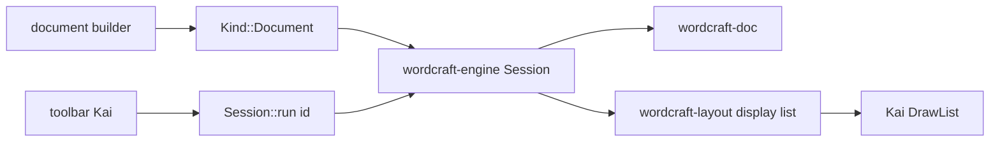

# 16 — Widget `document`: mini Word dentro de Kai

**Fase:** no implementado. Esta guía fija el contrato antes de escribir código. Depende del árbol y la `Session` ([03](03-eventos-y-estado.md)), del renderer ([04](04-renderer-y-texto.md)), de los widgets y el tema ([05](05-widgets-y-tema.md)), de la frontera con craft ([07](07-integracion-craft-libs.md)) y del patrón del mapa y el chart ([10](10-mapas.md), [05](05-widgets-y-tema.md#chart)). La app guía sigue siendo DSP desktop ([13](13-hoja-de-ruta-plataforma.md)).

La base de dominio es [`storytold/wordcraft`](https://github.com/storytold/wordcraft) (WordCraft, ArtCraft; MIT OR Apache-2.0; clean-room). La información de capas y crates se tomó del README y de [`docs/architecture.md`](https://github.com/storytold/wordcraft/blob/master/docs/architecture.md) el **21-oct-2026**. Fijar un `rev` de Git y volver a leer manifests antes de depender.

## 1. Recomendación

- **Un componente Kai, no una app Word embebida.** `document()` / `rich_text()` vive en el árbol como `map` y `chart`: spec en el nodo, paint con `DrawOp`, clics y teclas hacia un `Session` de documento.
- **Motor de documento independiente.** Cosmic-text + glyphon se quedan en la UI (`TextField`, `TextArea`, labels). El cuerpo del documento no comparte `TextStore` ni shaping con un campo.
- **WordCraft como motor, no como UI.** Se reutilizan las capas que no dependen de egui (`doc`, `fonts`, `layout`, `engine`, más adelante `docx` / `formats` / `proof`). No se adopta `wordcraft-ui-egui` ni se pinta el frame de UI con `wordcraft-render` (vello_cpu).
- **Dentro de ese widget, WordCraft de punta a punta.** No híbrido: ni runs de WordCraft medidos con cosmic-text, ni páginas de Kai shapeadas con HarfRust. El híbrido duplica font DB, caret e IME.
- **Progresivo y opcional.** Feature `document`. DSP no necesita ribbon, mail merge, track changes ni ecuaciones en el primer corte.
- **No subir el MSRV de Kai “por las dudas”.** El piso sigue en Rust 1.89 ([06](06-calidad-y-distribucion.md)). Se actualiza `rust-version` y el job `desktop-msrv` solo cuando un `rev` concreto de WordCraft lo exija, en el mismo cambio que la feature.



## 2. Qué es WordCraft y qué no se clona

WordCraft es un procesador de texto en Rust (~85k líneas, 15 crates) con paridad Word como objetivo. Está partido por capas; **nada por debajo de L6 depende de egui, eframe, winit o rfd**.

| Capa | Crates | En Kai |
|---|---|---|
| L0 | `wordcraft-geom` | Unidades del documento (twips, EMU). No sustituye a `geometry.rs`. |
| L1 | `doc`, `fonts`, `proof` | **Sí** el modelo y el shaping del documento. `proof` más tarde. |
| L2 | `layout`, `docx`, `formats`, `docbin` | **Sí** `layout` (display list + hit-test). I/O de archivo desde la fase de persistencia. |
| L3 | `render`, `pdf` | `render` (vello_cpu) **no** en el frame de UI. `pdf` como `Effects` al exportar. |
| L4 | `engine` | **Sí:** `Session`, undo del documento, registro de comandos (`format.bold`, …). |
| L5 | `mcp` | No hace falta: Kai ya tiene MCP sobre su propio registro ([09](09-framework-y-plataforma.md), [14](14-mcp.md)). Se reexportan ids de documento como comandos Kai. |
| L6 | `ui-egui` | **No.** Ribbon, keytips y canvas egui son su front. |
| apps | `wordcraft`, `cli`, `web` | **No** se incrustan. |

La misma frontera que [07](07-integracion-craft-libs.md) marca para `craft-ui`: modelo y lógica, no un segundo renderer.

## 3. Dos motores de texto

| Superficie | Motor | Ejemplos |
|---|---|---|
| Controles Kai | cosmic-text 0.19 + glyphon, `TextStore` | `TextField`, `TextArea`, títulos, toolbar del editor |
| Cuerpo del documento | WordCraft (`fonts` / HarfRust + `layout`) | Párrafos, runs, listas, tablas, páginas |

Un `TextArea` es un buffer plano (un estilo, wrap por palabras, caret de campo). Un documento son runs, estilos, paginación y hit-test por glifo. Compartir `TextStore` mezcla contratos e IME.

El widget posee **una** `wordcraft_engine::Session` por editor, como el mapa posee su cámara. `update` de la app Kai manda ids de comando (`"format.bold"`) o texto; no muta el árbol a mano. El undo del documento es el de WordCraft, no el ⌘Z del `TextField` ([03](03-eventos-y-estado.md)).

## 4. MSRV y supply chain

**MSRV** (*Minimum Supported Rust Version*) es la Rust más vieja con la que Kai promete compilar. Hoy es **1.89** (`rust-version` en `kai-ui-desktop/Cargo.toml` y `kai-cli`; job `desktop-msrv` con `dtolnay/rust-toolchain@1.89`). Lo impuso sobre todo cosmic-text 0.19. El CI diario ya usa Rust *stable*; el MSRV es el piso de quien clona el repo.

WordCraft / craft-libs declaran **Rust 1.95** (`rust-version` del workspace; confirmado en el spike del 23-oct-2026, §10). Antes de depender:

1. Fijar `rev` (nunca `branch = "main"` en builds reproducibles).
2. Leer `rust-version` y `Cargo.toml` de `doc`, `fonts`, `layout` y `engine`.
3. `cargo tree` y un crate de prueba que solo importe esos cuatro, **sin** `ui-egui`.
4. Si piden 1.95, subir el MSRV de Kai (`rust-version`, CI, `kai-cli`, fixture, docs) **en el mismo PR** que `feature = "document"`.
5. Licencia MIT OR Apache-2.0; NOTICE y `ATTRIBUTION.md` de fuentes e iconos embebidos. La marca ArtCraft en `docs/brand/` **no** se copia.

`muda` 0.19 es la última que declara 1.89. Subir MSRV puede exigir actualizar `muda` y vigilar `objc2` frente a `winit`.

## 5. Cableado en Kai (el mismo que mapa y chart)

API propuesta (no existe aún):

```rust
document(&self.doc)
    .on_change(Msg::Doc)
    .class("flex-1 min-h-0")
    .label("Informe");
```

- `Kind::Document` + `Content::Document` (caja de clases, como `Map` / `Chart`).
- El builder no recibe el `Document` por valor cada frame si es grande: la `Session` de Kai guarda el `wordcraft_engine::Session` keyed por `WidgetId`, o la app lo tiene en el modelo y el spec lleva un handle. Elegir en el spike; no clonar el doc en `view` si el layout de WordCraft ya cachea.
- `paint`: recorre la display list del layout de WordCraft y emite `DrawOp::{Text, Quad, Image, Geometry}` en la `padding_box`. Sin vello_cpu en este camino.
- Puntero y teclado: hit-test de WordCraft (`layout`) → selección / caret; IME de plataforma entra como `Session::run` de inserción, no como `text_field.rs`.
- Toolbar, menú y paleta: comandos Kai cuyos `into_msg` llaman al id de WordCraft (`format.bold`, `edit.undo`, …). Un subconjunto expuesto a MCP.
- Accesibilidad: `Role::Document` o `Role::TextArea` según el corte; nombre = `label`; más adelante árbol de párrafos. VoiceOver no lee un bitmap.

Tamaño solo por clases (`flex-1`, `min-h-0`, `h-96`). El documento hace scroll en su caja (`overflow-auto`) o pagina y el viewport desplaza páginas: decidirlo en la fase 1.

## 6. Fases

Cada fase es un commit Kai (o un PR). No mezclar dsp-27 ni `kai-cli/src/dev.rs`. `cargo test` / `clippy -D warnings` con permisos de máquina. Feature `document` desde el primer código que importe WordCraft.

### Fase 0 — nota rica (semanas)

Un cuerpo, párrafos y runs: negrita, cursiva, tamaño, color. Toolbar Kai con 6–8 acciones (`format.bold`, `format.italic`, lista, undo). Persistencia: Markdown o JSON propio. Sin paginación ni .docx.

**Gate:** tipear, IME en macOS, seleccionar, ⌘B, TestApp clic/teclas, captura de la demo. Si el spike de `wordcraft-doc` + MSRV tarda, un modelo mínimo de runs *solo* para esta fase está permitido, con la frontera “se sustituye por WordCraft antes de páginas o .docx”.

### Fase 1 — página

Viewport, márgenes, hit-test, selección arrastrando, scroll. Aquí `wordcraft-layout` deja de ser opcional.

**Gate:** un documento de varias páginas se desplaza; el caret cae en el run correcto; no se usa cosmic-text para medir el cuerpo.

### Fase 2 — tablas e imágenes

Insertar tabla 2×2, imagen inline o wrap simple. Reutilizar `ImageSource` / atlas de Kai para bits; WordCraft decide la caja.

### Fase 3 — archivo

Abrir/guardar .docx (`wordcraft-docx`) y exportar PDF (`wordcraft-pdf` / `craft-pdf`) con `Effects::pick_file` / `save_file`. Fuera del hilo de paint.

### Fuera de este widget (hasta que DSP lo pida)

Ribbon Word, mail merge, track changes, comentarios, ecuaciones, Zotero, web/WASM de WordCraft, segundo event loop egui.

## 7. Pruebas y demo

- Tests del mapeo display list → `DrawOp` y del hit-test (índice de run / caret), como `charts::tests`.
- `TestApp`: tipear, ⌘B, undo; query a11y por `label`.
- Nueva sección **Documento** en Datos (junto a Tabla, Mapa, Gráficos) cuando exista el builder. Cobertura en `the_demo_shows_every_component` y `mcp-schema.json` si hay `ui.ir_a` / comandos `doc.*`.
- Captura `demo-documento` (`#[ignore]`, GPU).

## 8. Criterios de aceptación

- Un solo renderer de UI: Kai. Cero egui en el binario de la demo por esta feature.
- El documento no pasa por `TextStore` / cosmic-text.
- Dependencia WordCraft fijada por `rev`, feature `document`, NOTICE al día.
- MSRV documentado: 1.89 hasta que el `rev` obligue a cambiarlo.
- Comandos del editor reutilizan `kai::commands`; MCP no abre un segundo servidor WordCraft.
- Cada fase tiene tests de geometría o de `TestApp` y una entrada en [CHANGELOG](../../CHANGELOG.md).

## 9. Estado

| Pieza | Estado |
|---|---|
| Guía (este documento) | Hecha (21-oct-2026) |
| Spike §4 / §0 (crate aislado + display list) | **Hecho (23-oct-2026)** — ver §10 |
| Feature `document` y crates WordCraft en Kai | No (bloqueado por MSRV declarado 1.95) |
| `Kind::Document`, paint, hit-test | No |
| Demo sección Documento | No |
| Subida de MSRV | **Pendiente** — no en este corte |

## 10. Spike (23-oct-2026) — go / no-go

Fixture: [`fixtures/wordcraft-spike`](../../fixtures/wordcraft-spike/).

| Pregunta | Resultado |
|---|---|
| ¿`rev` fijado (no `main`)? | Sí: `3a4770ef8ce037d2650c93e2d5764536549357c7` (2026-10-22, tip de `origin/main` al spike) |
| ¿Licencia? | MIT OR Apache-2.0; sin marca ArtCraft |
| ¿Compila `doc` + `fonts` + `layout` + `engine` sin `ui-egui`? | Sí. Cero `egui` / `eframe` / `winit` / `rfd` en `cargo tree` |
| ¿Sin vello en el camino de paint? | El spike pinta vía `layout::display::page_display` → `Draw`. **`engine` arrastra `wordcraft-render` → `vello_cpu` de forma transitiva** (reexport + comandos de imagen/PDF); no se llama desde el spike |
| ¿Display list mínima (un párrafo)? | Sí. 1 página Letter (612×792 pt), 1 `Draw::Glyphs` (~52 glifos, size 12, color negro) |
| ¿MSRV declarado WordCraft? | **1.95** (`workspace.package.rust-version`; `craft-pdf` también 1.95; fork `krilla` declara 1.92) |
| ¿MSRV medido (compila+corre)? | Con `--ignore-rust-version`: **1.89** y **1.92** OK. Sin el flag, cargo rechaza en 1.89 (`craft-pdf` exige 1.95) |
| ¿Kai MSRV hoy? | **1.89** (`kai-ui-desktop`, `kai-cli`, job `desktop-msrv`) |

### Muestra de display list → paint ops (sin implementar aún)

Salida del spike (`cargo +1.95 run --release`):

```text
spike-ok
pages=1
page_size_pt=612.0x792.0
draw_items=1
draw_summary=glyphs=1 fills=0 lines=0 other=0
sample=Glyphs text="Hola Kai — un párrafo mínimo para el spike Docum" size=12 n_glyphs=52 color=(0,0,0)
```

Mapeo previsto (fase posterior, no en este corte):

| `wordcraft_layout::display::Draw` | Op Kai probable |
|---|---|
| `Glyphs { face, size, glyphs, color, … }` | `DrawOp::Text` / run de glifos (atlas propio del documento, no `TextStore`) |
| `Fill { rect, color, alpha }` | `DrawOp::Quad` |
| `Line { … }` | `DrawOp::Quad` fino o geometría |
| `Image { … }` | `DrawOp::Image` |
| `Path` / `Shape` / `Ink` | `DrawOp::Geometry` |

### Supply chain del spike

- Dependencias git: `storytold/wordcraft` @ rev anterior.
- `[patch.crates-io] krilla` → mismo `craft-libs` rev que WordCraft (`c3487320…`). Obligatorio fuera del lock de WordCraft.
- `engine` tira además: `docx`, `docbin`, `formats`, `pdf`/`craft-pdf`, `render`/`vello_cpu`, `proof`, `metafile`. Para el widget Kai el paint sigue siendo display list → `DrawOp`; vello no entra al frame de UI.

### Veredicto

**Go con subida de MSRV pendiente.**

- El motor de documento (layout + display list + `Session`) es usable sin egui y produce ops mapeables.
- Integrar `feature = "document"` en `kai-ui-desktop` **exige** alinear el piso de cargo a **1.95** (o vivir con `--ignore-rust-version`, descartado). Impacto al subir: `rust-version` en desktop + `kai-cli` + fixture `external-app`, job `desktop-msrv` (`dtolnay/rust-toolchain@1.89` → `1.95`), y vigilar **`muda` 0.19** (última que declara 1.89) / `objc2` frente a `winit`.
- **Este corte no sube MSRV** ni añade `Kind::Document` / demo. Siguiente paso cuando se decida la subida: feature `document` + esqueleto + sección Documento en la demo Kai (no DSP).

### Cómo reproducir

```bash
cd kai-ui-desktop/fixtures/wordcraft-spike
cargo +1.95 run --release
cargo +1.95 test --release
# Medición 1.89 (solo investigación; no es el contrato de Kai):
cargo +1.89 build --release --ignore-rust-version
```
